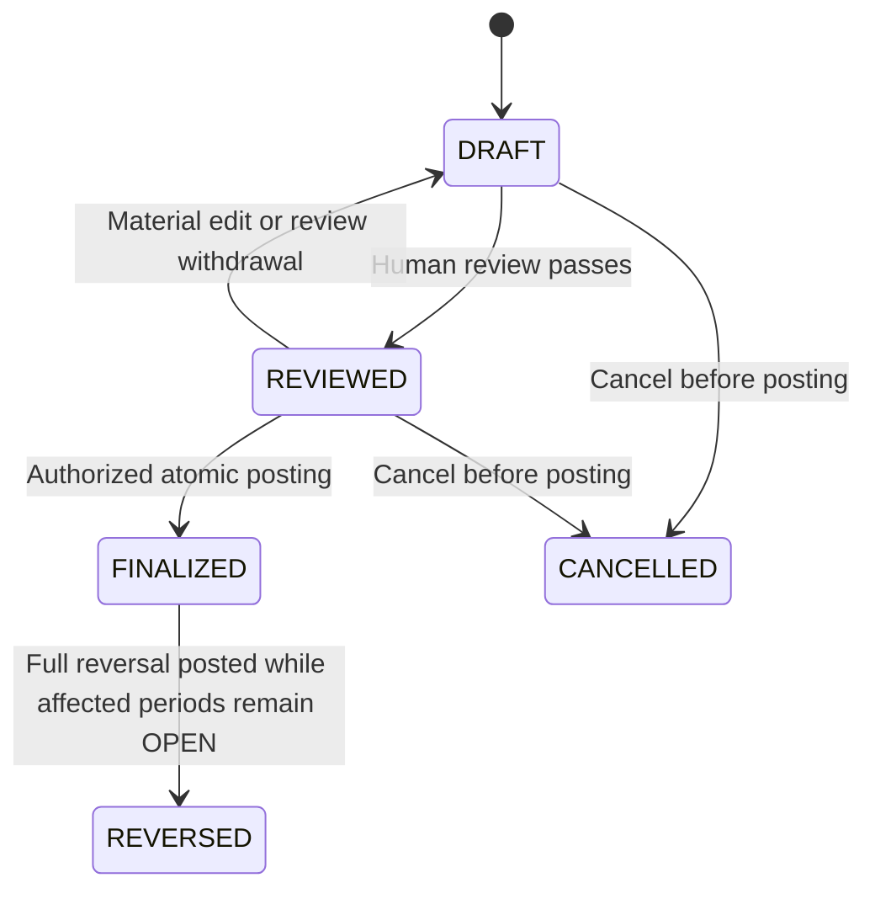

# GMIM Treasurer — Domain Model, Posting Rules, State Machines & Report Pack Data Mapping

**Document version:** Standalone 2.0 — approved rounds 1–6 baseline  
**Date:** 8 October 2026  
**Derived from:** Standalone 1.0 / engineering edition 4.0, amended by approved rounds 1–6  
**Predecessor SHA-256:** `9e709f2d10964d559782baf9dccb26f3cb292fd0c18072f22e43c33d175598d7`  
**Decision conversation:** Next Steps After Docs, `6ac62014-70cc-83ec-acb6-4134bf1b9bc1`  
**Purpose:** A self-contained engineering specification for another ChatGPT session or developer  
**Companion product baseline:** `GMIM_Treasurer_MVP_Design_Specification_and_Rulebook_v5.0.md`

This document can be handed over on its own for the Treasurer finance model and report dataset implementation. It includes the full 131-row Pendapatan and 158-row Belanja source editions and preserves the distinction between accepted product requirements, approved rounds 1–6 policies and remaining church-specific configuration/form details. The broader product roadmap and historical consolidated rulebook remain in the companion document.

## Contents

- 1. Status, scope and decision boundary
- 2. Embedded domain glossary
- 3. Logical domain records and relationships
- 4. Posting and recognition contract
- 5. Authoritative transaction and control state machines
- 6. Opening, import, reconciliation and month-close algorithms
- 7. Shared report population, measures and classification aggregation
- 8. Exact semantic GMIM Report Pack mapping
- 9. Cross-report control matrix and reproducibility
- 10. Worked posting and report example
- 11. Versioned layout adapter and exact-form completion register
- 12. Shared service boundaries and human/AI interface
- 13. Security, audit, backup/export and future-platform seams
- 14. Consolidated engineering rulebook supplement
- 15. Verification and remaining implementation gates
- Appendix A. Complete readable Mata Anggaran catalogs
- Appendix B. Complete machine-readable source snapshots

## 1. Status, scope and decision boundary

This standalone specification formalizes the recovered product requirements into one implementable Treasurer finance contract. It contains the domain records, posting rules, state transitions, calculations and all fourteen GMIM report dataset mappings. Appendix A embeds the complete readable source classifications; Appendix B embeds their full machine-readable source snapshots. The companion product design/rulebook retains the broader roadmap and all 775 accumulated master rules. D01–D12 below are now approved product decisions, with replaced D07 and permanent retention under D11. The policy register attributes this approval to the decision conversation; it does not misattribute it to the source exports or original GMIM forms.

The semantic mapping of all fourteen Report Pack components is specified here: authoritative inputs, inclusion rules, row grain, fields, calculations, classification rollups, drill-down and controls. **Physical mapping to a particular original GMIM form is not verified:** neither `.xls` source contains report cells, signatures or page layouts. The layout adapter in 11 therefore has deliberately unbound destinations. A developer can build the ledger and deterministic report datasets from this contract, but must not describe a church-specific printed form as verified until its original form is supplied and mapped.

| Decision | Explicit engineering choice | Status / boundary |
|---|---|---|
| D01 | One shared finance engine; relational records, append-only posted journals and derived reports | Formalization of shared-engine and immutability requirements; no separate unit ledgers implemented as different engines |
| D02 | IDR represented as integer rupiah; balanced internal debit/credit legs | Approved internal mechanism; not an expanded full accrual ERP or user-facing chart of accounts |
| D03 | Unclassified capture remains staging-only; classification required before a classified transaction posts | Approved V1 resolution: no posted suspense account |
| D04 | Recognize direct receipt/payment at posting; reimbursements at repayment; advances at accepted settlement | Approved cash-oriented V1 recognition; invoices and unpaid personal claims are not automatically accrued |
| D05 | Money held for another beneficiary uses a transit liability; own-church centralization expense uses expense recognition | Approved ownership-based distinction; require OWNED, CUSTODY or SPLIT |
| D06 | Keep economic income/expense separate from gross transit classification schedules | Approved separation; main report uses ECONOMIC_WITH_TRANSIT_SCHEDULE |
| D07 | OPEN → CLOSED is irreversible; financial corrections must finish before close | Approved amended D07: no reopen and no later-period accounting correction against CLOSED transactions in MVP |
| D08 | Allocate internal voucher numbers at successful finalization, using calendar year of effective date | Approved atomic numbering; exact prefixes/padding are church configuration, versioned before use |
| D09 | Opening balances are one controlled cutover batch, including advances and held-money liabilities | Approved controlled migration; arbitrary opening receivables/payables and FX are outside V1 |
| D10 | Require an explicit reconciliation result for every relevant account; allow documented timing differences, not unexplained differences | Approved explicit reconciliation: zero unexplained difference; timing items documented |
| D11 | Publish immutable reviewed masters; default leaf/parent postability; period-boundary activation; retain used versions forever | Approved D11; first activation is first production-month day; used versions can never be deleted; Appendix B source snapshots remain preserved/unpublished |
| D12 | Close and freeze report inputs atomically; export rendering may retry afterward | Approved atomic close and independent retryable export rendering |

Approved defaults are in the policy register. Church-specific threshold values, optional maker/checker activation, exception authorities and signature identities still require authorized configuration; transit presentation is fixed to ECONOMIC_WITH_TRANSIT_SCHEDULE for MVP. Draft policy configuration can be prepared without approval; activation is an audited human action. Missing required policy prevents the affected action, while unaffected manual work continues. Future collaboration requirements do not force a solo church to onboard other users.


### Approved policy register — rounds 1–6

**Authority:** User decisions in **Next Steps After Docs**, conversation `6ac62014-70cc-83ec-acb6-4134bf1b9bc1`, consolidated in the final approved-decision summary and incorporated at the user's request on 8 October 2026. These are approved product policies; they are not claims that the original GMIM forms or source exports contained them. This register supersedes conflicting earlier proposal/status wording. The source snapshots remain evidence, separate from the approved production definitions.

| Round / area | Approved policy |
|---|---|
| 1 — Production master | Retain all 289 rows (131 Pendapatan, 158 Belanja). Preserve source code `2.3.08.02`; production Belanja B113 uses `2.3.02.02`, name `Kemitraan / Jemaat Mitra`, parent B110 / `2.3.02.00`. Record old/new values, source row/cells, reason and approving decision. |
| 1 — Postability | Detail leaves are postable by default; group/family parents are nonpostable by default. A parent requires explicit authorized enablement. Derive concrete booleans from the explicit hierarchy, never from `.00` or numeric prefixes. No parent enablement has been specified for this baseline. |
| 1 — Activation | First production master becomes effective on the first day of the first production accounting month. The actual month is a workspace deployment value, not the source filename date. Later versions activate at a period boundary; no retroactive reinterpretation. |
| 2 — D01–D12 | Approved as defined in the decision table, with D07 replaced by irreversible close and D11 retaining every used master version permanently. |
| 3A — Approval modes | MVP supports `NOT_REQUIRED` and `EXTERNAL`; `IN_APP` is a future collaboration mode, not an MVP dependency. |
| 3B — Thresholds | Amount thresholds are configurable per church/Fund policy; no universal rupiah approval threshold is invented. |
| 3C — Maker/checker | Configurable and off by default for solo use. When enabled, maker and checker must be distinct humans; multiple roles/logins belonging to one person do not satisfy the rule. |
| 3D — External declaration | Structured declared approver identity/role, approval date, method, notes and supporting reference/evidence where required; recorded actor remains distinct. Bind the declaration to the transaction's material revision/digest; material edits invalidate it. |
| 3E — Evidence timing | Required evidence may remain missing/uploaded/pending verification during the OPEN month, including after finalization. Resolve to `VERIFIED` or explicitly authorized `EXCEPTION_ACCEPTED` before close. A church may strengthen posting-time requirements. |
| 3F — Evidence defaults | Evidence is required by default for core spending and settlement cases: direct expenses, reimbursements, accepted advance spending and transit/centralization remittances. Evidence requirements for other transaction types are configured by church policy; required cash/bank reconciliation observations remain mandatory. |
| 3G — Solo verification | Solo Treasurer may verify evidence where church policy permits; a universal second reviewer is not imposed. |
| 3H — Evidence exceptions | Only an authorized human may explicitly accept an exception, with reason, authority, actor/time and the affected evidence/transaction link. AI, upload success and technical administration grant no exception authority. |
| 3I — Open advances | Valid, explained outstanding advances may carry forward across month-end. They are disclosed and do not automatically block close; missing required proof, unexplained/negative balances or a configured overdue restriction do. |
| 3J — Advance due dates | Configurable per church/case policy; no universal settlement deadline is imposed. |
| 4A — Ownership | Every relevant collection/allocation uses explicit `OWNED`, `CUSTODY` or `SPLIT`. A code or recipient does not establish ownership. Split components sum to the one physical collection. |
| 4B — Allocation | Centralization percentages, fixed amounts, manual allocations, retained shares and rounding are versioned authorized church configuration; never hard-coded. |
| 4C — Beneficiary | A custody/transit allocation cannot finalize without an identified beneficiary/destination obligation. |
| 4D — Presentation | MVP main reports use `ECONOMIC_WITH_TRANSIT_SCHEDULE`: economic Pendapatan/Belanja totals plus a separate Dana Transit schedule. Gross bridge measures remain available as labeled controls. A gross main-form adapter requires a future explicit policy amendment after form review. |
| 4E — Transit carry-forward | Valid, explained positive transit liabilities may carry forward. Negative cases, over-remittance, unknown beneficiaries, unexplained differences, missing required proof and unresolved policy-required overdue remittances block close. |
| 4F–4G — Owned contributions / no duplication | Contributions from church-owned money are economic Belanja. Custody collection/remittance are liability movements, excluded from economic income/expense. Each rupiah receives one ownership treatment; never count the same component twice. |
| 5A — Deployment | Managed cloud, server-authoritative finalization, numbering, reconciliation and close; no church self-hosting or offline financial finalization in MVP. |
| 5B — Security | Encrypted transport and database/storage at rest; evidence private by default; credentials/API keys server-side; tenant + role + Scope checks on reads, writes, downloads, exports and AI queries; high-privilege session revocation. Technical administration does not confer financial authority. |
| 5C — Backup set | Database, actual evidence objects, report snapshot datasets, rendered official reports, master/template/policy versions and required encryption/key-recovery material. |
| 5D — Recovery defaults | RPO **1 hour**, RTO **8 hours**, **7-day point-in-time recovery**, **35 daily backups**, **12 monthly recovery snapshots**. These are product/operational defaults, not GMIM legal-record-retention rules. |
| 5E — Restore verification | Full restore test at least quarterly and before/after major infrastructure or database migrations; verify financial integrity and evidence/report accessibility. |
| 5F — Export | Full portable church export, including actual church-owned evidence files, structured ledger/allocations, reports/snapshots, exact masters, Account/Fund/case data, approval/evidence metadata and a relationship/checksum manifest. |
| 5G — Backup / export | Infrastructure backups are restricted disaster-recovery material. Authorized church export is a separate application workflow; it requires no raw backup credentials. |
| 6A — Models | Pin `openai/gpt-6-luna` for routine assistance and `openai/gpt-6.1-sol` for escalation. No moving `latest` aliases, Astra or unapproved model fallback. Intentional upgrades require a reviewed AI policy version. |
| 6B — Privacy | Every AI request containing church data requires OpenRouter `provider.zdr = true` and an eligible endpoint with no provider training or intentional inference prompt retention. If unavailable, fail gracefully without weakening privacy. ZDR still involves transmission/processing by the provider. |
| 6C — Context | Minimum task-specific authorized context only; narrow candidate classifications and mask/remove unnecessary personal identifiers. |
| 6D — Routing | Deterministic rules → Luna → Sol where appropriate → human review. Sol escalation: insufficient confidence, ambiguous candidates, multi-document reasoning, difficult matching/reconciliation explanation, explicit deeper-analysis request or a suitable retry after deterministic rejection. |
| 6E — Output | Structured proposals; server validates schema, row/version existence, active/postable status, master kind, Fund/Scope authority and current revision before human acceptance. Invalid output is rejected. |
| 6F — Cost | **Rp150,000 per church/workspace per month**. Below 70% normal use; at 70% (Rp105,000) warn; at 90% (Rp135,000) conserve, prefer Luna/cheaper permitted processing and avoid unnecessary Sol calls; at 100% (Rp150,000) stop optional AI for the remainder of the monthly budget period. Accounting continues fully. No unlimited default. |
| 6G — Failure | OpenRouter/ZDR/model failure, exhausted budget or malformed output leaves manual capture/classification, reconciliation, close, reports and exports operational. |
| 6H — Audit | Feature, input digest, model ID, provider/route metadata, candidate/master versions, timestamp, structured proposal, confidence if supplied, human accepted/edited/rejected disposition, final value and token/cost usage. Do not duplicate unrestricted receipt/statement content in AI logs or treat proposals as financial evidence. |
| 6I — Untrusted documents | Receipts, PDFs, bank descriptions and imported text are data, never instructions or authority. All proposed actions remain subject to deterministic guards and permissions. |

**D07 control boundary:** `OPEN → CLOSED` is irreversible in MVP. Complete all financial corrections before the affected period closes. CLOSED accepts the transaction population and official snapshot as final. V1 has no reopen, unlock, closed-transaction reversal/replacement/adjustment, or later-period accounting correction against a CLOSED transaction. Required future support is outside MVP and needs an explicitly governed design extension. Valid later advance settlements/returns and transit remittances remain new events against carried-forward positions; they do not revise earlier postings or snapshots. Later supplementary evidence is append-only accountability information and cannot cure or rewrite the frozen close decision.

**Activation versus approval:** Policies above are approved, but workspace timezone/fiscal settings, first production month, actual church approvers/thresholds, beneficiary identities, allocation formulas, optional parent enablement, due dates and original report-form bindings must still be recorded where needed. Their values cannot be chosen by AI. Publication/activation records actual authorized human actor, timestamp and policy/source references; this document is not a deployed database publication.

### Approved production-master derivation

The embedded source catalogs and fenced JSON snapshots are preserved byte-for-byte, including B113 `2.3.08.02`, `postable: null`, original spelling, indentation, source hashes and draft source-mapping flags. They are not mutated or published as the production master. Create a separate version-qualified reviewed master using the following approved definition:

```json
{
  "definition_version": "GMIM_TREASURER_PRODUCTION_MASTER_R1_2026-10-08",
  "decision_source": "6ac62014-70cc-83ec-acb6-4134bf1b9bc1",
  "status": "APPROVED_FOR_PUBLICATION",
  "source_catalog_row_counts": {"PENDAPATAN": 131, "BELANJA": 158},
  "retain_all_source_rows": true,
  "preserve_source_snapshots": true,
  "hierarchy": "explicit source-indentation parent map retained",
  "postability": {"leaf_default": true, "parent_default": false, "parent_overrides": []},
  "effective_from_rule": "FIRST_DAY_OF_FIRST_PRODUCTION_ACCOUNTING_MONTH",
  "later_activation_rule": "PERIOD_BOUNDARY",
  "used_version_deletion": "PROHIBITED_PERMANENTLY",
  "corrections": [{
    "kind": "BELANJA",
    "source_row_id": "B113",
    "source_row": "113",
    "source_cells": "Sheet0!B114:C114",
    "source_code": "2.3.08.02",
    "production_code": "2.3.02.02",
    "name": "Kemitraan / Jemaat Mitra",
    "parent_id": "B110",
    "parent_code": "2.3.02.00",
    "reason": "Authorized correction of anomalous source code to match reviewed hierarchy"
  }]
}
```

Derivation is deterministic: copy every source row with its source provenance; preserve the explicit parent/family/order/label mapping; apply only the B113 production-code override; assign explicit postability from actual child relationships (237 leaves true, 52 branch/root rows false, unless a later authorized parent override is recorded). Preserve `source_code`, raw label and source flags separately from the reviewed production `code` and resolved validation status. Validate uniqueness, all parent references, absence of cycles, six roots per kind and unchanged 131/158 counts. Record the correction decision and old/new values; do not propagate the unresolved source anomaly flag as an unresolved production blocker after its authorized resolution. Do not normalize other codes or labels. The production report F06/export uses `2.3.02.02`; source appendices continue to display `2.3.08.02`.

Assign actual immutable publication-version IDs by kind and deployment dates/actor metadata at activation. The first effective date is the first day of the chosen production accounting month, including when a later-in-month cutover is explicitly used. Retain every used version forever: a version referenced by any finalized transaction, report snapshot or historical dependency can never be deleted. Archival/deactivation only removes availability for new work; it preserves version-qualified rows, provenance and historical reproduction. Operational backup expiry is not authority to delete financial/master history.

### Product constraints carried into this specification

- **Treasurer-first:** solo Bendahara can operate without requiring other church leaders to have accounts. Assistants/Church Operators may prepare permitted drafts/evidence; only authorized humans finalize. Progressive adoption adds scoped unit treasurers and in-app approval later.
- **V1 limits:** IDR only; one church workspace per tenant; one fiscal/calendar configuration; no FX. Budgeting, procurement and service roster are deferred. Report budget fields are absent/not applicable.
- **Shared engine:** Jemaat, Kolom, BIPRA and Panitia use the same financial rules. Tenant separation and scoped Fund governance apply to every command, report and export.
- **Official data:** only committed postings affect financial totals. Finalized financial content is immutable; eligible OPEN-period reversals preserve history. CLOSED is final with no later-period accounting correction. Required classifications/approvals guard posting; evidence may remain pending during OPEN month but must resolve before close, along with zero unexplained reconciliation difference.
- **Report contract:** fourteen deterministic components, PDF/Excel/print projections, immutable snapshots and versioned masters/templates. Semantic mappings are precise here; original page/cell/signature forms remain a source gap.
- **Publication boundary:** internal financial evidence remains restricted. Warta uses separately approved snapshots/content and mandatory requested masking. Aggregate attendance is headcount-only and never derived as personal tracking from offerings.
- **AI:** OpenRouter through a server-side service; GPT-6 Luna default, GPT-6.1 Sol escalation; Astra excluded. Deterministic rules first, scoped proposals second, human review before authority. Provider failure preserves manual finance.

## 2. Embedded domain glossary

These are business definitions. Storage choices follow separately in 3.

| Term | Precise meaning |
|---|---|
| Church workspace / tenant | The isolated financial workspace for one church in V1. All records, permissions and reports belong to it. |
| Physical Account | A cash location or bank/payment account holding money, such as Kas or BNI. It is not a Fund or an income/expense category. |
| Fund | A pool of money with ownership, restrictions and governance. Several Funds may share one physical Account. |
| Scope | The organizational context of an activity or authority: Jemaat, Kolom, BIPRA or Panitia. Activity Scope does not automatically change Fund ownership. |
| Mata Anggaran | A versioned classification of the purpose of a receipt or expenditure. Pendapatan and Belanja are distinct trees even when their code strings coincide. |
| Transaction | A human-reviewed business event, with purpose, effective date, allocations, approval and evidence. A draft has no official financial effect. |
| Posted journal | The immutable, balanced financial effects produced once when a transaction is finalized. |
| Allocation | A portion of a transaction assigned to a Fund, activity Scope and, where required, one exact Mata Anggaran row/version. |
| Cash movement | A change in physical Account money. It may be an advance or transfer rather than income/expense. |
| Income / economic Pendapatan | Money recognized as belonging to the church under the declared recognition policy; excludes money merely held for another beneficiary. |
| Expense / economic Belanja | Recognized use of church resources under the declared policy; includes accepted advance spending and excludes issuing the advance itself. |
| Reported Pendapatan / Belanja | MVP main totals are economic income/expense under ECONOMIC_WITH_TRANSIT_SCHEDULE; Dana Transit is scheduled separately. Gross control measures are separately labeled. |
| Advance / Uang Muka | Money entrusted to a recipient before accountable spending. The remaining asset is issued less accepted spending and returned money. |
| Reimbursement | Repayment of accepted personal spending. It is distinct from an advance and is not recognized twice. |
| Transit obligation | Money held for an identified outside beneficiary, with a remaining liability until remitted or otherwise lawfully resolved. |
| Centralization | A contribution or remittance to the relevant church body. Its source ownership determines whether it is an expense or settlement of a transit obligation. |
| External approval declaration | The Treasurer's record that approval occurred outside the app. It is not an authenticated in-app action by the named approver. |
| Reconciliation | Explanation of the difference between posted book money and an independent bank statement or physical cash observation. |
| Close | Authorized irreversible OPEN → CLOSED action that accepts the period population and freezes its official reporting inputs as final in MVP. |
| Snapshot | Immutable report data and provenance captured at a specific cutoff. A preview or re-rendered file is not a new accounting event. |
| Reversal | Separately numbered compensating posting linked to an original event, available only while every affected period remains OPEN. It preserves the original; a CLOSED original cannot be reversed or corrected in a later period. |

## 3. Logical domain records and relationships

This is a logical schema, not a requirement for a particular programming language, ORM or table-per-line implementation. Use a normal transactional database and a small shared posting module. Do not add an event-store platform, a general workflow builder, a separate accounting engine per Scope, or a user-configurable ERP chart of accounts to satisfy this model.

**Common conventions.** Every tenant-owned record carries `workspace_id`. References must include tenant identity and cannot cross workspaces. Stable IDs are opaque; source code is a string attribute, never a numeric ID. Money is a nonnegative integer number of rupiah except explicitly signed derived amounts. Use checked integer arithmetic; APIs may serialize large amounts as decimal strings to avoid client floating-point rounding. `effective_date` is a church-local business date; `recorded_at` and audit timestamps are UTC instants. Posting order is a monotonically assigned workspace `posting_sequence`. The workspace's declared timezone and fiscal/calendar settings govern dates; the developer's computer timezone is not a default accounting policy.

| Record | Required fields / relationships | Constraint |
|---|---|---|
| Workspace | ID, church identity, timezone, IDR currency, fiscal/calendar configuration, active policy-version IDs | One church and one configuration in V1; changes cannot reinterpret old snapshots |
| PhysicalAccount | ID, name, type `CASH` or `BANK`, institution/reference where applicable, active dates | Closing or deactivating an Account retains its ledger; no deletion of used Accounts |
| Scope | ID, type, name, parent, effective dates, status | Acyclic hierarchy; permissions evaluated for the requested action and date |
| Fund | ID, name, owner Scope, restriction description, governance-policy reference, active dates | Fund owner governs approvals; spending activity Scope alone does not grant authority |
| Party | ID, counterparty/recipient display identity, optional member link, minimum contact/reference data | Donations, advances and suppliers do not require membership or login |
| MasterVersion | ID, kind `PENDAPATAN` or `BELANJA`, source hash/provenance, status, effective interval, reviewer/publication metadata | Separate immutable published versions; no overlapping active versions for the same kind/date; every used version is permanently retained and can never be deleted |
| MasterRow | version ID, row ID, exact code/name, raw source text, parent ID, level/order, explicit `postable`, active flag, source row | Key is `(version_id,row_id)`; no code-prefix inference or automatic `.00` exclusion |
| Transaction | ID, type, effective date, description, revision, amount, creator, review metadata, policy references, voucher, original/correction linkage | Finalization creates one immutable journal; pre-post changes invalidate material review/approval |
| TransactionAllocation | transaction ID, ordinal, integer amount, Fund, activity Scope, Party where relevant, class row/version where required, Advance/transit links | Relevant allocation sum equals its transaction component; classification kind and purpose validated |
| PostedBatch / JournalLeg | batch ID, transaction ID, sequence, effective date; legs with target, debit/credit, Fund, activity Scope, allocation reference | Each leg has one positive debit or credit; total debit equals total credit; finalized in one database commit |
| CashMovementGroup | stable movement ID, Account, payment/receipt reference, original and corrective batch links | Corrective entries can describe the same underlying bank movement; they are not fictional new payments |
| ApprovalRecord | mode, transaction revision/digest, declared/actual approver, role/Scope, decision/declaration date, method, notes, evidence | External declaration and authenticated in-app approval remain distinguishable |
| EvidenceItem / link | file/reference ID, checksum, uploader/time, tenant access policy, transaction/settlement link, evidence-status decisions | Upload does not imply verification; later evidence decisions append without changing posted amounts |
| AdvanceCase | ID, recipient, responsible Scope, Fund, issue transaction, due date if policy requires, settlement/return links | Outstanding amount derived from posted linked effects, never manually overwritten |
| TransitCase | ID, beneficiary, Fund, governing policy, collection/remittance links, due/reference data | Remaining liability derived; no automatic recipient, percentage or retained share |
| ImportBatch / StagedRow | source hash/format, row provenance/raw fields, interpreted fields, validation, duplicates, review, idempotency key, committed ID | Staging is not the ledger; partial selections and rejected rows remain visible |
| StatementLine | Account, provider/import identity, booking date, value date if supplied, signed amount, description/reference, raw source | Preserve source; independently supplied observation, not an automatic income/expense |
| ReconciliationSession / MatchGroup | Account, period, opening/closing observations, allocation links, documented reconciling items, reviewer/time | One source amount cannot be consumed more than once; book changes invalidate stale confirmation |
| CashCount | Account, counted date/time, integer amount, counter(s), evidence/reference, optional denominations | An observed zero is explicit; missing observation is not converted to zero |
| OpeningBatch | cutover date, source, Account/Fund balances, outstanding advances/transit, review and posting ID | One approved cutover population; opening is not current-period income |
| Period | boundaries, status, close actor/time, posting cutoff, closed snapshot ID | Prevent overlapping periods; CLOSED is final; reject backdating, reopen and all correction commands against CLOSED transactions even with an OPEN target date |
| ReportSnapshot | ID, period/perimeter, frozen transaction/journal IDs, policy/master/template versions, observations, calculated datasets, hashes | Reproduction uses frozen inputs, not current mutable configuration |
| ReportTemplate / LayoutMapping | version, report component IDs, semantic-field bindings, church/format, signature/page metadata | Presentation cannot change financial totals; source form provenance required for verified bindings |
| AuditRecord | actor, action, target, before/after relevant metadata, reason, UTC time, effective role/Scope/delegation | Append-only through normal application paths; no secrets or unrestricted attachment text |
| AIProposal | scoped request/input digest, candidate set, routing metadata, result, human disposition, cost/use metadata | No posting or approval authority; stale proposals cannot apply to a changed revision |

Relationships: one Transaction has many Allocations and at most one original PostedBatch; one PostedBatch has many JournalLegs; a reversal is a new Transaction/PostedBatch linked to that original. An Advance or TransitCase has several linked transactions. A period snapshot references many batches and the exact master versions they use. Evidence and approvals attach to their business objects, not to a flattened report total.

**Posting targets are internal.** Use a closed set of internal targets: `LIQUID(physical_account_id)`, `ADVANCE(advance_case_id)`, `TRANSIT_PAYABLE(transit_case_id)`, `INCOME`, `EXPENSE`, `OPENING_EQUITY`, and `CONTROLLED_ADJUSTMENT`. The terms debit and credit below describe these internal legs. They do not turn Physical Account into a generic chart-of-accounts concept. Classification and organizational dimensions stay independent from these targets.

**Permissions and perimeter.** A report balance perimeter is an explicit set of authorized Funds and physical Accounts in one workspace. A unit finance report may select Funds owned by that unit; an activity-Scope expense report selects activity allocations and is not automatically a complete balance sheet. Users must not see another Fund's slice of a shared bank Account merely because they can record activity in the same church. Whole-Account reconciliation belongs to users authorized for that Account; Fund-only viewers receive the allowed slice and an appropriate reconciliation status without unrestricted statement details. System administration alone does not confer Treasurer or approval authority.

## 4. Posting and recognition contract

### 4.1 Posting invariants

1. A journal posts only from a reviewed, permitted transaction revision, in an open effective period, using an idempotency key.
2. Posting, case updates/links, voucher allocation, sequence assignment and audit are atomic. A failure produces no partial authoritative effect or reused number.
3. Each batch balances globally: `sum(debits) = sum(credits)`. Do not require each Fund's legs to balance independently for an authorized Fund transfer.
4. Every classified component references one published, active, explicitly postable row of the correct master kind. Its exact code/name are resolved from that version. An OPEN-period reversal copies the original row/version as the historical-version exception; the exception never authorizes correcting a CLOSED transaction.
5. A split amount is partitioned once. For example, a Rp1,000,000 payment allocated Rp600,000/Rp400,000 generates Rp1,000,000 total expense and one actual payment, not two Rp1,000,000 payments.
6. Account/Fund combinations and Fund restrictions are checked before posting. An Account transfer cannot silently transfer Fund ownership. A Fund transfer cannot silently claim an external receipt or expenditure.
7. Posted data is append-only. Lifecycle displays and balances are projections of immutable records; OPEN-period corrections append their own records. Every affected original/dependency period and the correction target must be OPEN, checked atomically with posting and close.
8. Drafts, staged bank observations, uncommitted imports, pending approvals and AI proposals create zero official postings.

### 4.2 Transaction posting matrix

`m` is the accepted positive rupiah amount. `Cash` means the relevant `LIQUID(Account)` target. Rows describing split allocations repeat the appropriate recognition leg per allocation while preserving the movement total. Reversal signs apply to both recognition effects and transit schedules.

| Type | Debit | Credit | Economic effect | Physical cash / report treatment |
|---|---|---|---|---|
| Offering / donation / other owned receipt | Cash `m` | Income `m` | Pendapatan `+m` on published Pendapatan allocations | Receipt in the actual Account; cash/QR/bank components retain their own Accounts and references |
| Direct expense | Expense `m` | Cash `m` | Belanja `+m` on published Belanja allocations | One payment; any unpaid request remains pre-post |
| Reimbursement paid | Expense `m` | Cash `m` | Belanja `+m` once at repayment under D04 | Claim review alone is not a posted expense or payable; recipient and personal spending evidence linked |
| Advance issue | Advance asset `m` | Cash `m` | No Pendapatan/Belanja | Cash out and outstanding advance `+m`; recipient/case required |
| Accepted advance spending | Expense `m` | Advance asset `m` | Belanja `+m` at accepted settlement | No cash movement; itemized settlement/case link required; required proof may be pending while OPEN but must resolve before close |
| Unused advance returned | Cash `m` | Advance asset `m` | No income/expense | Cash in; outstanding advance `−m`; not a fresh donation |
| Physical Account transfer | Destination Cash `m` | Source Cash `m` | No income/expense | Same Fund, different Accounts; total workspace liquid position unchanged |
| Fund ownership transfer | Cash in target Fund `m` | Same Account Cash in source Fund `m` | No income/expense | `physical_flow=false`; Account total unchanged; Fund ownership changes |
| Held/transit collection | Cash `m` | Transit payable `m` | No economic income | Gross transit receipt schedule `+m`, mapped to an approved Pendapatan transit row; beneficiary/case required |
| Held/transit remittance | Transit payable `m` | Cash `m` | No economic expense | Gross transit payment schedule `+m`, mapped to an approved Belanja transit row |
| Own-church centralization paid | Expense `m` | Cash `m` | Belanja `+m` | Own resources contributed; eligible Belanja classification established by policy, not inferred from recipient alone |
| Controlled opening | Cash/Advance opening assets | Transit payable and balancing Opening equity | No period income/expense | Establishes verified cutover positions; zero opening treated explicitly |
| Controlled OPEN-period correction of non-I/E position | Specified affected target(s) | Explicit balancing adjustment target(s) | No hidden income/expense | Restricted OPEN-period operation, reason/proof and authority required; cannot correct a CLOSED event or make an unexplained difference disappear |
| OPEN-period reversal | Each original credit becomes debit | Each original debit becomes credit | Exact opposite original recognition/schedule effects | Original/dependency periods must be OPEN; links original; not an automatic bank transfer or real refund |

A real refund, chargeback or recovery is a new observed money event with actual Account movement and its own current-period date, active master and ordinary reviewed posting recipe. A provenance reference to an earlier event is not a reversal/correction command: it cannot change a CLOSED posting, reuse historical-version reversal permission or restate its snapshot. If the event requires accounting correction of a CLOSED transaction rather than a supported new event, MVP does not supply that mechanism. For classification corrections while all affected periods remain OPEN, reversal/replacement share the CashMovementGroup; reconciliation targets its net book amount.

**Offerings.** Counted cash and independently observed bank/QR receipts are separate components of one service/collection source. Each component must identify whether money belongs to the church or is held for a beneficiary. A cash deposit into BNI later uses Account transfer, not another offering receipt. Counted totals, component sum and denomination totals where used must agree; individual service attendance is not captured.

**Reimbursements and excess advance spending.** A reviewed personal claim can become a payment draft without a financial effect. Expense is recognized once when that repayment posts. For an advance, accepted spending cannot exceed its current outstanding asset. Additional accepted personal spending becomes a separate reimbursement; a top-up becomes a new linked advance issue. Do not make the advance negative or count the same receipt as both an advance settlement and a reimbursement. Evidence allocation identifies the portion used by each accepted event.

**Centralization.** The master contains Pendapatan `6.3.50.01` (P125) and Belanja `6.3.50.01` (B152), each “Pundi Extra untuk SMS / SMST”, and Belanja `1.1.00.00` (B002) / `1.2.00.00` (B003) for Sinode/Wilayah centralization. Identical codes across masters are distinct identities. These are source examples, not blanket posting permissions or percentage instructions. A versioned church policy must explicitly select OWNED, CUSTODY or SPLIT; split components sum exactly to the physical receipt. A beneficiary is mandatory for each custody component before finalization. No universal percentage is supplied; authorized church formulas/fixed amounts/manual allocations and rounding are validated. The approved MVP presentation is economic totals plus a separate Dana Transit schedule.

**Controlled adjustments.** Forgotten receipts/expenses belonging to an OPEN period use their ordinary posting recipe with evidence before close. A forgotten event belonging to a CLOSED period cannot be backdated or disguised as a current-period correction. A journal adjustment is reserved for supported documented migration or OPEN-period correction; it cannot target a CLOSED transaction/position or bypass D07. It must disclose affected target, Fund, basis and authorized adjustment category. An unexplained bank difference is a reconciliation blocker, not authority to adjust. Reclassifying held money into owned money or transferring outstanding advance ownership is not an automatic V1 action; it needs an explicitly reviewed extension and a report bridge before support.

### 4.3 Posting dates, reversal and historical inclusion

Reports include **committed journal effects by effective date and frozen posting cutoff**, not just Transactions whose current display state says `FINALIZED`. An original with a reversal committed while its affected period was still OPEN retains its original posting. Dropping every transaction now labeled `REVERSED` would erase history and misstate an earlier month.

V1 uses one full reversal per original batch, only while every affected original/dependency period and the target period are OPEN. Partial corrections use an atomic full reversal plus replacement transaction with correct allocations. Reversal requires a reason, human authority and original linkage. Copy original dimension/classification/version identities; invert monetary and transit-schedule effects. Do not reinterpret old rows using today's master. A reversal cannot itself be silently edited or deleted; further correction uses a documented replacement rather than an unbounded reversal chain in V1.

D07: An OPEN-period correction uses a valid OPEN effective date and retains its original linkage. Once October is CLOSED, its population and snapshot are final. Reject reversal, replacement, reclassification, controlled adjustment or correction of an October transaction in October, November or any later period; an OPEN target date is insufficient. No reopen, unlock or administrator bypass exists. Check original/dependency period status under the same lock/transaction as correction finalization and close. Genuine later settlement/return/remittance of valid carried-forward cases is a new event; it cannot revise the CLOSED issue/collection.

If linked settlements/returns exist, reversing the advance issue must first resolve those dependencies without making outstanding advance assets negative. Reversing an OPEN-period settlement can change the derived case state back to OPEN; this is case status, never reopening an accounting period. Dependencies in CLOSED periods make the correction unavailable in MVP. Apply the same dependency checks to transit collections/remittances. Only batches whose effects would be reversed/replaced/adjusted count as affected correction dependencies; an unchanged reference to a CLOSED advance issue or custody collection is not by itself a correction target. An atomic correction bundle is evaluated on its final combined position; a transient leg must not escape into reports or trigger an artificial negative balance. Money movement, approval and evidence consequences are part of the correction review.

## 5. Authoritative transaction and control state machines

### 5.1 Transaction lifecycle



`REVERSED` is a derived presentation of a finalized original plus a posted reversal link. It does not mutate the original journal. `CANCELLED` is a pre-post terminal state in this engineering contract and has no ledger effect; retained source/audit is still accessible to permitted users. A reversal transaction itself follows draft, review and finalization before affecting the original's display.

| Transition | Actor and preconditions | Atomic result / rejection |
|---|---|---|
| Create draft | Authorized Treasurer or scoped preparer; valid tenant | New revision; no voucher/posting |
| Edit draft | Current editor capability; optimistic revision check | New revision, stale proposals invalidated; no posting |
| Review | Human with review capability; totals, account/fund/scope, classification and required approvals checked | Review tied to revision and policy; no posting |
| Material edit after review | Permitted preparer/reviewer | Return to DRAFT; invalidate review and financially affected approval |
| Finalize | Human finalization capability; reviewed revision still current; effective period open; all posting guards pass | Journal, number, links and audit committed exactly once |
| Retry finalize | Same idempotency key and request digest | Return same committed result; different digest on same key is an error |
| Cancel | Permitted actor before posting; reason retained | Zero financial effect; cannot cancel posted journal |
| Reverse/correct | Correction capability, dependency checks, original and all affected dependency periods OPEN, target period OPEN, reason and relevant approvals; status checked under lock | New linked correction; original immutable; stale OPEN-period reconciliation flagged; any CLOSED affected period rejects the whole bundle |

Solo Treasurer may review and finalize through one user action if the configured policy permits it; record both checks/actions. This does not bypass a maker/checker restriction where one is enabled. AI and background notification jobs have no finalization capability.

### 5.2 Approval mode and review are independent

MVP `approval_mode` is `NOT_REQUIRED` or `EXTERNAL`; `IN_APP` is a reserved future collaboration mode. Transaction review checks the approval guard; it is not itself approval. Maker/checker is configurable, off by default for solo use and requires distinct humans when enabled.

| Mode | State / evidence | What satisfies the guard |
|---|---|---|
| NOT_REQUIRED | Applicable policy ID and rule | Policy explicitly says no approval is needed for this action/amount/Fund |
| EXTERNAL | `MISSING → RECORDED`; optional superseding declaration | Treasurer records declared approver role/identity, date, method, notes and proof/reference required by policy; no claim the approver logged in |
| IN_APP — future only | `PENDING → APPROVED` or `REJECTED`; material change resets to PENDING | Actual authenticated approver has current authority over the relevant Fund/Scope and is a different person where maker/checker applies |

A declaration must distinguish `recorded_by_user_id` from `declared_approver`. A digital decision captures actual actor, acting role, Scope and valid delegation. Multiple roles on one account do not make that account two people. Approval binds the material revision: amount, recipient, Accounts, Funds, classification, effective date and purpose. Relevant changes require renewed approval. Adding supplementary evidence later does not edit the financial event; policy can require renewed review if it alters the approval basis.

Expense thresholds, required approvers/quorum, permitted external methods and exception authority remain explicit per-church configuration. There is no invented universal threshold. Optional future IN_APP mode must not prevent external approvals in accepted solo adoption. An enabled maker/checker policy requires an eligible distinct human checker; missing authority blocks affected finalization. MVP can record required external approval without creating an in-app approver. Future IN_APP activation requires its separately implemented collaboration workflow; no impersonation or fabricated decision is allowed.

### 5.3 Evidence

Evidence status is a policy projection of append-only upload/review decisions: `NOT_REQUIRED`, `REQUIRED_MISSING`, `UPLOADED`, `VERIFIED`, `EXCEPTION_ACCEPTED`. `UPLOADED → VERIFIED` requires a human reviewer. A permitted human can record an exception with reason and authority; AI cannot manufacture or accept it. Failed/removed/quarantined files leave a trace and recompute completeness instead of erasing prior verification history.

Approved timing: mandatory evidence may remain pending during the OPEN month, including after finalization, but must be `VERIFIED` or `EXCEPTION_ACCEPTED` before close. Required-by-default core cases are direct spending, paid reimbursements, accepted advance spending and transit/centralization remittances; other evidence policies are configurable. A church may require earlier completion before finalization. Where posting is permitted before verification, the posted amount stays official and missing evidence remains an attention item/close blocker. Optional evidence is not silently made mandatory. A solo Treasurer may verify only when policy permits; no universal second reviewer is inferred. The snapshot freezes the evidence status at cutoff. Later receipt uploads update current accountability views and audit, not historical report status.

### 5.4 Advance and transit states

For an AdvanceCase, calculate `outstanding = posted_issues − accepted_spending − returned_unused`, including signed corrections. All terms reference linked posted effects. Outstanding must be nonnegative. Derive `OPEN` when no accepted spending/return has reduced it, `PARTIALLY_SETTLED` when some reduction leaves a positive amount, and `SETTLED` when zero. An eligible OPEN-period reverse/correct action may change the derived case state. New settlements/returns against valid carry-forward cases may also change the current position; CLOSED postings and snapshots remain final. Due-date/overdue is a separate flag. An open advance is disclosed; it does not automatically block all closes. Missing mandatory proof, unexplained case balance or a configured overdue restriction can block the relevant close.

TransitCase derives `OPEN`, `PARTIALLY_REMITTED`, or `SETTLED` from its remaining payable. Collections and remittances must identify the beneficiary and governing policy. A remittance cannot exceed the remaining matched obligation without an explicit owned-expense component or approved opening liability. Valid, explained positive liabilities may carry forward and do not automatically block close; negative cases, over-remittance, unknown beneficiaries, unexplained differences, missing required proof or unresolved policy-required overdue remittances block close. Aggregate totals do not hide an overdrawn individual case. Received settlements from another unit use the ownership/receipt recipe appropriate to that fact; they are not automatically fresh income in both sending and receiving Funds.

### 5.5 Masters, imports, reconciliation and close

| Object | States | Transition rules |
|---|---|---|
| Master version | `DRAFT → REVIEWED → PUBLISHED` | Validate exact source strings, acyclic explicit hierarchy, levels/order, postability and effective dates; published content immutable; all used versions permanently retained and never deleted; material pre-publication edits return to draft |
| Import batch | `STAGED → VALIDATED → REVIEWED → COMMITTED` | Validation errors retain staged rows; commit selected reviewed rows atomically; deselected/rejected rows retained with disposition; technical failures are recorded attempts, not fake success |
| Statement/movement matching | `UNMATCHED`, `PARTIAL`, `MATCHED` | States derived from confirmed allocations; AI suggestions consume no amount; invalidated decisions preserve audit |
| Reconciliation session | `OPEN → REVIEWED → CONFIRMED` | Human confirms observations, allocations and explained differences; subsequent relevant book/source changes invalidate confirmation before close |
| Period | `OPEN → CLOSED` | Validate and freeze under lock; failure leaves OPEN with blockers; CLOSED is irreversible/final; no reopen or later-period correction against its transactions in V1 |
| Report data | `PREVIEW → SNAPSHOT` | Preview is mutable/nonofficial; official snapshot generated by close, with exact cutoff; files may render from that snapshot repeatedly |
| File generation attempt | `QUEUED → GENERATED` or `FAILED` | Independent of accounting state; retry preserves same snapshot; missing PDF is not permission to undo close |

Do not create persistent financial states merely to describe a short-lived validation job. During close, a database lock/transaction prevents concurrent postings or input changes from moving the cutoff; a transient “checking” indicator is UI state. Previews for an OPEN period may be regenerated; official close freezes one final snapshot. Rendering retries reproduce that same snapshot. CLOSED has no MVP replacement/restatement policy; a future extension cannot silently overwrite original artifacts.

## 6. Opening, import, reconciliation and month-close algorithms

### 6.1 Cutover and opening

Choose one documented `cutover_date`: opening positions are the start of that date; ordinary V1 transactions begin on/after it. The first production master is effective from the first day of that production accounting month, independent of filename date; the actual month and cutover are recorded deployment values. For every physical Account, allocate its verified liquid opening amount to Funds exactly once. Record outstanding advances by recipient/case/Fund and money held for beneficiaries by transit case. The balancing opening equity is `liquid + advance − transit_payable`. Fund opening ownership is the result of these allocations, not a second journal added on top of Account openings.

If cutover falls inside a calendar month, the first operational report explicitly covers `cutover_date` through that month's end and labels its opening as the cutover position. It does not claim complete earlier-month coverage or fabricate missing prior-day balances. A full-month report requires reviewed history for the earlier interval under the nonoverlapping migration approach.

Two supported migration approaches: (a) balance-only cutover with verified opening schedules, or (b) import history ending before cutover and derive its opening position. If both are supplied, their equality is a validation check, not permission to add both. A prior-period statement does not become income. V1 opening data beyond these supported assets/liabilities requires an explicit scope extension. Opening approval follows a configured controlled-migration policy; no administrator may fabricate it.

### 6.2 Idempotent import

Store source hash and row identity, parse without losing original strings, validate currency/date/amount, classify candidates, flag duplicates, obtain review, and commit the selected population. Codes remain strings. A provider's stable transaction ID or a previously committed batch/row key can prove duplication. A fingerprint of date/amount/reference creates a review candidate, not proof that two legitimate identical offerings are the same event. Never auto-delete uncertain duplicates.

An import retry reuses its commit key/digest and returns existing IDs. A changed source/digest requires a new review/commit operation. Reports exclude all uncommitted rows. Bank statement import produces observations first, not ledger postings. A user can draft the actual corresponding receipt, expense or transfer; confirm against any existing event before finalizing it. Importing a statement and an expense workbook must not double-recognize the same payment.

### 6.3 Reconciliation cardinality and equations

Support explicit allocation groups for one-to-one, one-to-many and many-to-one matches; a many-to-many case is permitted only as a bounded, human-confirmed group with the same Account and coherent sign. Each statement line and cash-movement group has an unconsumed amount; confirmed allocations cannot exceed it. A bank fee must have its own expense posting/allocated observation; do not shrink another payment invisibly. Matching tolerance defaults to zero; any nonzero difference requires a separately documented real item and policy, not rounding away rupiah.

For a period-end bank balance, define signed reconciling items consistently:

```text
Adjusted statement closing
  = observed statement closing
  + deposits recorded in books but not yet credited by bank
  − payments recorded in books but not yet debited by bank
  + other approved signed reconciling items

Unexplained difference = book closing − adjusted statement closing
```

Statement-only receipts/payments known to belong in the books require a posted entry before close. For cash, `unexplained difference = book cash closing − independently observed counted cash` unless an explicitly approved, documented cutoff item applies. Each timing item records amount, direction, source/movement reference, responsible reviewer and expected resolution date if required; it carries forward until resolved. A reconciliation report may close with documented timing items and zero unexplained difference. It may not label an unexplained difference “reconciled”.

Use booking date consistently for statement population unless a reviewed policy expressly selects value date; retain both. The book uses its business effective date. A correction within a CashMovementGroup changes its net book target, so old match allocations are revalidated. A reversed classification followed by equal replacement does not require matching a fictitious refund and a fictitious second bank payment. CLOSED reconciliation snapshots remain final. New periods may disclose resolution of valid timing/carry-forward items as new facts; they cannot introduce an accounting correction against a CLOSED posting.

### 6.4 Close procedure and blocker classes

1. Verify human close capability and requested period/perimeter; establish a consistent posting cutoff under lock.
2. Verify all relevant Accounts have complete book balances and required cash/bank reconciliation confirmation at that cutoff. Closed/inactive Accounts with balances or period movements remain relevant.
3. Reject required unresolved classifications/cash observations for that period. Older carry-forward exceptions must be explicitly resolved or covered by a permitted documented policy; silently moving an unresolved actual movement into next month is prohibited.
4. Verify posting balance, integer sums, allocation completeness, master/version eligibility, advance/transit nonnegative case positions and correction dependencies.
5. Verify required approval and evidence conditions; use captured human exceptions only where policy permits.
6. Verify required report policy/configuration exists, including transit presentation, active versions and layout status. An unverified church-specific form cannot be labeled a verified official form. A default compatible report can be selected explicitly if church policy permits.
7. Compute all fourteen datasets and cross-report controls from the same population. Freeze observation, evidence, approval and case states, version IDs and opening/closing values.
8. Atomically persist close, snapshot, manifest, hashes and audit. Release the lock. Queue rendering/export attempts against that snapshot.

**Hard blockers:** unexplained money difference, invalid journal/allocation, missing required classification/approval/evidence, expired/stale required review, ambiguous required master activation, negative outstanding case, or unauthorized perimeter. **Attention/disclosure by default:** ordinary outstanding advances, allowed timing differences, upcoming due dates, optional missing evidence and AI unavailability. A configured human-approved policy may strengthen a warning into a blocker; the system cannot weaken a hard arithmetic or tenant/security invariant.

After successful close, CLOSED is irreversible and its financial population/snapshot is final. Reject all correction bundles affecting a CLOSED original or dependency, even if the target date is OPEN. Ordinary new events and valid advance/transit/timing-item carry-forward resolution in another OPEN period continue if allowed. Close failure does not erase drafts or imported observations. Rendering failure does not discard a successful close. Permission revocation, audit and manual review work independently of AI/push availability.

## 7. Shared report population, measures and classification aggregation

### 7.1 One report context

Every report component receives the same `ReportContext`:

```text
workspace_id, snapshot_id or preview_id
period_id, period_start (inclusive), period_end (exclusive)
timezone, currency=IDR, fiscal_configuration_version
authorized_fund_ids, authorized_account_ids, perimeter_description
posting_sequence_cutoff, included_batch_ids, correction_links
recognition_policy_version, transit_presentation_policy_version
master_version_ids_by_kind, report_template_version, layout_mapping_version
opening_snapshot_or_cutover_reference, reconciliation_observation_ids
approval_policy_version, evidence_policy_version, rounding_policy
generated_at, generated_by, software_calculation_version, dataset_hashes
```

**Correction-link scope for every report:** `correction_links`, correction flags, signed effects, historical-version blocks and supporting correction annexes refer only to corrections committed while all affected original/dependency periods and the target were OPEN. Frozen reports retain those committed links after close. No report field or annual/YTD query introduces a new accounting correction against a CLOSED transaction or a prior-period restatement. Provenance/carry-forward event links are distinct from correction commands.

Select committed batches with `period_start <= effective_date < period_end` and `posting_sequence <= cutoff`, subject to the explicit authorized perimeter. Include original and compensating batches independently. Opening position uses all applicable earlier committed effects at the same cutoff plus the approved cutover opening. A snapshot freezes its included IDs; reproducing it never queries “whatever is finalized today”. Current Account/Fund renaming, role changes and evidence updates do not reinterpret frozen historic inputs.

An activity-only Scope filter is permitted for expenditure/receipt analysis and is labeled as such. Do not apply it to a cash closing position unless a complete balance perimeter has been defined. No mixing whole-workspace receipts with one Fund's closing cash. Archived Funds, Accounts and case identities with applicable historic effects remain in the population.

**Completeness guard:** the full fourteen-component pack for a Fund perimeter includes all physical Accounts holding that perimeter's liquid ownership and all its advance/transit positions. Thus `Taccount=0` in an ordinary full pack. Selecting just one bank Account produces an Account cash book/position/reconciliation view, not an independently complete treasury pack with all that Fund's economic income/expense. Its balance uses the direct LIQUID equation and its Account transfer boundary. A restricted Account treasury bridge may be provided only with an explicitly complete attributable population and tested boundary rules; do not mechanically reuse whole-Fund realization totals. This avoids an arbitrary Account filter making the algebra appear valid while omitting money.

### 7.2 Canonical measures and signs

All amounts below are exact integer rupiah. There is no FX conversion and no floating-point rounding of ledger totals.

| Symbol / canonical field | Definition over included legs or schedule effects |
|---|---|
| `C` / `liquid_balance` | LIQUID debits minus credits, by Account/Fund; cash and bank combined only once |
| `A` / `advance_balance` | ADVANCE debits minus credits, by case/Fund |
| `L` / `transit_payable_balance` | TRANSIT_PAYABLE credits minus debits, by case/Fund |
| `N` / `net_position` | `C + A − L`; this is a treasury position, not a claim to include every asset/liability of the church |
| `I` / `economic_income_net` | INCOME credits minus debits; corrections/refunds may make a category negative |
| `E` / `economic_expense_net` | EXPENSE debits minus credits; accepted advance spending is included |
| `Tin` / `transit_receipts_net` | Signed posted custody-collection schedule effects classified to Pendapatan transit rows |
| `Tout` / `transit_payments_net` | Signed posted custody-remittance schedule effects classified to Belanja transit rows |
| `GP` / `gross_pendapatan_net` | `I + Tin` |
| `GB` / `gross_belanja_net` | `E + Tout` |
| `F` / `fund_transfer_net` | Incoming less outgoing Fund-ownership allocations for the selected Fund perimeter; zero for the whole workspace |
| `J` / `controlled_adjustment_net` | CONTROLLED_ADJUSTMENT credits minus debits, with each approved adjustment disclosed; no opening duplication |
| `delta_advance` | `A_close − A_open` |
| `delta_transit_payable` | `L_close − L_open` |
| `other_transit_change` | `delta_transit_payable − (Tin − Tout)`; zero for ordinary custody collection/remittance recipes |

Internal Account transfers cancel when both Accounts are included. For an Account-restricted perimeter, add `Taccount`, the signed transfers crossing that Account boundary. For a whole-Account or whole-workspace perimeter, Fund transfer ownership legs sum to zero; for a Fund-only perimeter include `F`. Report disjoint transfer effects once, not both under different labels. `J` applies only to specifically controlled adjustment postings; ordinary income/expense corrections remain in `I`/`E`.

```text
C_close = C_open + I − E − delta_advance + delta_transit_payable
          + F + Taccount + J

N_close = N_open + I − E + F + Taccount + J

C_close = C_open + GP − GB − delta_advance + other_transit_change
          + F + Taccount + J
```

The second equation includes `Taccount` only for a perimeter excluding the counterpart Account; its title must disclose that restricted perimeter. For an ordinary full-workspace pack, `F = Taccount = 0`. Opening entries contribute to opening only. Once ordinary operations start, an opening error may be corrected only through a controlled reviewed event/bridge while the affected opening/cutover period and every changed posting period remain OPEN. After that period is CLOSED, no later-period opening correction is available in MVP; the accepted opening and closed population remain final. Internal advance transfers and noncash transit ownership changes are outside the ordinary V1 recipes; supporting them later requires new controlled measures instead of hiding their effect inside cash income.

The recovered “opening + Pendapatan − Belanja ± transfers/adjustments = closing” requirement is thus preserved with explicit advance/transit bridges. It is exact for the selected declared basis; the interface cannot equate liquid cash with net position without these bridges.

### 7.3 Transit presentation policy

Produce economic, transit and labeled gross control datasets deterministically. The approved MVP main-form policy is ECONOMIC_WITH_TRANSIT_SCHEDULE:

| Policy | Main Pendapatan / Belanja totals | Dana Transit placement | Required control |
|---|---|---|---|
| `ECONOMIC_WITH_TRANSIT_SCHEDULE` | `I`, `E` | Separate family-6 custody collection/remittance schedules; never quietly merged into economic income/expense | Cash bridge uses `delta_transit_payable` |
| `GROSS_TRANSIT_SEPARATE` — future policy amendment only | `GP`, `GB` | Family-6 custody movements included in gross totals and identified separately from economic amounts | Cash bridge uses `other_transit_change`; economic subtotal still available |

Round 4D approved ECONOMIC_WITH_TRANSIT_SCHEDULE for MVP: main Pendapatan=I and Belanja=E; transit receipt/remittance and remaining obligation are separate schedules. GROSS_TRANSIT_SEPARATE remains a future adapter option only after original-form review and an explicit versioned policy amendment. It is not an unresolved MVP selection. If an owned receipt/expense legitimately uses a family-6 source category under an approved policy, its `effect_kind` remains `ECONOMIC`, distinct from a custodial `TRANSIT` effect. The category number alone never changes accounting recognition. Do not double-count an economic amount again as a custody amount.

### 7.4 Row identity, hierarchy and rollup

For classified effects define:

```text
ClassificationEffect:
  batch_id, transaction_id, allocation_id, effective_date, posting_sequence
  kind=PENDAPATAN|BELANJA, master_version_id, row_id
  effect_kind=ECONOMIC|TRANSIT, signed_amount_idr
  fund_id, activity_scope_id, party_id_if_permitted, evidence_status_at_cutoff
```

`signed_amount_idr` is positive for ordinary recognition/collection/remittance and negative for its correction. Generate an economic effect from the relevant Income/Expense legs; generate a transit effect only from its explicit posted custody allocation. This is a deterministic view of the batch, not a second independently editable ledger. Its total must equal the linked journal/schedule effect.

For each row `r`, `direct(r)` is the sum of its own effects. `aggregate(r) = direct(r) + sum(direct(d))` for all distinct descendants `d` in the **explicit approved parent tree of that same version**. Compute bottom-up once or use a distinct ancestor relation. A postable group may have both direct amount and descendants. Never sum all displayed parent/child subtotals to get a grand total; sum the six disjoint root aggregates for that version instead. An empty row has zero realization, not a missing master row.

Use the exact catalog order and strings. Do not parse dots to choose a parent; specifically, preserve source B113 `2.3.08.02` in the source snapshot, while the approved production master uses `2.3.02.02` under B110 / `2.3.02.00`. The reviewed override retains the original source/code and decision provenance. Preserve `1.3.53.07.00`, `4.03.03.00`, `5.03.02.00`, `5.03.03.00`, label spelling and `.00` leaf identities. Searches may use aliases but export the authoritative code/name.

For version changes, keep rows qualified by version. An eligible reversal whose original/dependency periods remain OPEN may copy the original published row/version, even if no longer active for new work. Version blocks disclose the actual included effects once; they provide no correction path against CLOSED transactions. Do not merge identical code strings across versions, or silently pretend a current master contains an old row. Annual/YTD totals retain version partitions and period snapshot lineage. The 131/158 manifests refer to the supplied source editions; a later authorized version may have different counts and must declare that change.

## 8. Exact semantic GMIM Report Pack mapping

Field paths below define the canonical report dataset under `pack`. They specify values rather than spreadsheet addresses. All fourteen components share 7's context. Fields labeled nullable are genuinely absent, not zero; required absent data blocks the relevant official action. All totals must be derived by the deterministic calculator, with drill-down to permitted immutable batch/allocation IDs.

### F01 — Laporan Perbendaharaan Bulanan

**Dataset:** `pack.monthly_treasury`. **Grain:** one summary per period and balance perimeter, with Account/Fund and family breakdowns. **Sources:** opening position, posted journal/effects, case schedules and confirmed period reconciliation.

| Output meaning / field | Exact source or formula |
|---|---|
| Jemaat, reporting period, basis | Context church identity, boundaries, recognition/transit policies |
| Saldo awal Kas/Bank | `opening.liquid = C_open`; Account detail uses F10 |
| Pendapatan ekonomi | `economic.income = I`, linked to F05 economic effects |
| Belanja ekonomi | `economic.expense = E`, linked to F07 economic effects |
| Dana Transit masuk / keluar | `transit.receipts = Tin`, `transit.payments = Tout`, linked to F13 |
| Pendapatan / Belanja according to declared form | `presentation.pendapatan = I`, `presentation.belanja = E` under approved ECONOMIC_WITH_TRANSIT_SCHEDULE; transit remains separate |
| Advance position / bridge | `advances.opening=A_open`, `closing=A_close`, `change=delta_advance` |
| Held-money liability / bridge | `transit.opening=L_open`, `closing=L_close`, `change=delta_transit_payable`, `other_change` |
| Transfers / controlled adjustments | `fund_transfer_net=F`, `account_boundary_transfer_net=Taccount`, `adjustment_net=J`, each with disclosed detail |
| Saldo akhir Kas/Bank | `closing.liquid=C_close`; recomputed from the applicable 7 equation |
| Treasury net position | `opening.net=N_open`, `closing.net=N_close`, distinctly titled |
| Reconciliation conclusion | F11 book/observed/adjusted balances, timing items, zero unexplained difference and confirmation |
| Accountability flags | Outstanding cases, evidence exceptions and eligible OPEN-period correction disclosures frozen at cutoff |

**Control:** computed closing equals F10 combined book closing, and economic/presentation totals equal the corresponding F05/F07 measures. Family subtotals do not replace the advance/transit bridge. Signature identities/roles and physical placement require the original form and actual approval metadata; no invented signature.

### F02 — Buku Kas Umum

**Dataset:** `pack.cash_book`. **Grain:** posted batch × physical Account × direction/component, collapsed to one Account movement per ordinary payment/receipt component. For same-Account allocation splits, financial columns appear once; classifications are an ordered list with linked allocation detail. If an approved form requires one row per allocation, divide the amount among rows and preserve one shared movement ID; never repeat the full payment.

| Confirmed book field | Canonical mapping |
|---|---|
| Tanggal | `effective_date`; recorded/posting dates retained separately for audit |
| No. Bukti | `voucher_number`; original external number is a separate optional field |
| No. MA / Kode | `classification_refs[].exact_code`, qualified internally by kind/version/row; blank with explicit nonclassification type for advance/transfer |
| Uraian | Accepted transaction description plus permitted type/correction annotation |
| Penerimaan | Positive liquid debit movement for the row; reversal corrections explicitly marked |
| Pengeluaran | Positive liquid credit movement for the row; reversal corrections explicitly marked |
| Saldo | Opening balance plus preceding row receipts minus payments at the declared Account/perimeter |

Source is LIQUID legs, not Expense legs. Include advance issue/return, transit collection/remittance and both Account-transfer sides. Accepted advance spending is noncash and belongs in F07/F14, not as a fictional cash-book payment. Whole-Account Fund transfer has zero physical Account change; show an optional zero-amount ownership annotation or the Fund subledger, never label it an external receipt/payment.

Sort by `(effective_date, posting_sequence, transaction_id, account_id, component_ordinal)`. A multi-Account general cash book uses an explicit combined-balance column and Account label, or separate Account blocks. Do not interleave unrelated per-Account running balances under one ambiguous Saldo heading. Correction rows retain original linkage and distinguish book corrections from actual bank settlement. Only bundles accepted while all affected periods were OPEN appear; there is no prior-CLOSED-period correction field. **Control:** opening plus displayed journal-derived book receipts minus displayed book payments equals closing for each declared Account/perimeter. These gross book columns are not automatically F05/F07 realization totals.

### F03 — Buku Kas Pembantu

**Dataset:** `pack.subledgers[]`. **Grain:** configured subledger dimension + opening row + ordered posted effects. **Supported projections:** Account; Fund liquid ownership by Account; advances by case/recipient; held money by beneficiary/case; and activity-Scope classified receipt/expense detail where authorized.

Each subledger declares `kind`, `perimeter`, `opening`, ordered `rows` with date/voucher/type/amount/classification/evidence link, and `closing`. Account balance uses LIQUID net; Fund ownership uses its LIQUID slice and explicitly labeled Fund transfers; advance balance uses issues less accepted spending/returns; transit liability uses collections less remittances. Activity analysis shows realization, not a made-up cash balance. **Controls:** Account blocks sum to F10; Fund ownership slices sum to the same Account money; advance cases sum to `A`; transit cases sum to `L`. A user sees only authorized slices. Specific Buku Kas Pembantu form variants are layout configuration, not duplicated posting engines.

### F04 — Mata Anggaran Pendapatan

**Dataset:** `pack.pendapatan_master`. **Grain:** every row of the selected published Pendapatan version; no financial-effect filter. Map `source_row → row_number`, `code → exact_code`, `name → exact_name`, explicit parent/level/order/postable/active, version/effective metadata and source hash. Print all 131 rows for the supplied source edition, including its six roots and nonpostable groups. Source export `Aksi` is an empty UI column, not an accounting field.

If the source snapshot has not been reviewed/published, label the catalog **source/draft**, not an active official master. Actual null postable flags remain null in source provenance; publication requires explicit booleans. **Control:** exact edition manifest, original order/strings and unique version-qualified row identities. Included historical master versions are disclosed separately rather than invented as current rows; every correction link must concern an original whose affected periods were OPEN at correction commit.

### F05 — Realisasi Pendapatan Menurut Mata Anggaran

**Dataset:** `pack.pendapatan_realization`. **Grain:** `(master_version_id,row_id)` in approved hierarchy order, including zero-value rows, with version blocks for eligible OPEN-period corrections when needed. **Inputs:** Pendapatan ClassificationEffects, not all bank credits.

Fields: `exact_code`, `exact_name`, `parent_id`, `level`, `display_order`, `postable`, `direct_economic`, `aggregate_economic`, `direct_transit`, `aggregate_transit`, `direct_gross`, `aggregate_gross`, `presentation_amount`, and drill-down IDs. `direct_gross=direct_economic+direct_transit`; aggregate each measure by 7.4. Choose presentation measure from the declared policy; title the transit schedule explicitly if separate. Period total `economic=I`, `transit=Tin`, `gross=GP`. Totals across versions include each effect once.

Do not treat Account transfers, Fund transfers, advance returns or openings as income. A correction may produce a negative amount; retain sign rather than clipping it to zero. Budget/variance/percentage-against-budget fields are **null/not applicable in V1**, because budgeting is deferred; zero would falsely assert an approved zero budget. YTD, if included, derives from fiscal start through period end using compatible snapshot/version lineage, not a second manually editable total. **Control:** six-root aggregate sum per version equals the corresponding direct-effect sum; pack totals equal F01/F08's matching measures.

### F06 — Mata Anggaran Belanja

**Dataset:** `pack.belanja_master`. **Grain and fields:** same master contract as F04, using Belanja only. The supplied edition has exactly 158 source rows and six roots. Preserve two-digit-segment codes; production B113 is `2.3.02.02` under B110 / `2.3.02.00`, with source `2.3.08.02` retained separately as provenance. Do not automatically mark B002/B003 nonpostable because they end in `.00`. **Control:** manifest/count/order/text identity and explicitly reviewed publication metadata, not inferred posting flags.

### F07 — Realisasi Belanja Menurut Mata Anggaran

**Dataset:** `pack.belanja_realization`. **Grain and fields:** same version-qualified hierarchy contract as F05, for Belanja effects. Period totals are `economic=E`, `transit=Tout`, `gross=GB`. Direct expenses, paid reimbursements and accepted advance spending contribute economic expense exactly once. Advance issue itself does not. Custody remittance contributes the transit schedule and the declared gross presentation, not economic expense. Own-church centralization expense contributes economic expense according to its explicit policy.

Noncash accepted advance spending remains visible with `cash_effect=0` and its AdvanceCase link. Budget fields remain null/not applicable. **Controls:** allocated effects equal their linked recognized spending; root sums equal effect totals; presentation equals F01/F09 on the same basis; differing cash-book outflow is explained by the advance and transit bridges.

### F08 — Rekap Penerimaan

**Dataset:** `pack.receipt_recap`. **Grain:** posted receipt/book-correction component, with optional grouping by date, Account, Fund, source and classification. Fields: date, voucher, movement ID, type, Account, Fund, activity Scope, economic Pendapatan amount, transit receipt amount, advance return amount, Account-transfer inbound amount, ownership-transfer annotation, eligible OPEN-period signed correction flag, classification references and proof status.

Maintain distinct measures: `book_receipts`, `economic_income_net=I`, `transit_receipts_net=Tin`, `gross_pendapatan_net=GP`, and `presentation_pendapatan`. A book receipt/correction may contribute no economic income; a eligible OPEN-period correction of earlier income may reduce economic income while appearing on the cash-book payment side. Consequently F08 includes relevant economic negative effects as classified correction rows even when they are not positive receipt movements. The dataset links F02 movement rows and F05 effects; it is not generated solely by filtering positive bank inflows.

Actual observed receipts are available from confirmed CashMovementGroups; do not describe the sum of gross book correction rows as new physical bank receipts. **Controls:** journal-derived `book_receipts` equals the same population of F02 receipt columns, while realization measures equal F05. The labeled columns, not a misleading single “total received”, explain advance returns/transfers/corrections.

### F09 — Rekap Pengeluaran

**Dataset:** `pack.payment_recap`. **Grain:** posted payment/book-correction component plus recognized noncash spending rows. Fields mirror F08 with economic Belanja, transit payment, advance issue, Account-transfer outbound, `noncash_advance_spending`, eligible OPEN-period correction flag and evidence/case links.

Maintain `book_payments`, `economic_expense_net=E`, `transit_payments_net=Tout`, `gross_belanja_net=GB`, and `presentation_belanja`. An accepted advance settlement has zero book payment and positive expense. A reversal of expense can appear as a book receipt and negative expense correction; include it in the classified correction rows. **Controls:** book-payment measure equals F02 payment columns; economic/transit measures equal F07/F13. Do not add noncash settlement amount again to cash paid.

### F10 — Posisi Kas & Bank

**Dataset:** `pack.cash_bank_position`. **Grain:** physical Account; authorized Fund slices nested separately. Fields: Account identity/type, opening liquid balance, period journal debit/credit movements, closing book balance, observed/count/statement closing where available, observation date/reference, timing adjustment, adjusted observation, unexplained difference and reconciliation status.

`closing_book=opening_book+period_liquid_debits−period_liquid_credits`. Fund transfer legs net to zero in the whole Account view. Combined Kas/Bank is the sum of distinct authorized Accounts, not the sum of Account total plus its Fund detail. `physical_cash_observed` is populated for counted cash; `bank_statement_observed` for bank balances; do not conflate the types or add a bank balance twice. No Account balance is changed by an uploaded statement alone. **Controls:** combined book closing equals F01 `C_close`; nested Fund slices reconcile to each Account; independently confirmed observations tie to F11.

### F11 — Rekonsiliasi

**Dataset:** `pack.reconciliation`. **Grain:** Account/session, with match allocations and reconciling items. Fields: period/cutoff, book closing, observation closing/date/source, deposits-in-transit, outstanding payments, other signed documented items, adjusted observation, unexplained difference, matched/partial/unmatched counts and amounts, confirmer/time and source IDs.

Use 6.3's equations exactly. Missing observation/confirmation remains null/unconfirmed, not zero/reconciled. Unmatched lines that are known statement-only actual church money require posting or an explicit documented non-ledger disposition (for example a source duplicate, with proof). A disposition cannot hide a real unexplained movement. Timing differences retain their own carry-forward identities. **Controls:** no overallocated observation/movement amount, no stale confirmation, zero unexplained difference for a successful required close, and all correction groups use the same cutoff as F10.

### F12 — Daftar Bukti Kas

**Dataset:** `pack.voucher_evidence_register`. **Grain:** voucher/transaction, with nested allocation, approval and evidence rows. Fields: internal number, original external number, effective/posting dates, type/amount, Accounts/Funds/Scopes, classification refs, actual creator/reviewer/finalizer, approval mode/declaration (future IN_APP authenticated decision where later implemented), evidence item IDs/checksums/status, exception authority/reason and eligible OPEN-period correction links.

Include the posted population and relevant controlled opening/correction records, clearly typed. An optional draft attention annex is labeled nonofficial and does not alter period totals. Number is unique per workspace/series/year; gaps remain traceable and numbers are not recycled. File counts and evidence completeness derive from links/decisions, not a boolean “has attachment”. **Controls:** every batch has its committed voucher relationship; all required proof/approval states are evaluated as of the snapshot cutoff; external approver is never represented as the logged-in finalizer.

### F13 — Sentralisasi / Settlement

**Dataset:** `pack.centralization_settlement`. **Grain:** beneficiary × TransitCase or owned-contribution group × Fund/policy, with detailed source/remittance links. Fields: opening payable, custody collected, custody remitted, explicit nonstandard adjustments if supported, closing payable, own-church centralization expense, source category/allocation, recipient/reference, due date, receipt/acknowledgment evidence, outstanding status and eligible OPEN-period correction links; no closed-period accounting-correction fields.

`closing_payable=opening_payable+custody_collected−custody_remitted+explicit_other_change`. F13 custody totals equal `Tin/Tout`; owned-contribution expense is separately included in `E` and not added to `Tout` as custody. No blanket percentage or automatic Sinode/Wilayah identity is configured from the category title. Collection and remittance can occur in different periods; an opening liability is not current income. **Controls:** each case nonnegative, beneficiary/source linkage, paid amount proof, and overall liability equals `L` in F01/F03. Where church policy distinguishes centralization from other Dana Transit, grouping follows that versioned policy rather than code guessing.

### F14 — Supporting Accountability Outputs

**Dataset:** `pack.accountability`. The accepted source names this component without enumerating its exact church forms. The following are proposed canonical annexes, not claims that all are official named GMIM forms:

| Annex key / grain | Inputs and exact mapped measures |
|---|---|
| `advances` / AdvanceCase | Recipient/Fund/Scope, opening outstanding, issues, accepted spending, returns, eligible OPEN-period corrections, closing outstanding, due/overdue and proof status; sums equal `A` and F01 bridge |
| `advance_settlement_items` / accepted allocation | Exact Belanja row/version, item description/date, accepted amount, proof allocation, linked issue/settlement voucher; totals reconcile F07 noncash expense |
| `offering_counts` / service collection component | Service/source, count date/counters, cash/QR/bank amounts, denomination total if used, owned/custody split, linked receipts and deposit transfer; no personal attendance |
| `reimbursements` / claim/payment | Claimant, accepted personal spending, paid amount/date, evidence and payment link; unpaid claim amount is informational, not an accrued V1 expense |
| `evidence_exceptions` / decision | Required item, status at cutoff, reason, authority, actor/time, linked voucher; totals unaffected |
| `corrections` / eligible OPEN-period bundle | Original/reversal/replacement IDs/dates/versions, affected period IDs, signed amounts, reason and commit-time OPEN guard result; no closed-period target, prior-period correction or restatement fields |
| `opening_cutover` / approved position | Cutover date/source, Account/Fund allocations, outstanding cases and equity control; no period realization |
| `control_checks` / invariant | Calculated expected/actual amount, difference, result, input references and cutoff |

Evidence attachment contents can be included only in an authorized export/package; publication masking and file access rules still apply. A public Warta view does not inherit this internal annex automatically. **Controls:** each annex reconciles to its authoritative case/posting totals; unknown church-specific annex layouts are unbound rather than fabricated.

## 9. Cross-report control matrix and reproducibility

| Control ID | Required equality / condition |
|---|---|
| RC01 | Every posted batch debit total equals credit total |
| RC02 | Every relevant transaction component equals the sum of its allocation amounts |
| RC03 | Pendapatan effect total equals F05 economic/transit direct totals respectively; six root aggregates per version yield the same totals |
| RC04 | Belanja effect total equals F07 economic/transit direct totals respectively; postable-parent direct amounts counted once |
| RC05 | F01 liquid closing equals F10 combined closing and F02 final running balance for the identical perimeter |
| RC06 | F08/F09 book measures equal F02 respective book columns; realization measures equal F05/F07 on the selected basis |
| RC07 | Sum Fund liquid slices equals their Account balances; whole-workspace ownership transfers net to zero |
| RC08 | Advance annex/case sum equals `A`; spending contributes to `E` once, returns do not contribute to `I` |
| RC09 | Transit case sum equals `L`; F13 schedules equal `Tin/Tout`; custody is not duplicated in `I/E` |
| RC10 | The three applicable 7 balance equations hold exactly in integer rupiah |
| RC11 | Reconciliation allocations do not exceed source amounts; required unexplained difference is zero and confirmation is current |
| RC12 | F12 proof/approval metadata has the same snapshot cutoff as all financial datasets |
| RC13 | Each classified effect resolves to the exact published row/version; historical reversal exceptions retain original identity |
| RC14 | Draft/staging/AI populations contribute zero authoritative financial effect |
| RC15 | A repeated identical commit changes no totals, voucher or journal count |
| RC16 | Re-rendering the same snapshot leaves semantic values, ordering, versions and input hashes identical |

Canonical serialization records ordered field names/rows, decimal-string money encoding where chosen, explicit nulls, dates, context and referenced immutable IDs. Compute SHA-256 over the declared serialization and record calculator/serialization version. A PDF can carry creation metadata and differ byte-for-byte on retry; the deterministic contract is identical semantic report data, with each rendered file's own checksum recorded. Financial invariants must not depend on an AI narrative, printer formula recalculation or an editable spreadsheet total.

## 10. Worked posting and report example

This example uses fictional amounts and reviewed postable classifications under the approved ECONOMIC_WITH_TRANSIT_SCHEDULE policy. It is not source church transaction data. Whole-workspace perimeter; `F=Taccount=J=0`.

| Event | Liquid change | Advance change | Transit payable change | Economic Pendapatan | Economic Belanja | Transit receipt / payment |
|---|---:|---:|---:|---:|---:|---|
| Opening | 10,000,000 opening | 0 | 0 | 0 | 0 | 0 / 0 |
| Owned receipts | +4,000,000 | 0 | 0 | +4,000,000 | 0 | 0 / 0 |
| Electricity expense | −1,250,000 | 0 | 0 | 0 | +1,250,000 | 0 / 0 |
| Advance issue | −1,000,000 | +1,000,000 | 0 | 0 | 0 | 0 / 0 |
| Accepted advance spending | 0 | −750,000 | 0 | 0 | +750,000 | 0 / 0 |
| Unused advance returned | +250,000 | −250,000 | 0 | 0 | 0 | 0 / 0 |
| Custody collection | +2,000,000 | 0 | +2,000,000 | 0 | 0 | +2,000,000 / 0 |
| Custody remittance | −1,500,000 | 0 | −1,500,000 | 0 | 0 | 0 / +1,500,000 |
| Cash-to-BNI transfer | −3,000,000 Cash; +3,000,000 BNI | 0 | 0 | 0 | 0 | 0 / 0 |

Results: `C_close=12,500,000`, `A_close=0`, `L_close=500,000`, `N_close=12,000,000`, `I=4,000,000`, `E=2,000,000`, `Tin=2,000,000`, `Tout=1,500,000`, `GP=6,000,000`, `GB=3,500,000`.

```text
Economic bridge:
10,000,000 + 4,000,000 − 2,000,000 − 0 + 500,000 = 12,500,000 liquid

Gross transit bridge:
10,000,000 + 6,000,000 − 3,500,000 − 0 + 0 = 12,500,000 liquid

Treasury net position:
10,000,000 + 4,000,000 − 2,000,000 = 12,000,000
12,500,000 + 0 − 500,000 = 12,000,000
```

For an OPEN-period electricity correction, assume independent payment proof shows the actual payment was Rp1,150,000 but the book incorrectly recorded Rp1,250,000. Reverse the incorrect Rp1,250,000 and replace with Rp1,150,000: economic Belanja becomes Rp1,900,000, liquid Rp12,600,000, liability Rp500,000 and net position Rp12,100,000. The report retains all three postings and class/version links. If the original month is CLOSED, reject this correction in every period: no reversal, replacement, later-period adjustment or reopen is available. Its accepted totals remain E=Rp2,000,000, C=Rp12,500,000, L=Rp500,000 and N=Rp12,000,000. These two scenarios are alternatives, not sequential steps.

A Rp500,000 ownership transfer between Funds within the same BNI Account leaves Account/workspace money unchanged, reduces source Fund liquid by Rp500,000 and increases target Fund liquid by Rp500,000. Each Fund's report shows its signed `F`; whole-workspace `F=0`. It creates no offering receipt and no Belanja. Actual available liquid ownership, restrictions and authority must permit the transfer.

## 11. Versioned layout adapter and exact-form completion register

The calculator outputs canonical datasets. A layout adapter maps their fields into PDF/print/Excel destinations. It cannot create financial amounts from free text, AI output, spreadsheet edits or a different transaction query.

| Binding attribute | Meaning |
|---|---|
| `mapping_version`, `template_version`, `report_id` | Immutable versioned identity, one of F01–F14 |
| `source_form_id`, `source_form_hash`, `source_location` | Original form provenance: filename/sheet/page/cell or field label |
| `target_kind`, `target_address` | Excel sheet/cell or table range; PDF/print named block/field; explicit `UNBOUND` until verified |
| `semantic_path` | Canonical path, such as `pack.monthly_treasury.closing.liquid` |
| `row_grain`, `repeat_order` | Master row, movement, case or summary repeat contract and deterministic ordering |
| `measure`, `aggregation_basis` | Economic, transit, gross or book measure; direct/aggregate/root total meaning |
| `formatter` | Date and rupiah display; negative-sign handling; authoritative code remains exact string |
| `nullable_behavior` | Blank / “not applicable” for absent fields; never convert deferred budget to zero |
| `publication_visibility` | Internal finance, governed shared report or specifically approved public projection |
| `signature_binding` | Real authorized identity/role/date or an empty signature space; no simulated signature |
| `reviewed_by`, `reviewed_at`, `status` | Draft, verified against original, and activated mapping metadata |

**Example semantic bindings, deliberately without invented addresses:**

| Report | Source meaning | Semantic source | Physical destination status |
|---|---|---|---|
| F01 | Saldo akhir Kas/Bank | `pack.monthly_treasury.closing.liquid` | UNBOUND — original monthly form required |
| F02 | Tanggal, No. Bukti, No. MA, Uraian, Penerimaan, Pengeluaran, Saldo | `pack.cash_book.rows[*]` fields in 8 | UNBOUND — original cash-book sheet required |
| F04 | Pendapatan code/name/hierarchy | `pack.pendapatan_master.rows[*]` | Source classification export verified; destination official master form UNBOUND |
| F05 | Period realization and parent subtotal | `pack.pendapatan_realization.rows[*].presentation_amount` | UNBOUND — basis and row locations require form review |
| F06 | Belanja code/name/hierarchy | `pack.belanja_master.rows[*]` | Source classification export verified; destination official master form UNBOUND |
| F07 | Period realization and parent subtotal | `pack.belanja_realization.rows[*].presentation_amount` | UNBOUND — basis and row locations require form review |
| F10 | Account closing book position | `pack.cash_bank_position.accounts[*].closing_book` | UNBOUND — position form required |
| F11 | Unexplained difference / confirmation | `pack.reconciliation.accounts[*]` | UNBOUND — reconciliation form required |
| F13 | Remaining held-money obligation | `pack.centralization_settlement.groups[*].closing_payable` | UNBOUND — centralization form/policy required |
| F14 | Accountability annex selection | `pack.accountability` | Proposed annex semantics; exact required forms UNBOUND |

F03/F08/F09/F12 use their defined datasets with the same binding requirements. A default GMIM-compatible template can be authored from the confirmed titles/fields, labeled with its own version and review status. It must not be portrayed as a recovered original Alfa Omega form.

To complete church-specific exact forms: supply the actual blank/example report files; identify every sheet/page and reporting basis; map each label/repeating row/total/signature to its semantic source; resolve any additional field through an explicit domain decision; test a controlled fixture against the form; verify totals and negative/zero/null behavior; activate the reviewed mapping. Preserve old mappings/snapshots. A printed blank signature block does not imply the named person approved in-app.

## 12. Shared service boundaries and human/AI interface

These are conceptual operations, not a requirement for microservices. A single application can implement them as ordinary modules using one transactional database.

| Boundary | Minimal operations | Authority |
|---|---|---|
| Draft preparation | Create/edit/cancel draft; stage import/observation; attach evidence | Scoped human preparer; AI supplies proposals only |
| Review and policy | Validate revision; record external declaration; decide authenticated approval; verify evidence/exception | Authorized human under policy |
| Posting | Finalize reviewed revision; eligible OPEN-period reverse/correct bundle; controlled opening/OPEN-period adjustment | Human Treasurer/authorized finalizer; deterministic guards |
| Case tracking | Derive advance/transit position; propose settlement/return/remittance | Shared posting recipes; case fields cannot overwrite balances |
| Reconciliation | Import observation; suggest match; confirm allocations/timing items; confirm session | Deterministic suggestion first, human confirmation |
| Reporting/close | Compute preview; evaluate blockers; close/freeze; render/export snapshot | Deterministic calculator; human close authority |
| Masters/templates | Review/publish master; activate policy/layout version; retain historical versions | Authorized configuration reviewer |
| AI assistance | Extract receipt fields; propose classifications/matches; explain ledger; draft reviewed narrative; summarize blockers | OpenRouter through server-side AI service, Luna default/Sol escalation; no posting privilege |

For the `FinalizeTransaction` command require workspace, transaction ID, expected revision, idempotency key and actual actor context. Do not accept caller-supplied journal totals or an impersonated acting role as authority. The service resolves current permissions/policies, constructs the posted effects, and returns voucher/batch/sequence/result. A report query similarly derives its permitted perimeter server-side; a caller cannot expand it by submitting extra Scope IDs.

AI flow: validate source and permitted Scope → apply deterministic rules/history/exact master lookup → if ambiguous, send minimum necessary context plus a narrowed published candidate set → Luna by default → Sol only for configured unresolved/complex cases → validate returned structured proposal and IDs → human accept/edit/reject into a draft → ordinary review/finalization. The approved Astra exclusion remains. Approved pinned IDs are `openai/gpt-6-luna` and `openai/gpt-6.1-sol`; enforce ZDR and the Rp150,000/church/month cap. Endpoint availability/modality, permitted provider routing and cost accounting are operational integration checks, not unresolved model-policy choices.

Permitted AI assistance around these boundaries includes: OCR/receipt capture, classification suggestions, bank matching, natural-language draft preparation, explanations/search/summaries, duplicate/anomaly cues, offering/advance assistance, evidence and month-end assistance, report narratives, import cleanup proposals and future governed content assistance. Financial totals, classification eligibility, approval, finalization, exception acceptance and close remain deterministic/human-controlled. An AI narrative may quote frozen report values but cannot write over them.

**Approved AI integration.** Pin routine `openai/gpt-6-luna` and escalation `openai/gpt-6.1-sol` in a reviewed policy version; no moving aliases, Astra or emergency unapproved model fallback. Validate endpoint availability/modality and ZDR eligibility when integrating and operating the service; approval of these IDs is not a perpetual availability claim. All church-data requests enforce `provider.zdr = true`, no provider training and no intentional prompt retention at the selected inference endpoint. No eligible endpoint means assistance unavailable; never relax privacy to get a response. ZDR requires transmission and processing and is not local-only computation.

Minimize context to the authorized task, permitted Fund/Scope, useful document fields, narrowed active candidates and relevant confirmed mappings. Remove/mask personal identifiers where unnecessary. Routine Luna tasks include extraction, classification/matching/draft suggestions, search, explanations, summaries and report narratives. Escalate to Sol only for insufficient confidence, unresolved ambiguity, multi-document reasoning, difficult matching/reconciliation explanation, an explicit deeper-analysis request or a suitable retry after deterministic validation rejection, subject to budget/privacy policy. Sol still cannot post, approve, verify evidence, accept exceptions, close or change a frozen report.

For financial assistance require structured proposals (for example row ID, master version, reason and optional confidence). Server validation checks schema, current revision, row/version existence, active/postable eligibility, correct master kind and authorized Fund/Scope. Reject invalid proposals before they can enter an authoritative workflow. Human acceptance/edits remain draft changes subject to ordinary review.

Enforce Rp150,000 per church/workspace per month: 70% warning at Rp105,000; 90% conservation at Rp135,000, preferring Luna/cheaper permitted processing and suppressing unnecessary Sol escalation; 100% stops optional AI until the next monthly budget period. Below 70% normal use applies. Record the configured monthly period, token/provider cost and the documented cost-to-IDR basis; do not invent a fixed foreign-exchange rate or model price. As an implementation control, reserve an estimated maximum permitted request cost atomically against the remaining allowance and reconcile actual usage to prevent concurrent requests from bypassing the cap. A request that cannot fit its bounded allowance is not sent. This cost-control mechanism is an implementation clarification, not a new financial recognition rule.

For material suggestions log feature, request/input digest, model ID, provider/route, candidate/master versions, timestamp, structured proposal, optional confidence, human accepted/edited/rejected disposition, final authoritative value and token/cost usage. Refer to controlled original evidence by ID/digest rather than duplicating unrestricted receipt/statement text. Uploaded text is data, never instructions. Stale proposals are invalidated. OpenRouter failure, unavailable ZDR/models, exhausted budget or malformed responses preserve manual capture/classification, posting, reconciliation, close, deterministic reports and exports; notifications are independently optional.

## 13. Security, audit, backup/export and future-platform seams

**Isolation and authority.** Enforce tenant and scoped capability checks at every read/write/export boundary, including attachment downloads and natural-language queries. Server checks use actual user, role, effective Scope and valid delegation; broad administration is not financial authority. A delegated action records actual actor and acting-on-behalf role separately. Fund ownership policy controls use of money. Future Church Operators can prepare scoped drafts/evidence without acquiring an unintended finalization right. A Panitia uses the same Funds/cases/ledger; financial closure and approved residual money/asset disposition remain prerequisites to its organizational closure.

**Immutability and audit.** Limit normal application database permissions so posting/audit/snapshot rows cannot be casually rewritten. Preserve hashes/provenance for evidence and imports. Audit material transitions, approvals, exceptions, master activation, corrections, import commits, reconciliation confirmations, close, report/export and authority changes. Include reason and prior/new relevant metadata; never dump passwords, OpenRouter keys or unrestricted file contents. Infrastructure access and recovery can affect database integrity, so operational access control and backup verification are still necessary; a checksum alone is not a permission system.

**Backup and recovery.** Managed cloud deployment keeps the server authoritative for finalization, numbering, reconciliation and close. Encrypt network transport and database/storage at rest; evidence objects are private by default and keys remain server-side. Back up database, actual evidence objects, snapshot datasets, rendered official reports, master/template/policy versions and encryption/key-recovery material. Restrict backup access to operational systems/personnel. Approved product defaults are RPO 1 hour, RTO 8 hours, 7-day PITR, 35 daily backups and 12 monthly recovery snapshots; these are operational recovery settings, not legal or financial-record retention periods. Perform a full restore test at least quarterly and before/after major infrastructure or database migrations. Verify tenant separation, opening/closing balances, batch/voucher uniqueness, evidence access, snapshot hashes and export completeness. Recovery must not re-send payments, duplicate posting retries or undo a successful CLOSED period. If recovery data predates committed events, reconcile/recover those events through disaster-recovery procedures rather than treating a prior state as permission to reopen or correct a CLOSED transaction.

**Portable church export.** The authorized application export includes machine-readable ledger/allocations, exact master and policy/template versions, Account/Fund/case information, approval/evidence metadata, actual church-owned evidence files, official PDF/Excel reports and snapshot data, plus a manifest of relationships and file checksums. Verify evidence-file count/checksum/link completeness. Export packaging may retry independently of accounting close. Backup and church export are separate operational concepts; Treasurers need no raw backup access and technical administrators gain no financial authority from recovery access.

**Failure behavior.** No partial posting/close/import commit; clear retryable errors and persisted staged work. Failed export generation retries the same snapshot. Failed provider/push jobs do not prevent manual finance. Unsupported offline finance finalization is not implied by future practical offline headcount entry; accounting concurrency/numbering/close remain server-authoritative. Client caches must respect tenant/session revocation and cannot display another unit's bank details.

**Warta and privacy.** Warta is a separately approved publication projection of authorized snapshot/content data, not direct access to finance tables. Its own `DRAFT → REVIEW → APPROVED → PUBLISHED → ARCHIVED` workflow and immutable published edition preserve the larger roadmap. Bind any financial excerpt to a selected report snapshot and approved narrative. Apply requested mandatory masking and the accepted per-person/household override precedence before rendering; authorized exceptions require necessity and audit. Anonymous/public donor presentation never changes internal monetary evidence or classification. Restricted financial/evidence attachments are not made public by publishing a Warta summary.

**Member lifecycle and attendance.** Optional Party-to-member links preserve historical financial identity without forcing donors/recipients to have accounts. Member death/transfer/role expiry revokes applicable current authority/notifications according to accepted lifecycle rules while preserving posted actor/history. No automatic replacement approver is inferred. Finance service/source IDs may link offerings to an event; attendance remains headcount-only with its own finalized aggregate publication control. Never infer individual attendance, participation scores or private pastoral facts from financial records.

## 14. Consolidated engineering rulebook supplement

These numbered `E` rules are this specification's consolidated engineering contract. The companion product rulebook contains the separate M001–M775 master, L293–L342 legacy AI rules and C01–C20 tightened controls; their numbers are not renumbered or conflated with these engineering rules. D01–D12 are approved, with amended D07 and permanent used-version retention under D11. Later implementation extensions require explicit policy amendments.

1. **E001:** Use one tenant-isolated shared finance engine for all organizational units.
2. **E002:** Keep Physical Account, Fund ownership, activity Scope and Mata Anggaran classification independent.
3. **E003:** Store money as exact integer IDR; do not introduce FX in V1.
4. **E004:** Keep business effective date, recorded UTC time and deterministic posting order distinct.
5. **E005:** Drafts, staged observations, import previews and AI proposals affect no official balance.
6. **E006:** Require classification before posting a transaction whose recipe requires it; unclassified V1 capture stays in staging.
7. **E007:** Finalize one reviewed revision atomically with its balanced journal, voucher, idempotency record and audit.
8. **E008:** Reusing a commit key with the same digest returns the original result; a different digest is an error.
9. **E009:** Published master row identity is version-qualified; authoritative code/name strings are never silently normalized.
10. **E010:** Preserve null source flags; the approved reviewed production derivation sets leaves postable and parents nonpostable unless explicitly enabled, applies B113 `2.3.02.02`, retains all 289 rows and activates from the first production-month day.
11. **E011:** Use the explicit hierarchy; `.00` and code-prefix shape do not determine postability or parenthood.
12. **E012:** Sum split allocations once; one payment does not become several full-value payments in reports.
13. **E013:** Advance issue creates an asset and reduces cash; accepted spending recognizes expense; unused return is not income.
14. **E014:** Reimbursement recognizes accepted personal spending once at repayment under the approved cash-oriented V1 basis.
15. **E015:** Account transfers preserve Fund ownership; Fund transfers preserve total physical Account money.
16. **E016:** Held money creates a beneficiary-linked liability; remitting it is not economic expense.
17. **E017:** Own-church centralization expense and custody remittance remain distinct even if a report groups them together.
18. **E018:** Produce economic, transit and labeled gross controls separately; MVP main totals use ECONOMIC_WITH_TRANSIT_SCHEDULE, with no duplicate custody income/expense.
19. **E019:** Derive case balances from postings and reject negative or unsupported dependency states.
20. **E020:** Opening Account/Fund/case positions are one controlled cutover population, never duplicated as period income.
21. **E021:** MVP supports NOT_REQUIRED and EXTERNAL declarations tied to material revision; IN_APP authenticated approval is future collaboration.
22. **E022:** Bind review/approval to material revision; one user with several roles does not satisfy a two-person restriction.
23. **E023:** Uploaded proof is not verified proof; human exceptions require explicit policy authority and reason.
24. **E024:** Allocate numbers at finalization; preserve original external references and traceable gaps; never reuse a number.
25. **E025:** Correct posted data only while all affected original/dependency periods and the target period remain OPEN; preserve original values, historical master identities and human approval/evidence.
26. **E026:** Include original and reversal postings by effective date/cutoff, regardless of the original's current display state.
27. **E027:** CLOSED is final and irreversible in MVP: no reopen/unlock and no later-period reversal/replacement/reclassification/adjustment against a CLOSED transaction. Enforce original/dependency period guards atomically, including administrators/imports/AI paths.
28. **E028:** Match bank observations to actual movement groups, not fictitious payments created by classification corrections.
29. **E029:** Confirm matching allocations explicitly; no double consumption or unrecorded fee/tolerance adjustment.
30. **E030:** Reconcile observed positions using documented signed timing items and zero unexplained difference.
31. **E031:** Keep fingerprint duplicate candidates separate from proven duplicate IDs; do not discard legitimate identical transactions.
32. **E032:** A complete treasury pack uses a complete authorized Fund balance perimeter; activity and Account-only analyses are distinctly labeled.
33. **E033:** Derive all fourteen report datasets from one cutoff, inclusion list, basis and version context.
34. **E034:** Roll up direct plus distinct descendant amounts once; grand totals sum disjoint roots, not every displayed subtotal.
35. **E035:** Distinguish cash-book movement columns from income/expense realization and include the required advance/transit bridge.
36. **E036:** Deferred budget amounts are absent/not applicable, not an invented zero approved budget.
37. **E037:** Freeze financial, approval, evidence, observation and configuration inputs at official close.
38. **E038:** Rendering retries use the same snapshot; edited spreadsheet cells and AI prose cannot alter authoritative totals.
39. **E039:** Treat unknown form addresses/signatures as unbound; verify against original forms before claiming exact printed compatibility.
40. **E040:** AI receives minimum authorized context and provides reviewed proposals only; provider failure preserves manual finance.
41. **E041:** Enforce scoped access to shared Accounts, statements, evidence, exports and AI search; administration is not approval authority.
42. **E042:** Keep Warta/public masking as an approved publication projection separate from internal financial evidence.
43. **E043:** Preserve member/role/delegation history while revoking expired or deceased current authority as required.
44. **E044:** Financial service links never create individual attendance tracking.
45. **E045:** Enforce RPO 1 hour/RTO 8 hours, 7-day PITR/35 daily/12 monthly recovery retention; full restore testing quarterly and around major migrations; full portable church export includes evidence files. Retain every used master version forever.
46. **E046:** Resolve required policy gaps before the affected action; do not invent percentages, thresholds, approvers or source evidence.

47. **E047:** MVP evidence may remain pending during OPEN month but required evidence must be VERIFIED or explicitly human EXCEPTION_ACCEPTED before close; apply core spending/settlement defaults and permitted solo verification.
48. **E048:** Require explicit OWNED/CUSTODY/SPLIT, identified custody beneficiary and exact split arithmetic; version church allocation formulas and allow valid explained case carry-forward.
49. **E049:** Enforce pinned Luna/Sol IDs, ZDR-required routing, minimum authorized context, structured server validation and untrusted-document controls; no relaxed privacy or unapproved fallback.
50. **E050:** Enforce Rp150,000/church/month AI cap with 70/90/100% behavior; audit route/proposal/disposition/cost without duplicating sensitive evidence; AI failure never disables accounting.
51. **E051:** Managed cloud is server-authoritative; encrypt transport/storage, keep evidence private and keys server-side, and enforce tenant/role/Scope checks and session revocation.


## 15. Verification and remaining implementation gates

This specification's arithmetic and data-contract verification is distinct from application testing: no production application has been built by this document update. Verify the worked journal fixture, original/correction inclusion, Fund transfer cancellation, direct-parent rollups and idempotent effects; preserve the source catalogs exactly and retain the companion source rulebook's authority. Results of those checks are recorded in the edition's verification note below.

The rounds 1–6 policy baseline is approved. Before production use, record actual workspace/church values and verify implementation of the following:

| Gate | Concrete required artifact |
|---|---|
| Classification activation | Publish the approved 289-row production derivation with B113 correction and explicit leaf/parent flags; record actual first production-month date, actor and immutable version IDs |
| Recognition/presentation policy | Approved D03–D07 encoded in workspace policy versions: cash-oriented recognition, economic totals plus transit schedule and irreversible close; no repeat policy-selection gate |
| Approval/evidence authority | Amount thresholds where used, checker rules, external declaration requirements, exception capabilities and due-date restrictions |
| Official forms | Actual report files, annex inventory, field/cell/page/signature bindings and verified sample output |
| Operational settings | Implement approved managed-cloud/encryption/access controls, RPO 1 hour/RTO 8 hours, 7-day PITR/35 daily/12 monthly backups, restore cadence and full evidence-file export |
| AI integration | Integrate approved pinned IDs with eligible ZDR endpoints, structured validation, Rp150,000/church/month metering and graceful failure; verify runtime availability |
| Application acceptance | Tests of concurrency/idempotent numbering, nonnegative cases, role isolation, OPEN-period correction, rejection of every CLOSED-target correction and irreversible atomic close |

Mandatory application acceptance cases include: a draft cannot change an official balance; a double-click/retry posts once; simultaneous finalization/close cannot insert a hidden late posting; missing required classification blocks finalization/close; a separate-person policy cannot be bypassed by another role on the same login; a missing required observation/proof cannot be converted to zero/verified; a multi-category payment has one total; an advance settlement is noncash expense; eligible OPEN-period old-version reversal remains reproducible; CLOSED-target correction/reversal/adjustment rejects even with an OPEN target; a shared-Account unit cannot read another Fund's evidence; an export/provider failure cannot erase an official close. These are executable acceptance requirements for the future application, not claims that a document-only exercise has validated its security or concurrency.


### Policy acceptance requirements added in this edition

| Case | Required result |
|---|---|
| OPEN original correction | Reviewed authorized full reversal/replacement commits atomically while all affected periods remain OPEN; original values/master version retained and reconciliation revalidated. |
| CLOSED original with OPEN target date | Reverse, replace, reclassify, partial/full correction and controlled adjustment all reject. No journal, voucher, sequence effect, case-balance change or replacement snapshot is committed. |
| Reopen or administrator/import/AI bypass | No MVP reopen/unlock command; period status cannot change CLOSED → OPEN. Imports, elevated roles and AI proposals cannot disguise a CLOSED-period correction as current income/expense/opening adjustment. |
| Correction versus close race | Lock original/dependency and target period states consistently; either the eligible correction commits before close and is frozen into it, or close commits first and correction rejects without partial effects. |
| Opening error after first close | No later-period opening/cutover correction is available; opening and closed population remain final. |
| Valid carry-forward event | Advance issue/custody collection in CLOSED October may be settled/returned/remitted in OPEN November as a new genuine event. October snapshots are unchanged; no double expense/income. An unchanged referenced origin is not a correction target. |
| Evidence timing | Core spending may finalize with pending required evidence during OPEN month under default policy. Close rejects until VERIFIED or explicitly human EXCEPTION_ACCEPTED; solo verification follows church policy. |
| Master production/source separation | Both source snapshots retain B113 `2.3.08.02` and null postability. Production B113 is `2.3.02.02` under B110; all 289 rows retained, 237 default postable leaves and 52 default nonpostable parents; no other code changes. |
| Master activation and permanent retention | Initial effective date equals first production-month day. Any used version deletion fails permanently, including after deactivation/archive; history remains reproducible. |
| Transit reporting | Owned income/expense appear in main totals; custody schedules/liability are separate. Split sum equals one physical receipt, beneficiary required, no duplicate economic recognition. |
| Full export and restore | Authorized export includes actual evidence files and manifest links/checksums. Quarterly/migration restore exercise checks financial and evidence/report integrity under approved recovery targets. |
| AI privacy/output/cap/failure | Only approved pinned models through eligible ZDR routes; malformed/unpermitted/stale proposals reject; injection text gains no authority; 70/90/100% cap behavior applies and concurrent calls cannot bypass remaining allowance. AI failure/cap exhaustion leaves accounting and exports available. |

These are future application acceptance requirements. This document-only revision verifies their consistency and preserved source data; it does not claim that a production implementation has passed them.

**Current edition verification (8 October 2026): PASS.** Original artifact SHA-256 values are unchanged; both readable source catalogs and both fenced source JSON snapshots are byte-for-byte preserved in each revised file. Verified 131/158 rows, six roots per kind, valid acyclic parent references, unique derived production codes, only B113 code override, 237 default postable leaves and 52 nonpostable parents. D01–D12, F01–F14 and E001–E051 are complete; the companion master retains M001–M775 in order with only its five declared rule amendments. OPEN-period example arithmetic and Rp105,000/Rp135,000/Rp150,000 cost thresholds reconcile. Retired post-close correction instructions/fields are absent from active policy, workflow, example and acceptance text. The CLOSED correction scenario requires rejection and retains the accepted original values. These are document, provenance and arithmetic checks, not production application tests.

**Historical verification provenance:** The predecessor recorded PASS for its integer-journal, rollup, source-fidelity and then-proposed correction fixture. That fixture included a November correction against a closed October transaction; this behavior is expressly retired by amended D07 and is not an acceptance case for this edition. Original files preserve the historical claim. Current-edition checks below validate source preservation and policy/document consistency; no production application is built or tested by this document revision.

**Continuation instruction:** use the approved policy baseline and engineering contract; preserve source snapshots and original provenance, record deployment/configuration and any future amendments explicitly, and obtain original forms before claiming verified print bindings. Do not describe a source-derived value or unbound cell as historical GMIM approval.

## Appendix A. Complete Mata Anggaran source catalogs

These tables preserve every source row, exact code string and label body. Full decoded label cells, including original leading nonbreaking-space indentation, are retained in Appendix B. Source data-row number is the `#` column; spreadsheet row is one greater. Root code identifies the family. IDs are snapshot-local and must be qualified by master version.

**Every Postable proposal value below preserves the original source-derived proposal, not exported fact.** Source `postable` stays `null`. Approved production eligibility is defined separately by the policy register; do not mutate this table or snapshot. Explicit parent maps derive from original label indentation/order as recorded in the preserved snapshot metadata and the approved production-master derivation. Proposed family/group = `false`, proposed detail = `true`; an approved direct-postable parent can override that proposal. No suffix, code-prefix or typo normalization is performed.

### A.1 Pendapatan — 131 source rows / 6 families

**Source version:** `ALFA_OMEGA_RINEGETAN_TONDANO_II_PENDAPATAN_20261007_SOURCE` — source snapshot, not a published active master.

| # / ID | Exact code | Exact label body | Parent ID / exact code | Level | Postable proposal |
|---|---|---|---|---:|---|
| 1 / P001 | `1.0.00.00` | KEESAAN / PERSEKUTUAN (KOINONIA) | ROOT | 0 | false |
| 2 / P002 | `1.3.01.00` | PERSEMBAHAN IBADAH KOMPELKA BIPRA | P001 / `1.0.00.00` | 1 | false |
| 3 / P003 | `1.3.01.01` | Pria/ Kaum Bapa Jemaat | P002 / `1.3.01.00` | 2 | true |
| 4 / P004 | `1.3.01.02` | Wanita/ Kaum Ibu | P002 / `1.3.01.00` | 2 | true |
| 5 / P005 | `1.3.01.03` | Pemuda Jemaat | P002 / `1.3.01.00` | 2 | true |
| 6 / P006 | `1.3.01.04` | Remaja Jemaat | P002 / `1.3.01.00` | 2 | true |
| 7 / P007 | `1.3.01.05` | Anak Sekolah Minggu | P002 / `1.3.01.00` | 2 | true |
| 8 / P008 | `1.3.01.06` | Rabu Gembira Anak Sekolah Minggu | P002 / `1.3.01.00` | 2 | true |
| 9 / P009 | `1.3.01.07` | Guru-guru Sekolah Minggu | P002 / `1.3.01.00` | 2 | true |
| 10 / P010 | `1.3.50.00` | PERSEMBAHAN IBADAH MINGGU | P001 / `1.0.00.00` | 1 | false |
| 11 / P011 | `1.3.50.01` | Subuh | P010 / `1.3.50.00` | 2 | true |
| 12 / P012 | `1.3.50.02` | Pagi | P010 / `1.3.50.00` | 2 | true |
| 13 / P013 | `1.3.50.03` | Malam | P010 / `1.3.50.00` | 2 | true |
| 14 / P014 | `1.3.51.00` | PERSEMBAHAN PERSEPULUHAN | P001 / `1.0.00.00` | 1 | true |
| 15 / P015 | `1.3.53.00` | PERSEMBAHAN IBADAH KOLOM | P001 / `1.0.00.00` | 1 | false |
| 16 / P016 | `1.3.53.01` | Persembahan Ibadah Jemaat | P015 / `1.3.53.00` | 2 | true |
| 17 / P017 | `1.3.53.02` | Persembahan Ibadah Pria/Kaum Bapa | P015 / `1.3.53.00` | 2 | true |
| 18 / P018 | `1.3.53.03` | Ibadah Ibadah Wanita/ Kaum Ibu | P015 / `1.3.53.00` | 2 | true |
| 19 / P019 | `1.3.53.04` | Persembahan Ibadah Pemuda | P015 / `1.3.53.00` | 2 | true |
| 20 / P020 | `1.3.53.05` | Persembahan Ibadah Remaja | P015 / `1.3.53.00` | 2 | true |
| 21 / P021 | `1.3.53.06` | Persembahan Ibadah Anak/ Sekolah Minggu | P015 / `1.3.53.00` | 2 | true |
| 22 / P022 | `1.3.53.07.00` | Persembahan Ibadah Keluarga | P015 / `1.3.53.00` | 2 | false |
| 23 / P023 | `1.3.53.07.01` | Ibadah Syukur HUT Kelahiran | P022 / `1.3.53.07.00` | 3 | true |
| 24 / P024 | `1.3.53.07.02` | Ibadah Syukur HUT Pernikahan | P022 / `1.3.53.07.00` | 3 | true |
| 25 / P025 | `1.3.53.07.03` | Ibadah Syukur Keluarga Lainnya | P022 / `1.3.53.07.00` | 3 | true |
| 26 / P026 | `1.3.53.08` | Ibadah Pengucapan Syukur Kolom | P015 / `1.3.53.00` | 2 | true |
| 27 / P027 | `1.3.54.00` | PERSEMBAHAN IBADAH HARI RAYA | P001 / `1.0.00.00` | 1 | false |
| 28 / P028 | `1.3.54.01` | Persembahan Ibadah Tahun Baru I | P027 / `1.3.54.00` | 2 | true |
| 29 / P029 | `1.3.54.02` | Persembahan Ibadah Tahun Baru II | P027 / `1.3.54.00` | 2 | true |
| 30 / P030 | `1.3.54.03` | Persembahan Ibadah Jumat Agung | P027 / `1.3.54.00` | 2 | true |
| 31 / P031 | `1.3.54.04` | Persembahan Ibadah Paskah I | P027 / `1.3.54.00` | 2 | true |
| 32 / P032 | `1.3.54.05` | Persembahan Ibadah Paskah II | P027 / `1.3.54.00` | 2 | true |
| 33 / P033 | `1.3.54.06` | Persembahan Ibadah Hari Kenaikan | P027 / `1.3.54.00` | 2 | true |
| 34 / P034 | `1.3.54.07` | Persembahan Hari Pentakosta | P027 / `1.3.54.00` | 2 | true |
| 35 / P035 | `1.3.54.08` | Persembahan Ibadah Hari Natal I | P027 / `1.3.54.00` | 2 | true |
| 36 / P036 | `1.3.54.09` | Persembahan Ibadah Hari Natal&nbsp; II | P027 / `1.3.54.00` | 2 | true |
| 37 / P037 | `1.3.54.10` | Persembahan Ibadah Akhir Tahun | P027 / `1.3.54.00` | 2 | true |
| 38 / P038 | `1.3.55.00` | PERSEMBAHAN IBADAH PERJAMUAN KUDUS | P001 / `1.0.00.00` | 1 | false |
| 39 / P039 | `1.3.55.01` | Perjamuan Kudus Jumat Agung | P038 / `1.3.55.00` | 2 | true |
| 40 / P040 | `1.3.55.02` | Perjamuan Kudus Tengah Tahun | P038 / `1.3.55.00` | 2 | true |
| 41 / P041 | `1.3.55.03` | Perjamuan Kudus Sedunia | P038 / `1.3.55.00` | 2 | true |
| 42 / P042 | `1.3.55.04` | Perjamuan Kudus Akhir Tahun | P038 / `1.3.55.00` | 2 | true |
| 43 / P043 | `1.3.56.00` | PERSEMBAHAN MINGGU PERTAMA JANUARI | P001 / `1.0.00.00` | 1 | true |
| 44 / P044 | `1.3.57.00` | PERSEMBAHAN IBADAH PENGUCAPAN SYUKUR JEMAAT | P001 / `1.0.00.00` | 1 | true |
| 45 / P045 | `1.3.58.00` | PERSEMBAHAN IBADAH PENEGUHAN DAN PEMBERKATAN NIKAH | P001 / `1.0.00.00` | 1 | true |
| 46 / P046 | `1.3.59.00` | PERSEMBAHAN IBADAH KATEKISASI | P001 / `1.0.00.00` | 1 | true |
| 47 / P047 | `1.3.60.00` | PERSEMBAHAN IBADAH PA/KONVEN PELAYAN KHUSUS | P001 / `1.0.00.00` | 1 | true |
| 48 / P048 | `1.3.61.00` | PERSEMBAHAN IBADAH SIDANG MAJELIS JEMAAT | P001 / `1.0.00.00` | 1 | true |
| 49 / P049 | `1.3.62.00` | PERSEMBAHAN IBADAH ORGANISASI / RUKUN | P001 / `1.0.00.00` | 1 | true |
| 50 / P050 | `1.3.63.00` | PERSEMBAHAN IBADAH KOMISI GEREJA | P001 / `1.0.00.00` | 1 | true |
| 51 / P051 | `1.3.64.00` | PERSEMBAHAN IBADAH HUT | P001 / `1.0.00.00` | 1 | false |
| 52 / P052 | `1.3.64.01` | Persembahan HUT PI dan Pendidikan Kristen GMIM | P051 / `1.3.64.00` | 2 | true |
| 53 / P053 | `1.3.64.02` | Persembahan HUT GMIM Bersinode | P051 / `1.3.64.00` | 2 | true |
| 54 / P054 | `1.3.64.03` | Persembahan HUT Jemaat | P051 / `1.3.64.00` | 2 | true |
| 55 / P055 | `1.3.64.04` | Persembahan HUT Pria/ Kaum Bapa | P051 / `1.3.64.00` | 2 | true |
| 56 / P056 | `1.3.64.05` | Persembahan HUT Wanita/ Kaum Ibu | P051 / `1.3.64.00` | 2 | true |
| 57 / P057 | `1.3.64.06` | Persembahan HUT Pemuda/ Remaja | P051 / `1.3.64.00` | 2 | true |
| 58 / P058 | `1.3.64.07` | Persembahan&nbsp; HUT ASM/GSM | P051 / `1.3.64.00` | 2 | true |
| 59 / P059 | `1.3.65.00` | PERSEMBAHAN IBADAH MENYAMBUT NATAL | P001 / `1.0.00.00` | 1 | false |
| 60 / P060 | `1.3.65.01` | Persembahan Ibadah Menyambut Natal Kolom | P059 / `1.3.65.00` | 2 | true |
| 61 / P061 | `1.3.65.02` | Persembahan Ibadah Menyambut Natal Keluarga | P059 / `1.3.65.00` | 2 | true |
| 62 / P062 | `1.3.65.03` | Persembahan Ibadah Menyambut Natal Jemaat | P059 / `1.3.65.00` | 2 | true |
| 63 / P063 | `1.3.65.04` | Persembahan Ibadah Menyambut Natal Pria/ Kaum Bapa | P059 / `1.3.65.00` | 2 | true |
| 64 / P064 | `1.3.65.05` | Persembahan Ibadah Menyambut Natal Wanita/ Kaum Ibu | P059 / `1.3.65.00` | 2 | true |
| 65 / P065 | `1.3.65.06` | Persembahan Ibadah Menyambut Natal Pemuda | P059 / `1.3.65.00` | 2 | true |
| 66 / P066 | `1.3.65.07` | Persembahan Ibadah Menyambut Natal Remaja | P059 / `1.3.65.00` | 2 | true |
| 67 / P067 | `1.3.65.08` | Persembahan Ibadah Menyambut Natal ASM | P059 / `1.3.65.00` | 2 | true |
| 68 / P068 | `1.3.65.09` | Persembahan Ibadah Menyambut Natal GSM | P059 / `1.3.65.00` | 2 | true |
| 69 / P069 | `1.3.65.10` | Persembahan Ibadah Menyambut Natal Pelayan Khusus | P059 / `1.3.65.00` | 2 | true |
| 70 / P070 | `1.3.65.11` | Persembahan Ibadah Menyambut Natal Organisasi/ Rukun | P059 / `1.3.65.00` | 2 | true |
| 71 / P071 | `1.3.66.00` | SAMPUL-SAMPUL | P001 / `1.0.00.00` | 1 | false |
| 72 / P072 | `1.3.66.01` | Sampul Syukur HUT Kelahiran | P071 / `1.3.66.00` | 2 | true |
| 73 / P073 | `1.3.66.02` | Sampul Syukur HUT Pernikahan | P071 / `1.3.66.00` | 2 | true |
| 74 / P074 | `1.3.66.03` | Sampul Syukur Pemberkatan/ Peneguhan Nikah | P071 / `1.3.66.00` | 2 | true |
| 75 / P075 | `1.3.66.04` | Sampul Syukur Baptisan Kudus | P071 / `1.3.66.00` | 2 | true |
| 76 / P076 | `1.3.66.05` | Sampul Syukur Perjamuan Kudus | P071 / `1.3.66.00` | 2 | true |
| 77 / P077 | `1.3.66.06` | Sampul Syukur Peneguhan Sidi | P071 / `1.3.66.00` | 2 | true |
| 78 / P078 | `1.3.66.07` | Sampul Syukur Tahun Baru | P071 / `1.3.66.00` | 2 | true |
| 79 / P079 | `1.3.66.08` | Sampul Syukur Paskah | P071 / `1.3.66.00` | 2 | true |
| 80 / P080 | `1.3.66.09` | Sampul Syukur HUT PI dan Pendidikan Kristen GMIM | P071 / `1.3.66.00` | 2 | true |
| 81 / P081 | `1.3.66.10` | Sampul Syukur HUT GMIM Bersinode | P071 / `1.3.66.00` | 2 | true |
| 82 / P082 | `1.3.66.11` | Sampul Syukur Natal | P071 / `1.3.66.00` | 2 | true |
| 83 / P083 | `1.3.66.12` | Sampul Syukur Pengucapan Syukur | P071 / `1.3.66.00` | 2 | true |
| 84 / P084 | `1.3.66.13` | Sampul Syukur Lainnya | P071 / `1.3.66.00` | 2 | true |
| 85 / P085 | `1.3.80.00` | USAHA-USAHA | P001 / `1.0.00.00` | 1 | false |
| 86 / P086 | `1.3.80.01` | Usaha Komisi Pengembagan Sumber Daya (PSD) | P085 / `1.3.80.00` | 2 | true |
| 87 / P087 | `1.3.80.02` | Usaha Komisi Kerja Lainnya | P085 / `1.3.80.00` | 2 | true |
| 88 / P088 | `1.3.80.03` | Hasil Penyewaan Aula, Kursi, dll | P085 / `1.3.80.00` | 2 | true |
| 89 / P089 | `2.0.00.00` | KESAKSIAN DAN KERJASAMA (MARTURIA) | ROOT | 0 | false |
| 90 / P090 | `2.3.01.00` | USAHA KOMISI KPDP | P089 / `2.0.00.00` | 1 | false |
| 91 / P091 | `2.3.01.01` | Persembahan Ibadah KPI | P090 / `2.3.01.00` | 2 | true |
| 92 / P092 | `2.3.50.00` | PERSEMBAHAN IBADAH KHUSUS | P089 / `2.0.00.00` | 1 | false |
| 93 / P093 | `2.3.50.01` | Persembahan Ibadah HUT Kemerdekaan RI | P092 / `2.3.50.00` | 2 | true |
| 94 / P094 | `2.3.50.02` | Persembahan Ibadh HUT GPI | P092 / `2.3.50.00` | 2 | true |
| 95 / P095 | `2.3.50.03` | Persembahan HUT Sinode Am Suluteng | P092 / `2.3.50.00` | 2 | true |
| 96 / P096 | `2.3.50.04` | Persembahan Ibadah HUT PGI / Hari Oikumene | P092 / `2.3.50.00` | 2 | true |
| 97 / P097 | `2.3.50.05` | Persembahan Ibadah Hari Alkitab | P092 / `2.3.50.00` | 2 | true |
| 98 / P098 | `2.3.50.06` | Persembahan Ibadah Hari Doa Sedunia | P092 / `2.3.50.00` | 2 | true |
| 99 / P099 | `3.0.00.00` | DIAKONIA | ROOT | 0 | false |
| 100 / P100 | `3.3.01.00` | KESEHATAN | P099 / `3.0.00.00` | 1 | false |
| 101 / P101 | `3.3.01.50` | Usaha Komisi Kesehatan Jemaat | P100 / `3.3.01.00` | 2 | true |
| 102 / P102 | `3.3.01.60` | Iuran Dana Sehat Anggota Jemaat | P100 / `3.3.01.00` | 2 | true |
| 103 / P103 | `3.3.02.00` | PENDIDIKAN | P099 / `3.0.00.00` | 1 | false |
| 104 / P104 | `3.3.02.50` | Usaha Komisi Pendidikan | P103 / `3.3.02.00` | 2 | true |
| 105 / P105 | `3.3.03.01` | DANA DUKA | P099 / `3.0.00.00` | 1 | true |
| 106 / P106 | `3.3.04.00` | DANA BENCANA ALAM | P099 / `3.0.00.00` | 1 | true |
| 107 / P107 | `3.3.05.00` | PERSEMBAHAN IBADAH NATURA | P099 / `3.0.00.00` | 1 | true |
| 108 / P108 | `3.3.06.00` | PERSEMBAHAN PUASA DIAKONAL | P099 / `3.0.00.00` | 1 | true |
| 109 / P109 | `4.0.00.00` | DANA PEMBANGUNAN | ROOT | 0 | false |
| 110 / P110 | `4.3.60.00` | USAHA KOMISI / PANITIA PEMBANGUNAN | P109 / `4.0.00.00` | 1 | true |
| 111 / P111 | `4.3.61.00` | HASIL PENGGALANGAN DANA PEMBANGUNAN DARI KOLOM-KOLOM | P109 / `4.0.00.00` | 1 | true |
| 112 / P112 | `4.3.62.00` | HASIL PENGGALANGAN DANA PEMBANGUNAN OLEH BPMJ | P109 / `4.0.00.00` | 1 | true |
| 113 / P113 | `4.3.63.00` | SUMBANGAN BANTUAN KHUSUS UNTUK PEMBANGUNAN DARI PEMERINTAH ATAU SWASTA | P109 / `4.0.00.00` | 1 | true |
| 114 / P114 | `4.3.64.00` | SAMPUL PEMBANGUNAN | P109 / `4.0.00.00` | 1 | true |
| 115 / P115 | `5.0.00.00` | PENDAPATAN LAINNYA | ROOT | 0 | false |
| 116 / P116 | `5.3.60.00` | PARTISIPASI / SUMBANGAN | P115 / `5.0.00.00` | 1 | false |
| 117 / P117 | `5.3.60.01` | Gereja dan Lembaga Kristen (Dalam dan Luar Negeri) | P116 / `5.3.60.00` | 2 | true |
| 118 / P118 | `5.3.60.02` | Pemerintah | P116 / `5.3.60.00` | 2 | true |
| 119 / P119 | `5.3.60.03` | Swasta | P116 / `5.3.60.00` | 2 | true |
| 120 / P120 | `5.3.70.00` | USAHA BPMJ | P115 / `5.0.00.00` | 1 | true |
| 121 / P121 | `5.3.80.00` | JASA BANK | P115 / `5.0.00.00` | 1 | true |
| 122 / P122 | `5.3.90.00` | PENDAPATAN LAIN-LAIN | P115 / `5.0.00.00` | 1 | true |
| 123 / P123 | `6.0.00.00` | DANA TRANSIT | ROOT | 0 | false |
| 124 / P124 | `6.3.50.00` | PUNDI EXTRA | P123 / `6.0.00.00` | 1 | false |
| 125 / P125 | `6.3.50.01` | Pundi Extra untuk SMS / SMST | P124 / `6.3.50.00` | 2 | true |
| 126 / P126 | `6.3.50.02` | Pundi Extra untuk Kegiatan Wilayah | P124 / `6.3.50.00` | 2 | true |
| 127 / P127 | `6.3.50.03` | Pundi Extra untuk Kegiatan Lainnya | P124 / `6.3.50.00` | 2 | true |
| 128 / P128 | `6.3.51.00` | KARTU PARTISIPASI / MAPALUS | P123 / `6.0.00.00` | 1 | false |
| 129 / P129 | `6.3.51.01` | Kartu Kawan Panitia SMS / SMST | P128 / `6.3.51.00` | 2 | true |
| 130 / P130 | `6.3.51.02` | Kartu Kawan untuk Kegiatan Khusus Lainnya | P128 / `6.3.51.00` | 2 | true |
| 131 / P131 | `6.3.52.00` | DANA-DANA KEGIATAN SINODAL LAINNYA | P123 / `6.0.00.00` | 1 | true |

### A.2 Belanja — 158 source rows / 6 families

**Source version:** `ALFA_OMEGA_RINEGETAN_TONDANO_II_BELANJA_20261007_SOURCE` — source snapshot, not a published active master.

| # / ID | Exact code | Exact label body | Parent ID / exact code | Level | Postable proposal |
|---|---|---|---|---:|---|
| 1 / B001 | `1.0.00.00` | KEESAAN / PERSEKUTUAN (KOINONIA) | ROOT | 0 | false |
| 2 / B002 | `1.1.00.00` | SENTRALISASI KE SINODE | B001 / `1.0.00.00` | 1 | true |
| 3 / B003 | `1.2.00.00` | SENTRALISASI KE WILAYAH | B001 / `1.0.00.00` | 1 | true |
| 4 / B004 | `1.3.00.00` | REALISASI DALAM JEMAAT | B001 / `1.0.00.00` | 1 | false |
| 5 / B005 | `1.3.01.00` | Komisi Pelayanan KATEGORIAL | B004 / `1.3.00.00` | 2 | false |
| 6 / B006 | `1.3.01.01` | Pria/Kaum Bapa | B005 / `1.3.01.00` | 3 | true |
| 7 / B007 | `1.3.01.02` | Wanita/Kaum Ibu | B005 / `1.3.01.00` | 3 | true |
| 8 / B008 | `1.3.01.03` | Pemuda | B005 / `1.3.01.00` | 3 | true |
| 9 / B009 | `1.3.01.04` | Remaja | B005 / `1.3.01.00` | 3 | true |
| 10 / B010 | `1.3.01.05` | Anak | B005 / `1.3.01.00` | 3 | true |
| 11 / B011 | `1.3.02.00` | Gaji / Tunjuangan Pekerja Gereja | B004 / `1.3.00.00` | 2 | false |
| 12 / B012 | `1.3.02.01` | Tunjangan Fungsional Ketua Jemaat | B011 / `1.3.02.00` | 3 | true |
| 13 / B013 | `1.3.02.02` | Tunjangan Fungsional Pendeta Jemaat | B011 / `1.3.02.00` | 3 | true |
| 14 / B014 | `1.3.02.03` | Tunjangan Fungsional Guru Agama | B011 / `1.3.02.00` | 3 | true |
| 15 / B015 | `1.3.02.04` | Gaji Pegawai Tata Usaha | B011 / `1.3.02.00` | 3 | true |
| 16 / B016 | `1.3.02.05` | Honor Kostor | B011 / `1.3.02.00` | 3 | true |
| 17 / B017 | `1.3.02.06` | Honor Pendeta Jemaat Non Pekerja GMIM | B011 / `1.3.02.00` | 3 | true |
| 18 / B018 | `1.3.02.07` | Honor Vicaris Pendeta | B011 / `1.3.02.00` | 3 | true |
| 19 / B019 | `1.3.03.00` | Tunjangan Struktural BPMJ | B004 / `1.3.00.00` | 2 | false |
| 20 / B020 | `1.3.03.01` | Ketua BPMJ | B019 / `1.3.03.00` | 3 | true |
| 21 / B021 | `1.3.03.02` | Wakil Ketua BPMJ | B019 / `1.3.03.00` | 3 | true |
| 22 / B022 | `1.3.03.03` | Sekretaris BPMJ | B019 / `1.3.03.00` | 3 | true |
| 23 / B023 | `1.3.03.04` | Bendahara BPMJ | B019 / `1.3.03.00` | 3 | true |
| 24 / B024 | `1.3.03.05` | Anggota BPMJ | B019 / `1.3.03.00` | 3 | true |
| 25 / B025 | `1.3.04.00` | Tunjangan Hari Raya Pekerja GMIM | B004 / `1.3.00.00` | 2 | false |
| 26 / B026 | `1.3.04.01` | Ketua BPMJ | B025 / `1.3.04.00` | 3 | true |
| 27 / B027 | `1.3.04.02` | Wakil Ketua BPMJ | B025 / `1.3.04.00` | 3 | true |
| 28 / B028 | `1.3.04.03` | Sekretaris BPMJ | B025 / `1.3.04.00` | 3 | true |
| 29 / B029 | `1.3.04.04` | Bendahara BPMJ | B025 / `1.3.04.00` | 3 | true |
| 30 / B030 | `1.3.04.05` | Anggota BPMJ | B025 / `1.3.04.00` | 3 | true |
| 31 / B031 | `1.3.04.06` | Majelelis Non BPMJ | B025 / `1.3.04.00` | 3 | true |
| 32 / B032 | `1.3.04.07` | Pendeta Jemaat/ Vicaris Pendeta | B025 / `1.3.04.00` | 3 | true |
| 33 / B033 | `1.3.04.08` | Guru Agama | B025 / `1.3.04.00` | 3 | true |
| 34 / B034 | `1.3.04.09` | Pegawai Tata Usaha | B025 / `1.3.04.00` | 3 | true |
| 35 / B035 | `1.3.04.10` | Kostor | B025 / `1.3.04.00` | 3 | true |
| 36 / B036 | `1.3.05.00` | Biaya Khadim | B004 / `1.3.00.00` | 2 | false |
| 37 / B037 | `1.3.05.01` | Khadim Jemaat | B036 / `1.3.05.00` | 3 | true |
| 38 / B038 | `1.3.05.02` | Khadim Wilayah | B036 / `1.3.05.00` | 3 | true |
| 39 / B039 | `1.3.05.03` | Khadim Sinode | B036 / `1.3.05.00` | 3 | true |
| 40 / B040 | `1.3.05.04` | Khadim Ibadah Hari Raya | B036 / `1.3.05.00` | 3 | true |
| 41 / B041 | `1.3.05.05` | Khadim Baptisan, Sidi, Perjamuan, Pernikahan | B036 / `1.3.05.00` | 3 | true |
| 42 / B042 | `1.3.05.06` | Khadim Khusus | B036 / `1.3.05.00` | 3 | true |
| 43 / B043 | `1.3.05.07` | Khadim Natura | B036 / `1.3.05.00` | 3 | true |
| 44 / B044 | `1.3.06.00` | Pemain Musik | B004 / `1.3.00.00` | 2 | false |
| 45 / B045 | `1.3.06.01` | Pemain Keyboard Ibadah Hari Minggu | B044 / `1.3.06.00` | 3 | true |
| 46 / B046 | `1.3.06.02` | Tim Musik / Kelompok Nyanyi Ibadah Hari Raya | B044 / `1.3.06.00` | 3 | true |
| 47 / B047 | `1.3.06.03` | Pemain Keyboard Ibadah Hari Khusus | B044 / `1.3.06.00` | 3 | true |
| 48 / B048 | `1.3.06.04` | Tim Pelayanan Ibadah Natura | B044 / `1.3.06.00` | 3 | true |
| 49 / B049 | `1.3.07.00` | Biaya Kelengkapan Kantor / Ibadah | B004 / `1.3.00.00` | 2 | false |
| 50 / B050 | `1.3.07.01` | Liturgi / Pengadaan Materi / Surat / Foto Copy | B049 / `1.3.07.00` | 3 | true |
| 51 / B051 | `1.3.07.02` | Pundi, Stola, Kain Mimbar, Lilin, dll | B049 / `1.3.07.00` | 3 | true |
| 52 / B052 | `1.3.07.03` | Sampul-Sampul (Syukur / HUT / Persepuluhan, dll) | B049 / `1.3.07.00` | 3 | true |
| 53 / B053 | `1.3.07.04` | Biaya Roti dan Anggur Perjamuan | B049 / `1.3.07.00` | 3 | true |
| 54 / B054 | `1.3.07.05` | Alat/ Perlengkapan Kantor (Kertas, Tinta, dll) | B049 / `1.3.07.00` | 3 | true |
| 55 / B055 | `1.3.07.06` | Konsumsi Ringan di Kantor Jemaat | B049 / `1.3.07.00` | 3 | true |
| 56 / B056 | `1.3.08.00` | Pengadaan Bacaan | B004 / `1.3.00.00` | 2 | false |
| 57 / B057 | `1.3.08.01` | Bina Ibu (Upus Ni Mama) | B056 / `1.3.08.00` | 3 | true |
| 58 / B058 | `1.3.08.02` | Bina Bapak (Pelita) | B056 / `1.3.08.00` | 3 | true |
| 59 / B059 | `1.3.08.03` | Bina Pemuda (Obor) | B056 / `1.3.08.00` | 3 | true |
| 60 / B060 | `1.3.08.04` | Bina Remaja | B056 / `1.3.08.00` | 3 | true |
| 61 / B061 | `1.3.08.05` | Bina Anak | B056 / `1.3.08.00` | 3 | true |
| 62 / B062 | `1.3.08.06` | MTPJ | B056 / `1.3.08.00` | 3 | true |
| 63 / B063 | `1.3.08.07` | RHK | B056 / `1.3.08.00` | 3 | true |
| 64 / B064 | `1.3.08.08` | Koran, Majalah / Dodoku | B056 / `1.3.08.00` | 3 | true |
| 65 / B065 | `1.3.09.00` | Biaya Rapat / Konsultasi / Konven | B004 / `1.3.00.00` | 2 | false |
| 66 / B066 | `1.3.09.01` | Konsumsi Rapat Kerja BPMJ | B065 / `1.3.09.00` | 3 | true |
| 67 / B067 | `1.3.09.02` | Konsumsi Sidang Majelis Jemaat | B065 / `1.3.09.00` | 3 | true |
| 68 / B068 | `1.3.09.03` | Konsumsi Sidang Tahunan | B065 / `1.3.09.00` | 3 | true |
| 69 / B069 | `1.3.09.04` | Rapat Sidi Jemaat | B065 / `1.3.09.00` | 3 | true |
| 70 / B070 | `1.3.09.05` | Konsultasi dengan BPW/ Sinode | B065 / `1.3.09.00` | 3 | true |
| 71 / B071 | `1.3.09.06` | Sidang Majelis Sinode Tahunan (SMST) | B065 / `1.3.09.00` | 3 | true |
| 72 / B072 | `1.3.09.07` | Sidang Majelis Sinode (SMS / SMSI) | B065 / `1.3.09.00` | 3 | true |
| 73 / B073 | `1.3.09.08` | Sidang Tahunan Wilayah | B065 / `1.3.09.00` | 3 | true |
| 74 / B074 | `1.3.09.09` | Rapat Kerja Wilayah | B065 / `1.3.09.00` | 3 | true |
| 75 / B075 | `1.3.09.10` | Rapat Kerja Ketua-Ketua Jemaat Se Sinode | B065 / `1.3.09.00` | 3 | true |
| 76 / B076 | `1.3.09.11` | Rapat Kerja KSB Se Sinode | B065 / `1.3.09.00` | 3 | true |
| 77 / B077 | `1.3.09.12` | Konve Komisi Kerja Wilayah / Sinode | B065 / `1.3.09.00` | 3 | true |
| 78 / B078 | `1.3.09.13` | Konven Pendeta dan Guru Agama | B065 / `1.3.09.00` | 3 | true |
| 79 / B079 | `1.3.09.14` | Konven Penatua dan Syamas Wilayah / Sinode | B065 / `1.3.09.00` | 3 | true |
| 80 / B080 | `1.3.09.15` | Konven Kostor | B065 / `1.3.09.00` | 3 | true |
| 81 / B081 | `1.3.10.00` | Biaya Pembekalan / Pelatihan: | B004 / `1.3.00.00` | 2 | false |
| 82 / B082 | `1.3.10.01` | Pembekalan Pelayan Khusus | B081 / `1.3.10.00` | 3 | true |
| 83 / B083 | `1.3.10.02` | Pembekalan Komisi Kerja | B081 / `1.3.10.00` | 3 | true |
| 84 / B084 | `1.3.10.03` | Pembekalan Perbendaharaan | B081 / `1.3.10.00` | 3 | true |
| 85 / B085 | `1.3.10.04` | Pembekalan Anggota Jemaat | B081 / `1.3.10.00` | 3 | true |
| 86 / B086 | `1.3.10.05` | Katekisasi Calon Sidi Jemaat | B081 / `1.3.10.00` | 3 | true |
| 87 / B087 | `1.3.11.00` | Rekening - Rekening | B004 / `1.3.00.00` | 2 | false |
| 88 / B088 | `1.3.11.01` | Listrik | B087 / `1.3.11.00` | 3 | true |
| 89 / B089 | `1.3.11.02` | Air Minum (PAM) | B087 / `1.3.11.00` | 3 | true |
| 90 / B090 | `1.3.11.03` | Telepon | B087 / `1.3.11.00` | 3 | true |
| 91 / B091 | `1.3.12.00` | Transportasi | B004 / `1.3.00.00` | 2 | false |
| 92 / B092 | `1.3.12.01` | BBM | B091 / `1.3.12.00` | 3 | true |
| 93 / B093 | `1.3.12.02` | Sewa Kendaraan | B091 / `1.3.12.00` | 3 | true |
| 94 / B094 | `1.3.12.03` | Perjalanan Dinas (Tiket, Airport, Tax Akomodasi, Uang Makan) | B091 / `1.3.12.00` | 3 | true |
| 95 / B095 | `1.3.13.00` | Perawatan / Pemeliharaan Inventaris | B004 / `1.3.00.00` | 2 | false |
| 96 / B096 | `1.3.13.01` | Onderdil / service / Oli Kendaraan | B095 / `1.3.13.00` | 3 | true |
| 97 / B097 | `1.3.13.02` | Surat Kendaraan (STNK / Pajak) | B095 / `1.3.13.00` | 3 | true |
| 98 / B098 | `1.3.13.03` | Surat Tanah / Bangunan (Sertifikat, Akta, IMB, PBB) | B095 / `1.3.13.00` | 3 | true |
| 99 / B099 | `1.3.13.04` | Perbaikan Peralatan / Perlengkapan Inventaris | B095 / `1.3.13.00` | 3 | true |
| 100 / B100 | `1.3.13.05` | Perbaikan / Pemeliharaan Bangunan | B095 / `1.3.13.00` | 3 | true |
| 101 / B101 | `1.3.14.00` | Pengawasan / Pemeriksaan | B004 / `1.3.00.00` | 2 | false |
| 102 / B102 | `1.3.14.01` | Biaya Pelayanan BPPJ | B101 / `1.3.14.00` | 3 | true |
| 103 / B103 | `1.3.14.02` | Biaya Pelayanan BPPW / BPPS | B101 / `1.3.14.00` | 3 | true |
| 104 / B104 | `1.3.15.00` | Biaya Pelaksanaan Pemilihan Pelsus | B004 / `1.3.00.00` | 2 | true |
| 105 / B105 | `2.0.00.00` | KESAKSIAN DAN KERJASAMA (MARTURIA) | ROOT | 0 | false |
| 106 / B106 | `2.3.01.00` | Kegiatan KPDP | B105 / `2.0.00.00` | 1 | false |
| 107 / B107 | `2.3.01.01` | Kebaktian Penyegaran Iman (KPI) | B106 / `2.3.01.00` | 2 | true |
| 108 / B108 | `2.3.01.02` | Pekabaran Injil Keluar | B106 / `2.3.01.00` | 2 | true |
| 109 / B109 | `2.3.01.03` | Biaya Perkunjungan Pelayanan | B106 / `2.3.01.00` | 2 | true |
| 110 / B110 | `2.3.02.00` | Hubungan Kerjasama | B105 / `2.0.00.00` | 1 | false |
| 111 / B111 | `2.3.02.01` | Tenaga Utusan Gerejawi | B110 / `2.3.02.00` | 2 | true |
| 112 / B112 | `2.3.02.03` | Kerjasama dengan Jemaat / Lembaga / Gereja Lain | B110 / `2.3.02.00` | 2 | true |
| 113 / B113 | `2.3.08.02` | Kemitraan / Jemaat Mitra | B110 / `2.3.02.00` | 2 | true |
| 114 / B114 | `3.0.00.00` | DIAKONIA | ROOT | 0 | false |
| 115 / B115 | `3.3.01.00` | Kesehatan | B114 / `3.0.00.00` | 1 | false |
| 116 / B116 | `3.3.01.01` | Dana Sehat Keluarga Pekerja GMIM di Jemaat | B115 / `3.3.01.00` | 2 | true |
| 117 / B117 | `3.3.01.02` | Dana Sehat Keluarga Pendeta / Guru Agama Non Pekerja GMIM | B115 / `3.3.01.00` | 2 | true |
| 118 / B118 | `3.3.01.03` | Dana Sehat Pelayan Khusus Non Pendeta / Guru Agama | B115 / `3.3.01.00` | 2 | true |
| 119 / B119 | `3.3.01.04` | Dana Sehat Anggota Jemaat | B115 / `3.3.01.00` | 2 | true |
| 120 / B120 | `3.3.02.00` | Pendidikan | B114 / `3.0.00.00` | 1 | false |
| 121 / B121 | `3.3.02.01` | Tunjangan / Honor Guru | B120 / `3.3.02.00` | 2 | true |
| 122 / B122 | `3.3.02.02` | Honor Penjaga Sekolah | B120 / `3.3.02.00` | 2 | true |
| 123 / B123 | `3.3.02.03` | Biaya Operasional Sekolah | B120 / `3.3.02.00` | 2 | true |
| 124 / B124 | `3.3.02.04` | Beasiswa Pendidikan Anggota Jemaat | B120 / `3.3.02.00` | 2 | true |
| 125 / B125 | `3.3.02.05` | Beasiswa Pendidikan Non Anggota Jemaat | B120 / `3.3.02.00` | 2 | true |
| 126 / B126 | `3.3.03.00` | Diakonia Duka | B114 / `3.0.00.00` | 1 | false |
| 127 / B127 | `3.3.03.01` | Dana Duka | B126 / `3.3.03.00` | 2 | true |
| 128 / B128 | `3.3.03.02` | Karangan Bunga Kedukaan | B126 / `3.3.03.00` | 2 | true |
| 129 / B129 | `3.3.04.00` | Bantuan Bencana Alam | B114 / `3.0.00.00` | 1 | true |
| 130 / B130 | `3.3.05.00` | Diakonia Hasil Ibadah Natura | B114 / `3.0.00.00` | 1 | true |
| 131 / B131 | `3.3.06.00` | Puasa Diakonal | B114 / `3.0.00.00` | 1 | true |
| 132 / B132 | `3.3.40.00` | Pemupukan Dana Abadi | B114 / `3.0.00.00` | 1 | true |
| 133 / B133 | `4.0.00.00` | PEMBANGUNAN / INVENTARIS GEREJA | ROOT | 0 | false |
| 134 / B134 | `4.03.03.00` | Pembangunan Gedung, Kantor / Konsistori, Pastori Gereja | B133 / `4.0.00.00` | 1 | true |
| 135 / B135 | `4.3.01.00` | Pembelian / Pengadaan Perlengkapan Dan Peralatan | B133 / `4.0.00.00` | 1 | false |
| 136 / B136 | `4.3.01.01` | Gedung Gereja (Kursi/Bangku, Mimbar, Meja, Lemari, Saund System, LCD Projector, dll) | B135 / `4.3.01.00` | 2 | true |
| 137 / B137 | `4.3.01.02` | Aula ( Kursi, Meja, Sound System, dll) | B135 / `4.3.01.00` | 2 | true |
| 138 / B138 | `4.3.01.03` | Kantor / Konsistori (Kursi, Meja, Lemari, Tempat Tidur, dll) | B135 / `4.3.01.00` | 2 | true |
| 139 / B139 | `4.3.01.04` | Pastori (Kursi, Meja, Lemari, Tempat Tidur, dll) | B135 / `4.3.01.00` | 2 | true |
| 140 / B140 | `4.3.02.00` | Pengadaan Kendaraan (Sepeda, Sepeda Motor, Mobil, Perahu, Perahu Motor) | B133 / `4.0.00.00` | 1 | true |
| 141 / B141 | `4.3.04.00` | Pembangunan Gedung / Perlengkapan Sekolah | B133 / `4.0.00.00` | 1 | true |
| 142 / B142 | `4.3.05.00` | Pengadaan Kintal | B133 / `4.0.00.00` | 1 | true |
| 143 / B143 | `4.3.06.00` | Sewa Kontrak Bangunan | B133 / `4.0.00.00` | 1 | true |
| 144 / B144 | `4.3.07.00` | Pengadaan Tenda | B133 / `4.0.00.00` | 1 | true |
| 145 / B145 | `5.0.00.00` | PENGELUARAN LAINNYA | ROOT | 0 | false |
| 146 / B146 | `5.03.02.00` | Biaya Lembur | B145 / `5.0.00.00` | 1 | true |
| 147 / B147 | `5.03.03.00` | Biaya Administrasi Bank | B145 / `5.0.00.00` | 1 | true |
| 148 / B148 | `5.3.01.00` | Biaya Tamu Gereja | B145 / `5.0.00.00` | 1 | true |
| 149 / B149 | `5.3.90.00` | Biaya Lain-lain | B145 / `5.0.00.00` | 1 | true |
| 150 / B150 | `6.0.00.00` | DANA TRANSIT | ROOT | 0 | false |
| 151 / B151 | `6.3.50.00` | Penyaluran Pundi Extra | B150 / `6.0.00.00` | 1 | false |
| 152 / B152 | `6.3.50.01` | Pundi Extra untuk SMS / SMST | B151 / `6.3.50.00` | 2 | true |
| 153 / B153 | `6.3.50.02` | Pundi Extra untuk Kegiatan Wilayah | B151 / `6.3.50.00` | 2 | true |
| 154 / B154 | `6.3.50.03` | Pundi Extra untuk Kegiatan Lainnya | B151 / `6.3.50.00` | 2 | true |
| 155 / B155 | `6.3.51.00` | Penyaluran Kartu Partisipasi / Mapalus | B150 / `6.0.00.00` | 1 | false |
| 156 / B156 | `6.3.51.01` | Kartu Kawan Panitia SMS / SMST | B155 / `6.3.51.00` | 2 | true |
| 157 / B157 | `6.3.51.02` | Kartu Kawan untuk Kegiatan Khusus Lainnya | B155 / `6.3.51.00` | 2 | true |
| 158 / B158 | `6.3.52.00` | Penyaluran Dana-Dana Kegiatan Sinodal lainnya | B150 / `6.0.00.00` | 1 | true |

## Appendix B. Machine-readable source snapshots and explicit draft mappings

Each fenced JSON object is a complete standalone catalog. `source_row` and `code` are strings. `name_raw` contains the exact decoded label cell, including nonbreaking-space indentation represented as `\u00a0`; `name` removes only the recorded presentation prefix. `parent_id`, `family_id`, `level` and `node_role` describe the source-derived draft mapping. `postable: null` preserves lack of exported eligibility; `postable_proposal` is separate and never silently substituted. Source effective dates/activation remain unknown as source facts. Approved production activation is separately the first production-month day. Filename date is extraction provenance, not fiscal authorization.

### B.1 Pendapatan snapshot

```json
{
  "kind": "PENDAPATAN",
  "version_id": "ALFA_OMEGA_RINEGETAN_TONDANO_II_PENDAPATAN_20261007_SOURCE",
  "version_status": "SOURCE_SNAPSHOT_NOT_PUBLISHED",
  "source_filename": "ALFA OMEGA RINEGETAN TONDANO II - Mata Anggaran Pendapatan - 20261007.xls",
  "source_sha256": "de17693e72fc502bac0b70f89c607ac4ed979f037f37fd75e677f252c86f8fad",
  "source_format": "HTML_TABLE_WITH_XLS_EXTENSION",
  "source_sheet": "Sheet0",
  "source_header": [
    "#",
    "Kode",
    "Mata Anggaran",
    "Aksi"
  ],
  "snapshot_date_from_filename": "2026-10-07",
  "effective_from": null,
  "effective_to": null,
  "active": null,
  "hierarchy_method": "PRECEDING_NEAREST_LOWER_LABEL_INDENTATION",
  "postable_source": "NOT_EXPORTED",
  "postable_proposal_policy": "DETAIL_TRUE_GROUP_AND_FAMILY_FALSE_PENDING_REVIEW",
  "rows": [
    {"id":"P001","source_row":"1","source_cells":"Sheet0!B2:C2","code":"1.0.00.00","name":"KEESAAN / PERSEKUTUAN (KOINONIA)","name_raw":" KEESAAN / PERSEKUTUAN (KOINONIA)","source_indent_nbsp":0,"parent_id":null,"family_id":"P001","level":0,"display_order":1,"node_role":"FAMILY","postable":null,"postable_proposal":false,"mapping_status":"DRAFT_SOURCE_INDENTATION","flags":[]},
    {"id":"P002","source_row":"2","source_cells":"Sheet0!B3:C3","code":"1.3.01.00","name":"PERSEMBAHAN IBADAH KOMPELKA BIPRA","name_raw":"\u00a0\u00a0 PERSEMBAHAN IBADAH KOMPELKA BIPRA","source_indent_nbsp":2,"parent_id":"P001","family_id":"P001","level":1,"display_order":2,"node_role":"GROUP","postable":null,"postable_proposal":false,"mapping_status":"DRAFT_SOURCE_INDENTATION","flags":[]},
    {"id":"P003","source_row":"3","source_cells":"Sheet0!B4:C4","code":"1.3.01.01","name":"Pria/ Kaum Bapa Jemaat","name_raw":"\u00a0\u00a0\u00a0\u00a0 Pria/ Kaum Bapa Jemaat","source_indent_nbsp":4,"parent_id":"P002","family_id":"P001","level":2,"display_order":3,"node_role":"DETAIL","postable":null,"postable_proposal":true,"mapping_status":"DRAFT_SOURCE_INDENTATION","flags":[]},
    {"id":"P004","source_row":"4","source_cells":"Sheet0!B5:C5","code":"1.3.01.02","name":"Wanita/ Kaum Ibu","name_raw":"\u00a0\u00a0\u00a0\u00a0 Wanita/ Kaum Ibu","source_indent_nbsp":4,"parent_id":"P002","family_id":"P001","level":2,"display_order":4,"node_role":"DETAIL","postable":null,"postable_proposal":true,"mapping_status":"DRAFT_SOURCE_INDENTATION","flags":[]},
    {"id":"P005","source_row":"5","source_cells":"Sheet0!B6:C6","code":"1.3.01.03","name":"Pemuda Jemaat","name_raw":"\u00a0\u00a0\u00a0\u00a0 Pemuda Jemaat","source_indent_nbsp":4,"parent_id":"P002","family_id":"P001","level":2,"display_order":5,"node_role":"DETAIL","postable":null,"postable_proposal":true,"mapping_status":"DRAFT_SOURCE_INDENTATION","flags":[]},
    {"id":"P006","source_row":"6","source_cells":"Sheet0!B7:C7","code":"1.3.01.04","name":"Remaja Jemaat","name_raw":"\u00a0\u00a0\u00a0\u00a0 Remaja Jemaat","source_indent_nbsp":4,"parent_id":"P002","family_id":"P001","level":2,"display_order":6,"node_role":"DETAIL","postable":null,"postable_proposal":true,"mapping_status":"DRAFT_SOURCE_INDENTATION","flags":[]},
    {"id":"P007","source_row":"7","source_cells":"Sheet0!B8:C8","code":"1.3.01.05","name":"Anak Sekolah Minggu","name_raw":"\u00a0\u00a0\u00a0\u00a0 Anak Sekolah Minggu","source_indent_nbsp":4,"parent_id":"P002","family_id":"P001","level":2,"display_order":7,"node_role":"DETAIL","postable":null,"postable_proposal":true,"mapping_status":"DRAFT_SOURCE_INDENTATION","flags":[]},
    {"id":"P008","source_row":"8","source_cells":"Sheet0!B9:C9","code":"1.3.01.06","name":"Rabu Gembira Anak Sekolah Minggu","name_raw":"\u00a0\u00a0\u00a0\u00a0 Rabu Gembira Anak Sekolah Minggu","source_indent_nbsp":4,"parent_id":"P002","family_id":"P001","level":2,"display_order":8,"node_role":"DETAIL","postable":null,"postable_proposal":true,"mapping_status":"DRAFT_SOURCE_INDENTATION","flags":[]},
    {"id":"P009","source_row":"9","source_cells":"Sheet0!B10:C10","code":"1.3.01.07","name":"Guru-guru Sekolah Minggu","name_raw":"\u00a0\u00a0\u00a0\u00a0 Guru-guru Sekolah Minggu","source_indent_nbsp":4,"parent_id":"P002","family_id":"P001","level":2,"display_order":9,"node_role":"DETAIL","postable":null,"postable_proposal":true,"mapping_status":"DRAFT_SOURCE_INDENTATION","flags":[]},
    {"id":"P010","source_row":"10","source_cells":"Sheet0!B11:C11","code":"1.3.50.00","name":"PERSEMBAHAN IBADAH MINGGU","name_raw":"\u00a0\u00a0 PERSEMBAHAN IBADAH MINGGU","source_indent_nbsp":2,"parent_id":"P001","family_id":"P001","level":1,"display_order":10,"node_role":"GROUP","postable":null,"postable_proposal":false,"mapping_status":"DRAFT_SOURCE_INDENTATION","flags":[]},
    {"id":"P011","source_row":"11","source_cells":"Sheet0!B12:C12","code":"1.3.50.01","name":"Subuh","name_raw":"\u00a0\u00a0\u00a0\u00a0 Subuh","source_indent_nbsp":4,"parent_id":"P010","family_id":"P001","level":2,"display_order":11,"node_role":"DETAIL","postable":null,"postable_proposal":true,"mapping_status":"DRAFT_SOURCE_INDENTATION","flags":[]},
    {"id":"P012","source_row":"12","source_cells":"Sheet0!B13:C13","code":"1.3.50.02","name":"Pagi","name_raw":"\u00a0\u00a0\u00a0\u00a0 Pagi","source_indent_nbsp":4,"parent_id":"P010","family_id":"P001","level":2,"display_order":12,"node_role":"DETAIL","postable":null,"postable_proposal":true,"mapping_status":"DRAFT_SOURCE_INDENTATION","flags":[]},
    {"id":"P013","source_row":"13","source_cells":"Sheet0!B14:C14","code":"1.3.50.03","name":"Malam","name_raw":"\u00a0\u00a0\u00a0\u00a0 Malam","source_indent_nbsp":4,"parent_id":"P010","family_id":"P001","level":2,"display_order":13,"node_role":"DETAIL","postable":null,"postable_proposal":true,"mapping_status":"DRAFT_SOURCE_INDENTATION","flags":[]},
    {"id":"P014","source_row":"14","source_cells":"Sheet0!B15:C15","code":"1.3.51.00","name":"PERSEMBAHAN PERSEPULUHAN","name_raw":"\u00a0\u00a0 PERSEMBAHAN PERSEPULUHAN","source_indent_nbsp":2,"parent_id":"P001","family_id":"P001","level":1,"display_order":14,"node_role":"DETAIL","postable":null,"postable_proposal":true,"mapping_status":"DRAFT_SOURCE_INDENTATION","flags":[]},
    {"id":"P015","source_row":"15","source_cells":"Sheet0!B16:C16","code":"1.3.53.00","name":"PERSEMBAHAN IBADAH KOLOM","name_raw":"\u00a0\u00a0 PERSEMBAHAN IBADAH KOLOM","source_indent_nbsp":2,"parent_id":"P001","family_id":"P001","level":1,"display_order":15,"node_role":"GROUP","postable":null,"postable_proposal":false,"mapping_status":"DRAFT_SOURCE_INDENTATION","flags":[]},
    {"id":"P016","source_row":"16","source_cells":"Sheet0!B17:C17","code":"1.3.53.01","name":"Persembahan Ibadah Jemaat","name_raw":"\u00a0\u00a0\u00a0\u00a0 Persembahan Ibadah Jemaat","source_indent_nbsp":4,"parent_id":"P015","family_id":"P001","level":2,"display_order":16,"node_role":"DETAIL","postable":null,"postable_proposal":true,"mapping_status":"DRAFT_SOURCE_INDENTATION","flags":[]},
    {"id":"P017","source_row":"17","source_cells":"Sheet0!B18:C18","code":"1.3.53.02","name":"Persembahan Ibadah Pria/Kaum Bapa","name_raw":"\u00a0\u00a0\u00a0\u00a0 Persembahan Ibadah Pria/Kaum Bapa","source_indent_nbsp":4,"parent_id":"P015","family_id":"P001","level":2,"display_order":17,"node_role":"DETAIL","postable":null,"postable_proposal":true,"mapping_status":"DRAFT_SOURCE_INDENTATION","flags":[]},
    {"id":"P018","source_row":"18","source_cells":"Sheet0!B19:C19","code":"1.3.53.03","name":"Ibadah Ibadah Wanita/ Kaum Ibu","name_raw":"\u00a0\u00a0\u00a0\u00a0 Ibadah Ibadah Wanita/ Kaum Ibu","source_indent_nbsp":4,"parent_id":"P015","family_id":"P001","level":2,"display_order":18,"node_role":"DETAIL","postable":null,"postable_proposal":true,"mapping_status":"DRAFT_SOURCE_INDENTATION","flags":[]},
    {"id":"P019","source_row":"19","source_cells":"Sheet0!B20:C20","code":"1.3.53.04","name":"Persembahan Ibadah Pemuda","name_raw":"\u00a0\u00a0\u00a0\u00a0 Persembahan Ibadah Pemuda","source_indent_nbsp":4,"parent_id":"P015","family_id":"P001","level":2,"display_order":19,"node_role":"DETAIL","postable":null,"postable_proposal":true,"mapping_status":"DRAFT_SOURCE_INDENTATION","flags":[]},
    {"id":"P020","source_row":"20","source_cells":"Sheet0!B21:C21","code":"1.3.53.05","name":"Persembahan Ibadah Remaja","name_raw":"\u00a0\u00a0\u00a0\u00a0 Persembahan Ibadah Remaja","source_indent_nbsp":4,"parent_id":"P015","family_id":"P001","level":2,"display_order":20,"node_role":"DETAIL","postable":null,"postable_proposal":true,"mapping_status":"DRAFT_SOURCE_INDENTATION","flags":[]},
    {"id":"P021","source_row":"21","source_cells":"Sheet0!B22:C22","code":"1.3.53.06","name":"Persembahan Ibadah Anak/ Sekolah Minggu","name_raw":"\u00a0\u00a0\u00a0\u00a0 Persembahan Ibadah Anak/ Sekolah Minggu","source_indent_nbsp":4,"parent_id":"P015","family_id":"P001","level":2,"display_order":21,"node_role":"DETAIL","postable":null,"postable_proposal":true,"mapping_status":"DRAFT_SOURCE_INDENTATION","flags":[]},
    {"id":"P022","source_row":"22","source_cells":"Sheet0!B23:C23","code":"1.3.53.07.00","name":"Persembahan Ibadah Keluarga","name_raw":"\u00a0\u00a0\u00a0\u00a0 Persembahan Ibadah Keluarga","source_indent_nbsp":4,"parent_id":"P015","family_id":"P001","level":2,"display_order":22,"node_role":"GROUP","postable":null,"postable_proposal":false,"mapping_status":"DRAFT_SOURCE_INDENTATION","flags":["FIVE_SEGMENT_CODE_PRESERVED"]},
    {"id":"P023","source_row":"23","source_cells":"Sheet0!B24:C24","code":"1.3.53.07.01","name":"Ibadah Syukur HUT Kelahiran","name_raw":"\u00a0\u00a0\u00a0\u00a0\u00a0\u00a0 Ibadah Syukur HUT Kelahiran","source_indent_nbsp":6,"parent_id":"P022","family_id":"P001","level":3,"display_order":23,"node_role":"DETAIL","postable":null,"postable_proposal":true,"mapping_status":"DRAFT_SOURCE_INDENTATION","flags":["FIVE_SEGMENT_CODE_PRESERVED"]},
    {"id":"P024","source_row":"24","source_cells":"Sheet0!B25:C25","code":"1.3.53.07.02","name":"Ibadah Syukur HUT Pernikahan","name_raw":"\u00a0\u00a0\u00a0\u00a0\u00a0\u00a0 Ibadah Syukur HUT Pernikahan","source_indent_nbsp":6,"parent_id":"P022","family_id":"P001","level":3,"display_order":24,"node_role":"DETAIL","postable":null,"postable_proposal":true,"mapping_status":"DRAFT_SOURCE_INDENTATION","flags":["FIVE_SEGMENT_CODE_PRESERVED"]},
    {"id":"P025","source_row":"25","source_cells":"Sheet0!B26:C26","code":"1.3.53.07.03","name":"Ibadah Syukur Keluarga Lainnya","name_raw":"\u00a0\u00a0\u00a0\u00a0\u00a0\u00a0 Ibadah Syukur Keluarga Lainnya","source_indent_nbsp":6,"parent_id":"P022","family_id":"P001","level":3,"display_order":25,"node_role":"DETAIL","postable":null,"postable_proposal":true,"mapping_status":"DRAFT_SOURCE_INDENTATION","flags":["FIVE_SEGMENT_CODE_PRESERVED"]},
    {"id":"P026","source_row":"26","source_cells":"Sheet0!B27:C27","code":"1.3.53.08","name":"Ibadah Pengucapan Syukur Kolom","name_raw":"\u00a0\u00a0\u00a0\u00a0 Ibadah Pengucapan Syukur Kolom","source_indent_nbsp":4,"parent_id":"P015","family_id":"P001","level":2,"display_order":26,"node_role":"DETAIL","postable":null,"postable_proposal":true,"mapping_status":"DRAFT_SOURCE_INDENTATION","flags":[]},
    {"id":"P027","source_row":"27","source_cells":"Sheet0!B28:C28","code":"1.3.54.00","name":"PERSEMBAHAN IBADAH HARI RAYA","name_raw":"\u00a0\u00a0 PERSEMBAHAN IBADAH HARI RAYA","source_indent_nbsp":2,"parent_id":"P001","family_id":"P001","level":1,"display_order":27,"node_role":"GROUP","postable":null,"postable_proposal":false,"mapping_status":"DRAFT_SOURCE_INDENTATION","flags":[]},
    {"id":"P028","source_row":"28","source_cells":"Sheet0!B29:C29","code":"1.3.54.01","name":"Persembahan Ibadah Tahun Baru I","name_raw":"\u00a0\u00a0\u00a0\u00a0 Persembahan Ibadah Tahun Baru I","source_indent_nbsp":4,"parent_id":"P027","family_id":"P001","level":2,"display_order":28,"node_role":"DETAIL","postable":null,"postable_proposal":true,"mapping_status":"DRAFT_SOURCE_INDENTATION","flags":[]},
    {"id":"P029","source_row":"29","source_cells":"Sheet0!B30:C30","code":"1.3.54.02","name":"Persembahan Ibadah Tahun Baru II","name_raw":"\u00a0\u00a0\u00a0\u00a0 Persembahan Ibadah Tahun Baru II","source_indent_nbsp":4,"parent_id":"P027","family_id":"P001","level":2,"display_order":29,"node_role":"DETAIL","postable":null,"postable_proposal":true,"mapping_status":"DRAFT_SOURCE_INDENTATION","flags":[]},
    {"id":"P030","source_row":"30","source_cells":"Sheet0!B31:C31","code":"1.3.54.03","name":"Persembahan Ibadah Jumat Agung","name_raw":"\u00a0\u00a0\u00a0\u00a0 Persembahan Ibadah Jumat Agung","source_indent_nbsp":4,"parent_id":"P027","family_id":"P001","level":2,"display_order":30,"node_role":"DETAIL","postable":null,"postable_proposal":true,"mapping_status":"DRAFT_SOURCE_INDENTATION","flags":[]},
    {"id":"P031","source_row":"31","source_cells":"Sheet0!B32:C32","code":"1.3.54.04","name":"Persembahan Ibadah Paskah I","name_raw":"\u00a0\u00a0\u00a0\u00a0 Persembahan Ibadah Paskah I","source_indent_nbsp":4,"parent_id":"P027","family_id":"P001","level":2,"display_order":31,"node_role":"DETAIL","postable":null,"postable_proposal":true,"mapping_status":"DRAFT_SOURCE_INDENTATION","flags":[]},
    {"id":"P032","source_row":"32","source_cells":"Sheet0!B33:C33","code":"1.3.54.05","name":"Persembahan Ibadah Paskah II","name_raw":"\u00a0\u00a0\u00a0\u00a0 Persembahan Ibadah Paskah II","source_indent_nbsp":4,"parent_id":"P027","family_id":"P001","level":2,"display_order":32,"node_role":"DETAIL","postable":null,"postable_proposal":true,"mapping_status":"DRAFT_SOURCE_INDENTATION","flags":[]},
    {"id":"P033","source_row":"33","source_cells":"Sheet0!B34:C34","code":"1.3.54.06","name":"Persembahan Ibadah Hari Kenaikan","name_raw":"\u00a0\u00a0\u00a0\u00a0 Persembahan Ibadah Hari Kenaikan","source_indent_nbsp":4,"parent_id":"P027","family_id":"P001","level":2,"display_order":33,"node_role":"DETAIL","postable":null,"postable_proposal":true,"mapping_status":"DRAFT_SOURCE_INDENTATION","flags":[]},
    {"id":"P034","source_row":"34","source_cells":"Sheet0!B35:C35","code":"1.3.54.07","name":"Persembahan Hari Pentakosta","name_raw":"\u00a0\u00a0\u00a0\u00a0 Persembahan Hari Pentakosta","source_indent_nbsp":4,"parent_id":"P027","family_id":"P001","level":2,"display_order":34,"node_role":"DETAIL","postable":null,"postable_proposal":true,"mapping_status":"DRAFT_SOURCE_INDENTATION","flags":[]},
    {"id":"P035","source_row":"35","source_cells":"Sheet0!B36:C36","code":"1.3.54.08","name":"Persembahan Ibadah Hari Natal I","name_raw":"\u00a0\u00a0\u00a0\u00a0 Persembahan Ibadah Hari Natal I","source_indent_nbsp":4,"parent_id":"P027","family_id":"P001","level":2,"display_order":35,"node_role":"DETAIL","postable":null,"postable_proposal":true,"mapping_status":"DRAFT_SOURCE_INDENTATION","flags":[]},
    {"id":"P036","source_row":"36","source_cells":"Sheet0!B37:C37","code":"1.3.54.09","name":"Persembahan Ibadah Hari Natal  II","name_raw":"\u00a0\u00a0\u00a0\u00a0 Persembahan Ibadah Hari Natal  II","source_indent_nbsp":4,"parent_id":"P027","family_id":"P001","level":2,"display_order":36,"node_role":"DETAIL","postable":null,"postable_proposal":true,"mapping_status":"DRAFT_SOURCE_INDENTATION","flags":[]},
    {"id":"P037","source_row":"37","source_cells":"Sheet0!B38:C38","code":"1.3.54.10","name":"Persembahan Ibadah Akhir Tahun","name_raw":"\u00a0\u00a0\u00a0\u00a0 Persembahan Ibadah Akhir Tahun","source_indent_nbsp":4,"parent_id":"P027","family_id":"P001","level":2,"display_order":37,"node_role":"DETAIL","postable":null,"postable_proposal":true,"mapping_status":"DRAFT_SOURCE_INDENTATION","flags":[]},
    {"id":"P038","source_row":"38","source_cells":"Sheet0!B39:C39","code":"1.3.55.00","name":"PERSEMBAHAN IBADAH PERJAMUAN KUDUS","name_raw":"\u00a0\u00a0 PERSEMBAHAN IBADAH PERJAMUAN KUDUS","source_indent_nbsp":2,"parent_id":"P001","family_id":"P001","level":1,"display_order":38,"node_role":"GROUP","postable":null,"postable_proposal":false,"mapping_status":"DRAFT_SOURCE_INDENTATION","flags":[]},
    {"id":"P039","source_row":"39","source_cells":"Sheet0!B40:C40","code":"1.3.55.01","name":"Perjamuan Kudus Jumat Agung","name_raw":"\u00a0\u00a0\u00a0\u00a0 Perjamuan Kudus Jumat Agung","source_indent_nbsp":4,"parent_id":"P038","family_id":"P001","level":2,"display_order":39,"node_role":"DETAIL","postable":null,"postable_proposal":true,"mapping_status":"DRAFT_SOURCE_INDENTATION","flags":[]},
    {"id":"P040","source_row":"40","source_cells":"Sheet0!B41:C41","code":"1.3.55.02","name":"Perjamuan Kudus Tengah Tahun","name_raw":"\u00a0\u00a0\u00a0\u00a0 Perjamuan Kudus Tengah Tahun","source_indent_nbsp":4,"parent_id":"P038","family_id":"P001","level":2,"display_order":40,"node_role":"DETAIL","postable":null,"postable_proposal":true,"mapping_status":"DRAFT_SOURCE_INDENTATION","flags":[]},
    {"id":"P041","source_row":"41","source_cells":"Sheet0!B42:C42","code":"1.3.55.03","name":"Perjamuan Kudus Sedunia","name_raw":"\u00a0\u00a0\u00a0\u00a0 Perjamuan Kudus Sedunia","source_indent_nbsp":4,"parent_id":"P038","family_id":"P001","level":2,"display_order":41,"node_role":"DETAIL","postable":null,"postable_proposal":true,"mapping_status":"DRAFT_SOURCE_INDENTATION","flags":[]},
    {"id":"P042","source_row":"42","source_cells":"Sheet0!B43:C43","code":"1.3.55.04","name":"Perjamuan Kudus Akhir Tahun","name_raw":"\u00a0\u00a0\u00a0\u00a0 Perjamuan Kudus Akhir Tahun","source_indent_nbsp":4,"parent_id":"P038","family_id":"P001","level":2,"display_order":42,"node_role":"DETAIL","postable":null,"postable_proposal":true,"mapping_status":"DRAFT_SOURCE_INDENTATION","flags":[]},
    {"id":"P043","source_row":"43","source_cells":"Sheet0!B44:C44","code":"1.3.56.00","name":"PERSEMBAHAN MINGGU PERTAMA JANUARI","name_raw":"\u00a0\u00a0 PERSEMBAHAN MINGGU PERTAMA JANUARI","source_indent_nbsp":2,"parent_id":"P001","family_id":"P001","level":1,"display_order":43,"node_role":"DETAIL","postable":null,"postable_proposal":true,"mapping_status":"DRAFT_SOURCE_INDENTATION","flags":[]},
    {"id":"P044","source_row":"44","source_cells":"Sheet0!B45:C45","code":"1.3.57.00","name":"PERSEMBAHAN IBADAH PENGUCAPAN SYUKUR JEMAAT","name_raw":"\u00a0\u00a0 PERSEMBAHAN IBADAH PENGUCAPAN SYUKUR JEMAAT","source_indent_nbsp":2,"parent_id":"P001","family_id":"P001","level":1,"display_order":44,"node_role":"DETAIL","postable":null,"postable_proposal":true,"mapping_status":"DRAFT_SOURCE_INDENTATION","flags":[]},
    {"id":"P045","source_row":"45","source_cells":"Sheet0!B46:C46","code":"1.3.58.00","name":"PERSEMBAHAN IBADAH PENEGUHAN DAN PEMBERKATAN NIKAH","name_raw":"\u00a0\u00a0 PERSEMBAHAN IBADAH PENEGUHAN DAN PEMBERKATAN NIKAH","source_indent_nbsp":2,"parent_id":"P001","family_id":"P001","level":1,"display_order":45,"node_role":"DETAIL","postable":null,"postable_proposal":true,"mapping_status":"DRAFT_SOURCE_INDENTATION","flags":[]},
    {"id":"P046","source_row":"46","source_cells":"Sheet0!B47:C47","code":"1.3.59.00","name":"PERSEMBAHAN IBADAH KATEKISASI","name_raw":"\u00a0\u00a0 PERSEMBAHAN IBADAH KATEKISASI","source_indent_nbsp":2,"parent_id":"P001","family_id":"P001","level":1,"display_order":46,"node_role":"DETAIL","postable":null,"postable_proposal":true,"mapping_status":"DRAFT_SOURCE_INDENTATION","flags":[]},
    {"id":"P047","source_row":"47","source_cells":"Sheet0!B48:C48","code":"1.3.60.00","name":"PERSEMBAHAN IBADAH PA/KONVEN PELAYAN KHUSUS","name_raw":"\u00a0\u00a0 PERSEMBAHAN IBADAH PA/KONVEN PELAYAN KHUSUS","source_indent_nbsp":2,"parent_id":"P001","family_id":"P001","level":1,"display_order":47,"node_role":"DETAIL","postable":null,"postable_proposal":true,"mapping_status":"DRAFT_SOURCE_INDENTATION","flags":[]},
    {"id":"P048","source_row":"48","source_cells":"Sheet0!B49:C49","code":"1.3.61.00","name":"PERSEMBAHAN IBADAH SIDANG MAJELIS JEMAAT","name_raw":"\u00a0\u00a0 PERSEMBAHAN IBADAH SIDANG MAJELIS JEMAAT","source_indent_nbsp":2,"parent_id":"P001","family_id":"P001","level":1,"display_order":48,"node_role":"DETAIL","postable":null,"postable_proposal":true,"mapping_status":"DRAFT_SOURCE_INDENTATION","flags":[]},
    {"id":"P049","source_row":"49","source_cells":"Sheet0!B50:C50","code":"1.3.62.00","name":"PERSEMBAHAN IBADAH ORGANISASI / RUKUN","name_raw":"\u00a0\u00a0 PERSEMBAHAN IBADAH ORGANISASI / RUKUN","source_indent_nbsp":2,"parent_id":"P001","family_id":"P001","level":1,"display_order":49,"node_role":"DETAIL","postable":null,"postable_proposal":true,"mapping_status":"DRAFT_SOURCE_INDENTATION","flags":[]},
    {"id":"P050","source_row":"50","source_cells":"Sheet0!B51:C51","code":"1.3.63.00","name":"PERSEMBAHAN IBADAH KOMISI GEREJA","name_raw":"\u00a0\u00a0 PERSEMBAHAN IBADAH KOMISI GEREJA","source_indent_nbsp":2,"parent_id":"P001","family_id":"P001","level":1,"display_order":50,"node_role":"DETAIL","postable":null,"postable_proposal":true,"mapping_status":"DRAFT_SOURCE_INDENTATION","flags":[]},
    {"id":"P051","source_row":"51","source_cells":"Sheet0!B52:C52","code":"1.3.64.00","name":"PERSEMBAHAN IBADAH HUT","name_raw":"\u00a0\u00a0 PERSEMBAHAN IBADAH HUT","source_indent_nbsp":2,"parent_id":"P001","family_id":"P001","level":1,"display_order":51,"node_role":"GROUP","postable":null,"postable_proposal":false,"mapping_status":"DRAFT_SOURCE_INDENTATION","flags":[]},
    {"id":"P052","source_row":"52","source_cells":"Sheet0!B53:C53","code":"1.3.64.01","name":"Persembahan HUT PI dan Pendidikan Kristen GMIM","name_raw":"\u00a0\u00a0\u00a0\u00a0 Persembahan HUT PI dan Pendidikan Kristen GMIM","source_indent_nbsp":4,"parent_id":"P051","family_id":"P001","level":2,"display_order":52,"node_role":"DETAIL","postable":null,"postable_proposal":true,"mapping_status":"DRAFT_SOURCE_INDENTATION","flags":[]},
    {"id":"P053","source_row":"53","source_cells":"Sheet0!B54:C54","code":"1.3.64.02","name":"Persembahan HUT GMIM Bersinode","name_raw":"\u00a0\u00a0\u00a0\u00a0 Persembahan HUT GMIM Bersinode","source_indent_nbsp":4,"parent_id":"P051","family_id":"P001","level":2,"display_order":53,"node_role":"DETAIL","postable":null,"postable_proposal":true,"mapping_status":"DRAFT_SOURCE_INDENTATION","flags":[]},
    {"id":"P054","source_row":"54","source_cells":"Sheet0!B55:C55","code":"1.3.64.03","name":"Persembahan HUT Jemaat","name_raw":"\u00a0\u00a0\u00a0\u00a0 Persembahan HUT Jemaat","source_indent_nbsp":4,"parent_id":"P051","family_id":"P001","level":2,"display_order":54,"node_role":"DETAIL","postable":null,"postable_proposal":true,"mapping_status":"DRAFT_SOURCE_INDENTATION","flags":[]},
    {"id":"P055","source_row":"55","source_cells":"Sheet0!B56:C56","code":"1.3.64.04","name":"Persembahan HUT Pria/ Kaum Bapa","name_raw":"\u00a0\u00a0\u00a0\u00a0 Persembahan HUT Pria/ Kaum Bapa","source_indent_nbsp":4,"parent_id":"P051","family_id":"P001","level":2,"display_order":55,"node_role":"DETAIL","postable":null,"postable_proposal":true,"mapping_status":"DRAFT_SOURCE_INDENTATION","flags":[]},
    {"id":"P056","source_row":"56","source_cells":"Sheet0!B57:C57","code":"1.3.64.05","name":"Persembahan HUT Wanita/ Kaum Ibu","name_raw":"\u00a0\u00a0\u00a0\u00a0 Persembahan HUT Wanita/ Kaum Ibu","source_indent_nbsp":4,"parent_id":"P051","family_id":"P001","level":2,"display_order":56,"node_role":"DETAIL","postable":null,"postable_proposal":true,"mapping_status":"DRAFT_SOURCE_INDENTATION","flags":[]},
    {"id":"P057","source_row":"57","source_cells":"Sheet0!B58:C58","code":"1.3.64.06","name":"Persembahan HUT Pemuda/ Remaja","name_raw":"\u00a0\u00a0\u00a0\u00a0 Persembahan HUT Pemuda/ Remaja","source_indent_nbsp":4,"parent_id":"P051","family_id":"P001","level":2,"display_order":57,"node_role":"DETAIL","postable":null,"postable_proposal":true,"mapping_status":"DRAFT_SOURCE_INDENTATION","flags":[]},
    {"id":"P058","source_row":"58","source_cells":"Sheet0!B59:C59","code":"1.3.64.07","name":"Persembahan  HUT ASM/GSM","name_raw":"\u00a0\u00a0\u00a0\u00a0 Persembahan  HUT ASM/GSM","source_indent_nbsp":4,"parent_id":"P051","family_id":"P001","level":2,"display_order":58,"node_role":"DETAIL","postable":null,"postable_proposal":true,"mapping_status":"DRAFT_SOURCE_INDENTATION","flags":[]},
    {"id":"P059","source_row":"59","source_cells":"Sheet0!B60:C60","code":"1.3.65.00","name":"PERSEMBAHAN IBADAH MENYAMBUT NATAL","name_raw":"\u00a0\u00a0 PERSEMBAHAN IBADAH MENYAMBUT NATAL","source_indent_nbsp":2,"parent_id":"P001","family_id":"P001","level":1,"display_order":59,"node_role":"GROUP","postable":null,"postable_proposal":false,"mapping_status":"DRAFT_SOURCE_INDENTATION","flags":[]},
    {"id":"P060","source_row":"60","source_cells":"Sheet0!B61:C61","code":"1.3.65.01","name":"Persembahan Ibadah Menyambut Natal Kolom","name_raw":"\u00a0\u00a0\u00a0\u00a0 Persembahan Ibadah Menyambut Natal Kolom","source_indent_nbsp":4,"parent_id":"P059","family_id":"P001","level":2,"display_order":60,"node_role":"DETAIL","postable":null,"postable_proposal":true,"mapping_status":"DRAFT_SOURCE_INDENTATION","flags":[]},
    {"id":"P061","source_row":"61","source_cells":"Sheet0!B62:C62","code":"1.3.65.02","name":"Persembahan Ibadah Menyambut Natal Keluarga","name_raw":"\u00a0\u00a0\u00a0\u00a0 Persembahan Ibadah Menyambut Natal Keluarga","source_indent_nbsp":4,"parent_id":"P059","family_id":"P001","level":2,"display_order":61,"node_role":"DETAIL","postable":null,"postable_proposal":true,"mapping_status":"DRAFT_SOURCE_INDENTATION","flags":[]},
    {"id":"P062","source_row":"62","source_cells":"Sheet0!B63:C63","code":"1.3.65.03","name":"Persembahan Ibadah Menyambut Natal Jemaat","name_raw":"\u00a0\u00a0\u00a0\u00a0 Persembahan Ibadah Menyambut Natal Jemaat","source_indent_nbsp":4,"parent_id":"P059","family_id":"P001","level":2,"display_order":62,"node_role":"DETAIL","postable":null,"postable_proposal":true,"mapping_status":"DRAFT_SOURCE_INDENTATION","flags":[]},
    {"id":"P063","source_row":"63","source_cells":"Sheet0!B64:C64","code":"1.3.65.04","name":"Persembahan Ibadah Menyambut Natal Pria/ Kaum Bapa","name_raw":"\u00a0\u00a0\u00a0\u00a0 Persembahan Ibadah Menyambut Natal Pria/ Kaum Bapa","source_indent_nbsp":4,"parent_id":"P059","family_id":"P001","level":2,"display_order":63,"node_role":"DETAIL","postable":null,"postable_proposal":true,"mapping_status":"DRAFT_SOURCE_INDENTATION","flags":[]},
    {"id":"P064","source_row":"64","source_cells":"Sheet0!B65:C65","code":"1.3.65.05","name":"Persembahan Ibadah Menyambut Natal Wanita/ Kaum Ibu","name_raw":"\u00a0\u00a0\u00a0\u00a0 Persembahan Ibadah Menyambut Natal Wanita/ Kaum Ibu","source_indent_nbsp":4,"parent_id":"P059","family_id":"P001","level":2,"display_order":64,"node_role":"DETAIL","postable":null,"postable_proposal":true,"mapping_status":"DRAFT_SOURCE_INDENTATION","flags":[]},
    {"id":"P065","source_row":"65","source_cells":"Sheet0!B66:C66","code":"1.3.65.06","name":"Persembahan Ibadah Menyambut Natal Pemuda","name_raw":"\u00a0\u00a0\u00a0\u00a0 Persembahan Ibadah Menyambut Natal Pemuda","source_indent_nbsp":4,"parent_id":"P059","family_id":"P001","level":2,"display_order":65,"node_role":"DETAIL","postable":null,"postable_proposal":true,"mapping_status":"DRAFT_SOURCE_INDENTATION","flags":[]},
    {"id":"P066","source_row":"66","source_cells":"Sheet0!B67:C67","code":"1.3.65.07","name":"Persembahan Ibadah Menyambut Natal Remaja","name_raw":"\u00a0\u00a0\u00a0\u00a0 Persembahan Ibadah Menyambut Natal Remaja","source_indent_nbsp":4,"parent_id":"P059","family_id":"P001","level":2,"display_order":66,"node_role":"DETAIL","postable":null,"postable_proposal":true,"mapping_status":"DRAFT_SOURCE_INDENTATION","flags":[]},
    {"id":"P067","source_row":"67","source_cells":"Sheet0!B68:C68","code":"1.3.65.08","name":"Persembahan Ibadah Menyambut Natal ASM","name_raw":"\u00a0\u00a0\u00a0\u00a0 Persembahan Ibadah Menyambut Natal ASM","source_indent_nbsp":4,"parent_id":"P059","family_id":"P001","level":2,"display_order":67,"node_role":"DETAIL","postable":null,"postable_proposal":true,"mapping_status":"DRAFT_SOURCE_INDENTATION","flags":[]},
    {"id":"P068","source_row":"68","source_cells":"Sheet0!B69:C69","code":"1.3.65.09","name":"Persembahan Ibadah Menyambut Natal GSM","name_raw":"\u00a0\u00a0\u00a0\u00a0 Persembahan Ibadah Menyambut Natal GSM","source_indent_nbsp":4,"parent_id":"P059","family_id":"P001","level":2,"display_order":68,"node_role":"DETAIL","postable":null,"postable_proposal":true,"mapping_status":"DRAFT_SOURCE_INDENTATION","flags":[]},
    {"id":"P069","source_row":"69","source_cells":"Sheet0!B70:C70","code":"1.3.65.10","name":"Persembahan Ibadah Menyambut Natal Pelayan Khusus","name_raw":"\u00a0\u00a0\u00a0\u00a0 Persembahan Ibadah Menyambut Natal Pelayan Khusus","source_indent_nbsp":4,"parent_id":"P059","family_id":"P001","level":2,"display_order":69,"node_role":"DETAIL","postable":null,"postable_proposal":true,"mapping_status":"DRAFT_SOURCE_INDENTATION","flags":[]},
    {"id":"P070","source_row":"70","source_cells":"Sheet0!B71:C71","code":"1.3.65.11","name":"Persembahan Ibadah Menyambut Natal Organisasi/ Rukun","name_raw":"\u00a0\u00a0\u00a0\u00a0 Persembahan Ibadah Menyambut Natal Organisasi/ Rukun","source_indent_nbsp":4,"parent_id":"P059","family_id":"P001","level":2,"display_order":70,"node_role":"DETAIL","postable":null,"postable_proposal":true,"mapping_status":"DRAFT_SOURCE_INDENTATION","flags":[]},
    {"id":"P071","source_row":"71","source_cells":"Sheet0!B72:C72","code":"1.3.66.00","name":"SAMPUL-SAMPUL","name_raw":"\u00a0\u00a0 SAMPUL-SAMPUL","source_indent_nbsp":2,"parent_id":"P001","family_id":"P001","level":1,"display_order":71,"node_role":"GROUP","postable":null,"postable_proposal":false,"mapping_status":"DRAFT_SOURCE_INDENTATION","flags":[]},
    {"id":"P072","source_row":"72","source_cells":"Sheet0!B73:C73","code":"1.3.66.01","name":"Sampul Syukur HUT Kelahiran","name_raw":"\u00a0\u00a0\u00a0\u00a0 Sampul Syukur HUT Kelahiran","source_indent_nbsp":4,"parent_id":"P071","family_id":"P001","level":2,"display_order":72,"node_role":"DETAIL","postable":null,"postable_proposal":true,"mapping_status":"DRAFT_SOURCE_INDENTATION","flags":[]},
    {"id":"P073","source_row":"73","source_cells":"Sheet0!B74:C74","code":"1.3.66.02","name":"Sampul Syukur HUT Pernikahan","name_raw":"\u00a0\u00a0\u00a0\u00a0 Sampul Syukur HUT Pernikahan","source_indent_nbsp":4,"parent_id":"P071","family_id":"P001","level":2,"display_order":73,"node_role":"DETAIL","postable":null,"postable_proposal":true,"mapping_status":"DRAFT_SOURCE_INDENTATION","flags":[]},
    {"id":"P074","source_row":"74","source_cells":"Sheet0!B75:C75","code":"1.3.66.03","name":"Sampul Syukur Pemberkatan/ Peneguhan Nikah","name_raw":"\u00a0\u00a0\u00a0\u00a0 Sampul Syukur Pemberkatan/ Peneguhan Nikah","source_indent_nbsp":4,"parent_id":"P071","family_id":"P001","level":2,"display_order":74,"node_role":"DETAIL","postable":null,"postable_proposal":true,"mapping_status":"DRAFT_SOURCE_INDENTATION","flags":[]},
    {"id":"P075","source_row":"75","source_cells":"Sheet0!B76:C76","code":"1.3.66.04","name":"Sampul Syukur Baptisan Kudus","name_raw":"\u00a0\u00a0\u00a0\u00a0 Sampul Syukur Baptisan Kudus","source_indent_nbsp":4,"parent_id":"P071","family_id":"P001","level":2,"display_order":75,"node_role":"DETAIL","postable":null,"postable_proposal":true,"mapping_status":"DRAFT_SOURCE_INDENTATION","flags":[]},
    {"id":"P076","source_row":"76","source_cells":"Sheet0!B77:C77","code":"1.3.66.05","name":"Sampul Syukur Perjamuan Kudus","name_raw":"\u00a0\u00a0\u00a0\u00a0 Sampul Syukur Perjamuan Kudus","source_indent_nbsp":4,"parent_id":"P071","family_id":"P001","level":2,"display_order":76,"node_role":"DETAIL","postable":null,"postable_proposal":true,"mapping_status":"DRAFT_SOURCE_INDENTATION","flags":[]},
    {"id":"P077","source_row":"77","source_cells":"Sheet0!B78:C78","code":"1.3.66.06","name":"Sampul Syukur Peneguhan Sidi","name_raw":"\u00a0\u00a0\u00a0\u00a0 Sampul Syukur Peneguhan Sidi","source_indent_nbsp":4,"parent_id":"P071","family_id":"P001","level":2,"display_order":77,"node_role":"DETAIL","postable":null,"postable_proposal":true,"mapping_status":"DRAFT_SOURCE_INDENTATION","flags":[]},
    {"id":"P078","source_row":"78","source_cells":"Sheet0!B79:C79","code":"1.3.66.07","name":"Sampul Syukur Tahun Baru","name_raw":"\u00a0\u00a0\u00a0\u00a0 Sampul Syukur Tahun Baru","source_indent_nbsp":4,"parent_id":"P071","family_id":"P001","level":2,"display_order":78,"node_role":"DETAIL","postable":null,"postable_proposal":true,"mapping_status":"DRAFT_SOURCE_INDENTATION","flags":[]},
    {"id":"P079","source_row":"79","source_cells":"Sheet0!B80:C80","code":"1.3.66.08","name":"Sampul Syukur Paskah","name_raw":"\u00a0\u00a0\u00a0\u00a0 Sampul Syukur Paskah","source_indent_nbsp":4,"parent_id":"P071","family_id":"P001","level":2,"display_order":79,"node_role":"DETAIL","postable":null,"postable_proposal":true,"mapping_status":"DRAFT_SOURCE_INDENTATION","flags":[]},
    {"id":"P080","source_row":"80","source_cells":"Sheet0!B81:C81","code":"1.3.66.09","name":"Sampul Syukur HUT PI dan Pendidikan Kristen GMIM","name_raw":"\u00a0\u00a0\u00a0\u00a0 Sampul Syukur HUT PI dan Pendidikan Kristen GMIM","source_indent_nbsp":4,"parent_id":"P071","family_id":"P001","level":2,"display_order":80,"node_role":"DETAIL","postable":null,"postable_proposal":true,"mapping_status":"DRAFT_SOURCE_INDENTATION","flags":[]},
    {"id":"P081","source_row":"81","source_cells":"Sheet0!B82:C82","code":"1.3.66.10","name":"Sampul Syukur HUT GMIM Bersinode","name_raw":"\u00a0\u00a0\u00a0\u00a0 Sampul Syukur HUT GMIM Bersinode","source_indent_nbsp":4,"parent_id":"P071","family_id":"P001","level":2,"display_order":81,"node_role":"DETAIL","postable":null,"postable_proposal":true,"mapping_status":"DRAFT_SOURCE_INDENTATION","flags":[]},
    {"id":"P082","source_row":"82","source_cells":"Sheet0!B83:C83","code":"1.3.66.11","name":"Sampul Syukur Natal","name_raw":"\u00a0\u00a0\u00a0\u00a0 Sampul Syukur Natal","source_indent_nbsp":4,"parent_id":"P071","family_id":"P001","level":2,"display_order":82,"node_role":"DETAIL","postable":null,"postable_proposal":true,"mapping_status":"DRAFT_SOURCE_INDENTATION","flags":[]},
    {"id":"P083","source_row":"83","source_cells":"Sheet0!B84:C84","code":"1.3.66.12","name":"Sampul Syukur Pengucapan Syukur","name_raw":"\u00a0\u00a0\u00a0\u00a0 Sampul Syukur Pengucapan Syukur","source_indent_nbsp":4,"parent_id":"P071","family_id":"P001","level":2,"display_order":83,"node_role":"DETAIL","postable":null,"postable_proposal":true,"mapping_status":"DRAFT_SOURCE_INDENTATION","flags":[]},
    {"id":"P084","source_row":"84","source_cells":"Sheet0!B85:C85","code":"1.3.66.13","name":"Sampul Syukur Lainnya","name_raw":"\u00a0\u00a0\u00a0\u00a0 Sampul Syukur Lainnya","source_indent_nbsp":4,"parent_id":"P071","family_id":"P001","level":2,"display_order":84,"node_role":"DETAIL","postable":null,"postable_proposal":true,"mapping_status":"DRAFT_SOURCE_INDENTATION","flags":[]},
    {"id":"P085","source_row":"85","source_cells":"Sheet0!B86:C86","code":"1.3.80.00","name":"USAHA-USAHA","name_raw":"\u00a0\u00a0 USAHA-USAHA","source_indent_nbsp":2,"parent_id":"P001","family_id":"P001","level":1,"display_order":85,"node_role":"GROUP","postable":null,"postable_proposal":false,"mapping_status":"DRAFT_SOURCE_INDENTATION","flags":[]},
    {"id":"P086","source_row":"86","source_cells":"Sheet0!B87:C87","code":"1.3.80.01","name":"Usaha Komisi Pengembagan Sumber Daya (PSD)","name_raw":"\u00a0\u00a0\u00a0\u00a0 Usaha Komisi Pengembagan Sumber Daya (PSD)","source_indent_nbsp":4,"parent_id":"P085","family_id":"P001","level":2,"display_order":86,"node_role":"DETAIL","postable":null,"postable_proposal":true,"mapping_status":"DRAFT_SOURCE_INDENTATION","flags":[]},
    {"id":"P087","source_row":"87","source_cells":"Sheet0!B88:C88","code":"1.3.80.02","name":"Usaha Komisi Kerja Lainnya","name_raw":"\u00a0\u00a0\u00a0\u00a0 Usaha Komisi Kerja Lainnya","source_indent_nbsp":4,"parent_id":"P085","family_id":"P001","level":2,"display_order":87,"node_role":"DETAIL","postable":null,"postable_proposal":true,"mapping_status":"DRAFT_SOURCE_INDENTATION","flags":[]},
    {"id":"P088","source_row":"88","source_cells":"Sheet0!B89:C89","code":"1.3.80.03","name":"Hasil Penyewaan Aula, Kursi, dll","name_raw":"\u00a0\u00a0\u00a0\u00a0 Hasil Penyewaan Aula, Kursi, dll","source_indent_nbsp":4,"parent_id":"P085","family_id":"P001","level":2,"display_order":88,"node_role":"DETAIL","postable":null,"postable_proposal":true,"mapping_status":"DRAFT_SOURCE_INDENTATION","flags":[]},
    {"id":"P089","source_row":"89","source_cells":"Sheet0!B90:C90","code":"2.0.00.00","name":"KESAKSIAN DAN KERJASAMA (MARTURIA)","name_raw":" KESAKSIAN DAN KERJASAMA (MARTURIA)","source_indent_nbsp":0,"parent_id":null,"family_id":"P089","level":0,"display_order":89,"node_role":"FAMILY","postable":null,"postable_proposal":false,"mapping_status":"DRAFT_SOURCE_INDENTATION","flags":[]},
    {"id":"P090","source_row":"90","source_cells":"Sheet0!B91:C91","code":"2.3.01.00","name":"USAHA KOMISI KPDP","name_raw":"\u00a0\u00a0 USAHA KOMISI KPDP","source_indent_nbsp":2,"parent_id":"P089","family_id":"P089","level":1,"display_order":90,"node_role":"GROUP","postable":null,"postable_proposal":false,"mapping_status":"DRAFT_SOURCE_INDENTATION","flags":[]},
    {"id":"P091","source_row":"91","source_cells":"Sheet0!B92:C92","code":"2.3.01.01","name":"Persembahan Ibadah KPI","name_raw":"\u00a0\u00a0\u00a0\u00a0 Persembahan Ibadah KPI","source_indent_nbsp":4,"parent_id":"P090","family_id":"P089","level":2,"display_order":91,"node_role":"DETAIL","postable":null,"postable_proposal":true,"mapping_status":"DRAFT_SOURCE_INDENTATION","flags":[]},
    {"id":"P092","source_row":"92","source_cells":"Sheet0!B93:C93","code":"2.3.50.00","name":"PERSEMBAHAN IBADAH KHUSUS","name_raw":"\u00a0\u00a0 PERSEMBAHAN IBADAH KHUSUS","source_indent_nbsp":2,"parent_id":"P089","family_id":"P089","level":1,"display_order":92,"node_role":"GROUP","postable":null,"postable_proposal":false,"mapping_status":"DRAFT_SOURCE_INDENTATION","flags":[]},
    {"id":"P093","source_row":"93","source_cells":"Sheet0!B94:C94","code":"2.3.50.01","name":"Persembahan Ibadah HUT Kemerdekaan RI","name_raw":"\u00a0\u00a0\u00a0\u00a0 Persembahan Ibadah HUT Kemerdekaan RI","source_indent_nbsp":4,"parent_id":"P092","family_id":"P089","level":2,"display_order":93,"node_role":"DETAIL","postable":null,"postable_proposal":true,"mapping_status":"DRAFT_SOURCE_INDENTATION","flags":[]},
    {"id":"P094","source_row":"94","source_cells":"Sheet0!B95:C95","code":"2.3.50.02","name":"Persembahan Ibadh HUT GPI","name_raw":"\u00a0\u00a0\u00a0\u00a0 Persembahan Ibadh HUT GPI","source_indent_nbsp":4,"parent_id":"P092","family_id":"P089","level":2,"display_order":94,"node_role":"DETAIL","postable":null,"postable_proposal":true,"mapping_status":"DRAFT_SOURCE_INDENTATION","flags":[]},
    {"id":"P095","source_row":"95","source_cells":"Sheet0!B96:C96","code":"2.3.50.03","name":"Persembahan HUT Sinode Am Suluteng","name_raw":"\u00a0\u00a0\u00a0\u00a0 Persembahan HUT Sinode Am Suluteng","source_indent_nbsp":4,"parent_id":"P092","family_id":"P089","level":2,"display_order":95,"node_role":"DETAIL","postable":null,"postable_proposal":true,"mapping_status":"DRAFT_SOURCE_INDENTATION","flags":[]},
    {"id":"P096","source_row":"96","source_cells":"Sheet0!B97:C97","code":"2.3.50.04","name":"Persembahan Ibadah HUT PGI / Hari Oikumene","name_raw":"\u00a0\u00a0\u00a0\u00a0 Persembahan Ibadah HUT PGI / Hari Oikumene","source_indent_nbsp":4,"parent_id":"P092","family_id":"P089","level":2,"display_order":96,"node_role":"DETAIL","postable":null,"postable_proposal":true,"mapping_status":"DRAFT_SOURCE_INDENTATION","flags":[]},
    {"id":"P097","source_row":"97","source_cells":"Sheet0!B98:C98","code":"2.3.50.05","name":"Persembahan Ibadah Hari Alkitab","name_raw":"\u00a0\u00a0\u00a0\u00a0 Persembahan Ibadah Hari Alkitab","source_indent_nbsp":4,"parent_id":"P092","family_id":"P089","level":2,"display_order":97,"node_role":"DETAIL","postable":null,"postable_proposal":true,"mapping_status":"DRAFT_SOURCE_INDENTATION","flags":[]},
    {"id":"P098","source_row":"98","source_cells":"Sheet0!B99:C99","code":"2.3.50.06","name":"Persembahan Ibadah Hari Doa Sedunia","name_raw":"\u00a0\u00a0\u00a0\u00a0 Persembahan Ibadah Hari Doa Sedunia","source_indent_nbsp":4,"parent_id":"P092","family_id":"P089","level":2,"display_order":98,"node_role":"DETAIL","postable":null,"postable_proposal":true,"mapping_status":"DRAFT_SOURCE_INDENTATION","flags":[]},
    {"id":"P099","source_row":"99","source_cells":"Sheet0!B100:C100","code":"3.0.00.00","name":"DIAKONIA","name_raw":" DIAKONIA","source_indent_nbsp":0,"parent_id":null,"family_id":"P099","level":0,"display_order":99,"node_role":"FAMILY","postable":null,"postable_proposal":false,"mapping_status":"DRAFT_SOURCE_INDENTATION","flags":[]},
    {"id":"P100","source_row":"100","source_cells":"Sheet0!B101:C101","code":"3.3.01.00","name":"KESEHATAN","name_raw":"\u00a0\u00a0 KESEHATAN","source_indent_nbsp":2,"parent_id":"P099","family_id":"P099","level":1,"display_order":100,"node_role":"GROUP","postable":null,"postable_proposal":false,"mapping_status":"DRAFT_SOURCE_INDENTATION","flags":[]},
    {"id":"P101","source_row":"101","source_cells":"Sheet0!B102:C102","code":"3.3.01.50","name":"Usaha Komisi Kesehatan Jemaat","name_raw":"\u00a0\u00a0\u00a0\u00a0 Usaha Komisi Kesehatan Jemaat","source_indent_nbsp":4,"parent_id":"P100","family_id":"P099","level":2,"display_order":101,"node_role":"DETAIL","postable":null,"postable_proposal":true,"mapping_status":"DRAFT_SOURCE_INDENTATION","flags":[]},
    {"id":"P102","source_row":"102","source_cells":"Sheet0!B103:C103","code":"3.3.01.60","name":"Iuran Dana Sehat Anggota Jemaat","name_raw":"\u00a0\u00a0\u00a0\u00a0 Iuran Dana Sehat Anggota Jemaat","source_indent_nbsp":4,"parent_id":"P100","family_id":"P099","level":2,"display_order":102,"node_role":"DETAIL","postable":null,"postable_proposal":true,"mapping_status":"DRAFT_SOURCE_INDENTATION","flags":[]},
    {"id":"P103","source_row":"103","source_cells":"Sheet0!B104:C104","code":"3.3.02.00","name":"PENDIDIKAN","name_raw":"\u00a0\u00a0 PENDIDIKAN","source_indent_nbsp":2,"parent_id":"P099","family_id":"P099","level":1,"display_order":103,"node_role":"GROUP","postable":null,"postable_proposal":false,"mapping_status":"DRAFT_SOURCE_INDENTATION","flags":[]},
    {"id":"P104","source_row":"104","source_cells":"Sheet0!B105:C105","code":"3.3.02.50","name":"Usaha Komisi Pendidikan","name_raw":"\u00a0\u00a0\u00a0\u00a0 Usaha Komisi Pendidikan","source_indent_nbsp":4,"parent_id":"P103","family_id":"P099","level":2,"display_order":104,"node_role":"DETAIL","postable":null,"postable_proposal":true,"mapping_status":"DRAFT_SOURCE_INDENTATION","flags":[]},
    {"id":"P105","source_row":"105","source_cells":"Sheet0!B106:C106","code":"3.3.03.01","name":"DANA DUKA","name_raw":"\u00a0\u00a0 DANA DUKA","source_indent_nbsp":2,"parent_id":"P099","family_id":"P099","level":1,"display_order":105,"node_role":"DETAIL","postable":null,"postable_proposal":true,"mapping_status":"DRAFT_SOURCE_INDENTATION","flags":[]},
    {"id":"P106","source_row":"106","source_cells":"Sheet0!B107:C107","code":"3.3.04.00","name":"DANA BENCANA ALAM","name_raw":"\u00a0\u00a0 DANA BENCANA ALAM","source_indent_nbsp":2,"parent_id":"P099","family_id":"P099","level":1,"display_order":106,"node_role":"DETAIL","postable":null,"postable_proposal":true,"mapping_status":"DRAFT_SOURCE_INDENTATION","flags":[]},
    {"id":"P107","source_row":"107","source_cells":"Sheet0!B108:C108","code":"3.3.05.00","name":"PERSEMBAHAN IBADAH NATURA","name_raw":"\u00a0\u00a0 PERSEMBAHAN IBADAH NATURA","source_indent_nbsp":2,"parent_id":"P099","family_id":"P099","level":1,"display_order":107,"node_role":"DETAIL","postable":null,"postable_proposal":true,"mapping_status":"DRAFT_SOURCE_INDENTATION","flags":[]},
    {"id":"P108","source_row":"108","source_cells":"Sheet0!B109:C109","code":"3.3.06.00","name":"PERSEMBAHAN PUASA DIAKONAL","name_raw":"\u00a0\u00a0 PERSEMBAHAN PUASA DIAKONAL","source_indent_nbsp":2,"parent_id":"P099","family_id":"P099","level":1,"display_order":108,"node_role":"DETAIL","postable":null,"postable_proposal":true,"mapping_status":"DRAFT_SOURCE_INDENTATION","flags":[]},
    {"id":"P109","source_row":"109","source_cells":"Sheet0!B110:C110","code":"4.0.00.00","name":"DANA PEMBANGUNAN","name_raw":" DANA PEMBANGUNAN","source_indent_nbsp":0,"parent_id":null,"family_id":"P109","level":0,"display_order":109,"node_role":"FAMILY","postable":null,"postable_proposal":false,"mapping_status":"DRAFT_SOURCE_INDENTATION","flags":[]},
    {"id":"P110","source_row":"110","source_cells":"Sheet0!B111:C111","code":"4.3.60.00","name":"USAHA KOMISI / PANITIA PEMBANGUNAN","name_raw":"\u00a0\u00a0 USAHA KOMISI / PANITIA PEMBANGUNAN","source_indent_nbsp":2,"parent_id":"P109","family_id":"P109","level":1,"display_order":110,"node_role":"DETAIL","postable":null,"postable_proposal":true,"mapping_status":"DRAFT_SOURCE_INDENTATION","flags":[]},
    {"id":"P111","source_row":"111","source_cells":"Sheet0!B112:C112","code":"4.3.61.00","name":"HASIL PENGGALANGAN DANA PEMBANGUNAN DARI KOLOM-KOLOM","name_raw":"\u00a0\u00a0 HASIL PENGGALANGAN DANA PEMBANGUNAN DARI KOLOM-KOLOM","source_indent_nbsp":2,"parent_id":"P109","family_id":"P109","level":1,"display_order":111,"node_role":"DETAIL","postable":null,"postable_proposal":true,"mapping_status":"DRAFT_SOURCE_INDENTATION","flags":[]},
    {"id":"P112","source_row":"112","source_cells":"Sheet0!B113:C113","code":"4.3.62.00","name":"HASIL PENGGALANGAN DANA PEMBANGUNAN OLEH BPMJ","name_raw":"\u00a0\u00a0 HASIL PENGGALANGAN DANA PEMBANGUNAN OLEH BPMJ","source_indent_nbsp":2,"parent_id":"P109","family_id":"P109","level":1,"display_order":112,"node_role":"DETAIL","postable":null,"postable_proposal":true,"mapping_status":"DRAFT_SOURCE_INDENTATION","flags":[]},
    {"id":"P113","source_row":"113","source_cells":"Sheet0!B114:C114","code":"4.3.63.00","name":"SUMBANGAN BANTUAN KHUSUS UNTUK PEMBANGUNAN DARI PEMERINTAH ATAU SWASTA","name_raw":"\u00a0\u00a0 SUMBANGAN BANTUAN KHUSUS UNTUK PEMBANGUNAN DARI PEMERINTAH ATAU SWASTA","source_indent_nbsp":2,"parent_id":"P109","family_id":"P109","level":1,"display_order":113,"node_role":"DETAIL","postable":null,"postable_proposal":true,"mapping_status":"DRAFT_SOURCE_INDENTATION","flags":[]},
    {"id":"P114","source_row":"114","source_cells":"Sheet0!B115:C115","code":"4.3.64.00","name":"SAMPUL PEMBANGUNAN","name_raw":"\u00a0\u00a0 SAMPUL PEMBANGUNAN","source_indent_nbsp":2,"parent_id":"P109","family_id":"P109","level":1,"display_order":114,"node_role":"DETAIL","postable":null,"postable_proposal":true,"mapping_status":"DRAFT_SOURCE_INDENTATION","flags":[]},
    {"id":"P115","source_row":"115","source_cells":"Sheet0!B116:C116","code":"5.0.00.00","name":"PENDAPATAN LAINNYA","name_raw":" PENDAPATAN LAINNYA","source_indent_nbsp":0,"parent_id":null,"family_id":"P115","level":0,"display_order":115,"node_role":"FAMILY","postable":null,"postable_proposal":false,"mapping_status":"DRAFT_SOURCE_INDENTATION","flags":[]},
    {"id":"P116","source_row":"116","source_cells":"Sheet0!B117:C117","code":"5.3.60.00","name":"PARTISIPASI / SUMBANGAN","name_raw":"\u00a0\u00a0 PARTISIPASI / SUMBANGAN","source_indent_nbsp":2,"parent_id":"P115","family_id":"P115","level":1,"display_order":116,"node_role":"GROUP","postable":null,"postable_proposal":false,"mapping_status":"DRAFT_SOURCE_INDENTATION","flags":[]},
    {"id":"P117","source_row":"117","source_cells":"Sheet0!B118:C118","code":"5.3.60.01","name":"Gereja dan Lembaga Kristen (Dalam dan Luar Negeri)","name_raw":"\u00a0\u00a0\u00a0\u00a0 Gereja dan Lembaga Kristen (Dalam dan Luar Negeri)","source_indent_nbsp":4,"parent_id":"P116","family_id":"P115","level":2,"display_order":117,"node_role":"DETAIL","postable":null,"postable_proposal":true,"mapping_status":"DRAFT_SOURCE_INDENTATION","flags":[]},
    {"id":"P118","source_row":"118","source_cells":"Sheet0!B119:C119","code":"5.3.60.02","name":"Pemerintah","name_raw":"\u00a0\u00a0\u00a0\u00a0 Pemerintah","source_indent_nbsp":4,"parent_id":"P116","family_id":"P115","level":2,"display_order":118,"node_role":"DETAIL","postable":null,"postable_proposal":true,"mapping_status":"DRAFT_SOURCE_INDENTATION","flags":[]},
    {"id":"P119","source_row":"119","source_cells":"Sheet0!B120:C120","code":"5.3.60.03","name":"Swasta","name_raw":"\u00a0\u00a0\u00a0\u00a0 Swasta","source_indent_nbsp":4,"parent_id":"P116","family_id":"P115","level":2,"display_order":119,"node_role":"DETAIL","postable":null,"postable_proposal":true,"mapping_status":"DRAFT_SOURCE_INDENTATION","flags":[]},
    {"id":"P120","source_row":"120","source_cells":"Sheet0!B121:C121","code":"5.3.70.00","name":"USAHA BPMJ","name_raw":"\u00a0\u00a0 USAHA BPMJ","source_indent_nbsp":2,"parent_id":"P115","family_id":"P115","level":1,"display_order":120,"node_role":"DETAIL","postable":null,"postable_proposal":true,"mapping_status":"DRAFT_SOURCE_INDENTATION","flags":[]},
    {"id":"P121","source_row":"121","source_cells":"Sheet0!B122:C122","code":"5.3.80.00","name":"JASA BANK","name_raw":"\u00a0\u00a0 JASA BANK","source_indent_nbsp":2,"parent_id":"P115","family_id":"P115","level":1,"display_order":121,"node_role":"DETAIL","postable":null,"postable_proposal":true,"mapping_status":"DRAFT_SOURCE_INDENTATION","flags":[]},
    {"id":"P122","source_row":"122","source_cells":"Sheet0!B123:C123","code":"5.3.90.00","name":"PENDAPATAN LAIN-LAIN","name_raw":"\u00a0\u00a0 PENDAPATAN LAIN-LAIN","source_indent_nbsp":2,"parent_id":"P115","family_id":"P115","level":1,"display_order":122,"node_role":"DETAIL","postable":null,"postable_proposal":true,"mapping_status":"DRAFT_SOURCE_INDENTATION","flags":[]},
    {"id":"P123","source_row":"123","source_cells":"Sheet0!B124:C124","code":"6.0.00.00","name":"DANA TRANSIT","name_raw":" DANA TRANSIT","source_indent_nbsp":0,"parent_id":null,"family_id":"P123","level":0,"display_order":123,"node_role":"FAMILY","postable":null,"postable_proposal":false,"mapping_status":"DRAFT_SOURCE_INDENTATION","flags":[]},
    {"id":"P124","source_row":"124","source_cells":"Sheet0!B125:C125","code":"6.3.50.00","name":"PUNDI EXTRA","name_raw":"\u00a0\u00a0 PUNDI EXTRA","source_indent_nbsp":2,"parent_id":"P123","family_id":"P123","level":1,"display_order":124,"node_role":"GROUP","postable":null,"postable_proposal":false,"mapping_status":"DRAFT_SOURCE_INDENTATION","flags":[]},
    {"id":"P125","source_row":"125","source_cells":"Sheet0!B126:C126","code":"6.3.50.01","name":"Pundi Extra untuk SMS / SMST","name_raw":"\u00a0\u00a0\u00a0\u00a0 Pundi Extra untuk SMS / SMST","source_indent_nbsp":4,"parent_id":"P124","family_id":"P123","level":2,"display_order":125,"node_role":"DETAIL","postable":null,"postable_proposal":true,"mapping_status":"DRAFT_SOURCE_INDENTATION","flags":[]},
    {"id":"P126","source_row":"126","source_cells":"Sheet0!B127:C127","code":"6.3.50.02","name":"Pundi Extra untuk Kegiatan Wilayah","name_raw":"\u00a0\u00a0\u00a0\u00a0 Pundi Extra untuk Kegiatan Wilayah","source_indent_nbsp":4,"parent_id":"P124","family_id":"P123","level":2,"display_order":126,"node_role":"DETAIL","postable":null,"postable_proposal":true,"mapping_status":"DRAFT_SOURCE_INDENTATION","flags":[]},
    {"id":"P127","source_row":"127","source_cells":"Sheet0!B128:C128","code":"6.3.50.03","name":"Pundi Extra untuk Kegiatan Lainnya","name_raw":"\u00a0\u00a0\u00a0\u00a0 Pundi Extra untuk Kegiatan Lainnya","source_indent_nbsp":4,"parent_id":"P124","family_id":"P123","level":2,"display_order":127,"node_role":"DETAIL","postable":null,"postable_proposal":true,"mapping_status":"DRAFT_SOURCE_INDENTATION","flags":[]},
    {"id":"P128","source_row":"128","source_cells":"Sheet0!B129:C129","code":"6.3.51.00","name":"KARTU PARTISIPASI / MAPALUS","name_raw":"\u00a0\u00a0 KARTU PARTISIPASI / MAPALUS","source_indent_nbsp":2,"parent_id":"P123","family_id":"P123","level":1,"display_order":128,"node_role":"GROUP","postable":null,"postable_proposal":false,"mapping_status":"DRAFT_SOURCE_INDENTATION","flags":[]},
    {"id":"P129","source_row":"129","source_cells":"Sheet0!B130:C130","code":"6.3.51.01","name":"Kartu Kawan Panitia SMS / SMST","name_raw":"\u00a0\u00a0\u00a0\u00a0 Kartu Kawan Panitia SMS / SMST","source_indent_nbsp":4,"parent_id":"P128","family_id":"P123","level":2,"display_order":129,"node_role":"DETAIL","postable":null,"postable_proposal":true,"mapping_status":"DRAFT_SOURCE_INDENTATION","flags":[]},
    {"id":"P130","source_row":"130","source_cells":"Sheet0!B131:C131","code":"6.3.51.02","name":"Kartu Kawan untuk Kegiatan Khusus Lainnya","name_raw":"\u00a0\u00a0\u00a0\u00a0 Kartu Kawan untuk Kegiatan Khusus Lainnya","source_indent_nbsp":4,"parent_id":"P128","family_id":"P123","level":2,"display_order":130,"node_role":"DETAIL","postable":null,"postable_proposal":true,"mapping_status":"DRAFT_SOURCE_INDENTATION","flags":[]},
    {"id":"P131","source_row":"131","source_cells":"Sheet0!B132:C132","code":"6.3.52.00","name":"DANA-DANA KEGIATAN SINODAL LAINNYA","name_raw":"\u00a0\u00a0 DANA-DANA KEGIATAN SINODAL LAINNYA","source_indent_nbsp":2,"parent_id":"P123","family_id":"P123","level":1,"display_order":131,"node_role":"DETAIL","postable":null,"postable_proposal":true,"mapping_status":"DRAFT_SOURCE_INDENTATION","flags":[]}
  ]
}
```

### B.2 Belanja snapshot

```json
{
  "kind": "BELANJA",
  "version_id": "ALFA_OMEGA_RINEGETAN_TONDANO_II_BELANJA_20261007_SOURCE",
  "version_status": "SOURCE_SNAPSHOT_NOT_PUBLISHED",
  "source_filename": "ALFA OMEGA RINEGETAN TONDANO II - Mata Anggaran Belanja - 20261007.xls",
  "source_sha256": "ed35818c3deb3d84363c14eac5869b32be81fb7c90c5b36c8d7508796e53409a",
  "source_format": "HTML_TABLE_WITH_XLS_EXTENSION",
  "source_sheet": "Sheet0",
  "source_header": [
    "#",
    "Kode",
    "Mata Anggaran",
    "Aksi"
  ],
  "snapshot_date_from_filename": "2026-10-07",
  "effective_from": null,
  "effective_to": null,
  "active": null,
  "hierarchy_method": "PRECEDING_NEAREST_LOWER_LABEL_INDENTATION",
  "postable_source": "NOT_EXPORTED",
  "postable_proposal_policy": "DETAIL_TRUE_GROUP_AND_FAMILY_FALSE_PENDING_REVIEW",
  "rows": [
    {"id":"B001","source_row":"1","source_cells":"Sheet0!B2:C2","code":"1.0.00.00","name":"KEESAAN / PERSEKUTUAN (KOINONIA)","name_raw":" KEESAAN / PERSEKUTUAN (KOINONIA)","source_indent_nbsp":0,"parent_id":null,"family_id":"B001","level":0,"display_order":1,"node_role":"FAMILY","postable":null,"postable_proposal":false,"mapping_status":"DRAFT_SOURCE_INDENTATION","flags":[]},
    {"id":"B002","source_row":"2","source_cells":"Sheet0!B3:C3","code":"1.1.00.00","name":"SENTRALISASI KE SINODE","name_raw":"\u00a0\u00a0 SENTRALISASI KE SINODE","source_indent_nbsp":2,"parent_id":"B001","family_id":"B001","level":1,"display_order":2,"node_role":"DETAIL","postable":null,"postable_proposal":true,"mapping_status":"DRAFT_SOURCE_INDENTATION","flags":[]},
    {"id":"B003","source_row":"3","source_cells":"Sheet0!B4:C4","code":"1.2.00.00","name":"SENTRALISASI KE WILAYAH","name_raw":"\u00a0\u00a0 SENTRALISASI KE WILAYAH","source_indent_nbsp":2,"parent_id":"B001","family_id":"B001","level":1,"display_order":3,"node_role":"DETAIL","postable":null,"postable_proposal":true,"mapping_status":"DRAFT_SOURCE_INDENTATION","flags":[]},
    {"id":"B004","source_row":"4","source_cells":"Sheet0!B5:C5","code":"1.3.00.00","name":"REALISASI DALAM JEMAAT","name_raw":"\u00a0\u00a0 REALISASI DALAM JEMAAT","source_indent_nbsp":2,"parent_id":"B001","family_id":"B001","level":1,"display_order":4,"node_role":"GROUP","postable":null,"postable_proposal":false,"mapping_status":"DRAFT_SOURCE_INDENTATION","flags":[]},
    {"id":"B005","source_row":"5","source_cells":"Sheet0!B6:C6","code":"1.3.01.00","name":"Komisi Pelayanan KATEGORIAL","name_raw":"\u00a0\u00a0\u00a0\u00a0 Komisi Pelayanan KATEGORIAL","source_indent_nbsp":4,"parent_id":"B004","family_id":"B001","level":2,"display_order":5,"node_role":"GROUP","postable":null,"postable_proposal":false,"mapping_status":"DRAFT_SOURCE_INDENTATION","flags":[]},
    {"id":"B006","source_row":"6","source_cells":"Sheet0!B7:C7","code":"1.3.01.01","name":"Pria/Kaum Bapa","name_raw":"\u00a0\u00a0\u00a0\u00a0\u00a0\u00a0 Pria/Kaum Bapa","source_indent_nbsp":6,"parent_id":"B005","family_id":"B001","level":3,"display_order":6,"node_role":"DETAIL","postable":null,"postable_proposal":true,"mapping_status":"DRAFT_SOURCE_INDENTATION","flags":[]},
    {"id":"B007","source_row":"7","source_cells":"Sheet0!B8:C8","code":"1.3.01.02","name":"Wanita/Kaum Ibu","name_raw":"\u00a0\u00a0\u00a0\u00a0\u00a0\u00a0 Wanita/Kaum Ibu","source_indent_nbsp":6,"parent_id":"B005","family_id":"B001","level":3,"display_order":7,"node_role":"DETAIL","postable":null,"postable_proposal":true,"mapping_status":"DRAFT_SOURCE_INDENTATION","flags":[]},
    {"id":"B008","source_row":"8","source_cells":"Sheet0!B9:C9","code":"1.3.01.03","name":"Pemuda","name_raw":"\u00a0\u00a0\u00a0\u00a0\u00a0\u00a0 Pemuda","source_indent_nbsp":6,"parent_id":"B005","family_id":"B001","level":3,"display_order":8,"node_role":"DETAIL","postable":null,"postable_proposal":true,"mapping_status":"DRAFT_SOURCE_INDENTATION","flags":[]},
    {"id":"B009","source_row":"9","source_cells":"Sheet0!B10:C10","code":"1.3.01.04","name":"Remaja","name_raw":"\u00a0\u00a0\u00a0\u00a0\u00a0\u00a0 Remaja","source_indent_nbsp":6,"parent_id":"B005","family_id":"B001","level":3,"display_order":9,"node_role":"DETAIL","postable":null,"postable_proposal":true,"mapping_status":"DRAFT_SOURCE_INDENTATION","flags":[]},
    {"id":"B010","source_row":"10","source_cells":"Sheet0!B11:C11","code":"1.3.01.05","name":"Anak","name_raw":"\u00a0\u00a0\u00a0\u00a0\u00a0\u00a0 Anak","source_indent_nbsp":6,"parent_id":"B005","family_id":"B001","level":3,"display_order":10,"node_role":"DETAIL","postable":null,"postable_proposal":true,"mapping_status":"DRAFT_SOURCE_INDENTATION","flags":[]},
    {"id":"B011","source_row":"11","source_cells":"Sheet0!B12:C12","code":"1.3.02.00","name":"Gaji / Tunjuangan Pekerja Gereja","name_raw":"\u00a0\u00a0\u00a0\u00a0 Gaji / Tunjuangan Pekerja Gereja","source_indent_nbsp":4,"parent_id":"B004","family_id":"B001","level":2,"display_order":11,"node_role":"GROUP","postable":null,"postable_proposal":false,"mapping_status":"DRAFT_SOURCE_INDENTATION","flags":[]},
    {"id":"B012","source_row":"12","source_cells":"Sheet0!B13:C13","code":"1.3.02.01","name":"Tunjangan Fungsional Ketua Jemaat","name_raw":"\u00a0\u00a0\u00a0\u00a0\u00a0\u00a0 Tunjangan Fungsional Ketua Jemaat","source_indent_nbsp":6,"parent_id":"B011","family_id":"B001","level":3,"display_order":12,"node_role":"DETAIL","postable":null,"postable_proposal":true,"mapping_status":"DRAFT_SOURCE_INDENTATION","flags":[]},
    {"id":"B013","source_row":"13","source_cells":"Sheet0!B14:C14","code":"1.3.02.02","name":"Tunjangan Fungsional Pendeta Jemaat","name_raw":"\u00a0\u00a0\u00a0\u00a0\u00a0\u00a0 Tunjangan Fungsional Pendeta Jemaat","source_indent_nbsp":6,"parent_id":"B011","family_id":"B001","level":3,"display_order":13,"node_role":"DETAIL","postable":null,"postable_proposal":true,"mapping_status":"DRAFT_SOURCE_INDENTATION","flags":[]},
    {"id":"B014","source_row":"14","source_cells":"Sheet0!B15:C15","code":"1.3.02.03","name":"Tunjangan Fungsional Guru Agama","name_raw":"\u00a0\u00a0\u00a0\u00a0\u00a0\u00a0 Tunjangan Fungsional Guru Agama","source_indent_nbsp":6,"parent_id":"B011","family_id":"B001","level":3,"display_order":14,"node_role":"DETAIL","postable":null,"postable_proposal":true,"mapping_status":"DRAFT_SOURCE_INDENTATION","flags":[]},
    {"id":"B015","source_row":"15","source_cells":"Sheet0!B16:C16","code":"1.3.02.04","name":"Gaji Pegawai Tata Usaha","name_raw":"\u00a0\u00a0\u00a0\u00a0\u00a0\u00a0 Gaji Pegawai Tata Usaha","source_indent_nbsp":6,"parent_id":"B011","family_id":"B001","level":3,"display_order":15,"node_role":"DETAIL","postable":null,"postable_proposal":true,"mapping_status":"DRAFT_SOURCE_INDENTATION","flags":[]},
    {"id":"B016","source_row":"16","source_cells":"Sheet0!B17:C17","code":"1.3.02.05","name":"Honor Kostor","name_raw":"\u00a0\u00a0\u00a0\u00a0\u00a0\u00a0 Honor Kostor","source_indent_nbsp":6,"parent_id":"B011","family_id":"B001","level":3,"display_order":16,"node_role":"DETAIL","postable":null,"postable_proposal":true,"mapping_status":"DRAFT_SOURCE_INDENTATION","flags":[]},
    {"id":"B017","source_row":"17","source_cells":"Sheet0!B18:C18","code":"1.3.02.06","name":"Honor Pendeta Jemaat Non Pekerja GMIM","name_raw":"\u00a0\u00a0\u00a0\u00a0\u00a0\u00a0 Honor Pendeta Jemaat Non Pekerja GMIM","source_indent_nbsp":6,"parent_id":"B011","family_id":"B001","level":3,"display_order":17,"node_role":"DETAIL","postable":null,"postable_proposal":true,"mapping_status":"DRAFT_SOURCE_INDENTATION","flags":[]},
    {"id":"B018","source_row":"18","source_cells":"Sheet0!B19:C19","code":"1.3.02.07","name":"Honor Vicaris Pendeta","name_raw":"\u00a0\u00a0\u00a0\u00a0\u00a0\u00a0 Honor Vicaris Pendeta","source_indent_nbsp":6,"parent_id":"B011","family_id":"B001","level":3,"display_order":18,"node_role":"DETAIL","postable":null,"postable_proposal":true,"mapping_status":"DRAFT_SOURCE_INDENTATION","flags":[]},
    {"id":"B019","source_row":"19","source_cells":"Sheet0!B20:C20","code":"1.3.03.00","name":"Tunjangan Struktural BPMJ","name_raw":"\u00a0\u00a0\u00a0\u00a0 Tunjangan Struktural BPMJ","source_indent_nbsp":4,"parent_id":"B004","family_id":"B001","level":2,"display_order":19,"node_role":"GROUP","postable":null,"postable_proposal":false,"mapping_status":"DRAFT_SOURCE_INDENTATION","flags":[]},
    {"id":"B020","source_row":"20","source_cells":"Sheet0!B21:C21","code":"1.3.03.01","name":"Ketua BPMJ","name_raw":"\u00a0\u00a0\u00a0\u00a0\u00a0\u00a0 Ketua BPMJ","source_indent_nbsp":6,"parent_id":"B019","family_id":"B001","level":3,"display_order":20,"node_role":"DETAIL","postable":null,"postable_proposal":true,"mapping_status":"DRAFT_SOURCE_INDENTATION","flags":[]},
    {"id":"B021","source_row":"21","source_cells":"Sheet0!B22:C22","code":"1.3.03.02","name":"Wakil Ketua BPMJ","name_raw":"\u00a0\u00a0\u00a0\u00a0\u00a0\u00a0 Wakil Ketua BPMJ","source_indent_nbsp":6,"parent_id":"B019","family_id":"B001","level":3,"display_order":21,"node_role":"DETAIL","postable":null,"postable_proposal":true,"mapping_status":"DRAFT_SOURCE_INDENTATION","flags":[]},
    {"id":"B022","source_row":"22","source_cells":"Sheet0!B23:C23","code":"1.3.03.03","name":"Sekretaris BPMJ","name_raw":"\u00a0\u00a0\u00a0\u00a0\u00a0\u00a0 Sekretaris BPMJ","source_indent_nbsp":6,"parent_id":"B019","family_id":"B001","level":3,"display_order":22,"node_role":"DETAIL","postable":null,"postable_proposal":true,"mapping_status":"DRAFT_SOURCE_INDENTATION","flags":[]},
    {"id":"B023","source_row":"23","source_cells":"Sheet0!B24:C24","code":"1.3.03.04","name":"Bendahara BPMJ","name_raw":"\u00a0\u00a0\u00a0\u00a0\u00a0\u00a0 Bendahara BPMJ","source_indent_nbsp":6,"parent_id":"B019","family_id":"B001","level":3,"display_order":23,"node_role":"DETAIL","postable":null,"postable_proposal":true,"mapping_status":"DRAFT_SOURCE_INDENTATION","flags":[]},
    {"id":"B024","source_row":"24","source_cells":"Sheet0!B25:C25","code":"1.3.03.05","name":"Anggota BPMJ","name_raw":"\u00a0\u00a0\u00a0\u00a0\u00a0\u00a0 Anggota BPMJ","source_indent_nbsp":6,"parent_id":"B019","family_id":"B001","level":3,"display_order":24,"node_role":"DETAIL","postable":null,"postable_proposal":true,"mapping_status":"DRAFT_SOURCE_INDENTATION","flags":[]},
    {"id":"B025","source_row":"25","source_cells":"Sheet0!B26:C26","code":"1.3.04.00","name":"Tunjangan Hari Raya Pekerja GMIM","name_raw":"\u00a0\u00a0\u00a0\u00a0 Tunjangan Hari Raya Pekerja GMIM","source_indent_nbsp":4,"parent_id":"B004","family_id":"B001","level":2,"display_order":25,"node_role":"GROUP","postable":null,"postable_proposal":false,"mapping_status":"DRAFT_SOURCE_INDENTATION","flags":[]},
    {"id":"B026","source_row":"26","source_cells":"Sheet0!B27:C27","code":"1.3.04.01","name":"Ketua BPMJ","name_raw":"\u00a0\u00a0\u00a0\u00a0\u00a0\u00a0 Ketua BPMJ","source_indent_nbsp":6,"parent_id":"B025","family_id":"B001","level":3,"display_order":26,"node_role":"DETAIL","postable":null,"postable_proposal":true,"mapping_status":"DRAFT_SOURCE_INDENTATION","flags":[]},
    {"id":"B027","source_row":"27","source_cells":"Sheet0!B28:C28","code":"1.3.04.02","name":"Wakil Ketua BPMJ","name_raw":"\u00a0\u00a0\u00a0\u00a0\u00a0\u00a0 Wakil Ketua BPMJ","source_indent_nbsp":6,"parent_id":"B025","family_id":"B001","level":3,"display_order":27,"node_role":"DETAIL","postable":null,"postable_proposal":true,"mapping_status":"DRAFT_SOURCE_INDENTATION","flags":[]},
    {"id":"B028","source_row":"28","source_cells":"Sheet0!B29:C29","code":"1.3.04.03","name":"Sekretaris BPMJ","name_raw":"\u00a0\u00a0\u00a0\u00a0\u00a0\u00a0 Sekretaris BPMJ","source_indent_nbsp":6,"parent_id":"B025","family_id":"B001","level":3,"display_order":28,"node_role":"DETAIL","postable":null,"postable_proposal":true,"mapping_status":"DRAFT_SOURCE_INDENTATION","flags":[]},
    {"id":"B029","source_row":"29","source_cells":"Sheet0!B30:C30","code":"1.3.04.04","name":"Bendahara BPMJ","name_raw":"\u00a0\u00a0\u00a0\u00a0\u00a0\u00a0 Bendahara BPMJ","source_indent_nbsp":6,"parent_id":"B025","family_id":"B001","level":3,"display_order":29,"node_role":"DETAIL","postable":null,"postable_proposal":true,"mapping_status":"DRAFT_SOURCE_INDENTATION","flags":[]},
    {"id":"B030","source_row":"30","source_cells":"Sheet0!B31:C31","code":"1.3.04.05","name":"Anggota BPMJ","name_raw":"\u00a0\u00a0\u00a0\u00a0\u00a0\u00a0 Anggota BPMJ","source_indent_nbsp":6,"parent_id":"B025","family_id":"B001","level":3,"display_order":30,"node_role":"DETAIL","postable":null,"postable_proposal":true,"mapping_status":"DRAFT_SOURCE_INDENTATION","flags":[]},
    {"id":"B031","source_row":"31","source_cells":"Sheet0!B32:C32","code":"1.3.04.06","name":"Majelelis Non BPMJ","name_raw":"\u00a0\u00a0\u00a0\u00a0\u00a0\u00a0 Majelelis Non BPMJ","source_indent_nbsp":6,"parent_id":"B025","family_id":"B001","level":3,"display_order":31,"node_role":"DETAIL","postable":null,"postable_proposal":true,"mapping_status":"DRAFT_SOURCE_INDENTATION","flags":[]},
    {"id":"B032","source_row":"32","source_cells":"Sheet0!B33:C33","code":"1.3.04.07","name":"Pendeta Jemaat/ Vicaris Pendeta","name_raw":"\u00a0\u00a0\u00a0\u00a0\u00a0\u00a0 Pendeta Jemaat/ Vicaris Pendeta","source_indent_nbsp":6,"parent_id":"B025","family_id":"B001","level":3,"display_order":32,"node_role":"DETAIL","postable":null,"postable_proposal":true,"mapping_status":"DRAFT_SOURCE_INDENTATION","flags":[]},
    {"id":"B033","source_row":"33","source_cells":"Sheet0!B34:C34","code":"1.3.04.08","name":"Guru Agama","name_raw":"\u00a0\u00a0\u00a0\u00a0\u00a0\u00a0 Guru Agama","source_indent_nbsp":6,"parent_id":"B025","family_id":"B001","level":3,"display_order":33,"node_role":"DETAIL","postable":null,"postable_proposal":true,"mapping_status":"DRAFT_SOURCE_INDENTATION","flags":[]},
    {"id":"B034","source_row":"34","source_cells":"Sheet0!B35:C35","code":"1.3.04.09","name":"Pegawai Tata Usaha","name_raw":"\u00a0\u00a0\u00a0\u00a0\u00a0\u00a0 Pegawai Tata Usaha","source_indent_nbsp":6,"parent_id":"B025","family_id":"B001","level":3,"display_order":34,"node_role":"DETAIL","postable":null,"postable_proposal":true,"mapping_status":"DRAFT_SOURCE_INDENTATION","flags":[]},
    {"id":"B035","source_row":"35","source_cells":"Sheet0!B36:C36","code":"1.3.04.10","name":"Kostor","name_raw":"\u00a0\u00a0\u00a0\u00a0\u00a0\u00a0 Kostor","source_indent_nbsp":6,"parent_id":"B025","family_id":"B001","level":3,"display_order":35,"node_role":"DETAIL","postable":null,"postable_proposal":true,"mapping_status":"DRAFT_SOURCE_INDENTATION","flags":[]},
    {"id":"B036","source_row":"36","source_cells":"Sheet0!B37:C37","code":"1.3.05.00","name":"Biaya Khadim","name_raw":"\u00a0\u00a0\u00a0\u00a0 Biaya Khadim","source_indent_nbsp":4,"parent_id":"B004","family_id":"B001","level":2,"display_order":36,"node_role":"GROUP","postable":null,"postable_proposal":false,"mapping_status":"DRAFT_SOURCE_INDENTATION","flags":[]},
    {"id":"B037","source_row":"37","source_cells":"Sheet0!B38:C38","code":"1.3.05.01","name":"Khadim Jemaat","name_raw":"\u00a0\u00a0\u00a0\u00a0\u00a0\u00a0 Khadim Jemaat","source_indent_nbsp":6,"parent_id":"B036","family_id":"B001","level":3,"display_order":37,"node_role":"DETAIL","postable":null,"postable_proposal":true,"mapping_status":"DRAFT_SOURCE_INDENTATION","flags":[]},
    {"id":"B038","source_row":"38","source_cells":"Sheet0!B39:C39","code":"1.3.05.02","name":"Khadim Wilayah","name_raw":"\u00a0\u00a0\u00a0\u00a0\u00a0\u00a0 Khadim Wilayah","source_indent_nbsp":6,"parent_id":"B036","family_id":"B001","level":3,"display_order":38,"node_role":"DETAIL","postable":null,"postable_proposal":true,"mapping_status":"DRAFT_SOURCE_INDENTATION","flags":[]},
    {"id":"B039","source_row":"39","source_cells":"Sheet0!B40:C40","code":"1.3.05.03","name":"Khadim Sinode","name_raw":"\u00a0\u00a0\u00a0\u00a0\u00a0\u00a0 Khadim Sinode","source_indent_nbsp":6,"parent_id":"B036","family_id":"B001","level":3,"display_order":39,"node_role":"DETAIL","postable":null,"postable_proposal":true,"mapping_status":"DRAFT_SOURCE_INDENTATION","flags":[]},
    {"id":"B040","source_row":"40","source_cells":"Sheet0!B41:C41","code":"1.3.05.04","name":"Khadim Ibadah Hari Raya","name_raw":"\u00a0\u00a0\u00a0\u00a0\u00a0\u00a0 Khadim Ibadah Hari Raya","source_indent_nbsp":6,"parent_id":"B036","family_id":"B001","level":3,"display_order":40,"node_role":"DETAIL","postable":null,"postable_proposal":true,"mapping_status":"DRAFT_SOURCE_INDENTATION","flags":[]},
    {"id":"B041","source_row":"41","source_cells":"Sheet0!B42:C42","code":"1.3.05.05","name":"Khadim Baptisan, Sidi, Perjamuan, Pernikahan","name_raw":"\u00a0\u00a0\u00a0\u00a0\u00a0\u00a0 Khadim Baptisan, Sidi, Perjamuan, Pernikahan","source_indent_nbsp":6,"parent_id":"B036","family_id":"B001","level":3,"display_order":41,"node_role":"DETAIL","postable":null,"postable_proposal":true,"mapping_status":"DRAFT_SOURCE_INDENTATION","flags":[]},
    {"id":"B042","source_row":"42","source_cells":"Sheet0!B43:C43","code":"1.3.05.06","name":"Khadim Khusus","name_raw":"\u00a0\u00a0\u00a0\u00a0\u00a0\u00a0 Khadim Khusus","source_indent_nbsp":6,"parent_id":"B036","family_id":"B001","level":3,"display_order":42,"node_role":"DETAIL","postable":null,"postable_proposal":true,"mapping_status":"DRAFT_SOURCE_INDENTATION","flags":[]},
    {"id":"B043","source_row":"43","source_cells":"Sheet0!B44:C44","code":"1.3.05.07","name":"Khadim Natura","name_raw":"\u00a0\u00a0\u00a0\u00a0\u00a0\u00a0 Khadim Natura","source_indent_nbsp":6,"parent_id":"B036","family_id":"B001","level":3,"display_order":43,"node_role":"DETAIL","postable":null,"postable_proposal":true,"mapping_status":"DRAFT_SOURCE_INDENTATION","flags":[]},
    {"id":"B044","source_row":"44","source_cells":"Sheet0!B45:C45","code":"1.3.06.00","name":"Pemain Musik","name_raw":"\u00a0\u00a0\u00a0\u00a0 Pemain Musik","source_indent_nbsp":4,"parent_id":"B004","family_id":"B001","level":2,"display_order":44,"node_role":"GROUP","postable":null,"postable_proposal":false,"mapping_status":"DRAFT_SOURCE_INDENTATION","flags":[]},
    {"id":"B045","source_row":"45","source_cells":"Sheet0!B46:C46","code":"1.3.06.01","name":"Pemain Keyboard Ibadah Hari Minggu","name_raw":"\u00a0\u00a0\u00a0\u00a0\u00a0\u00a0 Pemain Keyboard Ibadah Hari Minggu","source_indent_nbsp":6,"parent_id":"B044","family_id":"B001","level":3,"display_order":45,"node_role":"DETAIL","postable":null,"postable_proposal":true,"mapping_status":"DRAFT_SOURCE_INDENTATION","flags":[]},
    {"id":"B046","source_row":"46","source_cells":"Sheet0!B47:C47","code":"1.3.06.02","name":"Tim Musik / Kelompok Nyanyi Ibadah Hari Raya","name_raw":"\u00a0\u00a0\u00a0\u00a0\u00a0\u00a0 Tim Musik / Kelompok Nyanyi Ibadah Hari Raya","source_indent_nbsp":6,"parent_id":"B044","family_id":"B001","level":3,"display_order":46,"node_role":"DETAIL","postable":null,"postable_proposal":true,"mapping_status":"DRAFT_SOURCE_INDENTATION","flags":[]},
    {"id":"B047","source_row":"47","source_cells":"Sheet0!B48:C48","code":"1.3.06.03","name":"Pemain Keyboard Ibadah Hari Khusus","name_raw":"\u00a0\u00a0\u00a0\u00a0\u00a0\u00a0 Pemain Keyboard Ibadah Hari Khusus","source_indent_nbsp":6,"parent_id":"B044","family_id":"B001","level":3,"display_order":47,"node_role":"DETAIL","postable":null,"postable_proposal":true,"mapping_status":"DRAFT_SOURCE_INDENTATION","flags":[]},
    {"id":"B048","source_row":"48","source_cells":"Sheet0!B49:C49","code":"1.3.06.04","name":"Tim Pelayanan Ibadah Natura","name_raw":"\u00a0\u00a0\u00a0\u00a0\u00a0\u00a0 Tim Pelayanan Ibadah Natura","source_indent_nbsp":6,"parent_id":"B044","family_id":"B001","level":3,"display_order":48,"node_role":"DETAIL","postable":null,"postable_proposal":true,"mapping_status":"DRAFT_SOURCE_INDENTATION","flags":[]},
    {"id":"B049","source_row":"49","source_cells":"Sheet0!B50:C50","code":"1.3.07.00","name":"Biaya Kelengkapan Kantor / Ibadah","name_raw":"\u00a0\u00a0\u00a0\u00a0 Biaya Kelengkapan Kantor / Ibadah","source_indent_nbsp":4,"parent_id":"B004","family_id":"B001","level":2,"display_order":49,"node_role":"GROUP","postable":null,"postable_proposal":false,"mapping_status":"DRAFT_SOURCE_INDENTATION","flags":[]},
    {"id":"B050","source_row":"50","source_cells":"Sheet0!B51:C51","code":"1.3.07.01","name":"Liturgi / Pengadaan Materi / Surat / Foto Copy","name_raw":"\u00a0\u00a0\u00a0\u00a0\u00a0\u00a0 Liturgi / Pengadaan Materi / Surat / Foto Copy","source_indent_nbsp":6,"parent_id":"B049","family_id":"B001","level":3,"display_order":50,"node_role":"DETAIL","postable":null,"postable_proposal":true,"mapping_status":"DRAFT_SOURCE_INDENTATION","flags":[]},
    {"id":"B051","source_row":"51","source_cells":"Sheet0!B52:C52","code":"1.3.07.02","name":"Pundi, Stola, Kain Mimbar, Lilin, dll","name_raw":"\u00a0\u00a0\u00a0\u00a0\u00a0\u00a0 Pundi, Stola, Kain Mimbar, Lilin, dll","source_indent_nbsp":6,"parent_id":"B049","family_id":"B001","level":3,"display_order":51,"node_role":"DETAIL","postable":null,"postable_proposal":true,"mapping_status":"DRAFT_SOURCE_INDENTATION","flags":[]},
    {"id":"B052","source_row":"52","source_cells":"Sheet0!B53:C53","code":"1.3.07.03","name":"Sampul-Sampul (Syukur / HUT / Persepuluhan, dll)","name_raw":"\u00a0\u00a0\u00a0\u00a0\u00a0\u00a0 Sampul-Sampul (Syukur / HUT / Persepuluhan, dll)","source_indent_nbsp":6,"parent_id":"B049","family_id":"B001","level":3,"display_order":52,"node_role":"DETAIL","postable":null,"postable_proposal":true,"mapping_status":"DRAFT_SOURCE_INDENTATION","flags":[]},
    {"id":"B053","source_row":"53","source_cells":"Sheet0!B54:C54","code":"1.3.07.04","name":"Biaya Roti dan Anggur Perjamuan","name_raw":"\u00a0\u00a0\u00a0\u00a0\u00a0\u00a0 Biaya Roti dan Anggur Perjamuan","source_indent_nbsp":6,"parent_id":"B049","family_id":"B001","level":3,"display_order":53,"node_role":"DETAIL","postable":null,"postable_proposal":true,"mapping_status":"DRAFT_SOURCE_INDENTATION","flags":[]},
    {"id":"B054","source_row":"54","source_cells":"Sheet0!B55:C55","code":"1.3.07.05","name":"Alat/ Perlengkapan Kantor (Kertas, Tinta, dll)","name_raw":"\u00a0\u00a0\u00a0\u00a0\u00a0\u00a0 Alat/ Perlengkapan Kantor (Kertas, Tinta, dll)","source_indent_nbsp":6,"parent_id":"B049","family_id":"B001","level":3,"display_order":54,"node_role":"DETAIL","postable":null,"postable_proposal":true,"mapping_status":"DRAFT_SOURCE_INDENTATION","flags":[]},
    {"id":"B055","source_row":"55","source_cells":"Sheet0!B56:C56","code":"1.3.07.06","name":"Konsumsi Ringan di Kantor Jemaat","name_raw":"\u00a0\u00a0\u00a0\u00a0\u00a0\u00a0 Konsumsi Ringan di Kantor Jemaat","source_indent_nbsp":6,"parent_id":"B049","family_id":"B001","level":3,"display_order":55,"node_role":"DETAIL","postable":null,"postable_proposal":true,"mapping_status":"DRAFT_SOURCE_INDENTATION","flags":[]},
    {"id":"B056","source_row":"56","source_cells":"Sheet0!B57:C57","code":"1.3.08.00","name":"Pengadaan Bacaan","name_raw":"\u00a0\u00a0\u00a0\u00a0 Pengadaan Bacaan","source_indent_nbsp":4,"parent_id":"B004","family_id":"B001","level":2,"display_order":56,"node_role":"GROUP","postable":null,"postable_proposal":false,"mapping_status":"DRAFT_SOURCE_INDENTATION","flags":[]},
    {"id":"B057","source_row":"57","source_cells":"Sheet0!B58:C58","code":"1.3.08.01","name":"Bina Ibu (Upus Ni Mama)","name_raw":"\u00a0\u00a0\u00a0\u00a0\u00a0\u00a0 Bina Ibu (Upus Ni Mama)","source_indent_nbsp":6,"parent_id":"B056","family_id":"B001","level":3,"display_order":57,"node_role":"DETAIL","postable":null,"postable_proposal":true,"mapping_status":"DRAFT_SOURCE_INDENTATION","flags":[]},
    {"id":"B058","source_row":"58","source_cells":"Sheet0!B59:C59","code":"1.3.08.02","name":"Bina Bapak (Pelita)","name_raw":"\u00a0\u00a0\u00a0\u00a0\u00a0\u00a0 Bina Bapak (Pelita)","source_indent_nbsp":6,"parent_id":"B056","family_id":"B001","level":3,"display_order":58,"node_role":"DETAIL","postable":null,"postable_proposal":true,"mapping_status":"DRAFT_SOURCE_INDENTATION","flags":[]},
    {"id":"B059","source_row":"59","source_cells":"Sheet0!B60:C60","code":"1.3.08.03","name":"Bina Pemuda (Obor)","name_raw":"\u00a0\u00a0\u00a0\u00a0\u00a0\u00a0 Bina Pemuda (Obor)","source_indent_nbsp":6,"parent_id":"B056","family_id":"B001","level":3,"display_order":59,"node_role":"DETAIL","postable":null,"postable_proposal":true,"mapping_status":"DRAFT_SOURCE_INDENTATION","flags":[]},
    {"id":"B060","source_row":"60","source_cells":"Sheet0!B61:C61","code":"1.3.08.04","name":"Bina Remaja","name_raw":"\u00a0\u00a0\u00a0\u00a0\u00a0\u00a0 Bina Remaja","source_indent_nbsp":6,"parent_id":"B056","family_id":"B001","level":3,"display_order":60,"node_role":"DETAIL","postable":null,"postable_proposal":true,"mapping_status":"DRAFT_SOURCE_INDENTATION","flags":[]},
    {"id":"B061","source_row":"61","source_cells":"Sheet0!B62:C62","code":"1.3.08.05","name":"Bina Anak","name_raw":"\u00a0\u00a0\u00a0\u00a0\u00a0\u00a0 Bina Anak","source_indent_nbsp":6,"parent_id":"B056","family_id":"B001","level":3,"display_order":61,"node_role":"DETAIL","postable":null,"postable_proposal":true,"mapping_status":"DRAFT_SOURCE_INDENTATION","flags":[]},
    {"id":"B062","source_row":"62","source_cells":"Sheet0!B63:C63","code":"1.3.08.06","name":"MTPJ","name_raw":"\u00a0\u00a0\u00a0\u00a0\u00a0\u00a0 MTPJ","source_indent_nbsp":6,"parent_id":"B056","family_id":"B001","level":3,"display_order":62,"node_role":"DETAIL","postable":null,"postable_proposal":true,"mapping_status":"DRAFT_SOURCE_INDENTATION","flags":[]},
    {"id":"B063","source_row":"63","source_cells":"Sheet0!B64:C64","code":"1.3.08.07","name":"RHK","name_raw":"\u00a0\u00a0\u00a0\u00a0\u00a0\u00a0 RHK","source_indent_nbsp":6,"parent_id":"B056","family_id":"B001","level":3,"display_order":63,"node_role":"DETAIL","postable":null,"postable_proposal":true,"mapping_status":"DRAFT_SOURCE_INDENTATION","flags":[]},
    {"id":"B064","source_row":"64","source_cells":"Sheet0!B65:C65","code":"1.3.08.08","name":"Koran, Majalah / Dodoku","name_raw":"\u00a0\u00a0\u00a0\u00a0\u00a0\u00a0 Koran, Majalah / Dodoku","source_indent_nbsp":6,"parent_id":"B056","family_id":"B001","level":3,"display_order":64,"node_role":"DETAIL","postable":null,"postable_proposal":true,"mapping_status":"DRAFT_SOURCE_INDENTATION","flags":[]},
    {"id":"B065","source_row":"65","source_cells":"Sheet0!B66:C66","code":"1.3.09.00","name":"Biaya Rapat / Konsultasi / Konven","name_raw":"\u00a0\u00a0\u00a0\u00a0 Biaya Rapat / Konsultasi / Konven","source_indent_nbsp":4,"parent_id":"B004","family_id":"B001","level":2,"display_order":65,"node_role":"GROUP","postable":null,"postable_proposal":false,"mapping_status":"DRAFT_SOURCE_INDENTATION","flags":[]},
    {"id":"B066","source_row":"66","source_cells":"Sheet0!B67:C67","code":"1.3.09.01","name":"Konsumsi Rapat Kerja BPMJ","name_raw":"\u00a0\u00a0\u00a0\u00a0\u00a0\u00a0 Konsumsi Rapat Kerja BPMJ","source_indent_nbsp":6,"parent_id":"B065","family_id":"B001","level":3,"display_order":66,"node_role":"DETAIL","postable":null,"postable_proposal":true,"mapping_status":"DRAFT_SOURCE_INDENTATION","flags":[]},
    {"id":"B067","source_row":"67","source_cells":"Sheet0!B68:C68","code":"1.3.09.02","name":"Konsumsi Sidang Majelis Jemaat","name_raw":"\u00a0\u00a0\u00a0\u00a0\u00a0\u00a0 Konsumsi Sidang Majelis Jemaat","source_indent_nbsp":6,"parent_id":"B065","family_id":"B001","level":3,"display_order":67,"node_role":"DETAIL","postable":null,"postable_proposal":true,"mapping_status":"DRAFT_SOURCE_INDENTATION","flags":[]},
    {"id":"B068","source_row":"68","source_cells":"Sheet0!B69:C69","code":"1.3.09.03","name":"Konsumsi Sidang Tahunan","name_raw":"\u00a0\u00a0\u00a0\u00a0\u00a0\u00a0 Konsumsi Sidang Tahunan","source_indent_nbsp":6,"parent_id":"B065","family_id":"B001","level":3,"display_order":68,"node_role":"DETAIL","postable":null,"postable_proposal":true,"mapping_status":"DRAFT_SOURCE_INDENTATION","flags":[]},
    {"id":"B069","source_row":"69","source_cells":"Sheet0!B70:C70","code":"1.3.09.04","name":"Rapat Sidi Jemaat","name_raw":"\u00a0\u00a0\u00a0\u00a0\u00a0\u00a0 Rapat Sidi Jemaat","source_indent_nbsp":6,"parent_id":"B065","family_id":"B001","level":3,"display_order":69,"node_role":"DETAIL","postable":null,"postable_proposal":true,"mapping_status":"DRAFT_SOURCE_INDENTATION","flags":[]},
    {"id":"B070","source_row":"70","source_cells":"Sheet0!B71:C71","code":"1.3.09.05","name":"Konsultasi dengan BPW/ Sinode","name_raw":"\u00a0\u00a0\u00a0\u00a0\u00a0\u00a0 Konsultasi dengan BPW/ Sinode","source_indent_nbsp":6,"parent_id":"B065","family_id":"B001","level":3,"display_order":70,"node_role":"DETAIL","postable":null,"postable_proposal":true,"mapping_status":"DRAFT_SOURCE_INDENTATION","flags":[]},
    {"id":"B071","source_row":"71","source_cells":"Sheet0!B72:C72","code":"1.3.09.06","name":"Sidang Majelis Sinode Tahunan (SMST)","name_raw":"\u00a0\u00a0\u00a0\u00a0\u00a0\u00a0 Sidang Majelis Sinode Tahunan (SMST)","source_indent_nbsp":6,"parent_id":"B065","family_id":"B001","level":3,"display_order":71,"node_role":"DETAIL","postable":null,"postable_proposal":true,"mapping_status":"DRAFT_SOURCE_INDENTATION","flags":[]},
    {"id":"B072","source_row":"72","source_cells":"Sheet0!B73:C73","code":"1.3.09.07","name":"Sidang Majelis Sinode (SMS / SMSI)","name_raw":"\u00a0\u00a0\u00a0\u00a0\u00a0\u00a0 Sidang Majelis Sinode (SMS / SMSI)","source_indent_nbsp":6,"parent_id":"B065","family_id":"B001","level":3,"display_order":72,"node_role":"DETAIL","postable":null,"postable_proposal":true,"mapping_status":"DRAFT_SOURCE_INDENTATION","flags":[]},
    {"id":"B073","source_row":"73","source_cells":"Sheet0!B74:C74","code":"1.3.09.08","name":"Sidang Tahunan Wilayah","name_raw":"\u00a0\u00a0\u00a0\u00a0\u00a0\u00a0 Sidang Tahunan Wilayah","source_indent_nbsp":6,"parent_id":"B065","family_id":"B001","level":3,"display_order":73,"node_role":"DETAIL","postable":null,"postable_proposal":true,"mapping_status":"DRAFT_SOURCE_INDENTATION","flags":[]},
    {"id":"B074","source_row":"74","source_cells":"Sheet0!B75:C75","code":"1.3.09.09","name":"Rapat Kerja Wilayah","name_raw":"\u00a0\u00a0\u00a0\u00a0\u00a0\u00a0 Rapat Kerja Wilayah","source_indent_nbsp":6,"parent_id":"B065","family_id":"B001","level":3,"display_order":74,"node_role":"DETAIL","postable":null,"postable_proposal":true,"mapping_status":"DRAFT_SOURCE_INDENTATION","flags":[]},
    {"id":"B075","source_row":"75","source_cells":"Sheet0!B76:C76","code":"1.3.09.10","name":"Rapat Kerja Ketua-Ketua Jemaat Se Sinode","name_raw":"\u00a0\u00a0\u00a0\u00a0\u00a0\u00a0 Rapat Kerja Ketua-Ketua Jemaat Se Sinode","source_indent_nbsp":6,"parent_id":"B065","family_id":"B001","level":3,"display_order":75,"node_role":"DETAIL","postable":null,"postable_proposal":true,"mapping_status":"DRAFT_SOURCE_INDENTATION","flags":[]},
    {"id":"B076","source_row":"76","source_cells":"Sheet0!B77:C77","code":"1.3.09.11","name":"Rapat Kerja KSB Se Sinode","name_raw":"\u00a0\u00a0\u00a0\u00a0\u00a0\u00a0 Rapat Kerja KSB Se Sinode","source_indent_nbsp":6,"parent_id":"B065","family_id":"B001","level":3,"display_order":76,"node_role":"DETAIL","postable":null,"postable_proposal":true,"mapping_status":"DRAFT_SOURCE_INDENTATION","flags":[]},
    {"id":"B077","source_row":"77","source_cells":"Sheet0!B78:C78","code":"1.3.09.12","name":"Konve Komisi Kerja Wilayah / Sinode","name_raw":"\u00a0\u00a0\u00a0\u00a0\u00a0\u00a0 Konve Komisi Kerja Wilayah / Sinode","source_indent_nbsp":6,"parent_id":"B065","family_id":"B001","level":3,"display_order":77,"node_role":"DETAIL","postable":null,"postable_proposal":true,"mapping_status":"DRAFT_SOURCE_INDENTATION","flags":[]},
    {"id":"B078","source_row":"78","source_cells":"Sheet0!B79:C79","code":"1.3.09.13","name":"Konven Pendeta dan Guru Agama","name_raw":"\u00a0\u00a0\u00a0\u00a0\u00a0\u00a0 Konven Pendeta dan Guru Agama","source_indent_nbsp":6,"parent_id":"B065","family_id":"B001","level":3,"display_order":78,"node_role":"DETAIL","postable":null,"postable_proposal":true,"mapping_status":"DRAFT_SOURCE_INDENTATION","flags":[]},
    {"id":"B079","source_row":"79","source_cells":"Sheet0!B80:C80","code":"1.3.09.14","name":"Konven Penatua dan Syamas Wilayah / Sinode","name_raw":"\u00a0\u00a0\u00a0\u00a0\u00a0\u00a0 Konven Penatua dan Syamas Wilayah / Sinode","source_indent_nbsp":6,"parent_id":"B065","family_id":"B001","level":3,"display_order":79,"node_role":"DETAIL","postable":null,"postable_proposal":true,"mapping_status":"DRAFT_SOURCE_INDENTATION","flags":[]},
    {"id":"B080","source_row":"80","source_cells":"Sheet0!B81:C81","code":"1.3.09.15","name":"Konven Kostor","name_raw":"\u00a0\u00a0\u00a0\u00a0\u00a0\u00a0 Konven Kostor","source_indent_nbsp":6,"parent_id":"B065","family_id":"B001","level":3,"display_order":80,"node_role":"DETAIL","postable":null,"postable_proposal":true,"mapping_status":"DRAFT_SOURCE_INDENTATION","flags":[]},
    {"id":"B081","source_row":"81","source_cells":"Sheet0!B82:C82","code":"1.3.10.00","name":"Biaya Pembekalan / Pelatihan:","name_raw":"\u00a0\u00a0\u00a0\u00a0 Biaya Pembekalan / Pelatihan:","source_indent_nbsp":4,"parent_id":"B004","family_id":"B001","level":2,"display_order":81,"node_role":"GROUP","postable":null,"postable_proposal":false,"mapping_status":"DRAFT_SOURCE_INDENTATION","flags":[]},
    {"id":"B082","source_row":"82","source_cells":"Sheet0!B83:C83","code":"1.3.10.01","name":"Pembekalan Pelayan Khusus","name_raw":"\u00a0\u00a0\u00a0\u00a0\u00a0\u00a0 Pembekalan Pelayan Khusus","source_indent_nbsp":6,"parent_id":"B081","family_id":"B001","level":3,"display_order":82,"node_role":"DETAIL","postable":null,"postable_proposal":true,"mapping_status":"DRAFT_SOURCE_INDENTATION","flags":[]},
    {"id":"B083","source_row":"83","source_cells":"Sheet0!B84:C84","code":"1.3.10.02","name":"Pembekalan Komisi Kerja","name_raw":"\u00a0\u00a0\u00a0\u00a0\u00a0\u00a0 Pembekalan Komisi Kerja","source_indent_nbsp":6,"parent_id":"B081","family_id":"B001","level":3,"display_order":83,"node_role":"DETAIL","postable":null,"postable_proposal":true,"mapping_status":"DRAFT_SOURCE_INDENTATION","flags":[]},
    {"id":"B084","source_row":"84","source_cells":"Sheet0!B85:C85","code":"1.3.10.03","name":"Pembekalan Perbendaharaan","name_raw":"\u00a0\u00a0\u00a0\u00a0\u00a0\u00a0 Pembekalan Perbendaharaan","source_indent_nbsp":6,"parent_id":"B081","family_id":"B001","level":3,"display_order":84,"node_role":"DETAIL","postable":null,"postable_proposal":true,"mapping_status":"DRAFT_SOURCE_INDENTATION","flags":[]},
    {"id":"B085","source_row":"85","source_cells":"Sheet0!B86:C86","code":"1.3.10.04","name":"Pembekalan Anggota Jemaat","name_raw":"\u00a0\u00a0\u00a0\u00a0\u00a0\u00a0 Pembekalan Anggota Jemaat","source_indent_nbsp":6,"parent_id":"B081","family_id":"B001","level":3,"display_order":85,"node_role":"DETAIL","postable":null,"postable_proposal":true,"mapping_status":"DRAFT_SOURCE_INDENTATION","flags":[]},
    {"id":"B086","source_row":"86","source_cells":"Sheet0!B87:C87","code":"1.3.10.05","name":"Katekisasi Calon Sidi Jemaat","name_raw":"\u00a0\u00a0\u00a0\u00a0\u00a0\u00a0 Katekisasi Calon Sidi Jemaat","source_indent_nbsp":6,"parent_id":"B081","family_id":"B001","level":3,"display_order":86,"node_role":"DETAIL","postable":null,"postable_proposal":true,"mapping_status":"DRAFT_SOURCE_INDENTATION","flags":[]},
    {"id":"B087","source_row":"87","source_cells":"Sheet0!B88:C88","code":"1.3.11.00","name":"Rekening - Rekening","name_raw":"\u00a0\u00a0\u00a0\u00a0 Rekening - Rekening","source_indent_nbsp":4,"parent_id":"B004","family_id":"B001","level":2,"display_order":87,"node_role":"GROUP","postable":null,"postable_proposal":false,"mapping_status":"DRAFT_SOURCE_INDENTATION","flags":[]},
    {"id":"B088","source_row":"88","source_cells":"Sheet0!B89:C89","code":"1.3.11.01","name":"Listrik","name_raw":"\u00a0\u00a0\u00a0\u00a0\u00a0\u00a0 Listrik","source_indent_nbsp":6,"parent_id":"B087","family_id":"B001","level":3,"display_order":88,"node_role":"DETAIL","postable":null,"postable_proposal":true,"mapping_status":"DRAFT_SOURCE_INDENTATION","flags":[]},
    {"id":"B089","source_row":"89","source_cells":"Sheet0!B90:C90","code":"1.3.11.02","name":"Air Minum (PAM)","name_raw":"\u00a0\u00a0\u00a0\u00a0\u00a0\u00a0 Air Minum (PAM)","source_indent_nbsp":6,"parent_id":"B087","family_id":"B001","level":3,"display_order":89,"node_role":"DETAIL","postable":null,"postable_proposal":true,"mapping_status":"DRAFT_SOURCE_INDENTATION","flags":[]},
    {"id":"B090","source_row":"90","source_cells":"Sheet0!B91:C91","code":"1.3.11.03","name":"Telepon","name_raw":"\u00a0\u00a0\u00a0\u00a0\u00a0\u00a0 Telepon","source_indent_nbsp":6,"parent_id":"B087","family_id":"B001","level":3,"display_order":90,"node_role":"DETAIL","postable":null,"postable_proposal":true,"mapping_status":"DRAFT_SOURCE_INDENTATION","flags":[]},
    {"id":"B091","source_row":"91","source_cells":"Sheet0!B92:C92","code":"1.3.12.00","name":"Transportasi","name_raw":"\u00a0\u00a0\u00a0\u00a0 Transportasi","source_indent_nbsp":4,"parent_id":"B004","family_id":"B001","level":2,"display_order":91,"node_role":"GROUP","postable":null,"postable_proposal":false,"mapping_status":"DRAFT_SOURCE_INDENTATION","flags":[]},
    {"id":"B092","source_row":"92","source_cells":"Sheet0!B93:C93","code":"1.3.12.01","name":"BBM","name_raw":"\u00a0\u00a0\u00a0\u00a0\u00a0\u00a0 BBM","source_indent_nbsp":6,"parent_id":"B091","family_id":"B001","level":3,"display_order":92,"node_role":"DETAIL","postable":null,"postable_proposal":true,"mapping_status":"DRAFT_SOURCE_INDENTATION","flags":[]},
    {"id":"B093","source_row":"93","source_cells":"Sheet0!B94:C94","code":"1.3.12.02","name":"Sewa Kendaraan","name_raw":"\u00a0\u00a0\u00a0\u00a0\u00a0\u00a0 Sewa Kendaraan","source_indent_nbsp":6,"parent_id":"B091","family_id":"B001","level":3,"display_order":93,"node_role":"DETAIL","postable":null,"postable_proposal":true,"mapping_status":"DRAFT_SOURCE_INDENTATION","flags":[]},
    {"id":"B094","source_row":"94","source_cells":"Sheet0!B95:C95","code":"1.3.12.03","name":"Perjalanan Dinas (Tiket, Airport, Tax Akomodasi, Uang Makan)","name_raw":"\u00a0\u00a0\u00a0\u00a0\u00a0\u00a0 Perjalanan Dinas (Tiket, Airport, Tax Akomodasi, Uang Makan)","source_indent_nbsp":6,"parent_id":"B091","family_id":"B001","level":3,"display_order":94,"node_role":"DETAIL","postable":null,"postable_proposal":true,"mapping_status":"DRAFT_SOURCE_INDENTATION","flags":[]},
    {"id":"B095","source_row":"95","source_cells":"Sheet0!B96:C96","code":"1.3.13.00","name":"Perawatan / Pemeliharaan Inventaris","name_raw":"\u00a0\u00a0\u00a0\u00a0 Perawatan / Pemeliharaan Inventaris","source_indent_nbsp":4,"parent_id":"B004","family_id":"B001","level":2,"display_order":95,"node_role":"GROUP","postable":null,"postable_proposal":false,"mapping_status":"DRAFT_SOURCE_INDENTATION","flags":[]},
    {"id":"B096","source_row":"96","source_cells":"Sheet0!B97:C97","code":"1.3.13.01","name":"Onderdil / service / Oli Kendaraan","name_raw":"\u00a0\u00a0\u00a0\u00a0\u00a0\u00a0 Onderdil / service / Oli Kendaraan","source_indent_nbsp":6,"parent_id":"B095","family_id":"B001","level":3,"display_order":96,"node_role":"DETAIL","postable":null,"postable_proposal":true,"mapping_status":"DRAFT_SOURCE_INDENTATION","flags":[]},
    {"id":"B097","source_row":"97","source_cells":"Sheet0!B98:C98","code":"1.3.13.02","name":"Surat Kendaraan (STNK / Pajak)","name_raw":"\u00a0\u00a0\u00a0\u00a0\u00a0\u00a0 Surat Kendaraan (STNK / Pajak)","source_indent_nbsp":6,"parent_id":"B095","family_id":"B001","level":3,"display_order":97,"node_role":"DETAIL","postable":null,"postable_proposal":true,"mapping_status":"DRAFT_SOURCE_INDENTATION","flags":[]},
    {"id":"B098","source_row":"98","source_cells":"Sheet0!B99:C99","code":"1.3.13.03","name":"Surat Tanah / Bangunan (Sertifikat, Akta, IMB, PBB)","name_raw":"\u00a0\u00a0\u00a0\u00a0\u00a0\u00a0 Surat Tanah / Bangunan (Sertifikat, Akta, IMB, PBB)","source_indent_nbsp":6,"parent_id":"B095","family_id":"B001","level":3,"display_order":98,"node_role":"DETAIL","postable":null,"postable_proposal":true,"mapping_status":"DRAFT_SOURCE_INDENTATION","flags":[]},
    {"id":"B099","source_row":"99","source_cells":"Sheet0!B100:C100","code":"1.3.13.04","name":"Perbaikan Peralatan / Perlengkapan Inventaris","name_raw":"\u00a0\u00a0\u00a0\u00a0\u00a0\u00a0 Perbaikan Peralatan / Perlengkapan Inventaris","source_indent_nbsp":6,"parent_id":"B095","family_id":"B001","level":3,"display_order":99,"node_role":"DETAIL","postable":null,"postable_proposal":true,"mapping_status":"DRAFT_SOURCE_INDENTATION","flags":[]},
    {"id":"B100","source_row":"100","source_cells":"Sheet0!B101:C101","code":"1.3.13.05","name":"Perbaikan / Pemeliharaan Bangunan","name_raw":"\u00a0\u00a0\u00a0\u00a0\u00a0\u00a0 Perbaikan / Pemeliharaan Bangunan","source_indent_nbsp":6,"parent_id":"B095","family_id":"B001","level":3,"display_order":100,"node_role":"DETAIL","postable":null,"postable_proposal":true,"mapping_status":"DRAFT_SOURCE_INDENTATION","flags":[]},
    {"id":"B101","source_row":"101","source_cells":"Sheet0!B102:C102","code":"1.3.14.00","name":"Pengawasan / Pemeriksaan","name_raw":"\u00a0\u00a0\u00a0\u00a0 Pengawasan / Pemeriksaan","source_indent_nbsp":4,"parent_id":"B004","family_id":"B001","level":2,"display_order":101,"node_role":"GROUP","postable":null,"postable_proposal":false,"mapping_status":"DRAFT_SOURCE_INDENTATION","flags":[]},
    {"id":"B102","source_row":"102","source_cells":"Sheet0!B103:C103","code":"1.3.14.01","name":"Biaya Pelayanan BPPJ","name_raw":"\u00a0\u00a0\u00a0\u00a0\u00a0\u00a0 Biaya Pelayanan BPPJ","source_indent_nbsp":6,"parent_id":"B101","family_id":"B001","level":3,"display_order":102,"node_role":"DETAIL","postable":null,"postable_proposal":true,"mapping_status":"DRAFT_SOURCE_INDENTATION","flags":[]},
    {"id":"B103","source_row":"103","source_cells":"Sheet0!B104:C104","code":"1.3.14.02","name":"Biaya Pelayanan BPPW / BPPS","name_raw":"\u00a0\u00a0\u00a0\u00a0\u00a0\u00a0 Biaya Pelayanan BPPW / BPPS","source_indent_nbsp":6,"parent_id":"B101","family_id":"B001","level":3,"display_order":103,"node_role":"DETAIL","postable":null,"postable_proposal":true,"mapping_status":"DRAFT_SOURCE_INDENTATION","flags":[]},
    {"id":"B104","source_row":"104","source_cells":"Sheet0!B105:C105","code":"1.3.15.00","name":"Biaya Pelaksanaan Pemilihan Pelsus","name_raw":"\u00a0\u00a0\u00a0\u00a0 Biaya Pelaksanaan Pemilihan Pelsus","source_indent_nbsp":4,"parent_id":"B004","family_id":"B001","level":2,"display_order":104,"node_role":"DETAIL","postable":null,"postable_proposal":true,"mapping_status":"DRAFT_SOURCE_INDENTATION","flags":[]},
    {"id":"B105","source_row":"105","source_cells":"Sheet0!B106:C106","code":"2.0.00.00","name":"KESAKSIAN DAN KERJASAMA (MARTURIA)","name_raw":" KESAKSIAN DAN KERJASAMA (MARTURIA)","source_indent_nbsp":0,"parent_id":null,"family_id":"B105","level":0,"display_order":105,"node_role":"FAMILY","postable":null,"postable_proposal":false,"mapping_status":"DRAFT_SOURCE_INDENTATION","flags":[]},
    {"id":"B106","source_row":"106","source_cells":"Sheet0!B107:C107","code":"2.3.01.00","name":"Kegiatan KPDP","name_raw":"\u00a0\u00a0 Kegiatan KPDP","source_indent_nbsp":2,"parent_id":"B105","family_id":"B105","level":1,"display_order":106,"node_role":"GROUP","postable":null,"postable_proposal":false,"mapping_status":"DRAFT_SOURCE_INDENTATION","flags":[]},
    {"id":"B107","source_row":"107","source_cells":"Sheet0!B108:C108","code":"2.3.01.01","name":"Kebaktian Penyegaran Iman (KPI)","name_raw":"\u00a0\u00a0\u00a0\u00a0 Kebaktian Penyegaran Iman (KPI)","source_indent_nbsp":4,"parent_id":"B106","family_id":"B105","level":2,"display_order":107,"node_role":"DETAIL","postable":null,"postable_proposal":true,"mapping_status":"DRAFT_SOURCE_INDENTATION","flags":[]},
    {"id":"B108","source_row":"108","source_cells":"Sheet0!B109:C109","code":"2.3.01.02","name":"Pekabaran Injil Keluar","name_raw":"\u00a0\u00a0\u00a0\u00a0 Pekabaran Injil Keluar","source_indent_nbsp":4,"parent_id":"B106","family_id":"B105","level":2,"display_order":108,"node_role":"DETAIL","postable":null,"postable_proposal":true,"mapping_status":"DRAFT_SOURCE_INDENTATION","flags":[]},
    {"id":"B109","source_row":"109","source_cells":"Sheet0!B110:C110","code":"2.3.01.03","name":"Biaya Perkunjungan Pelayanan","name_raw":"\u00a0\u00a0\u00a0\u00a0 Biaya Perkunjungan Pelayanan","source_indent_nbsp":4,"parent_id":"B106","family_id":"B105","level":2,"display_order":109,"node_role":"DETAIL","postable":null,"postable_proposal":true,"mapping_status":"DRAFT_SOURCE_INDENTATION","flags":[]},
    {"id":"B110","source_row":"110","source_cells":"Sheet0!B111:C111","code":"2.3.02.00","name":"Hubungan Kerjasama","name_raw":"\u00a0\u00a0 Hubungan Kerjasama","source_indent_nbsp":2,"parent_id":"B105","family_id":"B105","level":1,"display_order":110,"node_role":"GROUP","postable":null,"postable_proposal":false,"mapping_status":"DRAFT_SOURCE_INDENTATION","flags":[]},
    {"id":"B111","source_row":"111","source_cells":"Sheet0!B112:C112","code":"2.3.02.01","name":"Tenaga Utusan Gerejawi","name_raw":"\u00a0\u00a0\u00a0\u00a0 Tenaga Utusan Gerejawi","source_indent_nbsp":4,"parent_id":"B110","family_id":"B105","level":2,"display_order":111,"node_role":"DETAIL","postable":null,"postable_proposal":true,"mapping_status":"DRAFT_SOURCE_INDENTATION","flags":[]},
    {"id":"B112","source_row":"112","source_cells":"Sheet0!B113:C113","code":"2.3.02.03","name":"Kerjasama dengan Jemaat / Lembaga / Gereja Lain","name_raw":"\u00a0\u00a0\u00a0\u00a0 Kerjasama dengan Jemaat / Lembaga / Gereja Lain","source_indent_nbsp":4,"parent_id":"B110","family_id":"B105","level":2,"display_order":112,"node_role":"DETAIL","postable":null,"postable_proposal":true,"mapping_status":"DRAFT_SOURCE_INDENTATION","flags":[]},
    {"id":"B113","source_row":"113","source_cells":"Sheet0!B114:C114","code":"2.3.08.02","name":"Kemitraan / Jemaat Mitra","name_raw":"\u00a0\u00a0\u00a0\u00a0 Kemitraan / Jemaat Mitra","source_indent_nbsp":4,"parent_id":"B110","family_id":"B105","level":2,"display_order":113,"node_role":"DETAIL","postable":null,"postable_proposal":true,"mapping_status":"DRAFT_SOURCE_INDENTATION","flags":["CODE_PREFIX_DIFFERS_FROM_DISPLAY_PARENT_REVIEW"]},
    {"id":"B114","source_row":"114","source_cells":"Sheet0!B115:C115","code":"3.0.00.00","name":"DIAKONIA","name_raw":" DIAKONIA","source_indent_nbsp":0,"parent_id":null,"family_id":"B114","level":0,"display_order":114,"node_role":"FAMILY","postable":null,"postable_proposal":false,"mapping_status":"DRAFT_SOURCE_INDENTATION","flags":[]},
    {"id":"B115","source_row":"115","source_cells":"Sheet0!B116:C116","code":"3.3.01.00","name":"Kesehatan","name_raw":"\u00a0\u00a0 Kesehatan","source_indent_nbsp":2,"parent_id":"B114","family_id":"B114","level":1,"display_order":115,"node_role":"GROUP","postable":null,"postable_proposal":false,"mapping_status":"DRAFT_SOURCE_INDENTATION","flags":[]},
    {"id":"B116","source_row":"116","source_cells":"Sheet0!B117:C117","code":"3.3.01.01","name":"Dana Sehat Keluarga Pekerja GMIM di Jemaat","name_raw":"\u00a0\u00a0\u00a0\u00a0 Dana Sehat Keluarga Pekerja GMIM di Jemaat","source_indent_nbsp":4,"parent_id":"B115","family_id":"B114","level":2,"display_order":116,"node_role":"DETAIL","postable":null,"postable_proposal":true,"mapping_status":"DRAFT_SOURCE_INDENTATION","flags":[]},
    {"id":"B117","source_row":"117","source_cells":"Sheet0!B118:C118","code":"3.3.01.02","name":"Dana Sehat Keluarga Pendeta / Guru Agama Non Pekerja GMIM","name_raw":"\u00a0\u00a0\u00a0\u00a0 Dana Sehat Keluarga Pendeta / Guru Agama Non Pekerja GMIM","source_indent_nbsp":4,"parent_id":"B115","family_id":"B114","level":2,"display_order":117,"node_role":"DETAIL","postable":null,"postable_proposal":true,"mapping_status":"DRAFT_SOURCE_INDENTATION","flags":[]},
    {"id":"B118","source_row":"118","source_cells":"Sheet0!B119:C119","code":"3.3.01.03","name":"Dana Sehat Pelayan Khusus Non Pendeta / Guru Agama","name_raw":"\u00a0\u00a0\u00a0\u00a0 Dana Sehat Pelayan Khusus Non Pendeta / Guru Agama","source_indent_nbsp":4,"parent_id":"B115","family_id":"B114","level":2,"display_order":118,"node_role":"DETAIL","postable":null,"postable_proposal":true,"mapping_status":"DRAFT_SOURCE_INDENTATION","flags":[]},
    {"id":"B119","source_row":"119","source_cells":"Sheet0!B120:C120","code":"3.3.01.04","name":"Dana Sehat Anggota Jemaat","name_raw":"\u00a0\u00a0\u00a0\u00a0 Dana Sehat Anggota Jemaat","source_indent_nbsp":4,"parent_id":"B115","family_id":"B114","level":2,"display_order":119,"node_role":"DETAIL","postable":null,"postable_proposal":true,"mapping_status":"DRAFT_SOURCE_INDENTATION","flags":[]},
    {"id":"B120","source_row":"120","source_cells":"Sheet0!B121:C121","code":"3.3.02.00","name":"Pendidikan","name_raw":"\u00a0\u00a0 Pendidikan","source_indent_nbsp":2,"parent_id":"B114","family_id":"B114","level":1,"display_order":120,"node_role":"GROUP","postable":null,"postable_proposal":false,"mapping_status":"DRAFT_SOURCE_INDENTATION","flags":[]},
    {"id":"B121","source_row":"121","source_cells":"Sheet0!B122:C122","code":"3.3.02.01","name":"Tunjangan / Honor Guru","name_raw":"\u00a0\u00a0\u00a0\u00a0 Tunjangan / Honor Guru","source_indent_nbsp":4,"parent_id":"B120","family_id":"B114","level":2,"display_order":121,"node_role":"DETAIL","postable":null,"postable_proposal":true,"mapping_status":"DRAFT_SOURCE_INDENTATION","flags":[]},
    {"id":"B122","source_row":"122","source_cells":"Sheet0!B123:C123","code":"3.3.02.02","name":"Honor Penjaga Sekolah","name_raw":"\u00a0\u00a0\u00a0\u00a0 Honor Penjaga Sekolah","source_indent_nbsp":4,"parent_id":"B120","family_id":"B114","level":2,"display_order":122,"node_role":"DETAIL","postable":null,"postable_proposal":true,"mapping_status":"DRAFT_SOURCE_INDENTATION","flags":[]},
    {"id":"B123","source_row":"123","source_cells":"Sheet0!B124:C124","code":"3.3.02.03","name":"Biaya Operasional Sekolah","name_raw":"\u00a0\u00a0\u00a0\u00a0 Biaya Operasional Sekolah","source_indent_nbsp":4,"parent_id":"B120","family_id":"B114","level":2,"display_order":123,"node_role":"DETAIL","postable":null,"postable_proposal":true,"mapping_status":"DRAFT_SOURCE_INDENTATION","flags":[]},
    {"id":"B124","source_row":"124","source_cells":"Sheet0!B125:C125","code":"3.3.02.04","name":"Beasiswa Pendidikan Anggota Jemaat","name_raw":"\u00a0\u00a0\u00a0\u00a0 Beasiswa Pendidikan Anggota Jemaat","source_indent_nbsp":4,"parent_id":"B120","family_id":"B114","level":2,"display_order":124,"node_role":"DETAIL","postable":null,"postable_proposal":true,"mapping_status":"DRAFT_SOURCE_INDENTATION","flags":[]},
    {"id":"B125","source_row":"125","source_cells":"Sheet0!B126:C126","code":"3.3.02.05","name":"Beasiswa Pendidikan Non Anggota Jemaat","name_raw":"\u00a0\u00a0\u00a0\u00a0 Beasiswa Pendidikan Non Anggota Jemaat","source_indent_nbsp":4,"parent_id":"B120","family_id":"B114","level":2,"display_order":125,"node_role":"DETAIL","postable":null,"postable_proposal":true,"mapping_status":"DRAFT_SOURCE_INDENTATION","flags":[]},
    {"id":"B126","source_row":"126","source_cells":"Sheet0!B127:C127","code":"3.3.03.00","name":"Diakonia Duka","name_raw":"\u00a0\u00a0 Diakonia Duka","source_indent_nbsp":2,"parent_id":"B114","family_id":"B114","level":1,"display_order":126,"node_role":"GROUP","postable":null,"postable_proposal":false,"mapping_status":"DRAFT_SOURCE_INDENTATION","flags":[]},
    {"id":"B127","source_row":"127","source_cells":"Sheet0!B128:C128","code":"3.3.03.01","name":"Dana Duka","name_raw":"\u00a0\u00a0\u00a0\u00a0 Dana Duka","source_indent_nbsp":4,"parent_id":"B126","family_id":"B114","level":2,"display_order":127,"node_role":"DETAIL","postable":null,"postable_proposal":true,"mapping_status":"DRAFT_SOURCE_INDENTATION","flags":[]},
    {"id":"B128","source_row":"128","source_cells":"Sheet0!B129:C129","code":"3.3.03.02","name":"Karangan Bunga Kedukaan","name_raw":"\u00a0\u00a0\u00a0\u00a0 Karangan Bunga Kedukaan","source_indent_nbsp":4,"parent_id":"B126","family_id":"B114","level":2,"display_order":128,"node_role":"DETAIL","postable":null,"postable_proposal":true,"mapping_status":"DRAFT_SOURCE_INDENTATION","flags":[]},
    {"id":"B129","source_row":"129","source_cells":"Sheet0!B130:C130","code":"3.3.04.00","name":"Bantuan Bencana Alam","name_raw":"\u00a0\u00a0 Bantuan Bencana Alam","source_indent_nbsp":2,"parent_id":"B114","family_id":"B114","level":1,"display_order":129,"node_role":"DETAIL","postable":null,"postable_proposal":true,"mapping_status":"DRAFT_SOURCE_INDENTATION","flags":[]},
    {"id":"B130","source_row":"130","source_cells":"Sheet0!B131:C131","code":"3.3.05.00","name":"Diakonia Hasil Ibadah Natura","name_raw":"\u00a0\u00a0 Diakonia Hasil Ibadah Natura","source_indent_nbsp":2,"parent_id":"B114","family_id":"B114","level":1,"display_order":130,"node_role":"DETAIL","postable":null,"postable_proposal":true,"mapping_status":"DRAFT_SOURCE_INDENTATION","flags":[]},
    {"id":"B131","source_row":"131","source_cells":"Sheet0!B132:C132","code":"3.3.06.00","name":"Puasa Diakonal","name_raw":"\u00a0\u00a0 Puasa Diakonal","source_indent_nbsp":2,"parent_id":"B114","family_id":"B114","level":1,"display_order":131,"node_role":"DETAIL","postable":null,"postable_proposal":true,"mapping_status":"DRAFT_SOURCE_INDENTATION","flags":[]},
    {"id":"B132","source_row":"132","source_cells":"Sheet0!B133:C133","code":"3.3.40.00","name":"Pemupukan Dana Abadi","name_raw":"\u00a0\u00a0 Pemupukan Dana Abadi","source_indent_nbsp":2,"parent_id":"B114","family_id":"B114","level":1,"display_order":132,"node_role":"DETAIL","postable":null,"postable_proposal":true,"mapping_status":"DRAFT_SOURCE_INDENTATION","flags":[]},
    {"id":"B133","source_row":"133","source_cells":"Sheet0!B134:C134","code":"4.0.00.00","name":"PEMBANGUNAN / INVENTARIS GEREJA","name_raw":" PEMBANGUNAN / INVENTARIS GEREJA","source_indent_nbsp":0,"parent_id":null,"family_id":"B133","level":0,"display_order":133,"node_role":"FAMILY","postable":null,"postable_proposal":false,"mapping_status":"DRAFT_SOURCE_INDENTATION","flags":[]},
    {"id":"B134","source_row":"134","source_cells":"Sheet0!B135:C135","code":"4.03.03.00","name":"Pembangunan Gedung, Kantor / Konsistori, Pastori Gereja","name_raw":"\u00a0\u00a0 Pembangunan Gedung, Kantor / Konsistori, Pastori Gereja","source_indent_nbsp":2,"parent_id":"B133","family_id":"B133","level":1,"display_order":134,"node_role":"DETAIL","postable":null,"postable_proposal":true,"mapping_status":"DRAFT_SOURCE_INDENTATION","flags":["TWO_DIGIT_SECOND_SEGMENT_PRESERVED"]},
    {"id":"B135","source_row":"135","source_cells":"Sheet0!B136:C136","code":"4.3.01.00","name":"Pembelian / Pengadaan Perlengkapan Dan Peralatan","name_raw":"\u00a0\u00a0 Pembelian / Pengadaan Perlengkapan Dan Peralatan","source_indent_nbsp":2,"parent_id":"B133","family_id":"B133","level":1,"display_order":135,"node_role":"GROUP","postable":null,"postable_proposal":false,"mapping_status":"DRAFT_SOURCE_INDENTATION","flags":[]},
    {"id":"B136","source_row":"136","source_cells":"Sheet0!B137:C137","code":"4.3.01.01","name":"Gedung Gereja (Kursi/Bangku, Mimbar, Meja, Lemari, Saund System, LCD Projector, dll)","name_raw":"\u00a0\u00a0\u00a0\u00a0 Gedung Gereja (Kursi/Bangku, Mimbar, Meja, Lemari, Saund System, LCD Projector, dll)","source_indent_nbsp":4,"parent_id":"B135","family_id":"B133","level":2,"display_order":136,"node_role":"DETAIL","postable":null,"postable_proposal":true,"mapping_status":"DRAFT_SOURCE_INDENTATION","flags":[]},
    {"id":"B137","source_row":"137","source_cells":"Sheet0!B138:C138","code":"4.3.01.02","name":"Aula ( Kursi, Meja, Sound System, dll)","name_raw":"\u00a0\u00a0\u00a0\u00a0 Aula ( Kursi, Meja, Sound System, dll)","source_indent_nbsp":4,"parent_id":"B135","family_id":"B133","level":2,"display_order":137,"node_role":"DETAIL","postable":null,"postable_proposal":true,"mapping_status":"DRAFT_SOURCE_INDENTATION","flags":[]},
    {"id":"B138","source_row":"138","source_cells":"Sheet0!B139:C139","code":"4.3.01.03","name":"Kantor / Konsistori (Kursi, Meja, Lemari, Tempat Tidur, dll)","name_raw":"\u00a0\u00a0\u00a0\u00a0 Kantor / Konsistori (Kursi, Meja, Lemari, Tempat Tidur, dll)","source_indent_nbsp":4,"parent_id":"B135","family_id":"B133","level":2,"display_order":138,"node_role":"DETAIL","postable":null,"postable_proposal":true,"mapping_status":"DRAFT_SOURCE_INDENTATION","flags":[]},
    {"id":"B139","source_row":"139","source_cells":"Sheet0!B140:C140","code":"4.3.01.04","name":"Pastori (Kursi, Meja, Lemari, Tempat Tidur, dll)","name_raw":"\u00a0\u00a0\u00a0\u00a0 Pastori (Kursi, Meja, Lemari, Tempat Tidur, dll)","source_indent_nbsp":4,"parent_id":"B135","family_id":"B133","level":2,"display_order":139,"node_role":"DETAIL","postable":null,"postable_proposal":true,"mapping_status":"DRAFT_SOURCE_INDENTATION","flags":[]},
    {"id":"B140","source_row":"140","source_cells":"Sheet0!B141:C141","code":"4.3.02.00","name":"Pengadaan Kendaraan (Sepeda, Sepeda Motor, Mobil, Perahu, Perahu Motor)","name_raw":"\u00a0\u00a0 Pengadaan Kendaraan (Sepeda, Sepeda Motor, Mobil, Perahu, Perahu Motor)","source_indent_nbsp":2,"parent_id":"B133","family_id":"B133","level":1,"display_order":140,"node_role":"DETAIL","postable":null,"postable_proposal":true,"mapping_status":"DRAFT_SOURCE_INDENTATION","flags":[]},
    {"id":"B141","source_row":"141","source_cells":"Sheet0!B142:C142","code":"4.3.04.00","name":"Pembangunan Gedung / Perlengkapan Sekolah","name_raw":"\u00a0\u00a0 Pembangunan Gedung / Perlengkapan Sekolah","source_indent_nbsp":2,"parent_id":"B133","family_id":"B133","level":1,"display_order":141,"node_role":"DETAIL","postable":null,"postable_proposal":true,"mapping_status":"DRAFT_SOURCE_INDENTATION","flags":[]},
    {"id":"B142","source_row":"142","source_cells":"Sheet0!B143:C143","code":"4.3.05.00","name":"Pengadaan Kintal","name_raw":"\u00a0\u00a0 Pengadaan Kintal","source_indent_nbsp":2,"parent_id":"B133","family_id":"B133","level":1,"display_order":142,"node_role":"DETAIL","postable":null,"postable_proposal":true,"mapping_status":"DRAFT_SOURCE_INDENTATION","flags":[]},
    {"id":"B143","source_row":"143","source_cells":"Sheet0!B144:C144","code":"4.3.06.00","name":"Sewa Kontrak Bangunan","name_raw":"\u00a0\u00a0 Sewa Kontrak Bangunan","source_indent_nbsp":2,"parent_id":"B133","family_id":"B133","level":1,"display_order":143,"node_role":"DETAIL","postable":null,"postable_proposal":true,"mapping_status":"DRAFT_SOURCE_INDENTATION","flags":[]},
    {"id":"B144","source_row":"144","source_cells":"Sheet0!B145:C145","code":"4.3.07.00","name":"Pengadaan Tenda","name_raw":"\u00a0\u00a0 Pengadaan Tenda","source_indent_nbsp":2,"parent_id":"B133","family_id":"B133","level":1,"display_order":144,"node_role":"DETAIL","postable":null,"postable_proposal":true,"mapping_status":"DRAFT_SOURCE_INDENTATION","flags":[]},
    {"id":"B145","source_row":"145","source_cells":"Sheet0!B146:C146","code":"5.0.00.00","name":"PENGELUARAN LAINNYA","name_raw":" PENGELUARAN LAINNYA","source_indent_nbsp":0,"parent_id":null,"family_id":"B145","level":0,"display_order":145,"node_role":"FAMILY","postable":null,"postable_proposal":false,"mapping_status":"DRAFT_SOURCE_INDENTATION","flags":[]},
    {"id":"B146","source_row":"146","source_cells":"Sheet0!B147:C147","code":"5.03.02.00","name":"Biaya Lembur","name_raw":"\u00a0\u00a0 Biaya Lembur","source_indent_nbsp":2,"parent_id":"B145","family_id":"B145","level":1,"display_order":146,"node_role":"DETAIL","postable":null,"postable_proposal":true,"mapping_status":"DRAFT_SOURCE_INDENTATION","flags":["TWO_DIGIT_SECOND_SEGMENT_PRESERVED"]},
    {"id":"B147","source_row":"147","source_cells":"Sheet0!B148:C148","code":"5.03.03.00","name":"Biaya Administrasi Bank","name_raw":"\u00a0\u00a0 Biaya Administrasi Bank","source_indent_nbsp":2,"parent_id":"B145","family_id":"B145","level":1,"display_order":147,"node_role":"DETAIL","postable":null,"postable_proposal":true,"mapping_status":"DRAFT_SOURCE_INDENTATION","flags":["TWO_DIGIT_SECOND_SEGMENT_PRESERVED"]},
    {"id":"B148","source_row":"148","source_cells":"Sheet0!B149:C149","code":"5.3.01.00","name":"Biaya Tamu Gereja","name_raw":"\u00a0\u00a0 Biaya Tamu Gereja","source_indent_nbsp":2,"parent_id":"B145","family_id":"B145","level":1,"display_order":148,"node_role":"DETAIL","postable":null,"postable_proposal":true,"mapping_status":"DRAFT_SOURCE_INDENTATION","flags":[]},
    {"id":"B149","source_row":"149","source_cells":"Sheet0!B150:C150","code":"5.3.90.00","name":"Biaya Lain-lain","name_raw":"\u00a0\u00a0 Biaya Lain-lain","source_indent_nbsp":2,"parent_id":"B145","family_id":"B145","level":1,"display_order":149,"node_role":"DETAIL","postable":null,"postable_proposal":true,"mapping_status":"DRAFT_SOURCE_INDENTATION","flags":[]},
    {"id":"B150","source_row":"150","source_cells":"Sheet0!B151:C151","code":"6.0.00.00","name":"DANA TRANSIT","name_raw":" DANA TRANSIT","source_indent_nbsp":0,"parent_id":null,"family_id":"B150","level":0,"display_order":150,"node_role":"FAMILY","postable":null,"postable_proposal":false,"mapping_status":"DRAFT_SOURCE_INDENTATION","flags":[]},
    {"id":"B151","source_row":"151","source_cells":"Sheet0!B152:C152","code":"6.3.50.00","name":"Penyaluran Pundi Extra","name_raw":"\u00a0\u00a0 Penyaluran Pundi Extra","source_indent_nbsp":2,"parent_id":"B150","family_id":"B150","level":1,"display_order":151,"node_role":"GROUP","postable":null,"postable_proposal":false,"mapping_status":"DRAFT_SOURCE_INDENTATION","flags":[]},
    {"id":"B152","source_row":"152","source_cells":"Sheet0!B153:C153","code":"6.3.50.01","name":"Pundi Extra untuk SMS / SMST","name_raw":"\u00a0\u00a0\u00a0\u00a0 Pundi Extra untuk SMS / SMST","source_indent_nbsp":4,"parent_id":"B151","family_id":"B150","level":2,"display_order":152,"node_role":"DETAIL","postable":null,"postable_proposal":true,"mapping_status":"DRAFT_SOURCE_INDENTATION","flags":[]},
    {"id":"B153","source_row":"153","source_cells":"Sheet0!B154:C154","code":"6.3.50.02","name":"Pundi Extra untuk Kegiatan Wilayah","name_raw":"\u00a0\u00a0\u00a0\u00a0 Pundi Extra untuk Kegiatan Wilayah","source_indent_nbsp":4,"parent_id":"B151","family_id":"B150","level":2,"display_order":153,"node_role":"DETAIL","postable":null,"postable_proposal":true,"mapping_status":"DRAFT_SOURCE_INDENTATION","flags":[]},
    {"id":"B154","source_row":"154","source_cells":"Sheet0!B155:C155","code":"6.3.50.03","name":"Pundi Extra untuk Kegiatan Lainnya","name_raw":"\u00a0\u00a0\u00a0\u00a0 Pundi Extra untuk Kegiatan Lainnya","source_indent_nbsp":4,"parent_id":"B151","family_id":"B150","level":2,"display_order":154,"node_role":"DETAIL","postable":null,"postable_proposal":true,"mapping_status":"DRAFT_SOURCE_INDENTATION","flags":[]},
    {"id":"B155","source_row":"155","source_cells":"Sheet0!B156:C156","code":"6.3.51.00","name":"Penyaluran Kartu Partisipasi / Mapalus","name_raw":"\u00a0\u00a0 Penyaluran Kartu Partisipasi / Mapalus","source_indent_nbsp":2,"parent_id":"B150","family_id":"B150","level":1,"display_order":155,"node_role":"GROUP","postable":null,"postable_proposal":false,"mapping_status":"DRAFT_SOURCE_INDENTATION","flags":[]},
    {"id":"B156","source_row":"156","source_cells":"Sheet0!B157:C157","code":"6.3.51.01","name":"Kartu Kawan Panitia SMS / SMST","name_raw":"\u00a0\u00a0\u00a0\u00a0 Kartu Kawan Panitia SMS / SMST","source_indent_nbsp":4,"parent_id":"B155","family_id":"B150","level":2,"display_order":156,"node_role":"DETAIL","postable":null,"postable_proposal":true,"mapping_status":"DRAFT_SOURCE_INDENTATION","flags":[]},
    {"id":"B157","source_row":"157","source_cells":"Sheet0!B158:C158","code":"6.3.51.02","name":"Kartu Kawan untuk Kegiatan Khusus Lainnya","name_raw":"\u00a0\u00a0\u00a0\u00a0 Kartu Kawan untuk Kegiatan Khusus Lainnya","source_indent_nbsp":4,"parent_id":"B155","family_id":"B150","level":2,"display_order":157,"node_role":"DETAIL","postable":null,"postable_proposal":true,"mapping_status":"DRAFT_SOURCE_INDENTATION","flags":[]},
    {"id":"B158","source_row":"158","source_cells":"Sheet0!B159:C159","code":"6.3.52.00","name":"Penyaluran Dana-Dana Kegiatan Sinodal lainnya","name_raw":"\u00a0\u00a0 Penyaluran Dana-Dana Kegiatan Sinodal lainnya","source_indent_nbsp":2,"parent_id":"B150","family_id":"B150","level":1,"display_order":158,"node_role":"DETAIL","postable":null,"postable_proposal":true,"mapping_status":"DRAFT_SOURCE_INDENTATION","flags":[]}
  ]
}
```

**Continuation instruction:** Preserve the unchanged original artifacts, all source records/hashes and rule identifiers. Implement the approved rounds 1–6 baseline, record actual deployment/church values and obtain original report-form bindings. Further revisions use new versioned artifacts. Source null flags/unset dates remain provenance; approved production definitions and actual publication metadata are separate.
