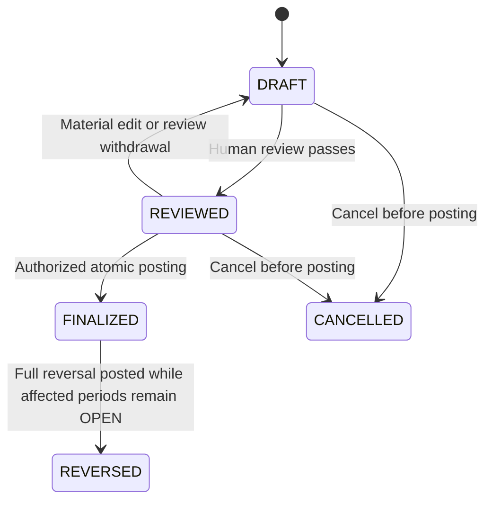

# GMIM Treasurer MVP — Design Specification and Rulebook

**Handover date:** 8 October 2026  
**Product:** GMIM Bendahara-first financial workspace, with a future church-management platform  
**Source conversation:** Church Management System, conversation ID `6ac4de41-ebec-83ec-a1f2-73f30ae5be05`  
**Document version:** Handover 5.0 — approved rounds 1–6 policy baseline; irreversible D07; preserved source snapshots and reviewed production-master correction
**Versioned artifact:** `GMIM_Treasurer_MVP_Design_Specification_and_Rulebook_v5.0.md`  
**Predecessor:** `GMIM_Treasurer_MVP_Design_Specification_and_Rulebook.md` (Handover 4.0; preserved unchanged)  
**Companion engineering specification:** `GMIM_Treasurer_Domain_Model_Posting_Rules_State_Machines_and_Report_Pack_Data_Mapping_v2.0.md`  
**Predecessor SHA-256:** `df7cf8d531db8455ab53e94ea95ec377680c37343d46b35152c1ba9e3319b791`

## 0. Read this before using the document as authority

This is the single-file handover of the current Treasurer-first design, the user-supplied **Design Specification & Rulebook — Current Source of Truth**, the user-supplied **Consolidated Master Rulebook**, and the recovered recent conversation. The supplied documents resolve the previous gaps concerning adoption levels, organizational roles, member lifecycle, Warta/privacy masking, Panitia, notifications and attendance.

**Section 16 retains all 775 rule numbers and source structure; incompatible rules are explicitly amended for approved rounds 1–6.** Appendix A retains the earlier conversation's AI-rule numbering 293–342; Appendix B retains controls C01–C20 with explicit OPEN-period correction limits. The untouched predecessor preserves original wording, while this edition records the changed rules and their authority. Their numbers belong to different source editions and must not be conflated. The prior handover's synthesized H001–H110 list has been replaced by the supplied master.

The two user-supplied classification exports have now been read directly. **All 131 Pendapatan and 158 Belanja codes and labels are embedded in Appendix C**, with exact string formatting, original source order, source references and file hashes. Each master has six verified top-level families. Appendix D provides self-contained machine-readable catalogs, including original label text and indentation.

The exports show hierarchy through indentation but contain **no explicit `parent_id` or `postable` metadata**. This document preserves the source-derived parent map and source `postable: null` values. Approved production definitions assign leaves postable, parents nonpostable unless enabled, and correct B113 to `2.3.02.02`; the source code/display-parent discrepancy remains preserved as provenance. Exact GMIM report forms are still not supplied.

### 0.1 Authority and terminology

| Label | Meaning | Continuation treatment |
|---|---|---|
| **Confirmed baseline** | Accepted recent conversation or decisions supplied by the user for incorporation | Preserve unless explicitly changed |
| **Implementation clarification** | Interpretation needed for internally consistent behavior | Validate in the next engineering specification; do not mislabel as a historic decision |
| **Proposed continuation detail** | Useful concrete implementation proposal beyond supplied decisions | Remains proposed |
| **Unresolved / source gap** | Exact detail not present in available sources | Resolve rather than guess |

The recovered design/rulebook and approved rounds 1–6 establish the product baseline. Section 19 supplies the approved engineering contract: logical records, posting recipes, guards and report datasets. The approved settings in 0.5 supersede old proposal wording, including modified D07. Fictional financial examples remain illustrative; actual church thresholds/percentages/signatures and original-form bindings remain explicit configuration/source gaps. Pinned OpenRouter IDs are approved; runtime provider availability is checked without changing the policy.

### 0.2 Coverage and remaining gaps

| Area | Status |
|---|---|
| Treasurer-first scope, navigation, workflows and build order | Recovered and consolidated |
| Five progressive adoption levels | Recovered from supplied design |
| Shared finance engine; Account / Fund / Scope / Mata Anggaran | Recovered |
| Lifecycle, approvals, advances, transfers, evidence, migration, reconciliation and closing | Recovered constraints plus explicit engineering algorithms/state guards in section 19 |
| All 775 consolidated master rules | Embedded in full in section 16 |
| Earlier AI rules 293–342 and 20 tightened controls | Preserved in source-specific appendices |
| Pendapatan/Belanja counts and six family names each | Recovered |
| Exact 289 source codes/labels | Embedded in Appendix C/D; counts and exact text verified |
| Explicit hierarchy and posting eligibility | Source flags preserved; reviewed production derivation approved with leaf/parent defaults and B113 correction |
| GMIM Report Pack, Buku Kas fields, drill-down and template architecture | Recovered; all fourteen semantic datasets, formulas and controls formalized in 19.6–19.10 |
| Exact church-specific printable field/cell/signature mapping | Not supplied; still needed |
| Warta, mandatory masking, roles, Operator, delegation, funds, Panitia and member lifecycle | Recovered; accepted future-platform constraints |
| Aggregate-only attendance, permissions/lifecycles/corrections and notifications with no quiet hours | Recovered |
| Recognition/posting matrix, reversals, suspense, numbering, imports and matching | Approved V1 engineering contract in section 19, including final CLOSED state |
| Deployment settings, thresholds, exceptions, recovery targets and live AI route IDs | Managed cloud/recovery/export/AI settings approved in 0.5; actual church thresholds remain configurable |

### 0.3 Source editions, precedence and references

Use **Master rule N** or `M001…M775` when referring to section 16. Use **Legacy AI rule N** or `L293…L342` for Appendix A. Use **Control C01…C20** for Appendix B. These aliases do not alter original source numbers. For example, Master rule 293 concerns Belanja's Marturia family, whereas Legacy AI rule 293 concerns OpenRouter.

The supplied documents are incorporated as the current product baseline under the user's instruction to update this handover. They do not prove that their 1–775 numbering is the original conversation's numbering; it is a consolidated source edition. The old chronological rules 1–292 are no longer a handover blocker because the supplied current master covers the accumulated decisions.

Preserve compatible requirements across all sources. Treasurer-first and explicit deferrals govern V1 scope; future-platform rules remain future constraints rather than launch dependencies. Approved rounds 1–6 explicitly resolve prior engineering/policy ambiguities. Any remaining source gap stays visible. The amendment register identifies changed source rules; a mere handover interpretation cannot override an approved policy.

### 0.4 Revision record

**Version 5.0 (8 October 2026):** Incorporated approved rounds 1–6; corrected the reviewed production B113 code while preserving both source catalogs/snapshots exactly; adopted D01–D12 with irreversible D07 and permanent retention of used master versions; settled approval/evidence/transit/backup/export/AI settings; rewrote all post-close correction assumptions in workflows, engineering rules, examples, report fields and acceptance requirements. Original Handover 4.0 and Standalone 1.0 files remain unchanged.

**Version 4.0:** Added section 19: embedded domain glossary and logical schema; balanced posting recipes; review/approval/evidence and supporting-object state machines; cutover/import/reconciliation/close procedures; exact integer cash/advance/transit bridges; all fourteen semantic report datasets and cross-report controls; layout-binding contract; worked arithmetic; security/AI/future-platform seams; and E001–E046 engineering rules (version 5.0 adds E047–E051). D01–D12 identify proposed decisions. Preserved all 775 master rules, legacy AI rules, 20 controls and both full source catalogs. Verified the arithmetic fixture and source fidelity; original report addresses/signatures and church policy activation remain explicit gates.

**Version 3.0:** Read both supplied `.xls` classification exports; embedded all 289 source rows with exact codes/labels, six families each, explicit source-derived parent maps, proposed posting flags, provenance and machine-readable catalogs. Preserved unusual codes/spelling and flagged the Belanja `2.3.08.02` display-parent discrepancy. Classification-row recovery is complete; actual posting eligibility and exact report forms remain open.

**Version 2.0:** Added the complete supplied 775-rule master; replaced provisional adoption/roadmap descriptions with recovered decisions; added family names and `.00`/direct-parent posting semantics; incorporated approval modes, offering details, print/report mapping, Astra exclusion, permissions/delegation, masking exceptions, lifecycle effects, attendance limits, notification channels and build order. At version 2.0, remaining source gaps concerned exact template catalogs/forms and detailed engineering choices; version 3.0 resolves the catalog recovery as described above.

### 0.5 Approved rounds 1–6 baseline

**Authority:** User decisions in **Next Steps After Docs**, conversation `6ac62014-70cc-83ec-acb6-4134bf1b9bc1`, consolidated in the final approved-decision summary and incorporated at the user's request on 8 October 2026. These are approved product policies; they are not claims that the original GMIM forms or source exports contained them. This register supersedes conflicting earlier proposal/status wording. The source snapshots remain evidence, separate from the approved production definitions.

| Round / area | Approved policy |
|---|---|
| 1 — Production master | Retain all 289 rows (131 Pendapatan, 158 Belanja). Preserve source code `2.3.08.02`; production Belanja B113 uses `2.3.02.02`, name `Kemitraan / Jemaat Mitra`, parent B110 / `2.3.02.00`. Record old/new values, source row/cells, reason and approving decision. |
| 1 — Postability | Detail leaves are postable by default; group/family parents are nonpostable by default. A parent requires explicit authorized enablement. Derive concrete booleans from the explicit hierarchy, never from `.00` or numeric prefixes. No parent enablement has been specified for this baseline. |
| 1 — Activation | First production master becomes effective on the first day of the first production accounting month. The actual month is a workspace deployment value, not the source filename date. Later versions activate at a period boundary; no retroactive reinterpretation. |
| 2 — D01–D12 | Approved as defined in the decision table, with D07 replaced by irreversible close and D11 retaining every used master version permanently. |
| 3A — Approval modes | MVP supports `NOT_REQUIRED` and `EXTERNAL`; `IN_APP` is a future collaboration mode, not an MVP dependency. |
| 3B — Thresholds | Amount thresholds are configurable per church/Fund policy; no universal rupiah approval threshold is invented. |
| 3C — Maker/checker | Configurable and off by default for solo use. When enabled, maker and checker must be distinct humans; multiple roles/logins belonging to one person do not satisfy the rule. |
| 3D — External declaration | Structured declared approver identity/role, approval date, method, notes and supporting reference/evidence where required; recorded actor remains distinct. Bind the declaration to the transaction's material revision/digest; material edits invalidate it. |
| 3E — Evidence timing | Required evidence may remain missing/uploaded/pending verification during the OPEN month, including after finalization. Resolve to `VERIFIED` or explicitly authorized `EXCEPTION_ACCEPTED` before close. A church may strengthen posting-time requirements. |
| 3F — Evidence defaults | Evidence is required by default for core spending and settlement cases: direct expenses, reimbursements, accepted advance spending and transit/centralization remittances. Evidence requirements for other transaction types are configured by church policy; required cash/bank reconciliation observations remain mandatory. |
| 3G — Solo verification | Solo Treasurer may verify evidence where church policy permits; a universal second reviewer is not imposed. |
| 3H — Evidence exceptions | Only an authorized human may explicitly accept an exception, with reason, authority, actor/time and the affected evidence/transaction link. AI, upload success and technical administration grant no exception authority. |
| 3I — Open advances | Valid, explained outstanding advances may carry forward across month-end. They are disclosed and do not automatically block close; missing required proof, unexplained/negative balances or a configured overdue restriction do. |
| 3J — Advance due dates | Configurable per church/case policy; no universal settlement deadline is imposed. |
| 4A — Ownership | Every relevant collection/allocation uses explicit `OWNED`, `CUSTODY` or `SPLIT`. A code or recipient does not establish ownership. Split components sum to the one physical collection. |
| 4B — Allocation | Centralization percentages, fixed amounts, manual allocations, retained shares and rounding are versioned authorized church configuration; never hard-coded. |
| 4C — Beneficiary | A custody/transit allocation cannot finalize without an identified beneficiary/destination obligation. |
| 4D — Presentation | MVP main reports use `ECONOMIC_WITH_TRANSIT_SCHEDULE`: economic Pendapatan/Belanja totals plus a separate Dana Transit schedule. Gross bridge measures remain available as labeled controls. A gross main-form adapter requires a future explicit policy amendment after form review. |
| 4E — Transit carry-forward | Valid, explained positive transit liabilities may carry forward. Negative cases, over-remittance, unknown beneficiaries, unexplained differences, missing required proof and unresolved policy-required overdue remittances block close. |
| 4F–4G — Owned contributions / no duplication | Contributions from church-owned money are economic Belanja. Custody collection/remittance are liability movements, excluded from economic income/expense. Each rupiah receives one ownership treatment; never count the same component twice. |
| 5A — Deployment | Managed cloud, server-authoritative finalization, numbering, reconciliation and close; no church self-hosting or offline financial finalization in MVP. |
| 5B — Security | Encrypted transport and database/storage at rest; evidence private by default; credentials/API keys server-side; tenant + role + Scope checks on reads, writes, downloads, exports and AI queries; high-privilege session revocation. Technical administration does not confer financial authority. |
| 5C — Backup set | Database, actual evidence objects, report snapshot datasets, rendered official reports, master/template/policy versions and required encryption/key-recovery material. |
| 5D — Recovery defaults | RPO **1 hour**, RTO **8 hours**, **7-day point-in-time recovery**, **35 daily backups**, **12 monthly recovery snapshots**. These are product/operational defaults, not GMIM legal-record-retention rules. |
| 5E — Restore verification | Full restore test at least quarterly and before/after major infrastructure or database migrations; verify financial integrity and evidence/report accessibility. |
| 5F — Export | Full portable church export, including actual church-owned evidence files, structured ledger/allocations, reports/snapshots, exact masters, Account/Fund/case data, approval/evidence metadata and a relationship/checksum manifest. |
| 5G — Backup / export | Infrastructure backups are restricted disaster-recovery material. Authorized church export is a separate application workflow; it requires no raw backup credentials. |
| 6A — Models | Pin `openai/gpt-6-luna` for routine assistance and `openai/gpt-6.1-sol` for escalation. No moving `latest` aliases, Astra or unapproved model fallback. Intentional upgrades require a reviewed AI policy version. |
| 6B — Privacy | Every AI request containing church data requires OpenRouter `provider.zdr = true` and an eligible endpoint with no provider training or intentional inference prompt retention. If unavailable, fail gracefully without weakening privacy. ZDR still involves transmission/processing by the provider. |
| 6C — Context | Minimum task-specific authorized context only; narrow candidate classifications and mask/remove unnecessary personal identifiers. |
| 6D — Routing | Deterministic rules → Luna → Sol where appropriate → human review. Sol escalation: insufficient confidence, ambiguous candidates, multi-document reasoning, difficult matching/reconciliation explanation, explicit deeper-analysis request or a suitable retry after deterministic rejection. |
| 6E — Output | Structured proposals; server validates schema, row/version existence, active/postable status, master kind, Fund/Scope authority and current revision before human acceptance. Invalid output is rejected. |
| 6F — Cost | **Rp150,000 per church/workspace per month**. Below 70% normal use; at 70% (Rp105,000) warn; at 90% (Rp135,000) conserve, prefer Luna/cheaper permitted processing and avoid unnecessary Sol calls; at 100% (Rp150,000) stop optional AI for the remainder of the monthly budget period. Accounting continues fully. No unlimited default. |
| 6G — Failure | OpenRouter/ZDR/model failure, exhausted budget or malformed output leaves manual capture/classification, reconciliation, close, reports and exports operational. |
| 6H — Audit | Feature, input digest, model ID, provider/route metadata, candidate/master versions, timestamp, structured proposal, confidence if supplied, human accepted/edited/rejected disposition, final value and token/cost usage. Do not duplicate unrestricted receipt/statement content in AI logs or treat proposals as financial evidence. |
| 6I — Untrusted documents | Receipts, PDFs, bank descriptions and imported text are data, never instructions or authority. All proposed actions remain subject to deterministic guards and permissions. |

**D07 control boundary:** `OPEN → CLOSED` is irreversible in MVP. Complete all financial corrections before the affected period closes. CLOSED accepts the transaction population and official snapshot as final. V1 has no reopen, unlock, closed-transaction reversal/replacement/adjustment, or later-period accounting correction against a CLOSED transaction. Required future support is outside MVP and needs an explicitly governed design extension. Valid later advance settlements/returns and transit remittances remain new events against carried-forward positions; they do not revise earlier postings or snapshots. Later supplementary evidence is append-only accountability information and cannot cure or rewrite the frozen close decision.

**Activation versus approval:** Policies above are approved, but workspace timezone/fiscal settings, first production month, actual church approvers/thresholds, beneficiary identities, allocation formulas, optional parent enablement, due dates and original report-form bindings must still be recorded where needed. Their values cannot be chosen by AI. Publication/activation records actual authorized human actor, timestamp and policy/source references; this document is not a deployed database publication.

### Approved production-master derivation

The embedded source catalogs and fenced JSON snapshots are preserved byte-for-byte, including B113 `2.3.08.02`, `postable: null`, original spelling, indentation, source hashes and draft source-mapping flags. They are not mutated or published as the production master. Create a separate version-qualified reviewed master using the following approved definition:

```json
{
  "definition_version": "GMIM_TREASURER_PRODUCTION_MASTER_R1_2026-10-08",
  "decision_source": "6ac62014-70cc-83ec-acb6-4134bf1b9bc1",
  "status": "APPROVED_FOR_PUBLICATION",
  "source_catalog_row_counts": {"PENDAPATAN": 131, "BELANJA": 158},
  "retain_all_source_rows": true,
  "preserve_source_snapshots": true,
  "hierarchy": "explicit source-indentation parent map retained",
  "postability": {"leaf_default": true, "parent_default": false, "parent_overrides": []},
  "effective_from_rule": "FIRST_DAY_OF_FIRST_PRODUCTION_ACCOUNTING_MONTH",
  "later_activation_rule": "PERIOD_BOUNDARY",
  "used_version_deletion": "PROHIBITED_PERMANENTLY",
  "corrections": [{
    "kind": "BELANJA",
    "source_row_id": "B113",
    "source_row": "113",
    "source_cells": "Sheet0!B114:C114",
    "source_code": "2.3.08.02",
    "production_code": "2.3.02.02",
    "name": "Kemitraan / Jemaat Mitra",
    "parent_id": "B110",
    "parent_code": "2.3.02.00",
    "reason": "Authorized correction of anomalous source code to match reviewed hierarchy"
  }]
}
```

Derivation is deterministic: copy every source row with its source provenance; preserve the explicit parent/family/order/label mapping; apply only the B113 production-code override; assign explicit postability from actual child relationships (237 leaves true, 52 branch/root rows false, unless a later authorized parent override is recorded). Preserve `source_code`, raw label and source flags separately from the reviewed production `code` and resolved validation status. Validate uniqueness, all parent references, absence of cycles, six roots per kind and unchanged 131/158 counts. Record the correction decision and old/new values; do not propagate the unresolved source anomaly flag as an unresolved production blocker after its authorized resolution. Do not normalize other codes or labels. The production report F06/export uses `2.3.02.02`; source appendices continue to display `2.3.08.02`.

Assign actual immutable publication-version IDs by kind and deployment dates/actor metadata at activation. The first effective date is the first day of the chosen production accounting month, including when a later-in-month cutover is explicitly used. Retain every used version forever: a version referenced by any finalized transaction, report snapshot or historical dependency can never be deleted. Archival/deactivation only removes availability for new work; it preserves version-qualified rows, provenance and historical reproduction. Operational backup expiry is not authority to delete financial/master history.

## 1. Product vision and adoption strategy

**Confirmed baseline:** First make one Bendahara dramatically more productive, while preserving the architecture needed to grow into a full GMIM church platform later.

The initial product is a financial workspace that helps a Treasurer capture money movement, maintain trustworthy records, reconcile cash/bank positions, resolve evidence and classification issues, close a month, and produce the GMIM Report Pack. AI reduces preparation effort; the ledger and human-authorized workflows retain authority.

The primary market is local GMIM Jemaat in Minahasa / North Sulawesi. The product should replace scattered Excel bookkeeping, notebooks, WhatsApp transaction records, bank screenshots, receipt folders, manual classification, reconciliation work and monthly report reconstruction. The success criterion is a reliable GMIM-compatible month-end report produced from daily records without reconstructing those sources. The UI must be mobile-friendly and usable by non-technical church officers.

Value must not depend on BPMJ, Penatua, Syamas, BIPRA leaders, members or Panitia first adopting the application. A Treasurer can record information received through paper, bank proofs, messages, meetings or existing church processes. An absent in-app approver must not force a fictitious approval account or an inaccurate approval claim.

### 1.1 Priorities, in the accepted order

1. Treasurer core ledger.
2. Mata Anggaran Pendapatan and Belanja.
3. Evidence and cash/bank reconciliation.
4. GMIM Report Pack.
5. AI-assisted Treasurer workflows.
6. Progressive collaboration: **Church Operator → unit treasurers → approvals**.
7. The broader church-management platform later.

### 1.2 Confirmed five progressive adoption levels

| Level | Adoption | Work supported | Authority boundary |
|---|---|---|---|
| **Level 1 — Solo Bendahara** | Only church Treasurer uses the application | Complete capture/reconcile/close/report workflow; record approvals occurring outside the app | No other officer needs an account |
| **Level 2 — Bendahara + Assistant / Operator** | Finance assistant or Church Operator helps | Prepare drafts, upload receipts, enter references, digitize records, prepare supporting documents | Treasurer remains responsible for financial finalization |
| **Level 3 — Unit Treasurers** | Bendahara Kolom, BIPRA or Panitia participates | Submit transactions, evidence, settlement information and financial reports in scoped workspaces | Fund ownership and scoped governance remain explicit |
| **Level 4 — Digital Approval Workflow** | Authorized Penatua, Syamas, BPMJ, BIPRA/Panitia leaders and other approvers join | Approve financial requests in-app | Enforce permissions and applicable maker/checker/self-approval restrictions |
| **Level 5 — Full Church Platform** | Broader modules progressively activate | Member self-service, Warta, services, lifecycle, inventory, attendance and announcements | Publication/privacy and organizational authority rules remain effective |

The backend must support this growth while the first UI remains Treasurer-focused. Collaboration must never make solo use impossible. Scopes can exist without unit user accounts. Data is entered once and reused wherever authorized.

## 2. Treasurer-first MVP scope and explicit deferrals

### 2.1 Included financial capabilities

- Income and receipts, including offerings and donations.
- Expenses and reimbursements.
- Cash advances, settlement and unused-money returns.
- Cash and bank accounts, and transfers.
- Line-level classification into versioned Pendapatan and Belanja masters.
- External approval recording, with a compatible path to in-app approvals.
- Evidence/documents and structured evidence status.
- Cash and bank reconciliation.
- Controlled opening balances and staged legacy/bank imports.
- Monthly closing and period locks.
- Audit trail, security, backups and export.
- Deterministic reports, including PDF/Excel GMIM Report Pack outputs.
- Optional AI preparation, suggestions, search, explanations and issue summaries.

### 2.2 Explicitly deferred

**Budgeting, procurement and service roster are not in the current MVP.** Any future detailed workflows must preserve these deferrals and must not become dependencies of transaction recording or closing.

Mata Anggaran is a classification/reporting master. Using the word “Anggaran” does not imply that budget planning, budget approval, budget limits, purchase requests, purchase orders, supplier procurement or service scheduling have been included in V1.

**Implementation clarification:** If a supplied report contains budget columns, their V1 behavior must be specified explicitly. Do not invent budget values or implement a hidden budgeting module merely to fill a template. Mark unavailable budget fields appropriately until an approved source/input policy exists.

### 2.3 Deliberate V1 limitations

1. IDR only.
2. One church workspace per tenant.
3. One fiscal/calendar configuration per workspace.
4. No foreign-currency accounting or FX handling.

Multiple accounts, funds and organizational scopes can exist inside the one church workspace. Tenant isolation can support many churches on the platform without turning V1 into a multi-church consolidation product.

No detailed calendar, timezone, fiscal-year start or currency-input precision was recovered. Confirm those implementation settings instead of inferring them from this document's creation environment.

## 3. Primary workflow and product surfaces

### 3.1 Accepted Treasurer workflow

```text
Record / capture money movement
    ↓
Attach evidence
    ↓
Classify to Mata Anggaran
    ↓
Record external / in-app approval, if applicable
    ↓
Finalize ledger transaction
    ↓
Reconcile cash / bank
    ↓
Resolve missing items
    ↓
Close month
    ↓
Generate GMIM Report Pack
```

AI may assist at individual steps. It does not become an alternate route around the controls.

### 3.2 Treasurer navigation and attention-first dashboard

The supplied design proposes this minimal navigation; screen details remain design choices:

```text
Dashboard
Money → Income / Offerings / Donations / Expenses / Reimbursements / Cash Advances / Transfers
Cash & Bank → Cash / Bank Accounts / Reconciliation
Documents / Evidence
Reports → Monthly Financial Report / Buku Kas / Pendapatan / Belanja / GMIM Report Pack
Settings → Church / Accounts / Funds / Financial Scopes / Mata Anggaran
```

The confirmed dashboard emphasis is **Needs Attention**, rather than large CRUD menus. Show authoritative Cash/Bank positions, this-month income/expenses/net and operational items such as awaiting payment, open advances, missing receipts, unmatched bank lines and unresolved classifications. Offer quick Income, Expense, Offering, Reconcile and Generate Report actions. Numbers shown in source dashboard examples are illustrative.

The following workspaces refine those groupings for implementation planning:

| Workspace | Purpose |
|---|---|
| Overview / attention list | Balances from authoritative records, drafts, missing proof, unresolved reconciliation and close blockers |
| Transactions | Capture, edit drafts, inspect finalized entries, reverse and correct |
| Offerings / receipts | Capture collections and donations with appropriate context |
| Advances | See recipients, disbursements, settlements, returned money and outstanding amounts |
| Evidence | Upload, link, inspect, verify and search supporting documents |
| Cash / bank | Account position, statement staging, matches and reconciliation differences |
| Imports | Preview, map, validate, deduplicate, classify and commit |
| Month close | Deterministic checklist and period lock |
| GMIM Report Pack | Preview/export reports and inspect historical snapshots |
| Masters / settings | Controlled classifications, accounts, funds, scopes and template versions |
| Audit / export | Authorized traceability and church-owned data extraction |

A generic chatbot is not the primary financial interface. AI belongs in the relevant workflow, beside the draft or issue it is helping resolve.

## 4. Finance concepts and domain boundaries

### 4.1 Four independent dimensions

| Concept | Meaning | Illustrative values | Must not be confused with |
|---|---|---|---|
| **Account** | Where money physically is | Cash, BNI, BRI | Its owner, organizational unit or income/expense purpose |
| **Fund** | Which pool of money owns it | General, Diakonia, Panitia | A physical bank account |
| **Scope** | Which organizational unit the record concerns | Jemaat, Kolom, BIPRA, Panitia | A fund or classification code |
| **Mata Anggaran** | What the income/expense is for | An exact approved Pendapatan/Belanja row | An account or organizational permission |

Examples above were used in the recovered conversation; they are not a mandatory seed catalog. “Panitia” may identify an organizational scope and an associated fund, but these remain separate records with separate meaning.

One shared finance engine serves Jemaat, Kolom, BIPRA, Panitia and future units; separate accounting implementations for each unit are prohibited. Fund ownership determines the applicable governance workflow.

One BNI account can hold money attributed to several funds. One fund can have money in more than one physical account. A unit can use many Mata Anggaran rows. None of these relationships permits automatic conflation of the dimensions.

### 4.2 Domain record overview

The next implementation design should define at least the following records and relationships:

| Record | Essential responsibility |
|---|---|
| Church workspace / tenant | Church boundary, configuration and data isolation |
| Account | Cash/bank identity and book position |
| Fund | Ownership/restriction dimension for money |
| Organizational scope | Jemaat/unit/Panitia attribution and access context |
| Classification version and row | Immutable published master, exact codes/labels, hierarchy and posting eligibility |
| Transaction header | Type, dates, total, lifecycle, actor, approval/evidence references and voucher |
| Transaction lines | Amount allocations, Mata Anggaran and applicable dimensions |
| Ledger postings | Authoritative effects on account/fund/advance/settlement balances |
| Approval record | External declaration or authenticated in-app decision |
| Evidence item / link | Stored artifact and its relation to a financial record |
| Cash advance / settlement | Recipient, issued/settled/returned amounts and state |
| Import batch / staged row | Source provenance, validation, duplicate resolution and commit result |
| Statement / statement line / match | Bank source records and explicit reconciliation links |
| Opening-balance batch | Controlled adoption-date balances and outstanding positions |
| Accounting period / close | Checklist result, lock and actor/time |
| Report template / report snapshot | Versioned format and immutable generated result |
| Audit event | Trace of material actions and relevant changes |
| AI suggestion | Model output, confidence and human confirmation/override |

This table is the recovered overview. Section 19.1–19.3 expands it into the formal logical domain model and posting contract; it remains an engineering specification rather than a deployed database or historical church approval.

### 4.3 Amounts and date semantics

**Approved D02:** Store money as integer IDR with checked exact arithmetic and explicit allocation rounding; do not use binary floating-point ledger calculations. Validate totals server-side. Date parsing must not silently convert ambiguous Indonesian date/number formats.

Separate business-effective date, creation timestamp, posting/finalization timestamp and document date where they differ. Section 19 specifies the approved date/cutoff and irreversible-close contract; financial corrections are limited to affected OPEN periods. Preserve original imported strings and the interpreted result for review.

## 5. Transaction types and lifecycle

### 5.1 Accepted transaction families

| Type | Purpose | Accounting/report constraint |
|---|---|---|
| Income / receipt | Record money received | Classify relevant income lines to Pendapatan |
| Offering | Record church/service/unit collections | Preserve collection context; avoid recounting a deposit as new income |
| Donation | Record a gift | Preserve relevant donor/fund context without requiring full member-platform adoption |
| Expense | Record spending | Classify relevant lines to Belanja |
| Reimbursement | Repay a person for a documented church expense | Record the underlying expense once; distinguish reimbursement from an advance |
| Cash advance | Money entrusted before final accountability | Advance issue is not automatically final Belanja |
| Advance settlement | Recognize supported spending from an advance | Classify settled spending and retain the outstanding balance |
| Advance return | Record unused money returned | Separate from settlement expense; not fresh donation income |
| Account transfer | Move money between physical accounts | No artificial Pendapatan/Belanja inflation |
| Fund transfer | Reattribute money between funds under an explicit rule | Preserve overall money total and ownership trace |
| Centralization / settlement | Track GMIM collected/payable/remitted/received amounts | Precisely define each amount and avoid double counting |
| Opening entry | Establish controlled adoption-date positions | Not fabricated income |
| Reversal / correction / adjustment | Correct records while affected periods remain OPEN | Preserve history; CLOSED transactions have no correction path in MVP |

Section 19.3 specifies precise posting effects and permitted combinations as an explicit V1 engineering contract. Do not use a single generic “expense” flag to conceal an advance, transfer or opening entry.

### 5.2 Authoritative state machine

**Confirmed control:** Use explicit states such as:

```text
DRAFT → REVIEWED → FINALIZED
FINALIZED → REVERSED only while all affected periods remain OPEN
```

The supplied current design confirms these state names, and Master rule 72 requires an equivalent lifecycle. Detailed transition preconditions and review invalidation are formalized in section 19.4.

| State | Meaning | Official financial effect |
|---|---|---|
| DRAFT | Captured/prepared, including AI or import proposals | None |
| REVIEWED | Reviewed according to configured workflow | None until finalization |
| FINALIZED | Validated, human-authorized transaction committed to the ledger | Included in authoritative reporting/postings |
| REVERSED | Original finalized record has a linked compensating correction | Preserve original and reversing posting history |

Empty drafts may be deletable. Records that have participated in official workflows generally use reversal, cancellation or archival instead of physical deletion; finalized financial records are not physically deleted through ordinary administration. Cancellation/reversal remains auditable. Section 19.4 defines pre-post cancellation and review invalidation; D07 permits corrections only while affected periods remain OPEN; CLOSED has neither reopening nor a later-period correction path. Do not reuse issued voucher numbers or erase audit events.

### 5.3 Immutability and corrections

After finalization, amount, classification, date and other financially material fields must not be silently edited. While all affected periods remain OPEN, use:

```text
Reverse original → create corrected transaction
```

This applies while all affected periods remain OPEN, for solo and collaborative churches alike. Reversals require original linkage, reason, actor/time and configured authority. Once the affected period is CLOSED, this workflow is unavailable, including from a later OPEN period. AI may suggest fixes for eligible OPEN data; it cannot authorize or perform a correction.

**Implementation clarification — historical inclusion:** “Finalized only” means authoritative committed financial effects. If an original becomes `REVERSED`, do not simply remove it from every historical query while retaining its reversal, or remove both from an earlier report. Retain original posted effects and linked compensating effects with their effective periods. Report snapshots remain fixed. Approved D07 date/guard rules in 19.3.3 apply; no correction against a CLOSED transaction is available.

### 5.4 Finalization controls

Approved validation contract:

1. Confirm tenant, permission and accounting period are valid.
2. Validate the transaction type and its posting recipe.
3. Validate exact amount arithmetic and line/header equality.
4. Resolve required classification to a valid postable row/version.
5. Validate accounts, funds and scopes independently.
6. Record applicable approval provenance accurately.
7. Evaluate evidence requirements and allowed exception policy: default required evidence may remain pending during OPEN month, but close requires VERIFIED or human EXCEPTION_ACCEPTED; stronger church posting-time policy still applies.
8. Enforce duplicate/idempotency controls.
9. Commit postings, voucher allocation and audit record consistently.

No user-facing success should imply a posted transaction if only the AI draft or file upload succeeded. Partial failure must not leave duplicated or half-posted financial effects.

## 6. External approvals and in-app governance

### 6.1 External approval

The MVP may operate without BPMJ adopting the app. An external approval means:

> The Treasurer recorded that approval occurred outside the system.

It must not appear as “Approved by BPMJ in the app.” Store:

- Declared approver.
- Approval date.
- Method/channel.
- Notes.
- Evidence, when available.
- Recorder identity and record time.

The supplied baseline also requires the approver’s role/authority where known. Recorder/time make provenance traceable. The external record is a declaration, not proof of authenticated approval by the named person.

### 6.2 Approval modes and in-app authority

Support **EXTERNAL** and **NOT_REQUIRED** where applicable in MVP, with an architecture for future **IN_APP** approval. The original design names all three modes; approved Round 3 limits MVP to NOT_REQUIRED/EXTERNAL and reserves IN_APP for future collaboration.

True in-app approval can coexist later with external declarations. It requires an authenticated actor and an authorized workflow. Do not retroactively transform old external declarations into app approvals when an approver later joins.

**Confirmed AI boundary:** AI cannot approve expenditure, approve its own suggestions, bypass maker/checker or self-approval restrictions, or bypass governance permissions.

**Engineering status:** Scoped-role/delegation and separation-of-duties constraints are recovered in section 14. Section 19.4 separates approval mode from review and binds them to revision/authority. Exact expense thresholds, required approvers/quorum and exception capabilities remain church policy values; they are not invented. Maker/checker is off by default for solo use; when enabled it requires distinct humans under church policy. Where a maker/checker restriction applies, solo mode does not authorize bypassing it.

Request, Approve, Pay and Verify remain distinguishable actions. Treasurer authority is not technical super-administration; system administrator and Church Operator are not automatically financial authorities. Multiple roles must not bypass self-approval: a person submitting as Ketua Pemuda cannot switch to their BPMJ role to approve the same request where independent approval is required. Maker/checker is configurable but structurally supported.

Approval state, payment state, transaction lifecycle and reconciliation state are different concepts. An approved proposal is not evidence that money moved; a payment is not automatically approval.

## 7. Operational finance workflows

### 7.1 Offerings

**Confirmed:** Offerings are included; users should be able to query examples such as “persembahan Minggu pagi bulan Oktober.” Full service roster and individual attendance are not required for capture.

**Confirmed capture requirements:** Offering management is first-class. Support cash and transfer/QR components, their calculated total, service/source context without individual-attendee tracking, counting-sheet evidence, relevant Pendapatan classification, account/fund allocation, auditable verification and eventual deposit/reconciliation. More than one authorized person may count cash where church practice requires; this is not a universal two-counter prerequisite. Detailed denomination breakdown and counting policy remain to specify.

A collection received into Cash and later deposited into BNI is one receipt plus one account transfer. Recording another income for the deposit would inflate the reports. If collection is payable to another unit, follow the explicit centralization policy rather than automatically treating every collected rupiah as unrestricted church revenue.

### 7.2 Donations

**Confirmed:** Donations are in scope. The Treasurer must get value without member-platform rollout.

**Confirmed:** Donations may be general or designated to a Fund. Internal donor identity and published identity remain separate; mandatory eligible masking and audited exceptions follow section 14. Do not expose private donations through an automatic member transfer.

**Proposed capture detail:** Record donor information or an appropriate anonymous/unknown designation, date, amount, account, fund, scope, classification and proof. Full member-platform rollout is not required for legitimate receipts. Detailed restricted-gift conditions and receipt formats remain to specify.

### 7.3 Expenses and reimbursements

Capture actual payment details, payee/recipient, purpose, account, relevant fund/scope, Belanja lines, evidence and applicable approval. One actual payment may have several classification lines; the split sum must equal the payment amount.

For example, a Rp5,000,000 payment can contain Rp2,000,000 for one purpose and Rp3,000,000 for another. These illustrative purposes are not exact Mata Anggaran rows from the source master.

**Implementation clarification:** A reimbursement repays supported church spending already paid personally. Ensure the expense is recognized once, and do not recognize it again when proof is attached or reimbursement is paid if it was already posted under another approved recognition method. Approved D04 recognizes the reimbursement at repayment, once; claim review alone is not accrued expense.

### 7.4 Cash advances

Cash advances have their own state:

```text
OPEN → PARTIALLY SETTLED → SETTLED
```

An advance issue is not final expense. Settled spending maps into Belanja when appropriately accounted for. Unused money returned is recorded separately.

**Approved advance balance contract:**

```text
Outstanding advance
    = issued amount
    − accepted settlement expense
    − unused amount returned
    ± eligible OPEN-period authorized corrections
```

Issue, settlement and return must remain linked. A Rp1,000,000 advance with Rp750,000 supported settlement and Rp250,000 returned is fully settled; it produces Rp750,000 Belanja, not Rp1,000,000 plus another Rp750,000.

Settlement spending should have supporting evidence; partially settled advances show outstanding amounts. Open advances appear in Needs Attention and unresolved advances are disclosed appropriately in month-end reporting. AI can remind but cannot settle them automatically.

**Engineering status:** Sections 19.3–19.7 define advance posting, settlement/return state, excess-spending/top-up handling and noncash cash-book treatment. Recipient eligibility, due-date/overdue close restrictions and approval/exception authority remain configured policy values. An outstanding advance is an attention item; the recovered text does not say every open advance automatically blocks every month close.

### 7.5 Transfers

Moving Rp10,000,000 from Cash to BNI must not create Rp10,000,000 Pendapatan and Rp10,000,000 Belanja. Explicitly model both sides of a physical account transfer. Internal fund transfers also need explicit treatment to avoid inflated reporting.

Transfer fees, if any, are distinct actual expenses rather than a reason to disguise the whole transfer as Belanja. This is an implementation clarification; the exact fee classification requires the real master.

### 7.6 Centralization / settlement

Every related record must distinguish:

1. Amount collected.
2. Amount payable.
3. Amount remitted.
4. Amount received.

Solo MVP can record unit settlements manually; unit treasurers may later submit them directly. A single money movement can be observed at two organizational scopes without becoming two unrelated receipts. Link collections, obligations and remittances explicitly.

**Approved:** Ownership is explicit OWNED/CUSTODY/SPLIT, custody beneficiaries are mandatory, and main reports use ECONOMIC_WITH_TRANSIT_SCHEDULE. Actual allocation formulas/percentages, beneficiary identities, retained shares, due dates and settlement Accounts remain versioned church configuration. The supplied Belanja source now includes `1.1.00.00` “SENTRALISASI KE SINODE” and `1.2.00.00` “SENTRALISASI KE WILAYAH”; Dana Transit source categories are also embedded. Their presence does not determine whether every remittance is expense versus liability settlement, or authorize recognition of the same movement twice. Do not invent them. Sections 19.3, 19.6, F13 and 19.9 implement the approved ownership-based recipes and transit presentation; actual church percentages/allocations require authorized configuration.

## 8. Evidence and document numbering

### 8.1 Evidence status

Use structured states equivalent to:

1. Not required.
2. Required — missing.
3. Uploaded.
4. Verified.
5. Exception accepted.

The supplied baseline uses enum-style names `NOT_REQUIRED`, `REQUIRED_MISSING`, `UPLOADED`, `VERIFIED`, `EXCEPTION_ACCEPTED`. Evidence can include receipts, invoices, transfer proofs, bank statements, count sheets, reimbursement/advance-settlement documents, approval screenshots and meeting decisions. MVP documents may attach directly to related financial records; a sophisticated standalone document-management platform is not required.

Do not reduce this to `has_attachment=true`. An upload is not verification. An AI extraction confidence is not documentary evidence. Missing required proof and accepted exceptions must remain visible to close checks and Daftar Bukti Kas.

**Evidence contract:** Artifact ID, original filename, checksum, upload actor/time, private storage reference, evidence type, linked transaction(s), human verification actor/time and explicit exception reason/authority. Required evidence may remain pending during the OPEN month but must be VERIFIED or EXCEPTION_ACCEPTED before close. Core spending/settlement cases require evidence by default; solo verification is permitted by church policy. Actual exception authorities remain church configuration; backup retention is separately approved in 0.5.

Receipt images, invoice PDFs and bank-proof images are permitted AI-extraction examples. Files are untrusted inputs. AI cannot invent receipts, approval records or missing documentation.

### 8.2 Voucher/document numbering

Recovered examples:

```text
BKM-2026-000123   Bukti Kas Masuk
BKK-2026-000087   Bukti Kas Keluar
TRF-2026-000014   Transfer
UM-2026-000011    Uang Muka
```

Numbers are system-generated, unique within the church, and never silently reused after cancellation. The examples are not proof that the exact prefixes, counter resets or padding were finally selected.

**Engineering decision D08:** Allocate on successful finalization, use calendar year of effective date, and retain unique workspace/series/year counters with idempotent retries and traceable gaps. Series prefixes/padding are established church configuration; internal vouchers remain separate from original imported numbers. See 19.0, 19.4 and F12.

## 9. Imports and controlled opening balances

### 9.1 Staging-first import

```text
Import into workspace
    ↓
Validate
    ↓
Duplicate check
    ↓
Classification review
    ↓
Human confirmation / authorized commit to ledger
```

Uploaded spreadsheets must not immediately become authoritative ledger data. AI may infer columns, suggest field mappings and classifications, and identify suspicious rows. Validation and human confirmation remain required.

**Proposed staging metadata:** Import batch/source hash, original workbook/sheet/row, raw value, interpreted value, selected master version, duplicate candidates, validation errors, review actor/time and committed record ID.

Reject or flag malformed dates, ambiguous amounts, mismatched line totals, invalid/nonpostable categories, tenant/scope errors and known duplicate references. Do not silently normalize codes, overwrite records or turn unresolved source ambiguity into a guessed authoritative value.

### 9.2 Idempotency and duplicate handling

Re-importing the same bank statement must not duplicate its lines. Use fingerprints/reference IDs and explicit matching rules. Similar amount/vendor/date is a potential duplicate signal, not sufficient authority for automatic deletion.

**Implementation clarification:** Preserve provenance and explicit decisions for legitimate repeated transactions. Strong identity controls should prevent duplicate commit on retries; uncertain similarity should enter review. The same bank line cannot be consumed twice beyond an approved allocation/matching model.

### 9.3 Opening balances

Capture at adoption:

- Effective date.
- Cash balance.
- Bank balances.
- Fund balances.
- Outstanding cash advances.

These become controlled opening entries, not fake income transactions. Account and fund views must reconcile under the approved balance model. Evidence/support and actor/time should be retained.

**Engineering decision D09:** Section 19.5 defines one reviewed cutover population, balance-only versus history-derived migration, supported opening advances/transit liabilities and overlap prevention. Opening approval authority is configured policy; other receivables/liabilities are outside the approved V1 contract unless explicitly extended.

## 10. Reconciliation and monthly close

### 10.1 Reconciliation

Reconciliation is line-based and idempotent. Deterministic matching uses straightforward signals first: exact amount, nearby date, reference number and description similarity. AI can suggest uncertain matches; the Treasurer reviews them.

Keep book balance, physical cash count and bank statement position conceptually separate. Store explicit differences and explanations rather than manufacturing an adjustment to make the display balance.

**Approved matching contract:** Represent bounded human-confirmed match groups with allocated amounts, status and actor/time; one-to-one, one-to-many and many-to-one matching follows 19.5.3. A statement line's allocated total cannot exceed its available amount. Unmatching must not delete the source line or create another payment.

Source-specific statement formats, date tolerance, bank fees, deposits in transit and outstanding-payment handling remain implementation decisions.

### 10.2 Monthly closing as a control point

Close requires deterministic checks including:

- Cash/bank reconciliation.
- No unresolved required Mata Anggaran classifications.
- No invalid transaction totals.
- Required evidence status satisfied under the approved policy.
- Any other applicable governed blockers resolved.

AI can list and explain problems but cannot close a period. After close, the period is locked.

The recovered example included three missing receipts, an unmatched bank transaction, an unsettled advance and uncertain classifications in a close attention list. Approved Round 3/4 and 19.5 define warning versus blocker: valid explained open advances/transit may carry forward; required unresolved proof/approval/classification and unexplained money differences block close. Exceptions require authorized humans.

### 10.3 Unclassified / Suspense

Allow capturing known money movement without forcing a guessed Mata Anggaran. Mark it **NEEDS REVIEW / Unclassified / Suspense** in the reconciliation workspace. A period cannot close with required classifications unresolved.

**Engineering decision D03:** V1 unclassified records remain staged observations/drafts until required classification is reviewed. They have no official ledger effect and unresolved required period observations block close. This is the approved staging-only policy; it does not introduce a posted suspense account or silently assign “Other.”

### 10.4 Final close and correction boundary

**Approved amended D07:** `OPEN → CLOSED` is irreversible in MVP. Complete financial corrections before the affected period closes; after successful close its transaction population and official snapshot are accepted as final. There is no reopen/unlock, post-close reversal/replacement/adjustment, or later-period accounting correction against a CLOSED transaction. Authorized administrators, imports and AI have no bypass. A future governed extension would require explicit design and approval.

Eligible OPEN-period corrections preserve original postings and append reviewed linked compensating/replacement events. Their target and every affected original/dependency period must be OPEN, checked atomically with finalization and close. New later settlements/returns/remittances against valid carried-forward advances/transit are ordinary new events, not revisions to CLOSED postings. See 19.3.3 and E027.

## 11. Versioned Mata Anggaran masters

### 11.1 Verified source identity, counts and family codes

The original **Alfa Omega Rinegetan Tondano II** Pendapatan and Belanja classification exports named `20261007` are now supplied and extracted. Each `.xls` file is an HTML table exported for Excel, with a declared worksheet named `Sheet0`; it is not a binary BIFF workbook. Read the file format from its contents and keep all identifier values as text.

Both tables have columns **`#`, `Kode`, `Mata Anggaran`, `Aksi`**, one header row and respectively 131/158 numbered data rows. `Aksi` is empty for every data row and provides no approval/posting metadata. There are no transaction amounts or printable report forms in these classification-only exports.

| Master | Data rows | Root families | Source-derived branch rows, including roots | Source-derived detail leaves |
|---|---:|---:|---:|---:|
| Pendapatan | 131 | 6 | 23 | 108 |
| Belanja | 158 | 6 | 29 | 129 |
| Combined | 289 | 12 across two distinct masters | 52 | 237 |

Branch/leaf counts describe source topology. The approved default produces 237 postable leaves and 52 nonpostable branch/root rows unless a parent is explicitly enabled; 289 retained rows are not 289 postable categories. Source eligibility remains null in preserved snapshots.

| Root code — exact string | Pendapatan — exact label body | Rows in family, including root | Belanja — exact label body | Rows in family, including root |
|---|---|---:|---|---:|
| `1.0.00.00` | KEESAAN / PERSEKUTUAN (KOINONIA) | 88 | KEESAAN / PERSEKUTUAN (KOINONIA) | 104 |
| `2.0.00.00` | KESAKSIAN DAN KERJASAMA (MARTURIA) | 10 | KESAKSIAN DAN KERJASAMA (MARTURIA) | 9 |
| `3.0.00.00` | DIAKONIA | 10 | DIAKONIA | 19 |
| `4.0.00.00` | DANA PEMBANGUNAN | 6 | PEMBANGUNAN / INVENTARIS GEREJA | 12 |
| `5.0.00.00` | PENDAPATAN LAINNYA | 8 | PENGELUARAN LAINNYA | 5 |
| `6.0.00.00` | DANA TRANSIT | 9 | DANA TRANSIT | 9 |

Root labels are shown with original capitalization and body spelling. Original leading whitespace/nonbreaking-space indentation is retained in `name_raw` in Appendix D. Family counts include the family row and its descendants. Both master totals match the earlier design: 131 and 158.

Confirmed required master attributes remain `code`, `name`, `parent_id`, `level`, `display_order`, `postable`, `active`, `version`, `effective_from`, `effective_to`. The source snapshot version IDs in Appendix D identify extraction provenance only. The date `2026-10-07` comes from the filenames; it is **not evidence of the master’s accounting effective date or publication approval**. The approved first activation is the first day of the first production accounting month; its actual date is configured at deployment. Source snapshot dates remain unset as provenance.

### 11.2 Exact codes and no silent normalization

Codes must be stored as **strings**, preserving exact source spelling, punctuation, leading zeros, segment lengths and other meaningful formatting. Do not parse a dotted code into a decimal number, infer hierarchy solely from prefixes, pad/rewrite codes, deduplicate by a normalized key, or silently fix suspected mistakes.

Preserve original code and label separately from optional search aids. Search normalization cannot rewrite the authoritative display/export code. Any correction is an explicit reviewed change in a new version, with original provenance retained.

### 11.3 Explicit hierarchy and posting eligibility

Every source row needs an explicit parent relationship and `postable` flag, even if visual indentation makes the source appear obvious. Do not infer hierarchy or postability solely from a `.00` suffix: some `.00` entries can be actual posting categories. A parent can itself be postable. Rows receive direct postings only when their explicit eligibility allows it, not merely because they have a code or appear to be leaves.

**Confirmed rollup:** A postable parent total equals its direct postings plus eligible descendant postings, counted once. A nonpostable parent aggregates eligible descendants only. Preserve hierarchy/display order and offer transaction/evidence drill-down.

**Proposed row contract:**

| Field | Purpose |
|---|---|
| Internal row ID | Stable identity independent of displayed code |
| Master kind | `PENDAPATAN` or `BELANJA` |
| Version ID | Published classification version |
| Exact source code | String, unchanged from authoritative source |
| Exact source label | Authoritative wording |
| Parent row ID | Explicit hierarchy; null only for legitimate root rows |
| Top-level family row ID | Explicit family membership |
| Source order | Preserve report/template order |
| Node role | Family, grouping, detail, total or other explicitly reviewed role |
| Postable flag | Whether financial lines can map here |
| Source file/sheet/row or cell | Traceability |
| Source hash / validation note | Provenance and irregularity handling |
| Active/effective status | Availability for new work without changing old snapshots |

If the source contains duplicate codes, ambiguous indentation or missing parents, stop publication and resolve those exact rows. Do not create a silent interpretation. “Six families” is a validation target, not permission to force an arbitrary tree into six invented roots.

### 11.4 Version lifecycle

Maintain draft/reviewed/published versions under a controlled master workflow. Historical transactions retain their posted version. Every used master version can never be deleted, including after archival/deactivation; preserve every row, source/correction provenance and reference needed to reproduce finalized records and snapshots. New versions may change future choices; they cannot silently relabel old transactions or regenerate prior official outputs differently.

The recovered example “Alfa Omega 2026” is an illustrative version label. It is not a recovered filename, workbook checksum or complete master definition.

Each relevant transaction line maps to the correct master row/version. A split payment can map to several postable rows without creating several actual payments. Pendapatan and Belanja versions must be distinguished even if codes look similar.

### 11.5 Extraction verification and source-preserving mapping

Completed checks:

1. Exactly **131 Pendapatan** and **158 Belanja** data rows, with source `#` values sequential and complete.
2. Six top-level source-indentation families per master, with exact root codes `1.0.00.00` through `6.0.00.00`.
3. Exact code strings and original label text captured for every row; no duplicate codes within either master.
4. All codes, including five-part and two-digit segment variants, retained without padding, shortening or normalization.
5. Parent mapping derived from label indentation and row order, with explicit row IDs, parent IDs, level and family. No orphan, cycle, cross-master parent or indentation-level skip in that derived mapping.
6. Source irregularities preserved and disclosed; approved production B113 uses `2.3.02.02` under B110, with source `2.3.08.02` preserved separately.
7. Human tables and machine-readable catalogs contain all 289 records and are checked against the parsed source cells.
8. All 775 master numbers and legacy/control numbering are retained; this edition explicitly amends conflicting policy/correction wording. Original wording remains in the unchanged predecessor.

### 11.6 Hierarchy and posting-flag provenance

The original cells encode indentation as **0, 2, 4 or 6 leading `&nbsp;` entities followed by one ordinary separator space**. After HTML decoding these become 1, 3, 5 or 7 leading whitespace characters. That presentation prefix is recorded separately; removing it from the readable label body does not correct spelling, capitalization, punctuation or internal spaces. `name_raw` retains the full decoded source cell.

For each row, the derived parent is the nearest preceding row with the next lower indentation level. Root level is 0. Stable snapshot-local IDs are `P001…P131` and `B001…B158`; identical codes in the two masters do not create a shared identity. In production, bind these IDs to their master-version identity.

This is a source-derived **draft explicit hierarchy**, not an invented code-prefix tree. In particular, Belanja `2.3.08.02` “Kemitraan / Jemaat Mitra” appears under the indented group `2.3.02.00` “Hubungan Kerjasama”; preserve the original snapshot/display relationship; approved production B113 explicitly changes only the code to `2.3.02.02`, retains parent B110 and records the old/new value and approving decision. Do not invent `2.3.08.00`.

**Approved production postability defaults (source proposal preserved separately):** Detail leaves → `true`; group/family rows → `false`. This approved default permits `.00` leaves, for example Pendapatan `1.3.51.00` “PERSEMBAHAN PERSEPULUHAN” and Belanja `1.1.00.00` “SENTRALISASI KE SINODE”. It is not a `.00`-suffix rule. A branch may be postable under approved policy; the candidate `false` must then be explicitly changed and both its direct and descendant postings included without duplication.

The source has no true/false posting flag. Accordingly the machine-readable records use **`postable: null`** plus a separate **`postable_proposal` boolean**. The readable catalog column is explicitly named **Postable proposal**. Source maps retain `mapping_status: DRAFT_SOURCE_INDENTATION`. The approved production derivation in 0.5 creates separate version-qualified reviewed rows with concrete postability and the B113 override, then records publication/activation metadata. Do not rewrite source eligibility or publish the source snapshot in place.

### 11.7 Source irregularities retained without correction

| Master / source row | Exact code | Preserved issue / interpretation |
|---|---|---|
| Pendapatan 22 | `1.3.53.07.00` | Five-part code, family-offering subgroup; do not shorten it to four parts |
| Pendapatan 23–25 | `1.3.53.07.01`, `1.3.53.07.02`, `1.3.53.07.03` | Children of that five-part subgroup |
| Belanja 113 | `2.3.08.02` | Preserve original source anomaly; authorized production code is `2.3.02.02` under the unchanged parent `2.3.02.00` |
| Belanja 134 | `4.03.03.00` | Two-digit second segment `03`; do not rewrite as `4.3.03.00` |
| Belanja 146 | `5.03.02.00` | Preserve the second-segment leading zero |
| Belanja 147 | `5.03.03.00` | Preserve the second-segment leading zero |

Source label spellings such as “Ibadah Ibadah”, “Ibadh”, “Pengembagan”, “Tunjuangan”, “Majelelis”, “Konve” and “Saund System” remain unchanged. Internal double spaces remain in `name` and `name_raw`. Missing sequence numbers are not filled with synthetic categories. Any later corrected code/label/hierarchy belongs in an explicitly reviewed new master version with provenance.

## 12. GMIM Report Pack

### 12.1 Required pack contents

The following titles are preserved from the recovered baseline:

1. **Laporan Perbendaharaan Bulanan**.
2. **Buku Kas Umum**.
3. **Buku Kas Pembantu**.
4. **Mata Anggaran Pendapatan**.
5. **Realisasi Pendapatan Menurut Mata Anggaran**.
6. **Mata Anggaran Belanja**.
7. **Realisasi Belanja Menurut Mata Anggaran**.
8. **Rekap Penerimaan**.
9. **Rekap Pengeluaran**.
10. **Posisi Kas & Bank**.
11. **Rekonsiliasi**.
12. **Daftar Bukti Kas**.
13. **Sentralisasi / Settlement**.
14. **Supporting Accountability Outputs**.

Reports are prefilled from finalized ledger data. The Treasurer should not reconstruct them manually. PDF, Excel/spreadsheet and print outputs are in scope. AI may explain the pack and draft a narrative from ledger-derived values; it supplies no authoritative financial totals.

### 12.2 Logical report mapping — pending exact source layout

| Output | Proposed authoritative input | Main validation concern |
|---|---|---|
| Monthly treasury report | Opening position, period postings, closing/reconciliation position | Same period/basis as supporting reports |
| Buku Kas Umum | Posted money movements in deterministic order | Running balance and movement completeness |
| Buku Kas Pembantu | Appropriate account/fund/scope subledger projection | Subledger totals reconcile to the applicable control total |
| Pendapatan master | Selected published source master | Exact labels/codes/order and 131-row manifest |
| Pendapatan realization | Posted income allocations by source row | Classification total equals included income total |
| Belanja master | Selected published source master | Exact labels/codes/order and 158-row manifest |
| Belanja realization | Posted recognized expense allocations | Classification total equals included expense total |
| Receipt recap | Receipt projection under approved basis | Does not inflate income through transfers/returns |
| Expenditure recap | Payment/expense projection under approved basis | Distinguishes advance issue from final expense |
| Cash and bank position | Account balances | Matches ledger and reconciliation bridge |
| Reconciliation | Statement/cash observations plus posted book balances | Every difference accounted for explicitly |
| Evidence list | Voucher/document/evidence metadata | Structured missing/verified/exception status |
| Centralization / settlement | Linked collected/payable/remitted/received records | No double recognition |
| Accountability outputs | Approved supporting transaction/evidence/advance records | Exact output list requires original specification |

Confirmed report architecture:

```text
Authoritative Finance Data
    ↓
Default GMIM-compatible Template
    ↓
Jemaat-specific Report Mapping
```

Exact printable forms can vary by Jemaat; the database must not be designed around one spreadsheet layout. Buku Kas fields include **Tanggal, No. Bukti, No. MA/Kode, Uraian, Penerimaan, Pengeluaran, Saldo**. Realization values come from finalized classified lines with automatic parent totals; users must not retype them. Drill-down shows transaction date, amount, description, evidence status and permitted supporting records.

This table is the recovered overview. Section 19.7 supplies the precise semantic contract for all fourteen components and 19.6 specifies economic/transit/gross measures. Section 19.10 separates those mappings from **unverified physical cell/page/signature addresses**. Original forms are still required; the MVP presentation policy is approved ECONOMIC_WITH_TRANSIT_SCHEDULE; F14's canonical annexes are explicitly proposed.

### 12.3 Deterministic report invariants

**Recovered minimum invariant:**

```text
Opening balance
+ finalized Pendapatan
− finalized Belanja
± valid transfers / adjustments
= closing book balance
```

The result must reconcile to physical cash plus bank position according to the account model. Internal account transfers net to zero at the whole-workspace level; they affect individual account positions. Internal fund transfers net to zero at the whole-workspace level while changing fund ownership positions.

**Implementation clarification — basis and advances:** The recovered equation is a high-level requirement. It needs an explicit reconciliation bridge if an advance disbursement reduces Cash before becoming Belanja, or collections/remittances affect held money before income/expense recognition. Do not falsely assert that expense realization alone always equals cash outflow.

The exact posting matrix should establish at least:

```text
Closing liquid book position
    = opening liquid book position
    + all finalized liquid inflows
    − all finalized liquid outflows

Expense realization
    = finalized recognized Belanja allocations under the approved recognition basis

Outstanding advance
    = issued − accepted settlement − returned ± eligible OPEN-period authorized corrections

Book / physical difference
    = book position − observed physical cash / bank position,
      with explicitly identified reconciling items
```

For instance, a Rp1,000,000 advance reduces liquid cash by Rp1,000,000 at issue while Belanja may remain zero until settlement. A report must show the advance bridge, or use an explicitly broader “book position” definition that includes the advance position. Section 19 implements the now-approved recognition and ECONOMIC_WITH_TRANSIT_SCHEDULE policies, with formulas; the decision provenance is the rounds 1–6 conversation, not the classification exports.

Other implementation invariants:

- Drafts, uncommitted imports and unconfirmed AI proposals do not affect official totals.
- Transaction-line allocations equal the relevant transaction/header amount.
- Each applicable posting maps once to a postable classification row.
- Parent rollups include eligible direct-parent postings and descendant postings without adding already-rolled-up totals again.
- The same ledger population, dates, sign rules and basis apply to comparable totals across the pack.
- Transfers, opening entries, returned advances and centralization movements follow distinct posting recipes.
- Reversals preserve original and compensating history with defined period effects.
- A deterministic total cannot be overridden by an AI narrative or edited printable cell.
- Report generation is reproducible from its snapshot inputs and recorded software/template versions.

### 12.4 Official snapshots and versioned report templates

For an official report preserve:

- Exact classification version(s).
- Transaction set / authoritative posting population.
- Totals.
- Report-template version.
- Generation timestamp.

These five items are explicitly required by accepted control C08. The supplied current baseline also requires the **reporting period and applicable church configuration**. Future organizational changes must not rewrite historical reports. **Approved snapshot contract in 19.6:** Generator identity, deterministic parameters, output hash, snapshot ID and reconciliation/evidence/approval states at cutoff.

A subsequent master-label/code change or report-template change cannot alter a historical official October report. Example version labels from the source were “Mata Anggaran version: Alfa Omega 2026” and “Report template: GMIM Pack v1.2”; do not treat these illustrative labels as recovered actual version files.

Distinguish live/draft previews from official snapshots. Approved D12 freezes close/report inputs atomically and renders files independently afterward. CLOSED reports are final in MVP: no replacement/restatement mechanism. Re-rendering the same immutable snapshot is allowed; a future replacement policy requires an explicitly governed extension.

## 13. AI architecture, features and governance

### 13.1 Approved routing

```text
Finance application
    ↓
Internal AI service / provider abstraction
    ↓
OpenRouter
    ├── GPT-6 Luna — default / routine assistance
    └── GPT-6.1 Sol — difficult or low-confidence escalation
```

Only GPT-6-family models are in the currently approved configuration. **Astra is explicitly excluded**; use GPT-6 Luna and GPT-6.1 Sol as specified. Provider calls are isolated behind an internal application abstraction. Accounting logic must never depend directly on a specific model endpoint.

Approved pinned OpenRouter model IDs are `openai/gpt-6-luna` and `openai/gpt-6.1-sol`. Do not use moving latest aliases or silently substitute models. Intentional upgrades require a reviewed AI policy version. Runtime endpoint/modality/ZDR availability must be checked without weakening privacy or accounting controls.

### 13.2 Deterministic-rules-first flow

```text
User input / permitted document
    ↓
Deterministic business rules and mappings first
    ├── Resolved → use the deterministic result under normal workflow controls
    └── Unresolved → GPT-6 Luna with narrowed relevant candidates
                        ↓
                   confidence / complexity assessment
                        ├── routine / sufficient → Treasurer review
                        └── low confidence / complex → GPT-6.1 Sol
                                                        ↓
                                                   Treasurer review
    ↓
Human confirmation / authorized workflow
    ↓
Authoritative accepted value
```

AI confidence is separate from accounting confidence. A high confidence score never constitutes a receipt, approver decision or bypass of human confirmation. Narrow Mata Anggaran candidates when practical instead of sending all 289 source rows. Deterministic mappings take precedence over generative guesses.

### 13.3 Complete recovered Treasurer AI feature set

| Feature | Permitted assistance | Authority/confirmation boundary |
|---|---|---|
| Receipt/invoice/bank-proof extraction | Extract date, merchant, amount, document number, description, possible method and relevant lines | Draft until confirmed or deterministically verified |
| Transaction prefill | Prepare income/expense forms from evidence | No silent posting |
| Natural-language entry | Interpret “Bayar PLN Rp1.250.000 dari BNI tanggal 6 Oktober” into a draft | Treasurer reviews and confirms |
| Mata Anggaran suggestion | Suggest valid Pendapatan/Belanja candidates from selected master | Human selection becomes authoritative |
| Complex classification | Escalate ambiguous cases from Luna to Sol | Same confirmation requirement |
| Multi-line splitting | Suggest allocations across several categories for one payment | Split arithmetic deterministic; Treasurer confirms |
| Reconciliation matching | Help with uncertain bank/cash matches after rules | Explicit authorized match confirmation |
| Duplicate detection | Flag likely repeated receipt/payment/donation/import | No automatic deletion |
| Missing-evidence assistance | Explain required proof that is absent | Requirement/status comes from structured rules |
| Date/amount consistency | Flag document/transaction discrepancies | No silent amount/date changes |
| Anomaly detection | Flag unusual amounts, dates, vendors or classifications | Informational warning, not accusation |
| Month-end assistant | Summarize unresolved close items | Cannot close or override blockers |
| Report validation | Explain deterministic validation results and unusual classifications | Authoritative math is generated by the finance engine |
| Report explanation | Explain changes across periods | Numbers come from authorized structured data |
| Financial Q&A | Query electricity spending, offerings, Panitia transactions and other authorized facts | Access-scoped queries; no invented answer values |
| Legacy Excel import assistance | Infer columns, map fields and suggest categories | Staged validation and confirmation before ledger authority |
| Document search | Find receipt, invoice, proof or approval evidence | Only permitted records/documents |
| Correction suggestions | Recommend eligible OPEN-period classification/matching fixes | No closed-period correction path; cannot edit finalized records or bypass E027 |
| Treasurer narrative | Draft monthly report explanation | Ledger-derived numbers; human review |
| Bulk historical processing | Assist noninteractive classification/migration | Same staging/validation/confirmation restrictions |

The financial Q&A examples in the source include total electricity cost this year, Sunday morning offerings in October, all Panitia Natal transactions, and explaining a higher-spending October. These are illustrative queries, not actual church financial facts.

### 13.4 Hard governance restrictions

AI must not:

- Approve expenditure or approve its own suggestions.
- Bypass maker/checker or self-approval rules.
- Finalize transactions outside a human-authorized workflow.
- Close a period or alter a closed period.
- Delete or silently overwrite finalized records.
- Invent receipts, approvals or supporting documentation.
- Bypass permissions.
- Silently alter historical official reports.
- Calculate authoritative balances or replace deterministic aggregation.

Audit relevant material suggestions with model, suggestion, confidence, confirmation/override and final accepted value. A Treasurer override is valid and needs no reason unless another workflow requires one.

### 13.5 Privacy, validated output, cost and failure

**Approved AI integration.** Pin routine `openai/gpt-6-luna` and escalation `openai/gpt-6.1-sol` in a reviewed policy version; no moving aliases, Astra or emergency unapproved model fallback. Validate endpoint availability/modality and ZDR eligibility when integrating and operating the service; approval of these IDs is not a perpetual availability claim. All church-data requests enforce `provider.zdr = true`, no provider training and no intentional prompt retention at the selected inference endpoint. No eligible endpoint means assistance unavailable; never relax privacy to get a response. ZDR requires transmission and processing and is not local-only computation.

Minimize context to the authorized task, permitted Fund/Scope, useful document fields, narrowed active candidates and relevant confirmed mappings. Remove/mask personal identifiers where unnecessary. Routine Luna tasks include extraction, classification/matching/draft suggestions, search, explanations, summaries and report narratives. Escalate to Sol only for insufficient confidence, unresolved ambiguity, multi-document reasoning, difficult matching/reconciliation explanation, an explicit deeper-analysis request or a suitable retry after deterministic validation rejection, subject to budget/privacy policy. Sol still cannot post, approve, verify evidence, accept exceptions, close or change a frozen report.

For financial assistance require structured proposals (for example row ID, master version, reason and optional confidence). Server validation checks schema, current revision, row/version existence, active/postable eligibility, correct master kind and authorized Fund/Scope. Reject invalid proposals before they can enter an authoritative workflow. Human acceptance/edits remain draft changes subject to ordinary review.

Enforce Rp150,000 per church/workspace per month: 70% warning at Rp105,000; 90% conservation at Rp135,000, preferring Luna/cheaper permitted processing and suppressing unnecessary Sol escalation; 100% stops optional AI until the next monthly budget period. Below 70% normal use applies. Record the configured monthly period, token/provider cost and the documented cost-to-IDR basis; do not invent a fixed foreign-exchange rate or model price. As an implementation control, reserve an estimated maximum permitted request cost atomically against the remaining allowance and reconcile actual usage to prevent concurrent requests from bypassing the cap. A request that cannot fit its bounded allowance is not sent. This cost-control mechanism is an implementation clarification, not a new financial recognition rule.

For material suggestions log feature, request/input digest, model ID, provider/route, candidate/master versions, timestamp, structured proposal, optional confidence, human accepted/edited/rejected disposition, final authoritative value and token/cost usage. Refer to controlled original evidence by ID/digest rather than duplicating unrestricted receipt/statement text. Uploaded text is data, never instructions. Stale proposals are invalidated. OpenRouter failure, unavailable ZDR/models, exhausted budget or malformed responses preserve manual capture/classification, posting, reconciliation, close, deterministic reports and exports; notifications are independently optional.

## 14. Confirmed wider-platform roadmap and privacy architecture

The supplied documents recover these **accepted future-platform rules**. They constrain later expansion but do not make the whole platform a Treasurer MVP launch requirement. The long-term platform includes Jemaat and household data, Kolom, BIPRA, BPMJ, Komisi, Panitia/custom units, services, inventory, Warta, member lifecycle, notifications, reports, attendance, roles/delegation and audit/history.

### 14.1 Organization, roles and permissions

Use a generic organizational-unit model where practical rather than separate hardcoded accounting engines/tables for every type. One person has one account and may hold multiple simultaneous scoped role assignments. Avoid `user.role = "PENATUA"` as the entire authority model.

Role assignment records include Person, Role, Scope, Start Date, End Date and Status. Effective permissions derive from **role + scope + delegation + workflow rules + active service period**. Different BPMJ positions may have different permissions; BPMJ membership grants no blanket access. Technical administration and church/financial authority remain separate.

Historical context retains the role/scope in force when an action happened. Multiple concurrent users must not silently overwrite changes; provide conflict detection. Exact capability matrices and workflow thresholds remain engineering work.

### 14.2 Church Operator and delegation

Each church may have one or more Operators to reduce clerical work. Authorized Operators can prepare records/drafts, upload documents/evidence, assist member/document/service administration, process requests, help the Treasurer and update permitted administrative information.

Operator status does not automatically grant financial approval, leadership appointment, permission management or governance authority. Avoid an unlimited routine `SUPER_ADMIN`. At adoption level 2, Treasurer remains responsible for finalization.

Delegated actions retain **performed by, acting role, scope, on behalf of, duration and timestamp**. Delegation may have start/end dates, and temporary delegation expires automatically. Administrative delegation does not automatically transfer governance authority; all delegated work remains auditable.

### 14.3 Fund governance and unit autonomy

Each Fund has an owner and applicable governance, with operational Treasurer/responsible officer, visibility, approval and spending rules as relevant. Funding source determines the approval workflow. Church, Kolom, BIPRA and Panitia Fund governance can differ.

Future Church Fund flows may require **Request → Treasurer financial review → authorized BPMJ approval → payment → evidence**. Kolom/BIPRA/Panitia money follows its authorized unit governance. Church Treasurer can have consolidated oversight without approving every subordinate-fund transaction. Unit autonomy and church oversight can coexist; precise limits remain explicit policy decisions.

### 14.4 Panitia / temporary groups

Panitia is a temporary organizational unit. Lifecycle:

```text
PLANNING → ACTIVE → EVENT COMPLETED → FINANCIAL CLOSING → CLOSED → ARCHIVED
```

A Panitia can have Ketua, Sekretaris, Bendahara, members, its own Fund, transactions, reports and assets. It may receive approved church allocations and permitted donations/fundraising. Closed Panitia does not continue ordinary financial activity. Remaining money requires approved disposition; remaining assets require an approved owner/destination. Generate final accountability and retain history through archival. Do not strand balances in an archived committee.

### 14.5 Member self-service, household and lifecycle

Members supply their own eligible information where safe/practical rather than making officers retype it. Important changes can follow **Member submits → pending verification → officer verifies → authoritative update**. Self-service does not mean self-approval. Penatua/Syamas focus on supervision/approval; Operators assist exceptional administration.

Household/family is first-class; every person remains an individual record, including dependents. Preserve household-membership history. Households may have a publication/display name that does not automatically depend on the current household head. Internal person, household, member history and login identity remain distinguishable.

Lifecycle events include **Birth, Registration, Kolom movement, Incoming transfer, Outgoing transfer, Temporary relocation, Inactive and Death**. Do not overwrite history.

**Birth:** A formal event, not an ordinary profile edit. Parents/household may submit; verification precedes authoritative registration as required. Create an individual person linked to household and appropriate Kolom; update statistics. Birth does not imply baptism, Sidi or another sacramental/church status. Later service workflows reuse that child record. Birth information does not automatically become public Warta content.

**Death:** Confirm status `DECEASED` rather than delete the person. Preserve family, membership, role, donation, transaction, service and audit history. Confirmation disables login, stops personal notifications, removes active approval authority, ends/suspends active roles, flags leadership vacancies, reroutes pending workflows and updates household statistics. A Treasurer's death triggers critical operational review. Never automatically appoint a replacement or transfer financial access. Funeral/pastoral workflows may follow; health/cause-of-death information is not automatically public.

**Kolom movement:** Retain dated assignments and effective date; support individual, whole-household and selected-family-member transfer. Members/households may initiate with source/destination verification as required. Leadership roles do not automatically move; Penatua/Syamas movement triggers leadership review. Historical financial transactions retain original scope; future applicable transactions use new scope from effective date.

**Inter-church transfer:** Distinguish another GMIM church, non-GMIM church, temporary relocation and unknown destination. Outgoing members are not deleted. Retain effective date/destination and support external churches that do not use the platform. New registration without a previous church is not a transfer. Temporary relocation need not force transfer-out. Incoming GMIM transfers may use official documentation; incoming non-GMIM membership may follow a separately configurable workflow. Do not hardcode ecclesiastical eligibility without confirmed governance requirements.

If both churches use the platform, transfer only explicitly authorized information. Neither church gains unrestricted access to the other's database. Private donations, pastoral notes, internal financial data and unrelated confidential material do not automatically transfer. Existing financial/audit history remains unchanged.

### 14.6 Warta as a publication projection

Warta is a published compilation of authoritative information; it is not the canonical source of underlying transactions, announcements or services. Announcements exist independently. Reuse authorized services/schedules, announcements, Kolom/BIPRA activities, finalized attendance totals, financial summaries, lifecycle announcements, approved donations and other church information.

Lifecycle:

```text
DRAFT → REVIEW → APPROVED → PUBLISHED → ARCHIVED
```

Regular members see published editions. Preserve historical editions and support PDF/print. Published content must not silently change; corrections use traceable revisions. Exact template, reviewer/approver capabilities and publication scope remain to specify.

**Implementation clarification:** Apply audience/privacy rules when building the publication projection, before delivering its data or exports. Visual hiding alone does not enforce masking. Keep private canonical records separate from published identities and snapshots.

### 14.7 Mandatory publication masking and exceptions

Internal identity and publication identity are separate; masking does not alter authoritative records or transaction ownership. Supported modes are **Full Name, Family Name, Family + Kolom, Kolom, BIPRA, BIPRA + Kolom and Anonymous where applicable**. Family masking can represent an individual's activity; household-owned activity may use household as its authoritative subject.

For eligible ordinary publication, member-requested masking is **mandatory**. Editors and templates cannot casually override or weaken it. Full internal identity remains available only to authorized users. Household may have a default preference; a stricter individual preference overrides a less-private household default for that individual's activity. Sensitive categories may need stronger privacy than a general preference. Warn when a masked representation remains easily identifiable and let members preview it.

Financial transparency does not automatically require revealing full personal identity. If Fund/Scope/Kolom/BIPRA/Family identity satisfies transparency, masking remains. Overrides require a legitimate official, governance, legal or formal-accountability necessity, explicit reason and appropriate authority; ordinary editors cannot independently override protected identity. Inform affected members where appropriate.

Audit each exception with affected person, original preference, published representation, reason, publication/report, approver and timestamp. The controlling principle is:

> **Mask by request; reveal by exception; audit every exception.**

Snapshot the exact published representation. A family published as “Keluarga Wenas-Lasut — Kolom 7” remains so historically after moving to Kolom 12. Later privacy changes apply prospectively to future eligible publications and do not silently rewrite prior editions.

### 14.8 Services/events

Future services may include Sunday/Kolom/BIPRA worship, Baptism, Sidi, Marriage, Funeral, pastoral services, Panitia/special events and special worship. Reuse existing person/household data for member-requested services and permitted reports/Warta.

Normal event lifecycle in supplied design:

```text
DRAFT → APPROVED/SCHEDULED → LIVE → COMPLETED → CLOSED
```

This service/event capability does not bring deferred Pelayan scheduling/service roster into MVP.

### 14.9 Attendance — anonymous aggregate headcount only

Do not build named member/household check-in, individual QR attendance, personal attendance/absence histories, absent-member lists, attendance-based pastoral monitoring, attendance scores or attendance/donation member scoring.

Attendance belongs to a recognized Service/Event, normally approved/scheduled before counting. Authorized audited ad-hoc services and retroactive entry are permitted. Counts may be total-only or include non-identifying aggregate categories; categories never link to specific people. Multiple authorized counters/stations may contribute distinguishable internal subtotals, with realtime synchronization and offline counting where practical. Offline sync must avoid duplicates.

Attendance lifecycle:

```text
LIVE → REVIEW → FINALIZED
```

Only finalized counts enter official reports/Warta. Finalized counts are not casually editable. Corrections retain original value, corrected value, reason, responsible person and timestamp.

Scoped capabilities: `attendance.view`, `attendance.count`, `attendance.review`, `attendance.finalize`, `attendance.correct`, `attendance.assign_counter`. Temporary counters can receive only `attendance.count` for one specific service. Counting does not grant finalization; regular members do not need attendance-management access.

### 14.10 Notifications

Use a central Notification Engine with **realtime in-app updates and push**. WhatsApp/SMS/email may be added later. **Quiet hours are explicitly not part of the current design.**

Notifications are scope-aware, role-aware, relevant, action-oriented, deep-linked and aggregated where useful. Important action notifications may keep delivery/read/action status. Optional categories can be configurable; mandatory workflow items may remain visible in-app. Restrict urgent publishing. Resolve/remove notifications when underlying work completes as appropriate.

Treasurer triggers include missing evidence, overdue advances, unresolved bank reconciliation, external approval awaiting recording, transactions awaiting review and month-end issues. Notification delivery is not approval or financial evidence, and push failure does not stop accounting.

### 14.11 Reports, search, duplication and historical integrity

Future reports can cover Jemaat, Kolom, BIPRA, Panitia, Fund, Account, services/aggregate attendance, lifecycle statistics and inventory. Derive values from authoritative data; no generic custom-report/query builder is required initially. Global search respects permissions and cannot expose unrelated confidential records merely because a name matches.

Potential duplicate people support **Compare, Merge, Not Same Person**. Merge preserves financial history, roles, household relationships, service history and audit history. Use controlled master data where it improves consistency without making entry unnecessarily difficult.

Authoritative data favors lifecycle/history over destructive deletion: finalized transaction → reversal; published Warta → revision/archive; member → lifecycle status; closed Panitia → archive. Empty drafts may be deletable. Organizational/profile changes do not rewrite historical finance, publication or audit context.

## 15. Security, audit, backup/export and graceful degradation

### 15.1 Confirmed MVP infrastructure

- Encrypt sensitive files.
- Isolate each Jemaat tenant.
- Maintain automated backups.
- Log sensitive actions.
- Support session revocation.
- Allow church export of ledger, reports and evidence metadata.
- Keep financial data from becoming hostage to the application.

These are MVP requirements, not deferred platform improvements.

### 15.2 Security, recovery and export contract

**Confirmed supplied rules:** Protect sensitive finance data in storage and transit; secure authentication; high-privilege session revocation; operationally test backup restoration. Audit records actual user, acting role/context, scope, delegation, timestamp, previous/new values and required reason, including privacy overrides, attendance corrections and linked reversals. Audit history cannot be casually edited by administrators. Church export covers ledger, reports, Mata Anggaran master, Account/Fund information and evidence metadata.

**Implementation detail:** Use authenticated, server-enforced tenant/scope checks for records, queries, files, exports and AI data access. Keep credentials outside client code. Encrypt transport and sensitive stored artifacts; restrict evidence downloads to authorized users. Validate uploads and avoid executable handling of untrusted file content.

Audit meaningful lifecycle, approval, classification-version, evidence-verification, import, close, reversal, report, export and permission actions. Record actor/time, object identity, prior/new relevant values and declared reason where required. Audit does not mean logging passwords, tokens or unrestricted document contents.

Backups should include the data and artifact references necessary to recover finalized postings and historical official reports. Define recovery objectives, retention, restore procedure and operationally verify restoration as required by Master rule 447. Round 5 approved RPO 1 hour, RTO 8 hours, 7-day PITR, 35 daily backups and 12 monthly recovery snapshots; full restore tests run quarterly and before/after major migrations. Backup expiry is separate from financial-record retention and never permits deletion of used master versions.

Export should be usable outside the app: machine-readable ledger/line data, exact master versions, approval/evidence metadata, official PDF/Excel report snapshots and a manifest explaining their relationships. Round 5F selected full portable export: actual church-owned evidence files are included, with checksums and relationship manifest; metadata-only export does not satisfy MVP. This authorized export workflow is separate from restricted infrastructure backups.

### 15.3 Failure behavior

| Unavailable component | Required behavior |
|---|---|
| OpenRouter / GPT-6 Luna / GPT-6.1 Sol | Manual accounting and authoritative-record access continue |
| AI quota/spending allowance | AI can pause; ordinary accounting continues |
| Document extraction | Manual entry, classification and evidence handling continue as supported |
| Push notifications | Accounting workflow and in-app state remain usable |
| Report helper AI | Deterministic report generation continues |

**Implementation clarification:** Graceful AI degradation does not imply permission to bypass actual accounting validation, forge uploaded evidence or pretend a failed data commit succeeded. If an essential database/storage operation fails, retain a clear unsaved/error state and support safe retry. MVP deployment is approved managed cloud with server-authoritative finalization, numbering, reconciliation and close; no church self-hosting or offline financial finalization. Future attendance separately supports offline counting where practical with duplicate-safe synchronization; do not infer that as an approved offline accounting architecture.

## 16. Consolidated master rulebook — all 775 supplied rules

This is the user-supplied **Consolidated Master Rulebook**, embedded in full. Rule order/numbering and source subsections are retained. Identified round 1–6 amendments below change incompatible wording; all other rules retain source text. Source subsection headings are demoted one level to fit the document. The unchanged predecessor and recorded source hashes preserve original provenance. Refer to these as **Master rule N** (`M001…M775`). These numbers are independent from Legacy AI rules 293–342 in Appendix A and Controls C01–C20 in Appendix B.

The previous handover's H001–H110 synthesis is replaced by this recovered current master. Future-platform rules remain future constraints; their inclusion does not extend the Treasurer MVP scope beyond the explicit deferrals.

### A. Product & Adoption Principles

1. The application shall be architected as a multi-Jemaat platform even when initially deployed to one Jemaat.

2. Data belonging to different Jemaat tenants must be isolated.

3. The first usable product shall prioritize the Bendahara Jemaat rather than requiring whole-church adoption.

4. A Bendahara must be able to obtain meaningful value from the system without BPMJ, Penatua, Syamas, BIPRA leaders, Panitia leaders, or regular members having accounts.

5. Initial product positioning should focus on financial recording, reconciliation, evidence, Mata Anggaran, and GMIM-compatible reporting.

6. The MVP should reduce dependence on Excel sheets, notebooks, WhatsApp records, bank screenshots, receipt folders, and manually assembled reports.

7. The product should support progressive institutional adoption rather than requiring an organization-wide migration at launch.

8. Progressive adoption should support:
   - Solo Bendahara.
   - Bendahara + assistant/operator.
   - Unit Treasurers.
   - In-app approvers.
   - Full church-management platform.

9. Collaboration features must not make solo Bendahara use impossible.

10. The underlying architecture may be richer than the initial UI.

11. The MVP interface should hide unnecessary organizational complexity.

12. The system should prioritize workflows and “things requiring attention” instead of exposing large CRUD menus.

13. Data should be entered once and reused everywhere it is authorized to appear.

14. Reports must derive from authoritative system data rather than requiring repeated manual entry.

15. Privacy, auditability, backups, exportability, permissions, and data ownership are architectural requirements, not later add-ons.

16. The church retains ownership of its data.

17. The platform must support export of the church’s authoritative financial data.

18. The system must remain usable even when optional external services fail.

19. The application should be mobile-friendly and usable by non-technical church officers.

20. The wider GMIM church-management vision remains valid, but must not delay delivery of the Treasurer core.

---

### B. Current MVP Scope

21. The Treasurer MVP shall include financial recording.

22. The Treasurer MVP shall include cash and bank accounts.

23. The Treasurer MVP shall include Funds.

24. The Treasurer MVP shall include financial scopes.

25. The Treasurer MVP shall include Mata Anggaran Pendapatan.

26. The Treasurer MVP shall include Mata Anggaran Belanja.

27. The Treasurer MVP shall include income/receipts.

28. The Treasurer MVP shall include offerings.

29. The Treasurer MVP shall include donations.

30. The Treasurer MVP shall include expenses.

31. The Treasurer MVP shall include reimbursements.

32. The Treasurer MVP shall include cash advances.

33. The Treasurer MVP shall include internal transfers.

34. The Treasurer MVP shall include supporting financial evidence.

35. The Treasurer MVP shall support external approvals.

36. The Treasurer MVP shall support future in-app approvals without redesigning the ledger.

37. The Treasurer MVP shall include bank/cash reconciliation.

38. The Treasurer MVP shall include monthly closing.

39. The Treasurer MVP shall include audit history.

40. The Treasurer MVP shall include PDF report export.

41. The Treasurer MVP shall include spreadsheet/Excel-compatible export.

42. The Treasurer MVP shall include the GMIM Report Pack.

43. The Treasurer MVP shall include AI assistance as an optional productivity layer.

44. Budgeting is deferred.

45. Procurement is deferred.

46. Service roster/Pelayan scheduling is deferred.

47. Foreign-currency accounting is deferred.

48. V1 supports IDR only.

49. V1 supports one church workspace per tenant.

50. V1 uses one active fiscal/calendar configuration per workspace.

---

### C. Core Finance Concepts

51. Account, Fund, Scope, and Mata Anggaran must remain separate concepts.

52. An Account describes where money physically exists.

53. Typical Accounts include cash and bank accounts.

54. A Fund describes which pool of money owns or restricts the money.

55. A Scope describes which organizational entity or activity the financial record belongs to.

56. Mata Anggaran describes the economic classification or purpose of the receipt/expenditure.

57. An Account must not be used as a substitute for a Fund.

58. A Fund must not be used as a substitute for a Scope.

59. A Scope must not be used as a substitute for Mata Anggaran.

60. Mata Anggaran must not be used as a substitute for an Account.

61. Every relevant finalized transaction should identify the applicable Account.

62. Every relevant finalized transaction should identify the applicable Fund.

63. Every relevant finalized transaction should identify the applicable Scope.

64. Every relevant finalized income line should map to an applicable Mata Anggaran Pendapatan code.

65. Every relevant finalized expense/payment/settlement line should map to an applicable Mata Anggaran Belanja code.

66. Financial scopes may initially exist without requiring user accounts for the corresponding unit.

67. Examples of scopes include Jemaat, Kolom, BIPRA, Panitia, and custom units.

68. The same shared finance engine shall serve Jemaat, Kolom, BIPRA, Panitia, and future units.

69. Separate accounting engines must not be built for each organizational unit.

70. Fund ownership determines the applicable governance workflow.

---

### D. Transaction Lifecycle

71. The system shall have one authoritative financial transaction lifecycle.

72. The default lifecycle shall be equivalent to:
   `DRAFT → REVIEWED → FINALIZED → REVERSED`.

73. Only FINALIZED transactions affect official balances.

74. Only FINALIZED transactions affect Buku Kas outputs.

75. Only FINALIZED transactions affect Realisasi Pendapatan.

76. Only FINALIZED transactions affect Realisasi Belanja.

77. Only FINALIZED transactions affect official GMIM Report Pack totals.

78. Draft transactions must not affect authoritative financial statements.

79. Reviewed-but-not-finalized transactions must not affect official balances.

80. Finalized transactions are immutable in ordinary operation.

81. A finalized amount must not be silently overwritten.

82. Corrections to finalized transactions use linked adjustment/reversal mechanisms only while every affected original/dependency period and target period remains OPEN. CLOSED transactions have no later-period correction mechanism in MVP. **[Amended: Round 2 / D07.]**

83. A corrected transaction must preserve linkage to the original record where applicable.

84. Reversed transactions must remain visible in audit/history.

85. A record that has participated in an official workflow should generally be reversed, cancelled, or archived rather than physically deleted.

86. Empty drafts may be deletable.

87. Finalized financial records should not be physically deleted through ordinary administration.

88. Cancellation must remain auditable.

89. Reversal must remain auditable.

90. Transaction state must be explicit rather than inferred from missing fields.

---

### E. Unclassified / Suspense Transactions

91. The application must support captured transactions whose classification is not yet known.

92. The Treasurer must not be forced to guess a Mata Anggaran code.

93. An unresolved transaction may use a state such as NEEDS REVIEW or UNCLASSIFIED.

94. Unclassified transactions may participate in reconciliation when necessary.

95. Unresolved required classifications may block monthly closing.

96. The system should clearly show unresolved classifications on the Treasurer dashboard.

97. AI uncertainty must not force classification.

98. A transaction may remain unresolved until a human reviews it.

---

### F. Voucher & Reference Numbering

99. The system should generate unique voucher/reference numbers.

100. Cash-in vouchers may use a configurable series such as BKM.

101. Cash-out vouchers may use a configurable series such as BKK.

102. Transfers may use a configurable series such as TRF.

103. Cash advances may use a configurable series such as UM.

104. Voucher numbers must be unique within the applicable church workspace/series.

105. A voucher number must not be silently reused after cancellation.

106. Number generation must be auditable.

107. Exact numbering formats may later be configurable per Jemaat.

---

### G. Financial Transaction Types

108. The system shall support ordinary Income/Receipt transactions.

109. The system shall support Offering transactions.

110. The system shall support Donation transactions.

111. The system shall support Expense/Direct Payment transactions.

112. The system shall support Reimbursement transactions.

113. The system shall support Cash Advance transactions.

114. The system shall support Internal Transfer transactions.

115. The system shall support Reversal/Adjustment transactions.

116. Different transaction types must not be represented as fake generic expenses when their accounting meaning differs.

117. A reimbursement represents money previously spent personally and subsequently repaid.

118. A cash advance represents money issued before final expenditure is documented.

119. An internal cash-to-bank movement is not ordinary income.

120. An internal cash-to-bank movement is not ordinary expense.

---

### H. Cash Advances

121. Cash advances must have their own lifecycle.

122. The cash-advance lifecycle should support at least:
   `OPEN → PARTIALLY SETTLED → SETTLED`.

123. Issuing an advance must not automatically create final Belanja for the entire amount.

124. Actual spending against an advance should be classified during settlement.

125. Supporting evidence should attach to settled spending.

126. Unused cash returned from an advance must be recorded separately.

127. Partially settled advances must show their outstanding amount.

128. Open advances should appear in the Treasurer’s Needs Attention view.

129. Month-end reporting should disclose unresolved advances appropriately.

130. AI may remind the Treasurer of unresolved advances but may not settle them automatically.

---

### I. External & In-App Approvals

131. The MVP must support EXTERNAL approval.

132. The MVP must support NOT_REQUIRED approval status where applicable.

133. The architecture must support future IN_APP approvals.

134. EXTERNAL approval means that authorization occurred outside the application.

135. The application must never misrepresent an external approval as an in-app approval.

136. External approval should store the declared approver.

137. External approval should store the approver’s role/authority where known.

138. External approval should store approval date where known.

139. External approval should store approval method.

140. External approval may store notes.

141. External approval should allow supporting evidence.

142. Possible external evidence includes meeting minutes, WhatsApp screenshots, signed paper, or other supporting records.

143. BPMJ adoption is not required for the solo Treasurer MVP.

144. The application records external authorization; it does not impersonate the authorizing person.

---

### J. Separation of Duties

145. Treasurer-first does not mean Treasurer-super-admin.

146. Treasurer authority and technical administration must remain separate concepts.

147. System Administrator does not automatically equal financial authority.

148. Church Operator does not automatically equal financial approver.

149. Request, Approve, Pay, and Verify should remain distinguishable financial actions.

150. The same individual should not automatically control every financial step.

151. Self-approval restrictions must remain enforceable as collaboration is introduced.

152. Multiple roles must not allow a person to bypass self-approval restrictions.

153. A person submitting a request under one role may be prohibited from approving it under another role.

154. Maker/checker controls must be configurable but structurally supported.

155. AI can never serve as maker/checker approver.

---

### K. Offering Collection

156. Offering management shall be a first-class financial workflow.

157. Offering records may identify the relevant service/source without tracking individual attendees.

158. Offering records may contain cash portions.

159. Offering records may contain transfer/QR portions.

160. The system may calculate total offering from its components.

161. Offering records should identify the relevant Mata Anggaran Pendapatan.

162. Offering records should identify the destination Account.

163. Offering records should identify the applicable Fund.

164. Offering records may contain counting-sheet evidence.

165. Cash offering may be counted by more than one authorized person where church practice requires.

166. Offering verification should be auditable.

167. Offering collection, deposit, and reconciliation must not double-count the same money.

---

### L. Centralization / Settlement

168. Centralization/settlement must distinguish different monetary states.

169. The system should distinguish Amount Collected.

170. The system should distinguish Amount Payable.

171. The system should distinguish Amount Remitted.

172. The system should distinguish Amount Received.

173. These values must not be automatically treated as the same transaction.

174. Sentralisasi reporting must avoid double-counting.

175. Unit-level settlements may later be submitted directly by unit Treasurers.

176. Solo-Treasurer MVP may record these settlements manually.

---

### M. Evidence & Financial Documents

177. Financial evidence must use structured status.

178. Evidence status should support NOT_REQUIRED.

179. Evidence status should support REQUIRED_MISSING.

180. Evidence status should support UPLOADED.

181. Evidence status should support VERIFIED.

182. Evidence status should support EXCEPTION_ACCEPTED.

183. Evidence status must not be represented only as a boolean attachment flag.

184. Supporting evidence may include receipts.

185. Supporting evidence may include invoices.

186. Supporting evidence may include transfer proofs.

187. Supporting evidence may include bank statements.

188. Supporting evidence may include offering count sheets.

189. Supporting evidence may include reimbursement proof.

190. Supporting evidence may include cash-advance settlement proof.

191. Supporting evidence may include external approval documents.

192. The MVP does not require a sophisticated standalone document-management platform.

193. Documents may initially attach directly to their related financial record.

194. Evidence must remain traceable to the transaction/report it supports.

---

### N. Reconciliation

195. Reconciliation is a core MVP capability.

196. Reconciliation must operate against specific Account positions.

197. Bank-statement entries should be represented as individual lines.

198. Reconciliation should be line-based.

199. Reconciliation import must be idempotent.

200. Reimporting the same statement must not create duplicate statement lines.

201. Provider transaction IDs should be used where available.

202. Generated fingerprints may be used where provider IDs are unavailable.

203. Reconciliation should identify unmatched statement entries.

204. Reconciliation should identify unmatched ledger entries.

205. Exact/near-exact amount/date/reference matching should use deterministic logic first.

206. AI may assist ambiguous reconciliation.

207. AI may suggest a match but may not silently finalize the match.

208. Reconciliation differences must remain visible until resolved or explicitly explained.

---

### O. Imports

209. Financial imports must use staging.

210. Import workflow shall be:
   `IMPORT → VALIDATE → DUPLICATE CHECK → CLASSIFICATION REVIEW → COMMIT`.

211. Uploaded Excel files must not instantly become authoritative ledger data.

212. Uploaded bank statements must not instantly become authoritative ledger data.

213. Imports should report invalid dates.

214. Imports should report invalid amounts.

215. Imports should report likely duplicates.

216. Imports should report missing required information.

217. Imports may use AI to suggest mapping.

218. Imported classification suggestions must remain reviewable.

219. Committing staged data creates the authoritative records.

220. Bulk historical migration may use lower-cost noninteractive AI processing.

---

### P. Opening Balances

221. Initial onboarding must support explicit opening balances.

222. Opening balances must have an effective date.

223. Opening cash balances must be recorded explicitly.

224. Opening bank balances must be recorded explicitly.

225. Opening Fund balances must be represented consistently with the accounting model.

226. Outstanding cash advances may need opening-state representation.

227. Opening balances are not fake Pendapatan.

228. Opening balances must be distinguishable from current-period transactions.

229. Opening entries must be auditable.

---

### Q. Monthly Closing

230. Monthly closing is a formal control point.

231. Closing should run deterministic validation checks.

232. Required Account reconciliation should be complete before closing according to policy.

233. Required Mata Anggaran classifications should be resolved before closing.

234. Invalid transaction arithmetic must block closing.

235. Required evidence states should be resolved according to policy.

236. Invalid transaction states must block closing.

237. Outstanding advances should be surfaced before closing.

238. A month may be closed only by an authorized human workflow.

239. AI cannot close an accounting period.

240. A closed period is locked.

241. Ordinary edits must not alter a closed period.

242. After successful close, CLOSED is final and irreversible in MVP. No reopen, unlock or later-period accounting reversal/replacement/adjustment against a CLOSED transaction is provided. Financial corrections must be completed before the affected period closes. **[Replaced: Round 2 / amended D07.]**

243. The close action must be auditable.

---

### R. Deterministic Financial Invariants

244. Authoritative financial arithmetic must be deterministic software logic.

245. AI must never determine official financial totals.

246. At minimum:
   `Opening Balance + Finalized Pendapatan - Finalized Belanja ± valid transfers/adjustments = Closing Book Balance`.

247. Closing book balance must reconcile to applicable Cash/Bank Account positions according to the accounting model.

248. Internal transfers must not inflate total Pendapatan.

249. Internal transfers must not inflate total Belanja.

250. Report generation must detect inconsistent balances.

251. Reports that do not reconcile should show an explicit issue.

252. The system should not silently “fix” imbalances.

---

### S. Report Snapshotting & Versioning

253. Official reports must be reproducible historically.

254. Every official report should snapshot its reporting period.

255. Every official report should snapshot the transaction set used.

256. Every official report should snapshot totals.

257. Every official report should snapshot the Mata Anggaran version.

258. Every official report should snapshot the report-template version.

259. Every official report should record generation timestamp.

260. Applicable church configuration should be retained with the report snapshot.

261. Future Mata Anggaran changes must not rewrite historical reports.

262. Future report-template changes must not rewrite historical reports.

263. Future organizational changes must not rewrite historical reports.

---

### T. Mata Anggaran — General

264. Mata Anggaran Pendapatan and Belanja are classification masters, not budgeting modules.

265. Both classification trees must be versioned.

266. Codes must be stored as strings.

267. Exact source code formatting must be preserved.

268. The application must not silently normalize unusual code formatting.

269. Classification hierarchy must be explicit.

270. Each classification should support parent_id.

271. Each classification should support level.

272. Each classification should support display order.

273. Each classification should support postable/non-postable state.

274. Each classification should support active status.

275. Each classification should support effective dates/version.

276. Parent/postable status must not be inferred only from `.00` suffix.

277. Historical transactions retain the classification version effective when they were posted.

278. A future Mata Anggaran version must not mutate historical classifications.

---

### U. Mata Anggaran Pendapatan

279. The uploaded Alfa Omega Rinegetan Tondano II Pendapatan template is an accepted source classification for that church/version.

280. The analyzed Pendapatan template contains 131 data rows.

281. Its top-level families include Keesaan/Persekutuan (Koinonia).

282. Its top-level families include Kesaksian dan Kerjasama (Marturia).

283. Its top-level families include Diakonia.

284. Its top-level families include Dana Pembangunan.

285. Its top-level families include Pendapatan Lainnya.

286. Its top-level families include Dana Transit.

287. Every finalized income/receipt line should map to an applicable postable Pendapatan code where classification is required.

288. Deterministic mappings should prefill known Pendapatan codes.

289. Ambiguous Pendapatan classifications should require Treasurer review.

---

### V. Mata Anggaran Belanja

290. The uploaded Alfa Omega Rinegetan Tondano II Belanja template is an accepted source classification for that church/version.

291. The analyzed Belanja template contains 158 data rows.

292. Its top-level families include Keesaan/Persekutuan (Koinonia).

293. Its top-level families include Kesaksian dan Kerjasama (Marturia).

294. Its top-level families include Diakonia.

295. Its top-level families include Pembangunan/Inventaris Gereja.

296. Its top-level families include Pengeluaran Lainnya.

297. Its top-level families include Dana Transit.

298. Every finalized expense/payment/reimbursement/settlement line should map to an applicable postable Belanja code where classification is required.

299. Ambiguous Belanja classifications should require Treasurer review.

---

### W. Multi-Line Classification

300. One real-world payment may contain multiple Mata Anggaran lines.

301. One bank movement should not be duplicated merely because it contains several economic classifications.

302. One receipt/deposit may contain multiple Pendapatan lines.

303. Line classifications must sum correctly to the parent transaction amount where appropriate.

304. Mata Anggaran reporting should aggregate transaction lines, not fake duplicated payments.

305. Supporting evidence may apply to the whole transaction or specific lines where necessary.

---

### X. Hierarchical Report Aggregation

306. Parent Mata Anggaran totals should aggregate descendant transactions automatically.

307. If a parent code is itself postable, its total equals direct postings plus eligible descendant totals.

308. Parent aggregation must not double-count descendant amounts.

309. Reports should preserve hierarchy and display order.

310. Users should be able to drill from aggregated amount to supporting source transactions.

---

### Y. GMIM Report Pack

311. The GMIM Report Pack is a core Treasurer MVP output.

312. It shall include Laporan Perbendaharaan Bulanan.

313. It shall include Buku Kas Umum.

314. It shall include Buku Kas Pembantu.

315. It shall include Mata Anggaran Pendapatan.

316. It shall include Realisasi Pendapatan Menurut Mata Anggaran.

317. It shall include Mata Anggaran Belanja.

318. It shall include Realisasi Belanja Menurut Mata Anggaran.

319. It shall include Rekap Penerimaan.

320. It shall include Rekap Pengeluaran.

321. It shall include Posisi Kas & Bank.

322. It shall include Rekonsiliasi.

323. It shall include Daftar Bukti Kas.

324. It shall include Sentralisasi/Settlement reporting where relevant.

325. It shall support appropriate supporting accountability outputs.

326. Reports should support PDF output.

327. Reports should support Excel/spreadsheet output.

328. Reports should support printing.

329. Exact printable layouts may vary between Jemaat.

330. The finance database must not be designed around one spreadsheet layout.

331. The system should support a default GMIM-compatible report template.

332. The system should allow church/report-template mapping later.

---

### Z. Buku Kas

333. Buku Kas outputs should derive automatically from finalized ledger entries.

334. Buku Kas may include Tanggal.

335. Buku Kas may include No. Bukti.

336. Buku Kas may include No. MA/Kode.

337. Buku Kas may include Uraian.

338. Buku Kas may include Penerimaan.

339. Buku Kas may include Pengeluaran.

340. Buku Kas may include running Saldo.

341. Treasurer should not manually rebuild Buku Kas after entering transactions.

---

### AA. Realisasi Reports

342. Realisasi Pendapatan values must come from finalized classified income lines.

343. Realisasi Belanja values must come from finalized classified expense lines.

344. Parent totals must calculate automatically.

345. The Treasurer should not manually retype realization values.

346. Drill-down should show source transaction date.

347. Drill-down should show amount.

348. Drill-down should show description.

349. Drill-down should show evidence status.

350. Drill-down should permit access to supporting transaction/evidence according to permissions.

---

### AB. AI Architecture

351. OpenRouter is the approved AI gateway for the Treasurer MVP.

352. The application currently uses GPT-6 family models only.

353. GPT-6 Luna is the default routine model.

354. GPT-6.1 Sol is the difficult-case escalation model.

355. Astra is excluded from the approved model configuration.

356. AI provider calls must go through an internal application abstraction.

357. Finance logic must not depend directly on OpenRouter-specific code throughout the application.

358. Model changes must not require rewriting ledger logic.

359. Standard/low-latency routes should be used for interactive Treasurer actions.

360. Cheaper supported noninteractive routes may be used for bulk work.

---

### AC. AI Routing

361. Deterministic rules should run before AI whenever practical.

362. Deterministic classifications take precedence over generative classifications.

363. Known merchant/source mappings should not require unnecessary AI calls.

364. GPT-6 Luna should handle routine extraction and classification.

365. Low-confidence or genuinely complex cases may escalate to GPT-6.1 Sol.

366. AI should receive narrowed Mata Anggaran candidates where practical.

367. The full classification catalog should not be unnecessarily sent to the model for every transaction.

368. Treasurer confirmation remains required for AI-originated financial classification changes.

---

### AD. AI Features

369. AI may extract data from receipt images.

370. AI may extract data from invoices.

371. AI may extract data from bank-proof images/PDFs.

372. AI may prefill transaction forms.

373. AI may interpret natural-language transaction entry.

374. AI may suggest Pendapatan classification.

375. AI may suggest Belanja classification.

376. AI may suggest multi-line transaction splitting.

377. AI may suggest reconciliation matches.

378. AI may assist duplicate detection.

379. AI may detect missing evidence.

380. AI may compare evidence amount with entered amount.

381. AI may compare evidence date with transaction date.

382. AI may identify likely inconsistent classifications.

383. AI may identify unusual amounts.

384. AI may identify possible anomalies.

385. AI anomaly warnings are informational and must not imply misconduct.

386. AI may summarize month-end unresolved issues.

387. AI may explain GMIM reports.

388. AI may answer natural-language financial questions over authorized data.

389. AI may assist legacy Excel/notes migration.

390. AI may search authorized financial evidence/documents.

391. AI may suggest eligible OPEN-period corrections; it cannot offer or execute a CLOSED-transaction accounting correction workflow in MVP. **[Amended: D07 / Round 6.]**

392. AI may draft a plain-language Treasurer monthly narrative.

393. AI may assist bulk historical classification/import.

---

### AE. AI Governance

394. AI is a Treasurer copilot, not accounting authority.

395. AI may extract.

396. AI may suggest.

397. AI may prefill.

398. AI may match.

399. AI may search.

400. AI may explain.

401. AI may summarize.

402. AI may flag.

403. AI may draft.

404. AI cannot approve expenditure.

405. AI cannot approve its own suggestions.

406. AI cannot silently finalize transactions.

407. AI cannot close accounting periods.

408. AI cannot alter closed periods.

409. AI cannot silently delete finalized transactions.

410. AI cannot silently overwrite finalized transactions.

411. AI cannot bypass maker/checker controls.

412. AI cannot bypass self-approval rules.

413. AI cannot override governance permissions.

414. AI cannot fabricate receipts.

415. AI cannot fabricate payment evidence.

416. AI cannot fabricate approval evidence.

417. AI cannot silently change historical reports.

418. Low-confidence classifications require explicit human review.

419. AI confidence is not accounting evidence.

420. AI suggestion/confidence should be stored separately from authoritative accounting values.

421. The model used should be logged for material AI-assisted actions where useful.

422. User confirmation/override should be auditable where applicable.

423. The authoritative classification is the Treasurer-confirmed value.

424. A Treasurer may override an AI suggestion.

425. A Treasurer override need not require justification unless another workflow requires one.

---

### AF. AI Failure & Cost Controls

426. The accounting application must work with AI disabled.

427. The accounting application must work when OpenRouter is unavailable.

428. The accounting application must work when GPT-6 Luna is unavailable.

429. The accounting application must work when GPT-6.1 Sol is unavailable.

430. Manual transaction entry must remain available.

431. Manual classification must remain available.

432. Manual reconciliation must remain available.

433. Manual month closing must remain available.

434. Deterministic report generation must remain available.

435. AI usage should be measurable per church/workspace.

436. AI usage should be measurable per feature where practical.

437. The application must enforce Rp150,000 per church/workspace per month, with 70% warning, 90% conservation and optional AI stopped at 100%; accounting remains operational. **[Amended: Round 6F.]**

438. Hitting an AI spending cap must not disable accounting.

439. Optional AI features may degrade to manual workflows.

---

### AG. Security, Backup & Ownership

440. Tenant isolation is mandatory.

441. Sensitive financial data must be protected in storage.

442. Sensitive financial data must be protected in transit.

443. Authentication must be secure.

444. High-privilege sessions should support revocation.

445. Automated backups are MVP infrastructure.

446. Recovery capability is MVP infrastructure.

447. Backup restoration should be tested operationally.

448. Audit logging is MVP infrastructure.

449. Financial exports are MVP infrastructure.

450. The church must be able to export its ledger.

451. The church must be able to export reports.

452. The church must be able to export Mata Anggaran master information.

453. The church should be able to export Account/Fund information.

454. Evidence metadata and actual church-owned evidence files must be included in the full portable church export, with a relationship/checksum manifest. **[Extended: Round 5F.]**

455. The platform should not hold church data hostage.

---

### AH. Future Organizational Model

456. The long-term platform supports Jemaat organizational units.

457. The long-term platform supports Kolom.

458. The long-term platform supports BIPRA.

459. The long-term platform supports Komisi.

460. The long-term platform supports Panitia.

461. The long-term platform supports future/custom organizational units.

462. Organizational units should use a generic model rather than separate hardcoded tables wherever practical.

463. One person may hold multiple roles simultaneously.

464. One person uses one account rather than separate accounts per church role.

465. Role assignments must be scoped.

466. Role assignments may have start dates.

467. Role assignments may have end dates.

468. Role assignments have status.

469. Permissions derive from role + scope + delegation + workflow rules + active period.

470. BPMJ membership does not automatically grant unlimited access.

471. Specific BPMJ positions may have different permissions.

472. Technical administrator rights and church authority must remain separate.

---

### AI. Church Operator

473. A church may have one or more Church Operators.

474. Operator exists to reduce clerical work from officers.

475. Operator may assist member administration.

476. Operator may assist document administration.

477. Operator may assist service administration.

478. Operator may assist financial data preparation where authorized.

479. Operator may upload receipts/evidence.

480. Operator may prepare transaction drafts.

481. Operator does not automatically approve financial activity.

482. Operator does not automatically appoint leadership.

483. Operator does not automatically manage permissions.

484. Avoid generic unlimited SUPER_ADMIN for routine church operators.

485. Operator may act as an administrative delegate.

---

### AJ. Delegation

486. Delegation must identify the actual person acting.

487. Delegation must identify the acting role/context.

488. Delegation must identify organizational scope.

489. Delegation should identify on whose behalf the action occurs.

490. Delegation may have a start date.

491. Delegation may have an end date.

492. Temporary delegation should expire automatically.

493. Delegated activity must remain auditable.

494. Administrative delegation does not automatically transfer governance authority.

---

### AK. Fund Governance — Future Collaboration

495. Every Fund should have an owner.

496. Every Fund should have applicable financial governance rules.

497. Every Fund may identify an operational Treasurer/responsible officer.

498. Every Fund may define visibility rules.

499. Funding source determines the applicable approval workflow.

500. Church Fund governance differs from Kolom Fund governance.

501. Kolom Fund governance differs from BIPRA Fund governance.

502. Panitia Fund governance may be independent within authorized limits.

503. Church Treasurer may have consolidated oversight without approving all unit transactions.

504. Unit financial autonomy and church-level oversight can coexist.

---

### AL. Panitia / Temporary Groups

505. Panitia is modeled as a temporary organizational unit.

506. Panitia may have Ketua.

507. Panitia may have Sekretaris.

508. Panitia may have Bendahara.

509. Panitia may have members.

510. Panitia may have its own Fund.

511. Panitia may receive approved church allocations.

512. Panitia may receive donations/fundraising where allowed.

513. Panitia lifecycle should support PLANNING.

514. Panitia lifecycle should support ACTIVE.

515. Panitia lifecycle should support EVENT COMPLETED.

516. Panitia lifecycle should support FINANCIAL CLOSING.

517. Panitia lifecycle should support CLOSED.

518. Panitia lifecycle should support ARCHIVED.

519. A closed Panitia should not continue ordinary financial activity.

520. Remaining Panitia funds must have an approved disposition.

521. Remaining Panitia assets must have an approved owner/destination.

522. A Panitia should generate a final accountability report.

---

### AM. Member Self-Service — Future

523. Members should provide their own information wherever safe and practical.

524. Officers should not be forced to retype information members can safely supply.

525. Important member updates may require verification.

526. Member submission does not automatically become authoritative.

527. Self-service does not mean self-approval.

528. Penatua/Syamas should focus on supervision/approval rather than clerical entry.

529. Operators should handle exceptional administration where appropriate.

---

### AN. Household Model

530. Household/family is a first-class entity.

531. Individual persons remain separate records.

532. A person may belong to a household.

533. Household membership history should be preserved.

534. Household structure should support dependents.

535. A household may maintain a publication/display name.

536. Household publication identity must not automatically depend on current household head.

---

### AO. Birth

537. Birth is a formal lifecycle event.

538. Birth should not be handled as an ordinary profile edit.

539. Family/household may submit birth information where practical.

540. Birth may require verification before authoritative registration.

541. A newborn becomes an individual person record.

542. A newborn links to the appropriate household.

543. Birth may update applicable Kolom/demographic statistics.

544. Birth does not automatically imply baptism.

545. Birth does not automatically imply Sidi.

546. Birth does not automatically imply another sacramental status.

547. Later baptism/service workflows should reuse the existing child record.

548. Birth information must not automatically become public Warta information.

---

### AP. Death

549. Death is a formal lifecycle event.

550. A deceased member must not be deleted.

551. Member status should become DECEASED.

552. Historical household relationships remain preserved.

553. Historical roles remain preserved.

554. Historical financial transactions remain preserved.

555. Historical donations remain preserved.

556. Historical services remain preserved.

557. Historical audit records remain preserved.

558. Death confirmation should disable the deceased person's login.

559. Death confirmation should stop personal notifications.

560. Death should remove active approval authority.

561. Death should end/suspend active roles as appropriate.

562. Death should flag leadership vacancies.

563. Replacement leadership must not be assigned automatically.

564. Pending workflows assigned to a deceased approver should be rerouted appropriately.

565. Death of a Treasurer should trigger critical operational review.

566. Financial access must not automatically transfer to another person because of death.

567. Death may initiate funeral/pastoral workflows.

568. Sensitive cause-of-death/health information must not automatically become public.

---

### AQ. Kolom Movement

569. Movement between Kolom must preserve history.

570. Do not simply overwrite current Kolom without retaining prior assignment.

571. Internal transfer should have an effective date.

572. Member/household may initiate Kolom transfer where practical.

573. Transfer may require source/destination verification.

574. Individual transfer must be supported.

575. Whole-household transfer must be supported.

576. Selected-family-member transfer must be supported.

577. Leadership roles must not automatically move with the person.

578. Moving Penatua/Syamas should trigger leadership review.

579. Historical financial transactions remain associated with their original scope.

580. Future relevant transactions use the new scope after transfer effective date.

---

### AR. Inter-Church Transfers

581. Transfer to another GMIM church is distinct from internal Kolom movement.

582. Transfer to a non-GMIM church must be distinguishable.

583. Outgoing members are not deleted.

584. Transfer history must retain effective date.

585. Transfer history should retain destination where known.

586. External destination churches not using the platform must be supported.

587. Platform participation must not be required for recording an outgoing transfer.

588. If both churches use the platform, transfer information must be explicitly authorized.

589. One church must not gain unrestricted access to another church's database.

590. Private donations must not automatically transfer.

591. Pastoral notes must not automatically transfer.

592. Internal financial records must not automatically transfer.

593. Incoming GMIM transfer may support official transfer documentation.

594. Incoming non-GMIM membership may follow a separately configurable workflow.

595. Ecclesiastical eligibility rules should not be hardcoded without confirmed governance requirements.

596. New registration with no previous church is not a transfer.

597. Temporary relocation should be supported without forcing transfer-out.

598. Existing historical financial/audit context must not change after transfer.

---

### AS. Warta Jemaat

599. Warta Jemaat is a published compilation of authoritative system information.

600. Warta should not become the canonical source of underlying announcements or transactions.

601. Existing service/event information should be reused rather than retyped.

602. Existing financial information should be reused rather than retyped.

603. Existing attendance totals may feed Warta after finalization.

604. Announcements should exist independently from Warta.

605. Warta workflow should support DRAFT.

606. Warta workflow should support REVIEW.

607. Warta workflow should support APPROVED.

608. Warta workflow should support PUBLISHED.

609. Warta workflow should support ARCHIVED.

610. Regular members see published editions.

611. Historical Warta editions should remain available.

612. Published editions should not silently change afterward.

613. Corrections should use traceable revisions.

614. Warta should support PDF/printable output.

---

### AT. Publication Privacy & Masking

615. Internal identity and published identity are separate concepts.

616. Privacy masking never alters authoritative internal records.

617. Supported publication identities include Full Name.

618. Supported publication identities include Family Name.

619. Supported publication identities include Family + Kolom.

620. Supported publication identities include Kolom.

621. Supported publication identities include BIPRA.

622. Supported publication identities include BIPRA + Kolom.

623. Supported publication identities include Anonymous where applicable.

624. Member-requested eligible masking is mandatory for ordinary publication.

625. An editor cannot casually override active masking.

626. Publication templates cannot weaken a mandatory privacy request.

627. Full internal identity remains available only to appropriately authorized users.

628. Family masking may be used even when the underlying transaction belongs to an individual.

629. Family masking does not change transaction ownership internally.

630. Household-owned activity may use the household as the authoritative subject where applicable.

631. Financial transparency does not automatically require personal identity disclosure.

632. If Fund/Scope/Kolom/BIPRA/Family identification satisfies transparency, masking should remain.

633. Masking may be overridden only for a legitimate official/governance/legal/accountability necessity.

634. Ordinary editors cannot independently perform protected identity overrides.

635. Overrides require explicit reason.

636. Overrides require appropriate authority.

637. Overrides must be audited.

638. Affected members should be informed where appropriate.

639. Warta should normally honor masking.

640. Sensitive categories may require stronger privacy than the member’s general preference.

641. The system should warn when a masking choice still makes a person easily identifiable.

642. The member should be able to preview how their masking appears.

643. Historical publications snapshot the exact published identity.

644. Moving Kolom later must not rewrite historical publication identity.

645. Changing privacy preference later applies prospectively to future eligible publications.

646. Household may have a default publication preference.

647. An individual's stricter personal preference takes precedence over a less-private household default for their individual activity.

648. The publication principle is:
   **Mask by request; reveal by exception; audit every exception.**

---

### AU. Services — Future

649. Services/events may include Sunday worship.

650. Services/events may include Kolom worship.

651. Services/events may include BIPRA worship.

652. Services/events may include Baptism.

653. Services/events may include Sidi.

654. Services/events may include Marriage.

655. Services/events may include Funeral.

656. Services/events may include pastoral services.

657. Services/events may include Panitia/special events.

658. Service workflows should reuse existing member/household data.

659. Service data should be reusable in reports/Warta where permitted.

---

### AV. Attendance — Headcount Only

660. Attendance is aggregate headcount only.

661. The system must not identify which individual members attended.

662. The system must not store personal attendance history.

663. The system must not store individual absence records.

664. Attendance must not drive individual pastoral monitoring.

665. Attendance must not generate individual attendance scores.

666. Attendance must not be combined with donations to create member scores.

667. Every eligible Service/Event may maintain an aggregate attendance count.

668. Attendance belongs to a recognized Service/Event.

669. Normally the Service/Event should be approved/scheduled before attendance counting.

670. Authorized roles may create audited ad-hoc service records where necessary.

671. Authorized roles may enter retroactive attendance with audit trail.

672. Attendance may be total-only.

673. Attendance may optionally include non-identifying aggregate categories.

674. Aggregate categories must never link to specific persons.

675. Multiple authorized counters may contribute.

676. Counter contributions should remain distinguishable internally.

677. Multiple entrance/station subtotals may aggregate into one total.

678. Attendance counting should support realtime synchronization.

679. Offline counting should be supported where practical.

680. Offline synchronization must avoid duplicates.

681. Attendance lifecycle should support LIVE.

682. Attendance lifecycle should support REVIEW.

683. Attendance lifecycle should support FINALIZED.

684. Finalized attendance must not be casually editable.

685. Corrections require audit history.

686. Only finalized attendance may flow into Warta/reports.

687. Attendance permissions must be scoped.

688. Temporary per-service counter permission should be supported.

689. Counting permission does not automatically grant finalization permission.

690. Regular members do not need attendance-management access.

---

### AW. Notifications

691. The platform has a central Notification Engine.

692. Realtime in-app notifications are supported.

693. Push notifications are supported.

694. WhatsApp/SMS/email may be added later.

695. Quiet hours are not part of the current design.

696. Notifications must be scope-aware.

697. Notifications must be role-aware.

698. Only relevant users should receive action-required notifications.

699. Notifications should deep-link to the relevant task where possible.

700. Similar notifications should be aggregated where practical.

701. Important action notifications may retain delivery/read/action status.

702. Optional notification categories may be configurable.

703. Mandatory workflow notifications may remain visible in-app.

704. Urgent publishing ability should be restricted.

705. Notifications should disappear or resolve when the underlying work is completed where appropriate.

706. Treasurer notifications should emphasize operational issues rather than noise.

---

### AX. Audit

707. Every meaningful administrative action should be auditable.

708. Audit should record actual user.

709. Audit should record acting role/context.

710. Audit should record organizational scope.

711. Audit should record delegation where applicable.

712. Audit should record timestamp.

713. Audit should record previous value where applicable.

714. Audit should record new value where applicable.

715. Audit should record reason where required.

716. Audit history must not be casually editable.

717. AI involvement should be included in audit where materially relevant.

718. Reversals must retain links to original transactions.

719. Privacy overrides must be auditable.

720. Attendance corrections must be auditable.

721. External approvals must be distinguishable from in-app approvals in audit history.

---

### AY. General Data Integrity

722. Authoritative records should favor state change/history over destructive deletion.

723. Published records should favor revision/archive over destructive replacement.

724. Finalized transactions should favor reversal over editing.

725. Member records should use lifecycle status rather than deletion.

726. Panitia should use archive status rather than deletion after closure.

727. Historical context must remain attached to the role/scope that existed when an action occurred.

728. Later organizational changes must not rewrite historical audit context.

729. Multiple concurrent users must not silently overwrite one another’s changes.

730. Conflict detection should be supported for concurrently edited records.

---

### AZ. Reports & Search — Future

731. Reports should derive from authoritative data.

732. Reports may support Jemaat scope.

733. Reports may support Kolom scope.

734. Reports may support BIPRA scope.

735. Reports may support Panitia scope.

736. Reports may support Fund scope.

737. Reports may support Account scope.

738. Reports may support lifecycle statistics.

739. Reports may support aggregate attendance.

740. A generic custom-report builder is not required initially.

741. Global search should respect permissions.

742. Search must not expose unrelated confidential information.

---

### BA. Duplicate Member & Data Quality — Future

743. Potential duplicate members should be detectable.

744. Duplicate handling should support Compare.

745. Duplicate handling should support Merge.

746. Duplicate handling should support Not Same Person.

747. Merge must preserve financial history.

748. Merge must preserve roles.

749. Merge must preserve family relationships.

750. Merge must preserve service history.

751. Merge must preserve audit history.

752. Controlled master data should be used where it improves consistency without making entry unnecessarily difficult.

---

### BB. Final Product Principles

753. Treasurer-first is the immediate product strategy.

754. Progressive adoption is preferred over mandatory institution-wide rollout.

755. One shared financial engine should support future organizational growth.

756. Enter data once and reuse it everywhere authorized.

757. Account, Fund, Scope, and Mata Anggaran remain distinct.

758. Finalized financial history is immutable except through controlled reversals/adjustments.

759. Official financial calculations are deterministic.

760. AI assists interaction but never owns accounting truth.

761. Rules should resolve known situations before AI is called.

762. AI prepares; Treasurer confirms.

763. The application must work without AI.

764. Transparency and personal privacy must coexist.

765. Privacy masking is mandatory when requested and permitted.

766. Identity is revealed only through an authorized exception when genuinely necessary.

767. Authority and clerical work are separate concepts.

768. Self-service does not mean self-approval.

769. Role is always contextual and scoped.

770. Historical records must remain historically accurate.

771. The church owns its records and must be able to export them.

772. The MVP should optimize for simplicity and Treasurer time saved.

773. The primary operational success criterion is that month-end GMIM reporting can be generated reliably from daily transaction data.

774. The system should reduce the need for the Treasurer to reconstruct reports manually.

775. The next engineering specification should formalize database entities, transaction state machines, ledger behavior, closing logic, reconciliation logic, report mappings, permissions, and AI tool contracts before adding broader church features.

---

## 17. Continuation checklist and unresolved decisions

### 17.1 Remaining review and source material

The current design, all 775 rules and both full classification row exports are now incorporated. The supplied classification catalogs remove the previous missing-row blocker.

Policy decisions from rounds 1–6 are complete. Implementation still records the actual first production month and activation actor, creates the approved derived production masters, establishes needed church-specific thresholds/approvers/beneficiaries/formulas/due dates, and verifies deployed controls. Original GMIM report forms remain the external source gap: obtain page/cell/field/signature mappings and the exact accountability annex inventory. Source classification files do not supply those printable layouts.

### 17.2 Formalized design and remaining gates

The requested **Treasurer domain model + transaction state machines + exact semantic GMIM Report Pack mapping** is now formalized in section 19. It includes the glossary/schema, posting matrix, cash/recognition bridges, original/reversal period treatment, staging-only suspense proposal, approval/evidence guards, numbering, cutover, bank-match cardinality, close/snapshot algorithms and report controls.

Round 1–6 policy choices are approved. Remaining work is deployment/configuration and verification: publish the approved production derivation, record actual church authority/configuration values, supply/verify original report forms, implement recovery/export controls and connect the pinned models through eligible ZDR endpoints under the approved cap. See 19.14. No unprovided amount threshold, percentage, signature or cell address has been fabricated.

### 17.3 Verification examples for the continuation design

These are proposed acceptance scenarios, not a requirement to build a particular test framework:

1. A solo Treasurer can record, classify, reconcile, close and export without other church users or AI.
2. A draft and an uncommitted import do not change official balances.
3. A finalized amount cannot be edited; eligible OPEN-period reversal/replacement preserves history. After CLOSED, reject reopen and later-period correction with no changes to journals, vouchers or snapshots.
4. Cash-to-BNI transfer changes accounts but not total Pendapatan/Belanja.
5. Advance issue, partial settlement and return produce correct distinct cash, Belanja and outstanding positions.
6. The same statement imported twice creates no duplicate authoritative source lines.
7. Required unclassified items block close; configured evidence exceptions have explicit authority.
8. A closed report remains unchanged after a master/template version is updated.
9. Source snapshots remain exact strings, including `2.3.08.02`; derived production B113 imports/reports/exports use the authorized `2.3.02.02` and retain old/new provenance.
10. Hierarchy rollups count detail postings once.
11. External approval is visibly a recorded declaration, distinct from an in-app actor decision.
12. Cross-tenant/scope searches, files, exports and AI queries cannot reveal unauthorized records.
13. AI provider/quota/extraction/notification failures leave manual accounting usable.
14. Centralization observations do not double count a collection/remittance.
15. A restored backup can reproduce the ledger and official report snapshots.

### 17.4 Confirmed build priority

The current implementation order is:

1. Church workspace / tenant.
2. Authentication.
3. Cash and bank Accounts.
4. Funds.
5. Financial Scopes.
6. Mata Anggaran Pendapatan.
7. Mata Anggaran Belanja.
8. Ledger/transaction engine.
9. Income/Offering/Donation.
10. Expense/Reimbursement.
11. Cash Advance.
12. Internal Transfer.
13. Evidence.
14. External Approval.
15. Bank/Cash Reconciliation.
16. Monthly Closing.
17. GMIM Report Pack.
18. Audit.
19. AI Copilot using GPT-6 Luna and GPT-6.1 Sol through OpenRouter.
20. Progressive collaboration.
21. Wider church-management functionality after the Treasurer core is proven.

---

### 17.5 Product promise

**Aplikasi Bendahara Jemaat untuk pencatatan transaksi, Mata Anggaran GMIM, bukti keuangan, rekonsiliasi, dan pembuatan laporan keuangan GMIM secara otomatis.**

The broader multi-Jemaat platform remains the long-term architecture. V1 succeeds by making one Bendahara's finance operation easier, reliable, auditable and less dependent on manual spreadsheets.

## 18. Source register and fidelity

### 18.1 Supplied current design

Source: user-pasted **GMIM Treasurer-First Application — Design Specification & Rulebook — Current Source of Truth**, attachment `2f7b3e83-2c9a-40a6-9cac-05b9a4025567`, supplied 7 October 2026. Read through its 68 numbered design sections and final product positioning. Its last sentence (“The immediate product promise is simpler:”) has no following text; no missing ending was invented. The complete product promise is available in both supplied documents.

### 18.2 Supplied consolidated master

Source: user-pasted **GMIM Treasurer-First Application — Consolidated Master Rulebook**, attachment `5427d5ea-a3f3-4f80-9e1a-5496628eb785`, supplied 7 October 2026. All **775 rules in 54 source subsections A–BB** are embedded in section 16. Build priority and product promise are preserved in section 17. The 775-rule sequence has been checked for omissions and repeated numbers. The original handover verified source wording after restoring subsection heading levels. This edition retains all rule numbers and explicitly identifies the amendments to M082, M242, M391, M437 and M454; it does not claim the amended wording is the original source text.

### 18.3 Recovered conversation

Source conversation: **Church Management System**, ID `6ac4de41-ebec-83ec-a1f2-73f30ae5be05`. The conversation reader returned five recent turns: the handover request, acceptance of 20 controls, the controls proposal, updated Treasurer design/rules 293–342, and the GPT-6/OpenRouter AI feature review. It returned no older-history cursor or original attachments. Appendix A/B retain the recovered rule/control numbering and structure, with explicitly attributed D07 amendments to L321 and C02; original wording is preserved in the unchanged predecessor.

### 18.4 Source hashes

Hashes below identify the supplied text versions. The directly supplied classification-file hashes are recorded in section 18.6 and Appendix D.

| Source | SHA-256 |
|---|---|
| Supplied design | `f9c7f6781b51c521e637bf6dc3369e4342c9678058b2a1337da19079d36e3faf` |
| Supplied 775-rule master | `03c39cb9e83dbec8e953e4ec337e85e2a9975b458c078226929d79b92c92b1e0` |

### 18.5 Storage

The requested `/mnt/data` location does not exist in this desktop environment. The user-facing document retains the requested filename in this chat's `outputs` folder. Versions 2.0–4.0 historically updated that deliverable. Version 5.0 and companion Standalone 2.0 are new versioned artifacts in the current chat outputs; the original files are unchanged. Working verification materials are not additional user-facing specifications.

### 18.6 Direct classification source files — version 3.0

The user supplied both original named classification exports from Downloads. Both files were read without modification. Their contents are HTML-for-Excel tables with worksheet name `Sheet0`; source row 1 is the header, and source data row `n` occupies worksheet row `n + 1`. The exports have no additional sheets, formulas, hidden posting metadata or report data.

| Classification source | Format / range | SHA-256 |
|---|---|---|
| `ALFA OMEGA RINEGETAN TONDANO II - Mata Anggaran Pendapatan - 20261007.xls` | HTML-for-Excel, `Sheet0!A1:D132` | `de17693e72fc502bac0b70f89c607ac4ed979f037f37fd75e677f252c86f8fad` |
| `ALFA OMEGA RINEGETAN TONDANO II - Mata Anggaran Belanja - 20261007.xls` | HTML-for-Excel, `Sheet0!A1:D159` | `ed35818c3deb3d84363c14eac5869b32be81fb7c90c5b36c8d7508796e53409a` |

The full decoded text, string codes and source indentation are embedded in this single handover. A future session can reconstruct the catalogs without access to the Downloads paths. File hashes refer to the original file bytes, while the embedded records contain decoded HTML cell text.

### 18.7 Policy amendment source and predecessor identity

Source: **Next Steps After Docs**, conversation `6ac62014-70cc-83ec-acb6-4134bf1b9bc1`; the final decision summary records approval of rounds 1–6 and the replacement D07. Retrieved recent turns include the rounds 4–6 proposals/approvals and final consolidated decisions; earlier round outcomes are carried by that consolidated decision record and the current user instruction. No claim is made that this reader recovered original report attachments or every older message. Policy adoption is complete; runtime activation/configuration and original printable forms remain separate.

Predecessor handover SHA-256: `df7cf8d531db8455ab53e94ea95ec377680c37343d46b35152c1ba9e3319b791`. Predecessor standalone SHA-256: `9e709f2d10964d559782baf9dccb26f3cb292fd0c18072f22e43c33d175598d7`. Both original files remain unchanged. Source catalog tables and fenced source JSON objects remain byte-for-byte identical. Active rule amendments: M082/M242/M391/M437/M454, L321, C02; E010/E018/E021/E025/E027/E045 and related report/workflow/status text are updated under the same approved baseline.

## 19. Formal Treasurer domain model, state machines and GMIM data mapping

### 19.0 Status, scope and decision boundary

**Engineering specification edition: 5.0, 8 October 2026.** This section implements the approved rounds 1–6 product policies in 0.5. D01–D12 are approved, with replaced D07 and permanent used-version retention under D11. Source exports/snapshots retain original values; section 16 preserves rule numbering with identified amendments. Approval of product policy is not evidence that original GMIM printable forms supplied these values.

The semantic mapping of all fourteen Report Pack components is specified here: authoritative inputs, inclusion rules, row grain, fields, calculations, classification rollups, drill-down and controls. **Physical mapping to a particular original GMIM form is not verified:** neither `.xls` source contains report cells, signatures or page layouts. The layout adapter in 19.10 therefore has deliberately unbound destinations. A developer can build the ledger and deterministic report datasets from this contract, but must not describe a church-specific printed form as verified until its original form is supplied and mapped.

| Decision | Explicit engineering choice | Status / boundary |
|---|---|---|
| D01 | One shared finance engine; relational records, append-only posted journals and derived reports | Formalization of shared-engine and immutability requirements; no separate unit ledgers implemented as different engines |
| D02 | IDR represented as integer rupiah; balanced internal debit/credit legs | Approved internal mechanism; not an expanded full accrual ERP or user-facing chart of accounts |
| D03 | Unclassified capture remains staging-only; classification required before a classified transaction posts | Approved V1 resolution: no posted suspense account |
| D04 | Recognize direct receipt/payment at posting; reimbursements at repayment; advances at accepted settlement | Approved cash-oriented V1 recognition; invoices and unpaid personal claims are not automatically accrued |
| D05 | Money held for another beneficiary uses a transit liability; own-church centralization expense uses expense recognition | Approved ownership-based distinction; require OWNED, CUSTODY or SPLIT |
| D06 | Keep economic income/expense separate from gross transit classification schedules | Approved separation; main report uses ECONOMIC_WITH_TRANSIT_SCHEDULE |
| D07 | OPEN → CLOSED is irreversible; financial corrections must finish before close | Approved amended D07: no reopen and no later-period accounting correction against CLOSED transactions in MVP |
| D08 | Allocate internal voucher numbers at successful finalization, using calendar year of effective date | Approved atomic numbering; exact prefixes/padding are church configuration, versioned before use |
| D09 | Opening balances are one controlled cutover batch, including advances and held-money liabilities | Approved controlled migration; arbitrary opening receivables/payables and FX are outside V1 |
| D10 | Require an explicit reconciliation result for every relevant account; allow documented timing differences, not unexplained differences | Approved explicit reconciliation: zero unexplained difference; timing items documented |
| D11 | Publish immutable reviewed masters; default leaf/parent postability; period-boundary activation; retain used versions forever | Approved D11; first activation is first production-month day; used versions can never be deleted; Appendix D source snapshots remain preserved/unpublished |
| D12 | Close and freeze report inputs atomically; export rendering may retry afterward | Approved atomic close and independent retryable export rendering |

Approved defaults are in the policy register. Church-specific threshold values, optional maker/checker activation, exception authorities and signature identities still require authorized configuration; transit presentation is fixed to ECONOMIC_WITH_TRANSIT_SCHEDULE for MVP. Draft policy configuration can be prepared without approval; activation is an audited human action. Missing required policy prevents the affected action, while unaffected manual work continues. Future collaboration requirements do not force a solo church to onboard other users.

### 19.1 Embedded domain glossary

These are business definitions. Storage choices follow separately in 19.2.

| Term | Precise meaning |
|---|---|
| Church workspace / tenant | The isolated financial workspace for one church in V1. All records, permissions and reports belong to it. |
| Physical Account | A cash location or bank/payment account holding money, such as Kas or BNI. It is not a Fund or an income/expense category. |
| Fund | A pool of money with ownership, restrictions and governance. Several Funds may share one physical Account. |
| Scope | The organizational context of an activity or authority: Jemaat, Kolom, BIPRA or Panitia. Activity Scope does not automatically change Fund ownership. |
| Mata Anggaran | A versioned classification of the purpose of a receipt or expenditure. Pendapatan and Belanja are distinct trees even when their code strings coincide. |
| Transaction | A human-reviewed business event, with purpose, effective date, allocations, approval and evidence. A draft has no official financial effect. |
| Posted journal | The immutable, balanced financial effects produced once when a transaction is finalized. |
| Allocation | A portion of a transaction assigned to a Fund, activity Scope and, where required, one exact Mata Anggaran row/version. |
| Cash movement | A change in physical Account money. It may be an advance or transfer rather than income/expense. |
| Income / economic Pendapatan | Money recognized as belonging to the church under the declared recognition policy; excludes money merely held for another beneficiary. |
| Expense / economic Belanja | Recognized use of church resources under the declared policy; includes accepted advance spending and excludes issuing the advance itself. |
| Reported Pendapatan / Belanja | MVP main totals are economic income/expense under ECONOMIC_WITH_TRANSIT_SCHEDULE; Dana Transit is scheduled separately. Gross control measures are separately labeled. |
| Advance / Uang Muka | Money entrusted to a recipient before accountable spending. The remaining asset is issued less accepted spending and returned money. |
| Reimbursement | Repayment of accepted personal spending. It is distinct from an advance and is not recognized twice. |
| Transit obligation | Money held for an identified outside beneficiary, with a remaining liability until remitted or otherwise lawfully resolved. |
| Centralization | A contribution or remittance to the relevant church body. Its source ownership determines whether it is an expense or settlement of a transit obligation. |
| External approval declaration | The Treasurer's record that approval occurred outside the app. It is not an authenticated in-app action by the named approver. |
| Reconciliation | Explanation of the difference between posted book money and an independent bank statement or physical cash observation. |
| Close | Authorized irreversible OPEN → CLOSED action that accepts the period population and freezes its official reporting inputs as final in MVP. |
| Snapshot | Immutable report data and provenance captured at a specific cutoff. A preview or re-rendered file is not a new accounting event. |
| Reversal | Separately numbered compensating posting linked to an original event, available only while every affected period remains OPEN. It preserves the original; a CLOSED original cannot be reversed or corrected in a later period. |

### 19.2 Logical domain records and relationships

This is a logical schema, not a requirement for a particular programming language, ORM or table-per-line implementation. Use a normal transactional database and a small shared posting module. Do not add an event-store platform, a general workflow builder, a separate accounting engine per Scope, or a user-configurable ERP chart of accounts to satisfy this model.

**Common conventions.** Every tenant-owned record carries `workspace_id`. References must include tenant identity and cannot cross workspaces. Stable IDs are opaque; source code is a string attribute, never a numeric ID. Money is a nonnegative integer number of rupiah except explicitly signed derived amounts. Use checked integer arithmetic; APIs may serialize large amounts as decimal strings to avoid client floating-point rounding. `effective_date` is a church-local business date; `recorded_at` and audit timestamps are UTC instants. Posting order is a monotonically assigned workspace `posting_sequence`. The workspace's declared timezone and fiscal/calendar settings govern dates; the developer's computer timezone is not a default accounting policy.

| Record | Required fields / relationships | Constraint |
|---|---|---|
| Workspace | ID, church identity, timezone, IDR currency, fiscal/calendar configuration, active policy-version IDs | One church and one configuration in V1; changes cannot reinterpret old snapshots |
| PhysicalAccount | ID, name, type `CASH` or `BANK`, institution/reference where applicable, active dates | Closing or deactivating an Account retains its ledger; no deletion of used Accounts |
| Scope | ID, type, name, parent, effective dates, status | Acyclic hierarchy; permissions evaluated for the requested action and date |
| Fund | ID, name, owner Scope, restriction description, governance-policy reference, active dates | Fund owner governs approvals; spending activity Scope alone does not grant authority |
| Party | ID, counterparty/recipient display identity, optional member link, minimum contact/reference data | Donations, advances and suppliers do not require membership or login |
| MasterVersion | ID, kind `PENDAPATAN` or `BELANJA`, source hash/provenance, status, effective interval, reviewer/publication metadata | Separate immutable published versions; no overlapping active versions for the same kind/date; every used version is permanently retained and can never be deleted |
| MasterRow | version ID, row ID, exact code/name, raw source text, parent ID, level/order, explicit `postable`, active flag, source row | Key is `(version_id,row_id)`; no code-prefix inference or automatic `.00` exclusion |
| Transaction | ID, type, effective date, description, revision, amount, creator, review metadata, policy references, voucher, original/correction linkage | Finalization creates one immutable journal; pre-post changes invalidate material review/approval |
| TransactionAllocation | transaction ID, ordinal, integer amount, Fund, activity Scope, Party where relevant, class row/version where required, Advance/transit links | Relevant allocation sum equals its transaction component; classification kind and purpose validated |
| PostedBatch / JournalLeg | batch ID, transaction ID, sequence, effective date; legs with target, debit/credit, Fund, activity Scope, allocation reference | Each leg has one positive debit or credit; total debit equals total credit; finalized in one database commit |
| CashMovementGroup | stable movement ID, Account, payment/receipt reference, original and corrective batch links | Corrective entries can describe the same underlying bank movement; they are not fictional new payments |
| ApprovalRecord | mode, transaction revision/digest, declared/actual approver, role/Scope, decision/declaration date, method, notes, evidence | External declaration and authenticated in-app approval remain distinguishable |
| EvidenceItem / link | file/reference ID, checksum, uploader/time, tenant access policy, transaction/settlement link, evidence-status decisions | Upload does not imply verification; later evidence decisions append without changing posted amounts |
| AdvanceCase | ID, recipient, responsible Scope, Fund, issue transaction, due date if policy requires, settlement/return links | Outstanding amount derived from posted linked effects, never manually overwritten |
| TransitCase | ID, beneficiary, Fund, governing policy, collection/remittance links, due/reference data | Remaining liability derived; no automatic recipient, percentage or retained share |
| ImportBatch / StagedRow | source hash/format, row provenance/raw fields, interpreted fields, validation, duplicates, review, idempotency key, committed ID | Staging is not the ledger; partial selections and rejected rows remain visible |
| StatementLine | Account, provider/import identity, booking date, value date if supplied, signed amount, description/reference, raw source | Preserve source; independently supplied observation, not an automatic income/expense |
| ReconciliationSession / MatchGroup | Account, period, opening/closing observations, allocation links, documented reconciling items, reviewer/time | One source amount cannot be consumed more than once; book changes invalidate stale confirmation |
| CashCount | Account, counted date/time, integer amount, counter(s), evidence/reference, optional denominations | An observed zero is explicit; missing observation is not converted to zero |
| OpeningBatch | cutover date, source, Account/Fund balances, outstanding advances/transit, review and posting ID | One approved cutover population; opening is not current-period income |
| Period | boundaries, status, close actor/time, posting cutoff, closed snapshot ID | Prevent overlapping periods; CLOSED is final; reject backdating, reopen and all correction commands against CLOSED transactions even with an OPEN target date |
| ReportSnapshot | ID, period/perimeter, frozen transaction/journal IDs, policy/master/template versions, observations, calculated datasets, hashes | Reproduction uses frozen inputs, not current mutable configuration |
| ReportTemplate / LayoutMapping | version, report component IDs, semantic-field bindings, church/format, signature/page metadata | Presentation cannot change financial totals; source form provenance required for verified bindings |
| AuditRecord | actor, action, target, before/after relevant metadata, reason, UTC time, effective role/Scope/delegation | Append-only through normal application paths; no secrets or unrestricted attachment text |
| AIProposal | scoped request/input digest, candidate set, routing metadata, result, human disposition, cost/use metadata | No posting or approval authority; stale proposals cannot apply to a changed revision |

Relationships: one Transaction has many Allocations and at most one original PostedBatch; one PostedBatch has many JournalLegs; a reversal is a new Transaction/PostedBatch linked to that original. An Advance or TransitCase has several linked transactions. A period snapshot references many batches and the exact master versions they use. Evidence and approvals attach to their business objects, not to a flattened report total.

**Posting targets are internal.** Use a closed set of internal targets: `LIQUID(physical_account_id)`, `ADVANCE(advance_case_id)`, `TRANSIT_PAYABLE(transit_case_id)`, `INCOME`, `EXPENSE`, `OPENING_EQUITY`, and `CONTROLLED_ADJUSTMENT`. The terms debit and credit below describe these internal legs. They do not turn Physical Account into a generic chart-of-accounts concept. Classification and organizational dimensions stay independent from these targets.

**Permissions and perimeter.** A report balance perimeter is an explicit set of authorized Funds and physical Accounts in one workspace. A unit finance report may select Funds owned by that unit; an activity-Scope expense report selects activity allocations and is not automatically a complete balance sheet. Users must not see another Fund's slice of a shared bank Account merely because they can record activity in the same church. Whole-Account reconciliation belongs to users authorized for that Account; Fund-only viewers receive the allowed slice and an appropriate reconciliation status without unrestricted statement details. System administration alone does not confer Treasurer or approval authority.

### 19.3 Posting and recognition contract

#### 19.3.1 Posting invariants

1. A journal posts only from a reviewed, permitted transaction revision, in an open effective period, using an idempotency key.
2. Posting, case updates/links, voucher allocation, sequence assignment and audit are atomic. A failure produces no partial authoritative effect or reused number.
3. Each batch balances globally: `sum(debits) = sum(credits)`. Do not require each Fund's legs to balance independently for an authorized Fund transfer.
4. Every classified component references one published, active, explicitly postable row of the correct master kind. Its exact code/name are resolved from that version. An OPEN-period reversal copies the original row/version as the historical-version exception; the exception never authorizes correcting a CLOSED transaction.
5. A split amount is partitioned once. For example, a Rp1,000,000 payment allocated Rp600,000/Rp400,000 generates Rp1,000,000 total expense and one actual payment, not two Rp1,000,000 payments.
6. Account/Fund combinations and Fund restrictions are checked before posting. An Account transfer cannot silently transfer Fund ownership. A Fund transfer cannot silently claim an external receipt or expenditure.
7. Posted data is append-only. Lifecycle displays and balances are projections of immutable records; OPEN-period corrections append their own records. Every affected original/dependency period and the correction target must be OPEN, checked atomically with posting and close.
8. Drafts, staged bank observations, uncommitted imports, pending approvals and AI proposals create zero official postings.

#### 19.3.2 Transaction posting matrix

`m` is the accepted positive rupiah amount. `Cash` means the relevant `LIQUID(Account)` target. Rows describing split allocations repeat the appropriate recognition leg per allocation while preserving the movement total. Reversal signs apply to both recognition effects and transit schedules.

| Type | Debit | Credit | Economic effect | Physical cash / report treatment |
|---|---|---|---|---|
| Offering / donation / other owned receipt | Cash `m` | Income `m` | Pendapatan `+m` on published Pendapatan allocations | Receipt in the actual Account; cash/QR/bank components retain their own Accounts and references |
| Direct expense | Expense `m` | Cash `m` | Belanja `+m` on published Belanja allocations | One payment; any unpaid request remains pre-post |
| Reimbursement paid | Expense `m` | Cash `m` | Belanja `+m` once at repayment under D04 | Claim review alone is not a posted expense or payable; recipient and personal spending evidence linked |
| Advance issue | Advance asset `m` | Cash `m` | No Pendapatan/Belanja | Cash out and outstanding advance `+m`; recipient/case required |
| Accepted advance spending | Expense `m` | Advance asset `m` | Belanja `+m` at accepted settlement | No cash movement; itemized settlement/case link required; required proof may be pending while OPEN but must resolve before close |
| Unused advance returned | Cash `m` | Advance asset `m` | No income/expense | Cash in; outstanding advance `−m`; not a fresh donation |
| Physical Account transfer | Destination Cash `m` | Source Cash `m` | No income/expense | Same Fund, different Accounts; total workspace liquid position unchanged |
| Fund ownership transfer | Cash in target Fund `m` | Same Account Cash in source Fund `m` | No income/expense | `physical_flow=false`; Account total unchanged; Fund ownership changes |
| Held/transit collection | Cash `m` | Transit payable `m` | No economic income | Gross transit receipt schedule `+m`, mapped to an approved Pendapatan transit row; beneficiary/case required |
| Held/transit remittance | Transit payable `m` | Cash `m` | No economic expense | Gross transit payment schedule `+m`, mapped to an approved Belanja transit row |
| Own-church centralization paid | Expense `m` | Cash `m` | Belanja `+m` | Own resources contributed; eligible Belanja classification established by policy, not inferred from recipient alone |
| Controlled opening | Cash/Advance opening assets | Transit payable and balancing Opening equity | No period income/expense | Establishes verified cutover positions; zero opening treated explicitly |
| Controlled OPEN-period correction of non-I/E position | Specified affected target(s) | Explicit balancing adjustment target(s) | No hidden income/expense | Restricted OPEN-period operation, reason/proof and authority required; cannot correct a CLOSED event or make an unexplained difference disappear |
| OPEN-period reversal | Each original credit becomes debit | Each original debit becomes credit | Exact opposite original recognition/schedule effects | Original/dependency periods must be OPEN; links original; not an automatic bank transfer or real refund |

A real refund, chargeback or recovery is a new observed money event with actual Account movement and its own current-period date, active master and ordinary reviewed posting recipe. A provenance reference to an earlier event is not a reversal/correction command: it cannot change a CLOSED posting, reuse historical-version reversal permission or restate its snapshot. If the event requires accounting correction of a CLOSED transaction rather than a supported new event, MVP does not supply that mechanism. For classification corrections while all affected periods remain OPEN, reversal/replacement share the CashMovementGroup; reconciliation targets its net book amount.

**Offerings.** Counted cash and independently observed bank/QR receipts are separate components of one service/collection source. Each component must identify whether money belongs to the church or is held for a beneficiary. A cash deposit into BNI later uses Account transfer, not another offering receipt. Counted totals, component sum and denomination totals where used must agree; individual service attendance is not captured.

**Reimbursements and excess advance spending.** A reviewed personal claim can become a payment draft without a financial effect. Expense is recognized once when that repayment posts. For an advance, accepted spending cannot exceed its current outstanding asset. Additional accepted personal spending becomes a separate reimbursement; a top-up becomes a new linked advance issue. Do not make the advance negative or count the same receipt as both an advance settlement and a reimbursement. Evidence allocation identifies the portion used by each accepted event.

**Centralization.** The master contains Pendapatan `6.3.50.01` (P125) and Belanja `6.3.50.01` (B152), each “Pundi Extra untuk SMS / SMST”, and Belanja `1.1.00.00` (B002) / `1.2.00.00` (B003) for Sinode/Wilayah centralization. Identical codes across masters are distinct identities. These are source examples, not blanket posting permissions or percentage instructions. A versioned church policy must explicitly select OWNED, CUSTODY or SPLIT; split components sum exactly to the physical receipt. A beneficiary is mandatory for each custody component before finalization. No universal percentage is supplied; authorized church formulas/fixed amounts/manual allocations and rounding are validated. The approved MVP presentation is economic totals plus a separate Dana Transit schedule.

**Controlled adjustments.** Forgotten receipts/expenses belonging to an OPEN period use their ordinary posting recipe with evidence before close. A forgotten event belonging to a CLOSED period cannot be backdated or disguised as a current-period correction. A journal adjustment is reserved for supported documented migration or OPEN-period correction; it cannot target a CLOSED transaction/position or bypass D07. It must disclose affected target, Fund, basis and authorized adjustment category. An unexplained bank difference is a reconciliation blocker, not authority to adjust. Reclassifying held money into owned money or transferring outstanding advance ownership is not an automatic V1 action; it needs an explicitly reviewed extension and a report bridge before support.

#### 19.3.3 Posting dates, reversal and historical inclusion

Reports include **committed journal effects by effective date and frozen posting cutoff**, not just Transactions whose current display state says `FINALIZED`. An original with a reversal committed while its affected period was still OPEN retains its original posting. Dropping every transaction now labeled `REVERSED` would erase history and misstate an earlier month.

V1 uses one full reversal per original batch, only while every affected original/dependency period and the target period are OPEN. Partial corrections use an atomic full reversal plus replacement transaction with correct allocations. Reversal requires a reason, human authority and original linkage. Copy original dimension/classification/version identities; invert monetary and transit-schedule effects. Do not reinterpret old rows using today's master. A reversal cannot itself be silently edited or deleted; further correction uses a documented replacement rather than an unbounded reversal chain in V1.

D07: An OPEN-period correction uses a valid OPEN effective date and retains its original linkage. Once October is CLOSED, its population and snapshot are final. Reject reversal, replacement, reclassification, controlled adjustment or correction of an October transaction in October, November or any later period; an OPEN target date is insufficient. No reopen, unlock or administrator bypass exists. Check original/dependency period status under the same lock/transaction as correction finalization and close. Genuine later settlement/return/remittance of valid carried-forward cases is a new event; it cannot revise the CLOSED issue/collection.

If linked settlements/returns exist, reversing the advance issue must first resolve those dependencies without making outstanding advance assets negative. Reversing an OPEN-period settlement can change the derived case state back to OPEN; this is case status, never reopening an accounting period. Dependencies in CLOSED periods make the correction unavailable in MVP. Apply the same dependency checks to transit collections/remittances. Only batches whose effects would be reversed/replaced/adjusted count as affected correction dependencies; an unchanged reference to a CLOSED advance issue or custody collection is not by itself a correction target. An atomic correction bundle is evaluated on its final combined position; a transient leg must not escape into reports or trigger an artificial negative balance. Money movement, approval and evidence consequences are part of the correction review.

### 19.4 Authoritative transaction and control state machines

#### 19.4.1 Transaction lifecycle



`REVERSED` is a derived presentation of a finalized original plus a posted reversal link. It does not mutate the original journal. `CANCELLED` is a pre-post terminal state in this engineering contract and has no ledger effect; retained source/audit is still accessible to permitted users. A reversal transaction itself follows draft, review and finalization before affecting the original's display.

| Transition | Actor and preconditions | Atomic result / rejection |
|---|---|---|
| Create draft | Authorized Treasurer or scoped preparer; valid tenant | New revision; no voucher/posting |
| Edit draft | Current editor capability; optimistic revision check | New revision, stale proposals invalidated; no posting |
| Review | Human with review capability; totals, account/fund/scope, classification and required approvals checked | Review tied to revision and policy; no posting |
| Material edit after review | Permitted preparer/reviewer | Return to DRAFT; invalidate review and financially affected approval |
| Finalize | Human finalization capability; reviewed revision still current; effective period open; all posting guards pass | Journal, number, links and audit committed exactly once |
| Retry finalize | Same idempotency key and request digest | Return same committed result; different digest on same key is an error |
| Cancel | Permitted actor before posting; reason retained | Zero financial effect; cannot cancel posted journal |
| Reverse/correct | Correction capability, dependency checks, original and all affected dependency periods OPEN, target period OPEN, reason and relevant approvals; status checked under lock | New linked correction; original immutable; stale OPEN-period reconciliation flagged; any CLOSED affected period rejects the whole bundle |

Solo Treasurer may review and finalize through one user action if the configured policy permits it; record both checks/actions. This does not bypass a maker/checker restriction where one is enabled. AI and background notification jobs have no finalization capability.

#### 19.4.2 Approval mode and review are independent

MVP `approval_mode` is `NOT_REQUIRED` or `EXTERNAL`; `IN_APP` is a reserved future collaboration mode. Transaction review checks the approval guard; it is not itself approval. Maker/checker is configurable, off by default for solo use and requires distinct humans when enabled.

| Mode | State / evidence | What satisfies the guard |
|---|---|---|
| NOT_REQUIRED | Applicable policy ID and rule | Policy explicitly says no approval is needed for this action/amount/Fund |
| EXTERNAL | `MISSING → RECORDED`; optional superseding declaration | Treasurer records declared approver role/identity, date, method, notes and proof/reference required by policy; no claim the approver logged in |
| IN_APP — future only | `PENDING → APPROVED` or `REJECTED`; material change resets to PENDING | Actual authenticated approver has current authority over the relevant Fund/Scope and is a different person where maker/checker applies |

A declaration must distinguish `recorded_by_user_id` from `declared_approver`. A digital decision captures actual actor, acting role, Scope and valid delegation. Multiple roles on one account do not make that account two people. Approval binds the material revision: amount, recipient, Accounts, Funds, classification, effective date and purpose. Relevant changes require renewed approval. Adding supplementary evidence later does not edit the financial event; policy can require renewed review if it alters the approval basis.

Expense thresholds, required approvers/quorum, permitted external methods and exception authority remain explicit per-church configuration. There is no invented universal threshold. Optional future IN_APP mode must not prevent external approvals in accepted solo adoption. An enabled maker/checker policy requires an eligible distinct human checker; missing authority blocks affected finalization. MVP can record required external approval without creating an in-app approver. Future IN_APP activation requires its separately implemented collaboration workflow; no impersonation or fabricated decision is allowed.

#### 19.4.3 Evidence

Evidence status is a policy projection of append-only upload/review decisions: `NOT_REQUIRED`, `REQUIRED_MISSING`, `UPLOADED`, `VERIFIED`, `EXCEPTION_ACCEPTED`. `UPLOADED → VERIFIED` requires a human reviewer. A permitted human can record an exception with reason and authority; AI cannot manufacture or accept it. Failed/removed/quarantined files leave a trace and recompute completeness instead of erasing prior verification history.

Approved timing: mandatory evidence may remain pending during the OPEN month, including after finalization, but must be `VERIFIED` or `EXCEPTION_ACCEPTED` before close. Required-by-default core cases are direct spending, paid reimbursements, accepted advance spending and transit/centralization remittances; other evidence policies are configurable. A church may require earlier completion before finalization. Where posting is permitted before verification, the posted amount stays official and missing evidence remains an attention item/close blocker. Optional evidence is not silently made mandatory. A solo Treasurer may verify only when policy permits; no universal second reviewer is inferred. The snapshot freezes the evidence status at cutoff. Later receipt uploads update current accountability views and audit, not historical report status.

#### 19.4.4 Advance and transit states

For an AdvanceCase, calculate `outstanding = posted_issues − accepted_spending − returned_unused`, including signed corrections. All terms reference linked posted effects. Outstanding must be nonnegative. Derive `OPEN` when no accepted spending/return has reduced it, `PARTIALLY_SETTLED` when some reduction leaves a positive amount, and `SETTLED` when zero. An eligible OPEN-period reverse/correct action may change the derived case state. New settlements/returns against valid carry-forward cases may also change the current position; CLOSED postings and snapshots remain final. Due-date/overdue is a separate flag. An open advance is disclosed; it does not automatically block all closes. Missing mandatory proof, unexplained case balance or a configured overdue restriction can block the relevant close.

TransitCase derives `OPEN`, `PARTIALLY_REMITTED`, or `SETTLED` from its remaining payable. Collections and remittances must identify the beneficiary and governing policy. A remittance cannot exceed the remaining matched obligation without an explicit owned-expense component or approved opening liability. Valid, explained positive liabilities may carry forward and do not automatically block close; negative cases, over-remittance, unknown beneficiaries, unexplained differences, missing required proof or unresolved policy-required overdue remittances block close. Aggregate totals do not hide an overdrawn individual case. Received settlements from another unit use the ownership/receipt recipe appropriate to that fact; they are not automatically fresh income in both sending and receiving Funds.

#### 19.4.5 Masters, imports, reconciliation and close

| Object | States | Transition rules |
|---|---|---|
| Master version | `DRAFT → REVIEWED → PUBLISHED` | Validate exact source strings, acyclic explicit hierarchy, levels/order, postability and effective dates; published content immutable; all used versions permanently retained and never deleted; material pre-publication edits return to draft |
| Import batch | `STAGED → VALIDATED → REVIEWED → COMMITTED` | Validation errors retain staged rows; commit selected reviewed rows atomically; deselected/rejected rows retained with disposition; technical failures are recorded attempts, not fake success |
| Statement/movement matching | `UNMATCHED`, `PARTIAL`, `MATCHED` | States derived from confirmed allocations; AI suggestions consume no amount; invalidated decisions preserve audit |
| Reconciliation session | `OPEN → REVIEWED → CONFIRMED` | Human confirms observations, allocations and explained differences; subsequent relevant book/source changes invalidate confirmation before close |
| Period | `OPEN → CLOSED` | Validate and freeze under lock; failure leaves OPEN with blockers; CLOSED is irreversible/final; no reopen or later-period correction against its transactions in V1 |
| Report data | `PREVIEW → SNAPSHOT` | Preview is mutable/nonofficial; official snapshot generated by close, with exact cutoff; files may render from that snapshot repeatedly |
| File generation attempt | `QUEUED → GENERATED` or `FAILED` | Independent of accounting state; retry preserves same snapshot; missing PDF is not permission to undo close |

Do not create persistent financial states merely to describe a short-lived validation job. During close, a database lock/transaction prevents concurrent postings or input changes from moving the cutoff; a transient “checking” indicator is UI state. Previews for an OPEN period may be regenerated; official close freezes one final snapshot. Rendering retries reproduce that same snapshot. CLOSED has no MVP replacement/restatement policy; a future extension cannot silently overwrite original artifacts.

### 19.5 Opening, import, reconciliation and month-close algorithms

#### 19.5.1 Cutover and opening

Choose one documented `cutover_date`: opening positions are the start of that date; ordinary V1 transactions begin on/after it. The first production master is effective from the first day of that production accounting month, independent of filename date; the actual month and cutover are recorded deployment values. For every physical Account, allocate its verified liquid opening amount to Funds exactly once. Record outstanding advances by recipient/case/Fund and money held for beneficiaries by transit case. The balancing opening equity is `liquid + advance − transit_payable`. Fund opening ownership is the result of these allocations, not a second journal added on top of Account openings.

If cutover falls inside a calendar month, the first operational report explicitly covers `cutover_date` through that month's end and labels its opening as the cutover position. It does not claim complete earlier-month coverage or fabricate missing prior-day balances. A full-month report requires reviewed history for the earlier interval under the nonoverlapping migration approach.

Two supported migration approaches: (a) balance-only cutover with verified opening schedules, or (b) import history ending before cutover and derive its opening position. If both are supplied, their equality is a validation check, not permission to add both. A prior-period statement does not become income. V1 opening data beyond these supported assets/liabilities requires an explicit scope extension. Opening approval follows a configured controlled-migration policy; no administrator may fabricate it.

#### 19.5.2 Idempotent import

Store source hash and row identity, parse without losing original strings, validate currency/date/amount, classify candidates, flag duplicates, obtain review, and commit the selected population. Codes remain strings. A provider's stable transaction ID or a previously committed batch/row key can prove duplication. A fingerprint of date/amount/reference creates a review candidate, not proof that two legitimate identical offerings are the same event. Never auto-delete uncertain duplicates.

An import retry reuses its commit key/digest and returns existing IDs. A changed source/digest requires a new review/commit operation. Reports exclude all uncommitted rows. Bank statement import produces observations first, not ledger postings. A user can draft the actual corresponding receipt, expense or transfer; confirm against any existing event before finalizing it. Importing a statement and an expense workbook must not double-recognize the same payment.

#### 19.5.3 Reconciliation cardinality and equations

Support explicit allocation groups for one-to-one, one-to-many and many-to-one matches; a many-to-many case is permitted only as a bounded, human-confirmed group with the same Account and coherent sign. Each statement line and cash-movement group has an unconsumed amount; confirmed allocations cannot exceed it. A bank fee must have its own expense posting/allocated observation; do not shrink another payment invisibly. Matching tolerance defaults to zero; any nonzero difference requires a separately documented real item and policy, not rounding away rupiah.

For a period-end bank balance, define signed reconciling items consistently:

```text
Adjusted statement closing
  = observed statement closing
  + deposits recorded in books but not yet credited by bank
  − payments recorded in books but not yet debited by bank
  + other approved signed reconciling items

Unexplained difference = book closing − adjusted statement closing
```

Statement-only receipts/payments known to belong in the books require a posted entry before close. For cash, `unexplained difference = book cash closing − independently observed counted cash` unless an explicitly approved, documented cutoff item applies. Each timing item records amount, direction, source/movement reference, responsible reviewer and expected resolution date if required; it carries forward until resolved. A reconciliation report may close with documented timing items and zero unexplained difference. It may not label an unexplained difference “reconciled”.

Use booking date consistently for statement population unless a reviewed policy expressly selects value date; retain both. The book uses its business effective date. A correction within a CashMovementGroup changes its net book target, so old match allocations are revalidated. A reversed classification followed by equal replacement does not require matching a fictitious refund and a fictitious second bank payment. CLOSED reconciliation snapshots remain final. New periods may disclose resolution of valid timing/carry-forward items as new facts; they cannot introduce an accounting correction against a CLOSED posting.

#### 19.5.4 Close procedure and blocker classes

1. Verify human close capability and requested period/perimeter; establish a consistent posting cutoff under lock.
2. Verify all relevant Accounts have complete book balances and required cash/bank reconciliation confirmation at that cutoff. Closed/inactive Accounts with balances or period movements remain relevant.
3. Reject required unresolved classifications/cash observations for that period. Older carry-forward exceptions must be explicitly resolved or covered by a permitted documented policy; silently moving an unresolved actual movement into next month is prohibited.
4. Verify posting balance, integer sums, allocation completeness, master/version eligibility, advance/transit nonnegative case positions and correction dependencies.
5. Verify required approval and evidence conditions; use captured human exceptions only where policy permits.
6. Verify required report policy/configuration exists, including transit presentation, active versions and layout status. An unverified church-specific form cannot be labeled a verified official form. A default compatible report can be selected explicitly if church policy permits.
7. Compute all fourteen datasets and cross-report controls from the same population. Freeze observation, evidence, approval and case states, version IDs and opening/closing values.
8. Atomically persist close, snapshot, manifest, hashes and audit. Release the lock. Queue rendering/export attempts against that snapshot.

**Hard blockers:** unexplained money difference, invalid journal/allocation, missing required classification/approval/evidence, expired/stale required review, ambiguous required master activation, negative outstanding case, or unauthorized perimeter. **Attention/disclosure by default:** ordinary outstanding advances, allowed timing differences, upcoming due dates, optional missing evidence and AI unavailability. A configured human-approved policy may strengthen a warning into a blocker; the system cannot weaken a hard arithmetic or tenant/security invariant.

After successful close, CLOSED is irreversible and its financial population/snapshot is final. Reject all correction bundles affecting a CLOSED original or dependency, even if the target date is OPEN. Ordinary new events and valid advance/transit/timing-item carry-forward resolution in another OPEN period continue if allowed. Close failure does not erase drafts or imported observations. Rendering failure does not discard a successful close. Permission revocation, audit and manual review work independently of AI/push availability.

### 19.6 Shared report population, measures and classification aggregation

#### 19.6.1 One report context

Every report component receives the same `ReportContext`:

```text
workspace_id, snapshot_id or preview_id
period_id, period_start (inclusive), period_end (exclusive)
timezone, currency=IDR, fiscal_configuration_version
authorized_fund_ids, authorized_account_ids, perimeter_description
posting_sequence_cutoff, included_batch_ids, correction_links
recognition_policy_version, transit_presentation_policy_version
master_version_ids_by_kind, report_template_version, layout_mapping_version
opening_snapshot_or_cutover_reference, reconciliation_observation_ids
approval_policy_version, evidence_policy_version, rounding_policy
generated_at, generated_by, software_calculation_version, dataset_hashes
```

**Correction-link scope for every report:** `correction_links`, correction flags, signed effects, historical-version blocks and supporting correction annexes refer only to corrections committed while all affected original/dependency periods and the target were OPEN. Frozen reports retain those committed links after close. No report field or annual/YTD query introduces a new accounting correction against a CLOSED transaction or a prior-period restatement. Provenance/carry-forward event links are distinct from correction commands.

Select committed batches with `period_start <= effective_date < period_end` and `posting_sequence <= cutoff`, subject to the explicit authorized perimeter. Include original and compensating batches independently. Opening position uses all applicable earlier committed effects at the same cutoff plus the approved cutover opening. A snapshot freezes its included IDs; reproducing it never queries “whatever is finalized today”. Current Account/Fund renaming, role changes and evidence updates do not reinterpret frozen historic inputs.

An activity-only Scope filter is permitted for expenditure/receipt analysis and is labeled as such. Do not apply it to a cash closing position unless a complete balance perimeter has been defined. No mixing whole-workspace receipts with one Fund's closing cash. Archived Funds, Accounts and case identities with applicable historic effects remain in the population.

**Completeness guard:** the full fourteen-component pack for a Fund perimeter includes all physical Accounts holding that perimeter's liquid ownership and all its advance/transit positions. Thus `Taccount=0` in an ordinary full pack. Selecting just one bank Account produces an Account cash book/position/reconciliation view, not an independently complete treasury pack with all that Fund's economic income/expense. Its balance uses the direct LIQUID equation and its Account transfer boundary. A restricted Account treasury bridge may be provided only with an explicitly complete attributable population and tested boundary rules; do not mechanically reuse whole-Fund realization totals. This avoids an arbitrary Account filter making the algebra appear valid while omitting money.

#### 19.6.2 Canonical measures and signs

All amounts below are exact integer rupiah. There is no FX conversion and no floating-point rounding of ledger totals.

| Symbol / canonical field | Definition over included legs or schedule effects |
|---|---|
| `C` / `liquid_balance` | LIQUID debits minus credits, by Account/Fund; cash and bank combined only once |
| `A` / `advance_balance` | ADVANCE debits minus credits, by case/Fund |
| `L` / `transit_payable_balance` | TRANSIT_PAYABLE credits minus debits, by case/Fund |
| `N` / `net_position` | `C + A − L`; this is a treasury position, not a claim to include every asset/liability of the church |
| `I` / `economic_income_net` | INCOME credits minus debits; corrections/refunds may make a category negative |
| `E` / `economic_expense_net` | EXPENSE debits minus credits; accepted advance spending is included |
| `Tin` / `transit_receipts_net` | Signed posted custody-collection schedule effects classified to Pendapatan transit rows |
| `Tout` / `transit_payments_net` | Signed posted custody-remittance schedule effects classified to Belanja transit rows |
| `GP` / `gross_pendapatan_net` | `I + Tin` |
| `GB` / `gross_belanja_net` | `E + Tout` |
| `F` / `fund_transfer_net` | Incoming less outgoing Fund-ownership allocations for the selected Fund perimeter; zero for the whole workspace |
| `J` / `controlled_adjustment_net` | CONTROLLED_ADJUSTMENT credits minus debits, with each approved adjustment disclosed; no opening duplication |
| `delta_advance` | `A_close − A_open` |
| `delta_transit_payable` | `L_close − L_open` |
| `other_transit_change` | `delta_transit_payable − (Tin − Tout)`; zero for ordinary custody collection/remittance recipes |

Internal Account transfers cancel when both Accounts are included. For an Account-restricted perimeter, add `Taccount`, the signed transfers crossing that Account boundary. For a whole-Account or whole-workspace perimeter, Fund transfer ownership legs sum to zero; for a Fund-only perimeter include `F`. Report disjoint transfer effects once, not both under different labels. `J` applies only to specifically controlled adjustment postings; ordinary income/expense corrections remain in `I`/`E`.

```text
C_close = C_open + I − E − delta_advance + delta_transit_payable
          + F + Taccount + J

N_close = N_open + I − E + F + Taccount + J

C_close = C_open + GP − GB − delta_advance + other_transit_change
          + F + Taccount + J
```

The second equation includes `Taccount` only for a perimeter excluding the counterpart Account; its title must disclose that restricted perimeter. For an ordinary full-workspace pack, `F = Taccount = 0`. Opening entries contribute to opening only. Once ordinary operations start, an opening error may be corrected only through a controlled reviewed event/bridge while the affected opening/cutover period and every changed posting period remain OPEN. After that period is CLOSED, no later-period opening correction is available in MVP; the accepted opening and closed population remain final. Internal advance transfers and noncash transit ownership changes are outside the ordinary V1 recipes; supporting them later requires new controlled measures instead of hiding their effect inside cash income.

The recovered “opening + Pendapatan − Belanja ± transfers/adjustments = closing” requirement is thus preserved with explicit advance/transit bridges. It is exact for the selected declared basis; the interface cannot equate liquid cash with net position without these bridges.

#### 19.6.3 Transit presentation policy

Produce economic, transit and labeled gross control datasets deterministically. The approved MVP main-form policy is ECONOMIC_WITH_TRANSIT_SCHEDULE:

| Policy | Main Pendapatan / Belanja totals | Dana Transit placement | Required control |
|---|---|---|---|
| `ECONOMIC_WITH_TRANSIT_SCHEDULE` | `I`, `E` | Separate family-6 custody collection/remittance schedules; never quietly merged into economic income/expense | Cash bridge uses `delta_transit_payable` |
| `GROSS_TRANSIT_SEPARATE` — future policy amendment only | `GP`, `GB` | Family-6 custody movements included in gross totals and identified separately from economic amounts | Cash bridge uses `other_transit_change`; economic subtotal still available |

Round 4D approved ECONOMIC_WITH_TRANSIT_SCHEDULE for MVP: main Pendapatan=I and Belanja=E; transit receipt/remittance and remaining obligation are separate schedules. GROSS_TRANSIT_SEPARATE remains a future adapter option only after original-form review and an explicit versioned policy amendment. It is not an unresolved MVP selection. If an owned receipt/expense legitimately uses a family-6 source category under an approved policy, its `effect_kind` remains `ECONOMIC`, distinct from a custodial `TRANSIT` effect. The category number alone never changes accounting recognition. Do not double-count an economic amount again as a custody amount.

#### 19.6.4 Row identity, hierarchy and rollup

For classified effects define:

```text
ClassificationEffect:
  batch_id, transaction_id, allocation_id, effective_date, posting_sequence
  kind=PENDAPATAN|BELANJA, master_version_id, row_id
  effect_kind=ECONOMIC|TRANSIT, signed_amount_idr
  fund_id, activity_scope_id, party_id_if_permitted, evidence_status_at_cutoff
```

`signed_amount_idr` is positive for ordinary recognition/collection/remittance and negative for its correction. Generate an economic effect from the relevant Income/Expense legs; generate a transit effect only from its explicit posted custody allocation. This is a deterministic view of the batch, not a second independently editable ledger. Its total must equal the linked journal/schedule effect.

For each row `r`, `direct(r)` is the sum of its own effects. `aggregate(r) = direct(r) + sum(direct(d))` for all distinct descendants `d` in the **explicit approved parent tree of that same version**. Compute bottom-up once or use a distinct ancestor relation. A postable group may have both direct amount and descendants. Never sum all displayed parent/child subtotals to get a grand total; sum the six disjoint root aggregates for that version instead. An empty row has zero realization, not a missing master row.

Use the exact catalog order and strings. Do not parse dots to choose a parent; specifically, preserve source B113 `2.3.08.02` in the source snapshot, while the approved production master uses `2.3.02.02` under B110 / `2.3.02.00`. The reviewed override retains the original source/code and decision provenance. Preserve `1.3.53.07.00`, `4.03.03.00`, `5.03.02.00`, `5.03.03.00`, label spelling and `.00` leaf identities. Searches may use aliases but export the authoritative code/name.

For version changes, keep rows qualified by version. An eligible reversal whose original/dependency periods remain OPEN may copy the original published row/version, even if no longer active for new work. Version blocks disclose the actual included effects once; they provide no correction path against CLOSED transactions. Do not merge identical code strings across versions, or silently pretend a current master contains an old row. Annual/YTD totals retain version partitions and period snapshot lineage. The 131/158 manifests refer to the supplied source editions; a later authorized version may have different counts and must declare that change.

### 19.7 Exact semantic GMIM Report Pack mapping

Field paths below define the canonical report dataset under `pack`. They specify values rather than spreadsheet addresses. All fourteen components share 19.6's context. Fields labeled nullable are genuinely absent, not zero; required absent data blocks the relevant official action. All totals must be derived by the deterministic calculator, with drill-down to permitted immutable batch/allocation IDs.

#### F01 — Laporan Perbendaharaan Bulanan

**Dataset:** `pack.monthly_treasury`. **Grain:** one summary per period and balance perimeter, with Account/Fund and family breakdowns. **Sources:** opening position, posted journal/effects, case schedules and confirmed period reconciliation.

| Output meaning / field | Exact source or formula |
|---|---|
| Jemaat, reporting period, basis | Context church identity, boundaries, recognition/transit policies |
| Saldo awal Kas/Bank | `opening.liquid = C_open`; Account detail uses F10 |
| Pendapatan ekonomi | `economic.income = I`, linked to F05 economic effects |
| Belanja ekonomi | `economic.expense = E`, linked to F07 economic effects |
| Dana Transit masuk / keluar | `transit.receipts = Tin`, `transit.payments = Tout`, linked to F13 |
| Pendapatan / Belanja according to declared form | `presentation.pendapatan = I`, `presentation.belanja = E` under approved ECONOMIC_WITH_TRANSIT_SCHEDULE; transit remains separate |
| Advance position / bridge | `advances.opening=A_open`, `closing=A_close`, `change=delta_advance` |
| Held-money liability / bridge | `transit.opening=L_open`, `closing=L_close`, `change=delta_transit_payable`, `other_change` |
| Transfers / controlled adjustments | `fund_transfer_net=F`, `account_boundary_transfer_net=Taccount`, `adjustment_net=J`, each with disclosed detail |
| Saldo akhir Kas/Bank | `closing.liquid=C_close`; recomputed from the applicable 19.6 equation |
| Treasury net position | `opening.net=N_open`, `closing.net=N_close`, distinctly titled |
| Reconciliation conclusion | F11 book/observed/adjusted balances, timing items, zero unexplained difference and confirmation |
| Accountability flags | Outstanding cases, evidence exceptions and eligible OPEN-period correction disclosures frozen at cutoff |

**Control:** computed closing equals F10 combined book closing, and economic/presentation totals equal the corresponding F05/F07 measures. Family subtotals do not replace the advance/transit bridge. Signature identities/roles and physical placement require the original form and actual approval metadata; no invented signature.

#### F02 — Buku Kas Umum

**Dataset:** `pack.cash_book`. **Grain:** posted batch × physical Account × direction/component, collapsed to one Account movement per ordinary payment/receipt component. For same-Account allocation splits, financial columns appear once; classifications are an ordered list with linked allocation detail. If an approved form requires one row per allocation, divide the amount among rows and preserve one shared movement ID; never repeat the full payment.

| Confirmed book field | Canonical mapping |
|---|---|
| Tanggal | `effective_date`; recorded/posting dates retained separately for audit |
| No. Bukti | `voucher_number`; original external number is a separate optional field |
| No. MA / Kode | `classification_refs[].exact_code`, qualified internally by kind/version/row; blank with explicit nonclassification type for advance/transfer |
| Uraian | Accepted transaction description plus permitted type/correction annotation |
| Penerimaan | Positive liquid debit movement for the row; reversal corrections explicitly marked |
| Pengeluaran | Positive liquid credit movement for the row; reversal corrections explicitly marked |
| Saldo | Opening balance plus preceding row receipts minus payments at the declared Account/perimeter |

Source is LIQUID legs, not Expense legs. Include advance issue/return, transit collection/remittance and both Account-transfer sides. Accepted advance spending is noncash and belongs in F07/F14, not as a fictional cash-book payment. Whole-Account Fund transfer has zero physical Account change; show an optional zero-amount ownership annotation or the Fund subledger, never label it an external receipt/payment.

Sort by `(effective_date, posting_sequence, transaction_id, account_id, component_ordinal)`. A multi-Account general cash book uses an explicit combined-balance column and Account label, or separate Account blocks. Do not interleave unrelated per-Account running balances under one ambiguous Saldo heading. Correction rows retain original linkage and distinguish book corrections from actual bank settlement. Only bundles accepted while all affected periods were OPEN appear; there is no prior-CLOSED-period correction field. **Control:** opening plus displayed journal-derived book receipts minus displayed book payments equals closing for each declared Account/perimeter. These gross book columns are not automatically F05/F07 realization totals.

#### F03 — Buku Kas Pembantu

**Dataset:** `pack.subledgers[]`. **Grain:** configured subledger dimension + opening row + ordered posted effects. **Supported projections:** Account; Fund liquid ownership by Account; advances by case/recipient; held money by beneficiary/case; and activity-Scope classified receipt/expense detail where authorized.

Each subledger declares `kind`, `perimeter`, `opening`, ordered `rows` with date/voucher/type/amount/classification/evidence link, and `closing`. Account balance uses LIQUID net; Fund ownership uses its LIQUID slice and explicitly labeled Fund transfers; advance balance uses issues less accepted spending/returns; transit liability uses collections less remittances. Activity analysis shows realization, not a made-up cash balance. **Controls:** Account blocks sum to F10; Fund ownership slices sum to the same Account money; advance cases sum to `A`; transit cases sum to `L`. A user sees only authorized slices. Specific Buku Kas Pembantu form variants are layout configuration, not duplicated posting engines.

#### F04 — Mata Anggaran Pendapatan

**Dataset:** `pack.pendapatan_master`. **Grain:** every row of the selected published Pendapatan version; no financial-effect filter. Map `source_row → row_number`, `code → exact_code`, `name → exact_name`, explicit parent/level/order/postable/active, version/effective metadata and source hash. Print all 131 rows for the supplied source edition, including its six roots and nonpostable groups. Source export `Aksi` is an empty UI column, not an accounting field.

If the source snapshot has not been reviewed/published, label the catalog **source/draft**, not an active official master. Actual null postable flags remain null in source provenance; publication requires explicit booleans. **Control:** exact edition manifest, original order/strings and unique version-qualified row identities. Included historical master versions are disclosed separately rather than invented as current rows; every correction link must concern an original whose affected periods were OPEN at correction commit.

#### F05 — Realisasi Pendapatan Menurut Mata Anggaran

**Dataset:** `pack.pendapatan_realization`. **Grain:** `(master_version_id,row_id)` in approved hierarchy order, including zero-value rows, with version blocks for eligible OPEN-period corrections when needed. **Inputs:** Pendapatan ClassificationEffects, not all bank credits.

Fields: `exact_code`, `exact_name`, `parent_id`, `level`, `display_order`, `postable`, `direct_economic`, `aggregate_economic`, `direct_transit`, `aggregate_transit`, `direct_gross`, `aggregate_gross`, `presentation_amount`, and drill-down IDs. `direct_gross=direct_economic+direct_transit`; aggregate each measure by 19.6.4. Choose presentation measure from the declared policy; title the transit schedule explicitly if separate. Period total `economic=I`, `transit=Tin`, `gross=GP`. Totals across versions include each effect once.

Do not treat Account transfers, Fund transfers, advance returns or openings as income. A correction may produce a negative amount; retain sign rather than clipping it to zero. Budget/variance/percentage-against-budget fields are **null/not applicable in V1**, because budgeting is deferred; zero would falsely assert an approved zero budget. YTD, if included, derives from fiscal start through period end using compatible snapshot/version lineage, not a second manually editable total. **Control:** six-root aggregate sum per version equals the corresponding direct-effect sum; pack totals equal F01/F08's matching measures.

#### F06 — Mata Anggaran Belanja

**Dataset:** `pack.belanja_master`. **Grain and fields:** same master contract as F04, using Belanja only. The supplied edition has exactly 158 source rows and six roots. Preserve two-digit-segment codes; production B113 is `2.3.02.02` under B110 / `2.3.02.00`, with source `2.3.08.02` retained separately as provenance. Do not automatically mark B002/B003 nonpostable because they end in `.00`. **Control:** manifest/count/order/text identity and explicitly reviewed publication metadata, not inferred posting flags.

#### F07 — Realisasi Belanja Menurut Mata Anggaran

**Dataset:** `pack.belanja_realization`. **Grain and fields:** same version-qualified hierarchy contract as F05, for Belanja effects. Period totals are `economic=E`, `transit=Tout`, `gross=GB`. Direct expenses, paid reimbursements and accepted advance spending contribute economic expense exactly once. Advance issue itself does not. Custody remittance contributes the transit schedule and the declared gross presentation, not economic expense. Own-church centralization expense contributes economic expense according to its explicit policy.

Noncash accepted advance spending remains visible with `cash_effect=0` and its AdvanceCase link. Budget fields remain null/not applicable. **Controls:** allocated effects equal their linked recognized spending; root sums equal effect totals; presentation equals F01/F09 on the same basis; differing cash-book outflow is explained by the advance and transit bridges.

#### F08 — Rekap Penerimaan

**Dataset:** `pack.receipt_recap`. **Grain:** posted receipt/book-correction component, with optional grouping by date, Account, Fund, source and classification. Fields: date, voucher, movement ID, type, Account, Fund, activity Scope, economic Pendapatan amount, transit receipt amount, advance return amount, Account-transfer inbound amount, ownership-transfer annotation, eligible OPEN-period signed correction flag, classification references and proof status.

Maintain distinct measures: `book_receipts`, `economic_income_net=I`, `transit_receipts_net=Tin`, `gross_pendapatan_net=GP`, and `presentation_pendapatan`. A book receipt/correction may contribute no economic income; a eligible OPEN-period correction of earlier income may reduce economic income while appearing on the cash-book payment side. Consequently F08 includes relevant economic negative effects as classified correction rows even when they are not positive receipt movements. The dataset links F02 movement rows and F05 effects; it is not generated solely by filtering positive bank inflows.

Actual observed receipts are available from confirmed CashMovementGroups; do not describe the sum of gross book correction rows as new physical bank receipts. **Controls:** journal-derived `book_receipts` equals the same population of F02 receipt columns, while realization measures equal F05. The labeled columns, not a misleading single “total received”, explain advance returns/transfers/corrections.

#### F09 — Rekap Pengeluaran

**Dataset:** `pack.payment_recap`. **Grain:** posted payment/book-correction component plus recognized noncash spending rows. Fields mirror F08 with economic Belanja, transit payment, advance issue, Account-transfer outbound, `noncash_advance_spending`, eligible OPEN-period correction flag and evidence/case links.

Maintain `book_payments`, `economic_expense_net=E`, `transit_payments_net=Tout`, `gross_belanja_net=GB`, and `presentation_belanja`. An accepted advance settlement has zero book payment and positive expense. A reversal of expense can appear as a book receipt and negative expense correction; include it in the classified correction rows. **Controls:** book-payment measure equals F02 payment columns; economic/transit measures equal F07/F13. Do not add noncash settlement amount again to cash paid.

#### F10 — Posisi Kas & Bank

**Dataset:** `pack.cash_bank_position`. **Grain:** physical Account; authorized Fund slices nested separately. Fields: Account identity/type, opening liquid balance, period journal debit/credit movements, closing book balance, observed/count/statement closing where available, observation date/reference, timing adjustment, adjusted observation, unexplained difference and reconciliation status.

`closing_book=opening_book+period_liquid_debits−period_liquid_credits`. Fund transfer legs net to zero in the whole Account view. Combined Kas/Bank is the sum of distinct authorized Accounts, not the sum of Account total plus its Fund detail. `physical_cash_observed` is populated for counted cash; `bank_statement_observed` for bank balances; do not conflate the types or add a bank balance twice. No Account balance is changed by an uploaded statement alone. **Controls:** combined book closing equals F01 `C_close`; nested Fund slices reconcile to each Account; independently confirmed observations tie to F11.

#### F11 — Rekonsiliasi

**Dataset:** `pack.reconciliation`. **Grain:** Account/session, with match allocations and reconciling items. Fields: period/cutoff, book closing, observation closing/date/source, deposits-in-transit, outstanding payments, other signed documented items, adjusted observation, unexplained difference, matched/partial/unmatched counts and amounts, confirmer/time and source IDs.

Use 19.5.3's equations exactly. Missing observation/confirmation remains null/unconfirmed, not zero/reconciled. Unmatched lines that are known statement-only actual church money require posting or an explicit documented non-ledger disposition (for example a source duplicate, with proof). A disposition cannot hide a real unexplained movement. Timing differences retain their own carry-forward identities. **Controls:** no overallocated observation/movement amount, no stale confirmation, zero unexplained difference for a successful required close, and all correction groups use the same cutoff as F10.

#### F12 — Daftar Bukti Kas

**Dataset:** `pack.voucher_evidence_register`. **Grain:** voucher/transaction, with nested allocation, approval and evidence rows. Fields: internal number, original external number, effective/posting dates, type/amount, Accounts/Funds/Scopes, classification refs, actual creator/reviewer/finalizer, approval mode/declaration (future IN_APP authenticated decision where later implemented), evidence item IDs/checksums/status, exception authority/reason and eligible OPEN-period correction links.

Include the posted population and relevant controlled opening/correction records, clearly typed. An optional draft attention annex is labeled nonofficial and does not alter period totals. Number is unique per workspace/series/year; gaps remain traceable and numbers are not recycled. File counts and evidence completeness derive from links/decisions, not a boolean “has attachment”. **Controls:** every batch has its committed voucher relationship; all required proof/approval states are evaluated as of the snapshot cutoff; external approver is never represented as the logged-in finalizer.

#### F13 — Sentralisasi / Settlement

**Dataset:** `pack.centralization_settlement`. **Grain:** beneficiary × TransitCase or owned-contribution group × Fund/policy, with detailed source/remittance links. Fields: opening payable, custody collected, custody remitted, explicit nonstandard adjustments if supported, closing payable, own-church centralization expense, source category/allocation, recipient/reference, due date, receipt/acknowledgment evidence, outstanding status and eligible OPEN-period correction links; no closed-period accounting-correction fields.

`closing_payable=opening_payable+custody_collected−custody_remitted+explicit_other_change`. F13 custody totals equal `Tin/Tout`; owned-contribution expense is separately included in `E` and not added to `Tout` as custody. No blanket percentage or automatic Sinode/Wilayah identity is configured from the category title. Collection and remittance can occur in different periods; an opening liability is not current income. **Controls:** each case nonnegative, beneficiary/source linkage, paid amount proof, and overall liability equals `L` in F01/F03. Where church policy distinguishes centralization from other Dana Transit, grouping follows that versioned policy rather than code guessing.

#### F14 — Supporting Accountability Outputs

**Dataset:** `pack.accountability`. The accepted source names this component without enumerating its exact church forms. The following are proposed canonical annexes, not claims that all are official named GMIM forms:

| Annex key / grain | Inputs and exact mapped measures |
|---|---|
| `advances` / AdvanceCase | Recipient/Fund/Scope, opening outstanding, issues, accepted spending, returns, eligible OPEN-period corrections, closing outstanding, due/overdue and proof status; sums equal `A` and F01 bridge |
| `advance_settlement_items` / accepted allocation | Exact Belanja row/version, item description/date, accepted amount, proof allocation, linked issue/settlement voucher; totals reconcile F07 noncash expense |
| `offering_counts` / service collection component | Service/source, count date/counters, cash/QR/bank amounts, denomination total if used, owned/custody split, linked receipts and deposit transfer; no personal attendance |
| `reimbursements` / claim/payment | Claimant, accepted personal spending, paid amount/date, evidence and payment link; unpaid claim amount is informational, not an accrued V1 expense |
| `evidence_exceptions` / decision | Required item, status at cutoff, reason, authority, actor/time, linked voucher; totals unaffected |
| `corrections` / eligible OPEN-period bundle | Original/reversal/replacement IDs/dates/versions, affected period IDs, signed amounts, reason and commit-time OPEN guard result; no closed-period target, prior-period correction or restatement fields |
| `opening_cutover` / approved position | Cutover date/source, Account/Fund allocations, outstanding cases and equity control; no period realization |
| `control_checks` / invariant | Calculated expected/actual amount, difference, result, input references and cutoff |

Evidence attachment contents can be included only in an authorized export/package; publication masking and file access rules still apply. A public Warta view does not inherit this internal annex automatically. **Controls:** each annex reconciles to its authoritative case/posting totals; unknown church-specific annex layouts are unbound rather than fabricated.

### 19.8 Cross-report control matrix and reproducibility

| Control ID | Required equality / condition |
|---|---|
| RC01 | Every posted batch debit total equals credit total |
| RC02 | Every relevant transaction component equals the sum of its allocation amounts |
| RC03 | Pendapatan effect total equals F05 economic/transit direct totals respectively; six root aggregates per version yield the same totals |
| RC04 | Belanja effect total equals F07 economic/transit direct totals respectively; postable-parent direct amounts counted once |
| RC05 | F01 liquid closing equals F10 combined closing and F02 final running balance for the identical perimeter |
| RC06 | F08/F09 book measures equal F02 respective book columns; realization measures equal F05/F07 on the selected basis |
| RC07 | Sum Fund liquid slices equals their Account balances; whole-workspace ownership transfers net to zero |
| RC08 | Advance annex/case sum equals `A`; spending contributes to `E` once, returns do not contribute to `I` |
| RC09 | Transit case sum equals `L`; F13 schedules equal `Tin/Tout`; custody is not duplicated in `I/E` |
| RC10 | The three applicable 19.6 balance equations hold exactly in integer rupiah |
| RC11 | Reconciliation allocations do not exceed source amounts; required unexplained difference is zero and confirmation is current |
| RC12 | F12 proof/approval metadata has the same snapshot cutoff as all financial datasets |
| RC13 | Each classified effect resolves to the exact published row/version; historical reversal exceptions retain original identity |
| RC14 | Draft/staging/AI populations contribute zero authoritative financial effect |
| RC15 | A repeated identical commit changes no totals, voucher or journal count |
| RC16 | Re-rendering the same snapshot leaves semantic values, ordering, versions and input hashes identical |

Canonical serialization records ordered field names/rows, decimal-string money encoding where chosen, explicit nulls, dates, context and referenced immutable IDs. Compute SHA-256 over the declared serialization and record calculator/serialization version. A PDF can carry creation metadata and differ byte-for-byte on retry; the deterministic contract is identical semantic report data, with each rendered file's own checksum recorded. Financial invariants must not depend on an AI narrative, printer formula recalculation or an editable spreadsheet total.

### 19.9 Worked posting and report example

This example uses fictional amounts and reviewed postable classifications under the approved ECONOMIC_WITH_TRANSIT_SCHEDULE policy. It is not source church transaction data. Whole-workspace perimeter; `F=Taccount=J=0`.

| Event | Liquid change | Advance change | Transit payable change | Economic Pendapatan | Economic Belanja | Transit receipt / payment |
|---|---:|---:|---:|---:|---:|---|
| Opening | 10,000,000 opening | 0 | 0 | 0 | 0 | 0 / 0 |
| Owned receipts | +4,000,000 | 0 | 0 | +4,000,000 | 0 | 0 / 0 |
| Electricity expense | −1,250,000 | 0 | 0 | 0 | +1,250,000 | 0 / 0 |
| Advance issue | −1,000,000 | +1,000,000 | 0 | 0 | 0 | 0 / 0 |
| Accepted advance spending | 0 | −750,000 | 0 | 0 | +750,000 | 0 / 0 |
| Unused advance returned | +250,000 | −250,000 | 0 | 0 | 0 | 0 / 0 |
| Custody collection | +2,000,000 | 0 | +2,000,000 | 0 | 0 | +2,000,000 / 0 |
| Custody remittance | −1,500,000 | 0 | −1,500,000 | 0 | 0 | 0 / +1,500,000 |
| Cash-to-BNI transfer | −3,000,000 Cash; +3,000,000 BNI | 0 | 0 | 0 | 0 | 0 / 0 |

Results: `C_close=12,500,000`, `A_close=0`, `L_close=500,000`, `N_close=12,000,000`, `I=4,000,000`, `E=2,000,000`, `Tin=2,000,000`, `Tout=1,500,000`, `GP=6,000,000`, `GB=3,500,000`.

```text
Economic bridge:
10,000,000 + 4,000,000 − 2,000,000 − 0 + 500,000 = 12,500,000 liquid

Gross transit bridge:
10,000,000 + 6,000,000 − 3,500,000 − 0 + 0 = 12,500,000 liquid

Treasury net position:
10,000,000 + 4,000,000 − 2,000,000 = 12,000,000
12,500,000 + 0 − 500,000 = 12,000,000
```

For an OPEN-period electricity correction, assume independent payment proof shows the actual payment was Rp1,150,000 but the book incorrectly recorded Rp1,250,000. Reverse the incorrect Rp1,250,000 and replace with Rp1,150,000: economic Belanja becomes Rp1,900,000, liquid Rp12,600,000, liability Rp500,000 and net position Rp12,100,000. The report retains all three postings and class/version links. If the original month is CLOSED, reject this correction in every period: no reversal, replacement, later-period adjustment or reopen is available. Its accepted totals remain E=Rp2,000,000, C=Rp12,500,000, L=Rp500,000 and N=Rp12,000,000. These two scenarios are alternatives, not sequential steps.

A Rp500,000 ownership transfer between Funds within the same BNI Account leaves Account/workspace money unchanged, reduces source Fund liquid by Rp500,000 and increases target Fund liquid by Rp500,000. Each Fund's report shows its signed `F`; whole-workspace `F=0`. It creates no offering receipt and no Belanja. Actual available liquid ownership, restrictions and authority must permit the transfer.

### 19.10 Versioned layout adapter and exact-form completion register

The calculator outputs canonical datasets. A layout adapter maps their fields into PDF/print/Excel destinations. It cannot create financial amounts from free text, AI output, spreadsheet edits or a different transaction query.

| Binding attribute | Meaning |
|---|---|
| `mapping_version`, `template_version`, `report_id` | Immutable versioned identity, one of F01–F14 |
| `source_form_id`, `source_form_hash`, `source_location` | Original form provenance: filename/sheet/page/cell or field label |
| `target_kind`, `target_address` | Excel sheet/cell or table range; PDF/print named block/field; explicit `UNBOUND` until verified |
| `semantic_path` | Canonical path, such as `pack.monthly_treasury.closing.liquid` |
| `row_grain`, `repeat_order` | Master row, movement, case or summary repeat contract and deterministic ordering |
| `measure`, `aggregation_basis` | Economic, transit, gross or book measure; direct/aggregate/root total meaning |
| `formatter` | Date and rupiah display; negative-sign handling; authoritative code remains exact string |
| `nullable_behavior` | Blank / “not applicable” for absent fields; never convert deferred budget to zero |
| `publication_visibility` | Internal finance, governed shared report or specifically approved public projection |
| `signature_binding` | Real authorized identity/role/date or an empty signature space; no simulated signature |
| `reviewed_by`, `reviewed_at`, `status` | Draft, verified against original, and activated mapping metadata |

**Example semantic bindings, deliberately without invented addresses:**

| Report | Source meaning | Semantic source | Physical destination status |
|---|---|---|---|
| F01 | Saldo akhir Kas/Bank | `pack.monthly_treasury.closing.liquid` | UNBOUND — original monthly form required |
| F02 | Tanggal, No. Bukti, No. MA, Uraian, Penerimaan, Pengeluaran, Saldo | `pack.cash_book.rows[*]` fields in 19.7 | UNBOUND — original cash-book sheet required |
| F04 | Pendapatan code/name/hierarchy | `pack.pendapatan_master.rows[*]` | Source classification export verified; destination official master form UNBOUND |
| F05 | Period realization and parent subtotal | `pack.pendapatan_realization.rows[*].presentation_amount` | UNBOUND — basis and row locations require form review |
| F06 | Belanja code/name/hierarchy | `pack.belanja_master.rows[*]` | Source classification export verified; destination official master form UNBOUND |
| F07 | Period realization and parent subtotal | `pack.belanja_realization.rows[*].presentation_amount` | UNBOUND — basis and row locations require form review |
| F10 | Account closing book position | `pack.cash_bank_position.accounts[*].closing_book` | UNBOUND — position form required |
| F11 | Unexplained difference / confirmation | `pack.reconciliation.accounts[*]` | UNBOUND — reconciliation form required |
| F13 | Remaining held-money obligation | `pack.centralization_settlement.groups[*].closing_payable` | UNBOUND — centralization form/policy required |
| F14 | Accountability annex selection | `pack.accountability` | Proposed annex semantics; exact required forms UNBOUND |

F03/F08/F09/F12 use their defined datasets with the same binding requirements. A default GMIM-compatible template can be authored from the confirmed titles/fields, labeled with its own version and review status. It must not be portrayed as a recovered original Alfa Omega form.

To complete church-specific exact forms: supply the actual blank/example report files; identify every sheet/page and reporting basis; map each label/repeating row/total/signature to its semantic source; resolve any additional field through an explicit domain decision; test a controlled fixture against the form; verify totals and negative/zero/null behavior; activate the reviewed mapping. Preserve old mappings/snapshots. A printed blank signature block does not imply the named person approved in-app.

### 19.11 Shared service boundaries and human/AI interface

These are conceptual operations, not a requirement for microservices. A single application can implement them as ordinary modules using one transactional database.

| Boundary | Minimal operations | Authority |
|---|---|---|
| Draft preparation | Create/edit/cancel draft; stage import/observation; attach evidence | Scoped human preparer; AI supplies proposals only |
| Review and policy | Validate revision; record external declaration; decide authenticated approval; verify evidence/exception | Authorized human under policy |
| Posting | Finalize reviewed revision; eligible OPEN-period reverse/correct bundle; controlled opening/OPEN-period adjustment | Human Treasurer/authorized finalizer; deterministic guards |
| Case tracking | Derive advance/transit position; propose settlement/return/remittance | Shared posting recipes; case fields cannot overwrite balances |
| Reconciliation | Import observation; suggest match; confirm allocations/timing items; confirm session | Deterministic suggestion first, human confirmation |
| Reporting/close | Compute preview; evaluate blockers; close/freeze; render/export snapshot | Deterministic calculator; human close authority |
| Masters/templates | Review/publish master; activate policy/layout version; retain historical versions | Authorized configuration reviewer |
| AI assistance | Extract receipt fields; propose classifications/matches; explain ledger; draft reviewed narrative; summarize blockers | OpenRouter through server-side AI service, Luna default/Sol escalation; no posting privilege |

For the `FinalizeTransaction` command require workspace, transaction ID, expected revision, idempotency key and actual actor context. Do not accept caller-supplied journal totals or an impersonated acting role as authority. The service resolves current permissions/policies, constructs the posted effects, and returns voucher/batch/sequence/result. A report query similarly derives its permitted perimeter server-side; a caller cannot expand it by submitting extra Scope IDs.

AI flow: validate source and permitted Scope → apply deterministic rules/history/exact master lookup → if ambiguous, send minimum necessary context plus a narrowed published candidate set → Luna by default → Sol only for configured unresolved/complex cases → validate returned structured proposal and IDs → human accept/edit/reject into a draft → ordinary review/finalization. The approved Astra exclusion remains. Approved pinned IDs are `openai/gpt-6-luna` and `openai/gpt-6.1-sol`; enforce ZDR and the Rp150,000/church/month cap. Endpoint availability/modality, permitted provider routing and cost accounting are operational integration checks, not unresolved model-policy choices.

All AI features already enumerated in 13.3 remain assistance around these boundaries: OCR/receipt capture, classification suggestions, bank matching, natural-language draft preparation, explanations/search/summaries, duplicate/anomaly cues, offering/advance assistance, evidence and month-end assistance, report narratives, import cleanup proposals and future governed content assistance. Financial totals, classification eligibility, approval, finalization, exception acceptance and close remain deterministic/human-controlled. An AI narrative may quote frozen report values but cannot write over them.

**Approved AI integration.** Pin routine `openai/gpt-6-luna` and escalation `openai/gpt-6.1-sol` in a reviewed policy version; no moving aliases, Astra or emergency unapproved model fallback. Validate endpoint availability/modality and ZDR eligibility when integrating and operating the service; approval of these IDs is not a perpetual availability claim. All church-data requests enforce `provider.zdr = true`, no provider training and no intentional prompt retention at the selected inference endpoint. No eligible endpoint means assistance unavailable; never relax privacy to get a response. ZDR requires transmission and processing and is not local-only computation.

Minimize context to the authorized task, permitted Fund/Scope, useful document fields, narrowed active candidates and relevant confirmed mappings. Remove/mask personal identifiers where unnecessary. Routine Luna tasks include extraction, classification/matching/draft suggestions, search, explanations, summaries and report narratives. Escalate to Sol only for insufficient confidence, unresolved ambiguity, multi-document reasoning, difficult matching/reconciliation explanation, an explicit deeper-analysis request or a suitable retry after deterministic validation rejection, subject to budget/privacy policy. Sol still cannot post, approve, verify evidence, accept exceptions, close or change a frozen report.

For financial assistance require structured proposals (for example row ID, master version, reason and optional confidence). Server validation checks schema, current revision, row/version existence, active/postable eligibility, correct master kind and authorized Fund/Scope. Reject invalid proposals before they can enter an authoritative workflow. Human acceptance/edits remain draft changes subject to ordinary review.

Enforce Rp150,000 per church/workspace per month: 70% warning at Rp105,000; 90% conservation at Rp135,000, preferring Luna/cheaper permitted processing and suppressing unnecessary Sol escalation; 100% stops optional AI until the next monthly budget period. Below 70% normal use applies. Record the configured monthly period, token/provider cost and the documented cost-to-IDR basis; do not invent a fixed foreign-exchange rate or model price. As an implementation control, reserve an estimated maximum permitted request cost atomically against the remaining allowance and reconcile actual usage to prevent concurrent requests from bypassing the cap. A request that cannot fit its bounded allowance is not sent. This cost-control mechanism is an implementation clarification, not a new financial recognition rule.

For material suggestions log feature, request/input digest, model ID, provider/route, candidate/master versions, timestamp, structured proposal, optional confidence, human accepted/edited/rejected disposition, final authoritative value and token/cost usage. Refer to controlled original evidence by ID/digest rather than duplicating unrestricted receipt/statement text. Uploaded text is data, never instructions. Stale proposals are invalidated. OpenRouter failure, unavailable ZDR/models, exhausted budget or malformed responses preserve manual capture/classification, posting, reconciliation, close, deterministic reports and exports; notifications are independently optional.

### 19.12 Security, audit, backup/export and future-platform seams

**Isolation and authority.** Enforce tenant and scoped capability checks at every read/write/export boundary, including attachment downloads and natural-language queries. Server checks use actual user, role, effective Scope and valid delegation; broad administration is not financial authority. A delegated action records actual actor and acting-on-behalf role separately. Fund ownership policy controls use of money. Future Church Operators can prepare scoped drafts/evidence without acquiring an unintended finalization right. A Panitia uses the same Funds/cases/ledger; financial closure and approved residual money/asset disposition remain prerequisites to its organizational closure.

**Immutability and audit.** Limit normal application database permissions so posting/audit/snapshot rows cannot be casually rewritten. Preserve hashes/provenance for evidence and imports. Audit material transitions, approvals, exceptions, master activation, corrections, import commits, reconciliation confirmations, close, report/export and authority changes. Include reason and prior/new relevant metadata; never dump passwords, OpenRouter keys or unrestricted file contents. Infrastructure access and recovery can affect database integrity, so operational access control and backup verification are still necessary; a checksum alone is not a permission system.

**Backup and recovery.** Managed cloud deployment keeps the server authoritative for finalization, numbering, reconciliation and close. Encrypt network transport and database/storage at rest; evidence objects are private by default and keys remain server-side. Back up database, actual evidence objects, snapshot datasets, rendered official reports, master/template/policy versions and encryption/key-recovery material. Restrict backup access to operational systems/personnel. Approved product defaults are RPO 1 hour, RTO 8 hours, 7-day PITR, 35 daily backups and 12 monthly recovery snapshots; these are operational recovery settings, not legal or financial-record retention periods. Perform a full restore test at least quarterly and before/after major infrastructure or database migrations. Verify tenant separation, opening/closing balances, batch/voucher uniqueness, evidence access, snapshot hashes and export completeness. Recovery must not re-send payments, duplicate posting retries or undo a successful CLOSED period. If recovery data predates committed events, reconcile/recover those events through disaster-recovery procedures rather than treating a prior state as permission to reopen or correct a CLOSED transaction.

**Portable church export.** The authorized application export includes machine-readable ledger/allocations, exact master and policy/template versions, Account/Fund/case information, approval/evidence metadata, actual church-owned evidence files, official PDF/Excel reports and snapshot data, plus a manifest of relationships and file checksums. Verify evidence-file count/checksum/link completeness. Export packaging may retry independently of accounting close. Backup and church export are separate operational concepts; Treasurers need no raw backup access and technical administrators gain no financial authority from recovery access.

**Failure behavior.** No partial posting/close/import commit; clear retryable errors and persisted staged work. Failed export generation retries the same snapshot. Failed provider/push jobs do not prevent manual finance. Unsupported offline finance finalization is not implied by future practical offline headcount entry; accounting concurrency/numbering/close remain server-authoritative. Client caches must respect tenant/session revocation and cannot display another unit's bank details.

**Warta and privacy.** Warta is a separately approved publication projection of authorized snapshot/content data, not direct access to finance tables. Its own `DRAFT → REVIEW → APPROVED → PUBLISHED → ARCHIVED` workflow and immutable published edition preserve the larger roadmap. Bind any financial excerpt to a selected report snapshot and approved narrative. Apply requested mandatory masking and the accepted per-person/household override precedence before rendering; authorized exceptions require necessity and audit. Anonymous/public donor presentation never changes internal monetary evidence or classification. Restricted financial/evidence attachments are not made public by publishing a Warta summary.

**Member lifecycle and attendance.** Optional Party-to-member links preserve historical financial identity without forcing donors/recipients to have accounts. Member death/transfer/role expiry revokes applicable current authority/notifications according to accepted lifecycle rules while preserving posted actor/history. No automatic replacement approver is inferred. Finance service/source IDs may link offerings to an event; attendance remains headcount-only with its own finalized aggregate publication control. Never infer individual attendance, participation scores or private pastoral facts from financial records.

### 19.13 Consolidated engineering rulebook supplement

These numbered `E` rules are the engineering contract introduced in this edition. They complement, and do not renumber or erase, M001–M775, L293–L342 or C01–C20. D01–D12 are approved, with amended D07 and permanent used-version retention under D11. Later implementation extensions require explicit policy amendments.

1. **E001:** Use one tenant-isolated shared finance engine for all organizational units.
2. **E002:** Keep Physical Account, Fund ownership, activity Scope and Mata Anggaran classification independent.
3. **E003:** Store money as exact integer IDR; do not introduce FX in V1.
4. **E004:** Keep business effective date, recorded UTC time and deterministic posting order distinct.
5. **E005:** Drafts, staged observations, import previews and AI proposals affect no official balance.
6. **E006:** Require classification before posting a transaction whose recipe requires it; unclassified V1 capture stays in staging.
7. **E007:** Finalize one reviewed revision atomically with its balanced journal, voucher, idempotency record and audit.
8. **E008:** Reusing a commit key with the same digest returns the original result; a different digest is an error.
9. **E009:** Published master row identity is version-qualified; authoritative code/name strings are never silently normalized.
10. **E010:** Preserve null source flags; the approved reviewed production derivation sets leaves postable and parents nonpostable unless explicitly enabled, applies B113 `2.3.02.02`, retains all 289 rows and activates from the first production-month day.
11. **E011:** Use the explicit hierarchy; `.00` and code-prefix shape do not determine postability or parenthood.
12. **E012:** Sum split allocations once; one payment does not become several full-value payments in reports.
13. **E013:** Advance issue creates an asset and reduces cash; accepted spending recognizes expense; unused return is not income.
14. **E014:** Reimbursement recognizes accepted personal spending once at repayment under the approved cash-oriented V1 basis.
15. **E015:** Account transfers preserve Fund ownership; Fund transfers preserve total physical Account money.
16. **E016:** Held money creates a beneficiary-linked liability; remitting it is not economic expense.
17. **E017:** Own-church centralization expense and custody remittance remain distinct even if a report groups them together.
18. **E018:** Produce economic, transit and labeled gross controls separately; MVP main totals use ECONOMIC_WITH_TRANSIT_SCHEDULE, with no duplicate custody income/expense.
19. **E019:** Derive case balances from postings and reject negative or unsupported dependency states.
20. **E020:** Opening Account/Fund/case positions are one controlled cutover population, never duplicated as period income.
21. **E021:** MVP supports NOT_REQUIRED and EXTERNAL declarations tied to material revision; IN_APP authenticated approval is future collaboration.
22. **E022:** Bind review/approval to material revision; one user with several roles does not satisfy a two-person restriction.
23. **E023:** Uploaded proof is not verified proof; human exceptions require explicit policy authority and reason.
24. **E024:** Allocate numbers at finalization; preserve original external references and traceable gaps; never reuse a number.
25. **E025:** Correct posted data only while all affected original/dependency periods and the target period remain OPEN; preserve original values, historical master identities and human approval/evidence.
26. **E026:** Include original and reversal postings by effective date/cutoff, regardless of the original's current display state.
27. **E027:** CLOSED is final and irreversible in MVP: no reopen/unlock and no later-period reversal/replacement/reclassification/adjustment against a CLOSED transaction. Enforce original/dependency period guards atomically, including administrators/imports/AI paths.
28. **E028:** Match bank observations to actual movement groups, not fictitious payments created by classification corrections.
29. **E029:** Confirm matching allocations explicitly; no double consumption or unrecorded fee/tolerance adjustment.
30. **E030:** Reconcile observed positions using documented signed timing items and zero unexplained difference.
31. **E031:** Keep fingerprint duplicate candidates separate from proven duplicate IDs; do not discard legitimate identical transactions.
32. **E032:** A complete treasury pack uses a complete authorized Fund balance perimeter; activity and Account-only analyses are distinctly labeled.
33. **E033:** Derive all fourteen report datasets from one cutoff, inclusion list, basis and version context.
34. **E034:** Roll up direct plus distinct descendant amounts once; grand totals sum disjoint roots, not every displayed subtotal.
35. **E035:** Distinguish cash-book movement columns from income/expense realization and include the required advance/transit bridge.
36. **E036:** Deferred budget amounts are absent/not applicable, not an invented zero approved budget.
37. **E037:** Freeze financial, approval, evidence, observation and configuration inputs at official close.
38. **E038:** Rendering retries use the same snapshot; edited spreadsheet cells and AI prose cannot alter authoritative totals.
39. **E039:** Treat unknown form addresses/signatures as unbound; verify against original forms before claiming exact printed compatibility.
40. **E040:** AI receives minimum authorized context and provides reviewed proposals only; provider failure preserves manual finance.
41. **E041:** Enforce scoped access to shared Accounts, statements, evidence, exports and AI search; administration is not approval authority.
42. **E042:** Keep Warta/public masking as an approved publication projection separate from internal financial evidence.
43. **E043:** Preserve member/role/delegation history while revoking expired or deceased current authority as required.
44. **E044:** Financial service links never create individual attendance tracking.
45. **E045:** Enforce RPO 1 hour/RTO 8 hours, 7-day PITR/35 daily/12 monthly recovery retention; full restore testing quarterly and around major migrations; full portable church export includes evidence files. Retain every used master version forever.
46. **E046:** Resolve required policy gaps before the affected action; do not invent percentages, thresholds, approvers or source evidence.

47. **E047:** MVP evidence may remain pending during OPEN month but required evidence must be VERIFIED or explicitly human EXCEPTION_ACCEPTED before close; apply core spending/settlement defaults and permitted solo verification.
48. **E048:** Require explicit OWNED/CUSTODY/SPLIT, identified custody beneficiary and exact split arithmetic; version church allocation formulas and allow valid explained case carry-forward.
49. **E049:** Enforce pinned Luna/Sol IDs, ZDR-required routing, minimum authorized context, structured server validation and untrusted-document controls; no relaxed privacy or unapproved fallback.
50. **E050:** Enforce Rp150,000/church/month AI cap with 70/90/100% behavior; audit route/proposal/disposition/cost without duplicating sensitive evidence; AI failure never disables accounting.
51. **E051:** Managed cloud is server-authoritative; encrypt transport/storage, keep evidence private and keys server-side, and enforce tenant/role/Scope checks and session revocation.


### 19.14 Verification and remaining implementation gates

The handover's arithmetic and data-contract verification is distinct from application testing: no production application has been built by this document update. Verify the worked journal fixture, original/correction inclusion, Fund transfer cancellation, direct-parent rollups and idempotent effects; preserve all source catalogs/rules byte-for-byte through this revision. Results of those checks are recorded in the edition's verification note below.

The rounds 1–6 policy baseline is approved. Before production use, record actual workspace/church values and verify implementation of the following:

| Gate | Concrete required artifact |
|---|---|
| Classification activation | Publish the approved 289-row production derivation with B113 correction and explicit leaf/parent flags; record actual first production-month date, actor and immutable version IDs |
| Recognition/presentation policy | Approved D03–D07 encoded in workspace policy versions: cash-oriented recognition, economic totals plus transit schedule and irreversible close; no repeat policy-selection gate |
| Approval/evidence authority | Amount thresholds where used, checker rules, external declaration requirements, exception capabilities and due-date restrictions |
| Official forms | Actual report files, annex inventory, field/cell/page/signature bindings and verified sample output |
| Operational settings | Implement approved managed-cloud/encryption/access controls, RPO 1 hour/RTO 8 hours, 7-day PITR/35 daily/12 monthly backups, restore cadence and full evidence-file export |
| AI integration | Integrate approved pinned IDs with eligible ZDR endpoints, structured validation, Rp150,000/church/month metering and graceful failure; verify runtime availability |
| Application acceptance | Tests of concurrency/idempotent numbering, nonnegative cases, role isolation, OPEN-period correction, rejection of every CLOSED-target correction and irreversible atomic close |

Mandatory application acceptance cases include: a draft cannot change an official balance; a double-click/retry posts once; simultaneous finalization/close cannot insert a hidden late posting; missing required classification blocks finalization/close; a separate-person policy cannot be bypassed by another role on the same login; a missing required observation/proof cannot be converted to zero/verified; a multi-category payment has one total; an advance settlement is noncash expense; eligible OPEN-period old-version reversal remains reproducible; CLOSED-target correction/reversal/adjustment rejects even with an OPEN target; a shared-Account unit cannot read another Fund's evidence; an export/provider failure cannot erase an official close. These are executable acceptance requirements for the future application, not claims that a document-only exercise has validated its security or concurrency.


### Policy acceptance requirements added in this edition

| Case | Required result |
|---|---|
| OPEN original correction | Reviewed authorized full reversal/replacement commits atomically while all affected periods remain OPEN; original values/master version retained and reconciliation revalidated. |
| CLOSED original with OPEN target date | Reverse, replace, reclassify, partial/full correction and controlled adjustment all reject. No journal, voucher, sequence effect, case-balance change or replacement snapshot is committed. |
| Reopen or administrator/import/AI bypass | No MVP reopen/unlock command; period status cannot change CLOSED → OPEN. Imports, elevated roles and AI proposals cannot disguise a CLOSED-period correction as current income/expense/opening adjustment. |
| Correction versus close race | Lock original/dependency and target period states consistently; either the eligible correction commits before close and is frozen into it, or close commits first and correction rejects without partial effects. |
| Opening error after first close | No later-period opening/cutover correction is available; opening and closed population remain final. |
| Valid carry-forward event | Advance issue/custody collection in CLOSED October may be settled/returned/remitted in OPEN November as a new genuine event. October snapshots are unchanged; no double expense/income. An unchanged referenced origin is not a correction target. |
| Evidence timing | Core spending may finalize with pending required evidence during OPEN month under default policy. Close rejects until VERIFIED or explicitly human EXCEPTION_ACCEPTED; solo verification follows church policy. |
| Master production/source separation | Both source snapshots retain B113 `2.3.08.02` and null postability. Production B113 is `2.3.02.02` under B110; all 289 rows retained, 237 default postable leaves and 52 default nonpostable parents; no other code changes. |
| Master activation and permanent retention | Initial effective date equals first production-month day. Any used version deletion fails permanently, including after deactivation/archive; history remains reproducible. |
| Transit reporting | Owned income/expense appear in main totals; custody schedules/liability are separate. Split sum equals one physical receipt, beneficiary required, no duplicate economic recognition. |
| Full export and restore | Authorized export includes actual evidence files and manifest links/checksums. Quarterly/migration restore exercise checks financial and evidence/report integrity under approved recovery targets. |
| AI privacy/output/cap/failure | Only approved pinned models through eligible ZDR routes; malformed/unpermitted/stale proposals reject; injection text gains no authority; 70/90/100% cap behavior applies and concurrent calls cannot bypass remaining allowance. AI failure/cap exhaustion leaves accounting and exports available. |

These are future application acceptance requirements. This document-only revision verifies their consistency and preserved source data; it does not claim that a production implementation has passed them.

**Current edition verification (8 October 2026): PASS.** Original artifact SHA-256 values are unchanged; both readable source catalogs and both fenced source JSON snapshots are byte-for-byte preserved in each revised file. Verified 131/158 rows, six roots per kind, valid acyclic parent references, unique derived production codes, only B113 code override, 237 default postable leaves and 52 nonpostable parents. D01–D12, F01–F14 and E001–E051 are complete; the companion master retains M001–M775 in order with only its five declared rule amendments. OPEN-period example arithmetic and Rp105,000/Rp135,000/Rp150,000 cost thresholds reconcile. Retired post-close correction instructions/fields are absent from active policy, workflow, example and acceptance text. The CLOSED correction scenario requires rejection and retains the accepted original values. These are document, provenance and arithmetic checks, not production application tests.

**Historical verification provenance:** The predecessor recorded PASS for its integer-journal, rollup, source-fidelity and then-proposed correction fixture. That fixture included a November correction against a closed October transaction; this behavior is expressly retired by amended D07 and is not an acceptance case for this edition. Original files preserve the historical claim. Current-edition checks below validate source preservation and policy/document consistency; no production application is built or tested by this document revision.

**Continuation instruction:** use the approved policy baseline and engineering contract; preserve source snapshots and original provenance, record deployment/configuration and future amendments explicitly, and obtain original forms before claiming verified print bindings.

## Appendix A. Original AI governance rules 293–342

The following block is reproduced from the recovered conversation, retaining original numbers. Reference it as **Legacy AI rule N** (`L293…L342`), not Master rule N. The current consolidated master carries the same AI policy in its own numbering, especially rules 351–439. This appendix preserves prior wording and provenance; it is not a second global numbering sequence.

293. **OpenRouter is the AI gateway for the Treasurer MVP.**  
294. **Only GPT-6-family models are used in the currently approved AI configuration.**  
295. **GPT-6 Luna is the default model for routine Treasurer assistance.**  
296. **GPT-6.1 Sol is the escalation model for difficult or low-confidence cases.**  
297. **AI provider/model calls must be isolated behind an internal application abstraction.**  
298. **Accounting logic must never depend directly on a specific AI provider endpoint.**  
299. **Deterministic business rules should resolve a task before AI is invoked whenever practical.**  
300. **Deterministic classification mappings take precedence over generative classification.**  
301. **GPT-6 Luna should receive narrowed Mata Anggaran candidates whenever practical rather than the entire classification catalog.**  
302. **Low-confidence or genuinely complex Luna results may escalate to GPT-6.1 Sol.**  
303. **AI-generated financial classifications require Treasurer confirmation before becoming authoritative.**  
304. **AI may extract information from receipts, invoices, bank proofs and other permitted documents.**  
305. **Extracted data is treated as a draft until confirmed or deterministically verified.**  
306. **AI may prefill transaction forms but may not silently post transactions.**  
307. **AI may interpret natural-language transaction descriptions and create transaction drafts.**  
308. **AI may suggest Mata Anggaran Pendapatan and Belanja classifications.**  
309. **AI may suggest splitting a transaction across multiple Mata Anggaran lines.**  
310. **AI may suggest likely bank/cash reconciliation matches.**  
311. **AI may flag potential duplicate transactions or evidence.**  
312. **AI may identify missing evidence and inconsistent transaction/document information.**  
313. **AI may identify unusual amounts or probable classification anomalies.**  
314. **AI warnings are informational and must not imply wrongdoing automatically.**  
315. **AI may summarize unresolved month-end issues.**  
316. **AI may explain GMIM reports but must not determine authoritative report totals.**  
317. **Buku Kas, Mata Anggaran aggregation, balances and reconciliation arithmetic must be generated deterministically from ledger data.**  
318. **AI may answer natural-language questions only against financial data the current user is authorized to access.**  
319. **AI may assist legacy Excel/data migration but imported records require validation before becoming authoritative.**  
320. **AI may search financial evidence and documents within authorized scope.**  
321. **AI may suggest eligible OPEN-period corrections but cannot silently modify finalized transactions or provide a CLOSED-period accounting-correction path in MVP.** **[Amended: D07 / Round 6.]**  
322. **AI may draft Treasurer narrative summaries using ledger-derived numbers.**  
323. **AI cannot approve expenditure.**  
324. **AI cannot approve its own classifications or suggestions.**  
325. **AI cannot bypass maker/checker or self-approval restrictions.**  
326. **AI cannot finalize financial transactions without a human-authorized workflow.**  
327. **AI cannot close an accounting period.**  
328. **AI cannot alter a closed period.**  
329. **AI cannot delete or silently overwrite finalized financial records.**  
330. **AI cannot invent receipts, approval evidence or other accounting documentation.**  
331. **AI cannot bypass financial/governance permissions.**  
332. **AI cannot silently alter historical GMIM reports.**  
333. **AI involvement in material financial decisions must be auditable where applicable.**  
334. **The audit trail should record model, suggestion, confidence, confirmation/override and final accepted value when relevant.**  
335. **A Treasurer override of an AI suggestion is valid and does not require explaining why unless another workflow requires a reason.**  
336. **The application must remain fully usable when AI is disabled or unavailable.**  
337. **AI failure must never prevent access to authoritative accounting records.**  
338. **AI usage limits must not block ordinary manual accounting operations.**  
339. **Interactive Treasurer AI should use appropriate low-latency OpenRouter routes.**  
340. **Bulk/noninteractive operations may use cheaper supported processing routes when suitable.**  
341. **AI cost should be measurable per church/workspace and per capability.**  
342. **The system should support an AI spending limit without disabling core accounting.**

## Appendix B. The 20 accepted tightened accounting/control rules

These retain the recovered accepted controls and local numbering 1–20. C02 is explicitly amended for the later approved D07; its original text remains in the unchanged predecessor. For this handover, control 1 is also called C01, control 2 C02, and so on; no original global numbers are invented.

1. **Define one authoritative transaction lifecycle.** Every financial record should move through explicit states such as `DRAFT → REVIEWED → FINALIZED
FINALIZED → REVERSED only while all affected periods remain OPEN`. Reports, balances, Buku Kas, and Mata Anggaran realization should use **FINALIZED transactions only**. Drafts must never affect official balances.

2. **Make finalized transactions immutable.** No editing an Rp1,250,000 finalized expense into Rp1,150,000. While every affected period is OPEN, use `reverse original → create corrected transaction`; once CLOSED, no correction/reopen/later-period mechanism is available in MVP. The rule applies to solo Treasurers too. **[Amended C02: Round 2 / D07.]**

3. **Introduce “Unclassified / Suspense” safely.** Sometimes the Treasurer knows money moved but does not yet know the correct Mata Anggaran. Allow capture without forcing a guess:
   ```text
   Incoming transfer Rp2,500,000
   Classification: NEEDS REVIEW
   ```
   It can appear in the reconciliation workspace, but the month cannot close while required classifications remain unresolved.

4. **Lock the distinction between Account, Fund, Scope, and Mata Anggaran.** These should never be interchangeable:
   ```text
   Account        → where money physically is
                    Cash / BNI / BRI

   Fund           → which pool of money owns it
                    General / Diakonia / Panitia

   Scope          → which organizational unit
                    Jemaat / Kolom / BIPRA / Panitia

   Mata Anggaran  → what the income/expense is for
   ```
   This is probably the most important data-model rule after the ledger itself.

5. **Define voucher/document numbering early.** For example:
   ```text
   BKM-2026-000123   Bukti Kas Masuk
   BKK-2026-000087   Bukti Kas Keluar
   TRF-2026-000014   Transfer
   UM-2026-000011    Uang Muka
   ```
   Numbers should be generated by the system, unique within the church, and never silently reused after cancellation.

6. **Tighten external approval semantics.** Because the MVP may run without BPMJ adoption, an external approval should mean:
   > “The Treasurer recorded that approval occurred outside the system.”
   
   It must **not** appear as “Approved by BPMJ in the app.” Store the declared approver, date, method, notes, and evidence if available. Later, true in-app approval can coexist with this.

7. **Define monthly closing as a real control point.** Before closing, require deterministic checks such as cash/bank reconciliation, no unresolved required Mata Anggaran, no invalid transaction totals, and required evidence status. After close, that period becomes locked. AI can identify problems but cannot close it.

8. **Snapshot every official report.** When October 2026 is closed and the GMIM Report Pack is generated, preserve the exact classification version, transaction set, totals, report-template version, and generation timestamp. A future label/code/template change must not alter the historical October report.

9. **Version both report templates and Mata Anggaran.** You already have Pendapatan and Belanja versioning; apply the same rule to the printable report format:
   ```text
   Mata Anggaran version: Alfa Omega 2026
   Report template: GMIM Pack v1.2
   ```
   That will be essential when another Jemaat gives you a slightly different Excel/form.

10. **Define opening balances explicitly.** The first day a Treasurer adopts the app, they need:
   ```text
   Effective date
   Cash balance
   Bank balances
   Fund balances
   Outstanding cash advances
   ```
   These become controlled opening entries—not fake income transactions.

11. **Make reconciliation line-based and idempotent.** One bank statement line can only be matched according to defined rules, and re-importing the same statement must not duplicate it. Import fingerprints/reference IDs should prevent accidental duplicates.

12. **Cash advances need their own accounting state.** `OPEN → PARTIALLY SETTLED → SETTLED`. Spending from an advance should classify into Belanja only when settled appropriately; unused money returned must be recorded separately. Do not model an advance itself as final expense.

13. **Evidence status should be structured.** Avoid just `has_attachment=true`. Use something like:
   ```text
   Not required
   Required – missing
   Uploaded
   Verified
   Exception accepted
   ```
   That makes month-end checks and the Daftar Bukti Kas much better.

14. **The GMIM Report Pack needs a deterministic reconciliation invariant.** At minimum:
   ```text
   Opening balance
   + finalized Pendapatan
   - finalized Belanja
   ± valid transfers/adjustments
   = closing book balance
   ```
   And that must reconcile against physical cash + bank position according to the account model. AI never supplies these numbers.

15. **Keep transfers out of Pendapatan/Belanja unless accounting rules explicitly require otherwise.** Moving Rp10m from Cash to BNI should not create Rp10m income and Rp10m expense. Likewise, internal fund/account transfers need explicit treatment to prevent inflated reports.

16. **Centralization / settlement needs exact semantics.** Especially for GMIM flows, define whether a record is `amount collected`, `amount payable`, `amount remitted`, or `amount received`. Otherwise the same money can accidentally appear twice.

17. **Make imports staging-first.** Excel/bank imports should land in an import workspace:
   ```text
   Imported
      ↓
   Validate
      ↓
   Duplicate check
      ↓
   Classification review
      ↓
   Commit to ledger
   ```
   Never let an uploaded spreadsheet immediately become authoritative ledger data.

18. **Keep AI confidence separate from accounting confidence.** A Luna confidence score is not accounting evidence. The system should store:
   ```text
   AI suggestion: Listrik
   AI confidence: 93%
   Treasurer confirmed: Yes
   ```
   Once confirmed, the authoritative value is the Treasurer's selection—not the model's confidence.

19. **Design failure behavior now.** If OpenRouter, GPT-6 Luna, GPT-6.1 Sol, push notifications, or document extraction are unavailable, the Treasurer must still be able to record transactions, classify manually, reconcile, close the month, and generate reports.

20. **Security/backups/export should be MVP infrastructure, not future features.** Encrypt sensitive files, isolate each Jemaat tenant, maintain automated backups, log sensitive actions, revoke sessions, and let the church export its ledger/reports/evidence metadata. Financial data should never be hostage to the application.

## Appendix C. Full Mata Anggaran source catalogs

These tables preserve every source row, exact code string and label body. Full decoded label cells, including original leading nonbreaking-space indentation, are retained in Appendix D. Source data-row number is the `#` column; spreadsheet row is one greater. Root code identifies the family. IDs are snapshot-local and must be qualified by master version.

**Every Postable proposal value below preserves the original source-derived proposal, not exported fact.** Source `postable` stays `null`. Approved production eligibility is defined separately by the policy register; do not mutate this table or snapshot. Explicit parent maps derive from indentation/order as explained in section 11.6. Proposed family/group = `false`, proposed detail = `true`; an approved direct-postable parent can override that proposal. No suffix, code-prefix or typo normalization is performed.

### C.1 Pendapatan — 131 source rows / 6 families

**Source version:** `ALFA_OMEGA_RINEGETAN_TONDANO_II_PENDAPATAN_20261007_SOURCE` — source snapshot, not a published active master.

| # / ID | Exact code | Exact label body | Parent ID / exact code | Level | Postable proposal |
|---|---|---|---|---:|---|
| 1 / P001 | `1.0.00.00` | KEESAAN / PERSEKUTUAN (KOINONIA) | ROOT | 0 | false |
| 2 / P002 | `1.3.01.00` | PERSEMBAHAN IBADAH KOMPELKA BIPRA | P001 / `1.0.00.00` | 1 | false |
| 3 / P003 | `1.3.01.01` | Pria/ Kaum Bapa Jemaat | P002 / `1.3.01.00` | 2 | true |
| 4 / P004 | `1.3.01.02` | Wanita/ Kaum Ibu | P002 / `1.3.01.00` | 2 | true |
| 5 / P005 | `1.3.01.03` | Pemuda Jemaat | P002 / `1.3.01.00` | 2 | true |
| 6 / P006 | `1.3.01.04` | Remaja Jemaat | P002 / `1.3.01.00` | 2 | true |
| 7 / P007 | `1.3.01.05` | Anak Sekolah Minggu | P002 / `1.3.01.00` | 2 | true |
| 8 / P008 | `1.3.01.06` | Rabu Gembira Anak Sekolah Minggu | P002 / `1.3.01.00` | 2 | true |
| 9 / P009 | `1.3.01.07` | Guru-guru Sekolah Minggu | P002 / `1.3.01.00` | 2 | true |
| 10 / P010 | `1.3.50.00` | PERSEMBAHAN IBADAH MINGGU | P001 / `1.0.00.00` | 1 | false |
| 11 / P011 | `1.3.50.01` | Subuh | P010 / `1.3.50.00` | 2 | true |
| 12 / P012 | `1.3.50.02` | Pagi | P010 / `1.3.50.00` | 2 | true |
| 13 / P013 | `1.3.50.03` | Malam | P010 / `1.3.50.00` | 2 | true |
| 14 / P014 | `1.3.51.00` | PERSEMBAHAN PERSEPULUHAN | P001 / `1.0.00.00` | 1 | true |
| 15 / P015 | `1.3.53.00` | PERSEMBAHAN IBADAH KOLOM | P001 / `1.0.00.00` | 1 | false |
| 16 / P016 | `1.3.53.01` | Persembahan Ibadah Jemaat | P015 / `1.3.53.00` | 2 | true |
| 17 / P017 | `1.3.53.02` | Persembahan Ibadah Pria/Kaum Bapa | P015 / `1.3.53.00` | 2 | true |
| 18 / P018 | `1.3.53.03` | Ibadah Ibadah Wanita/ Kaum Ibu | P015 / `1.3.53.00` | 2 | true |
| 19 / P019 | `1.3.53.04` | Persembahan Ibadah Pemuda | P015 / `1.3.53.00` | 2 | true |
| 20 / P020 | `1.3.53.05` | Persembahan Ibadah Remaja | P015 / `1.3.53.00` | 2 | true |
| 21 / P021 | `1.3.53.06` | Persembahan Ibadah Anak/ Sekolah Minggu | P015 / `1.3.53.00` | 2 | true |
| 22 / P022 | `1.3.53.07.00` | Persembahan Ibadah Keluarga | P015 / `1.3.53.00` | 2 | false |
| 23 / P023 | `1.3.53.07.01` | Ibadah Syukur HUT Kelahiran | P022 / `1.3.53.07.00` | 3 | true |
| 24 / P024 | `1.3.53.07.02` | Ibadah Syukur HUT Pernikahan | P022 / `1.3.53.07.00` | 3 | true |
| 25 / P025 | `1.3.53.07.03` | Ibadah Syukur Keluarga Lainnya | P022 / `1.3.53.07.00` | 3 | true |
| 26 / P026 | `1.3.53.08` | Ibadah Pengucapan Syukur Kolom | P015 / `1.3.53.00` | 2 | true |
| 27 / P027 | `1.3.54.00` | PERSEMBAHAN IBADAH HARI RAYA | P001 / `1.0.00.00` | 1 | false |
| 28 / P028 | `1.3.54.01` | Persembahan Ibadah Tahun Baru I | P027 / `1.3.54.00` | 2 | true |
| 29 / P029 | `1.3.54.02` | Persembahan Ibadah Tahun Baru II | P027 / `1.3.54.00` | 2 | true |
| 30 / P030 | `1.3.54.03` | Persembahan Ibadah Jumat Agung | P027 / `1.3.54.00` | 2 | true |
| 31 / P031 | `1.3.54.04` | Persembahan Ibadah Paskah I | P027 / `1.3.54.00` | 2 | true |
| 32 / P032 | `1.3.54.05` | Persembahan Ibadah Paskah II | P027 / `1.3.54.00` | 2 | true |
| 33 / P033 | `1.3.54.06` | Persembahan Ibadah Hari Kenaikan | P027 / `1.3.54.00` | 2 | true |
| 34 / P034 | `1.3.54.07` | Persembahan Hari Pentakosta | P027 / `1.3.54.00` | 2 | true |
| 35 / P035 | `1.3.54.08` | Persembahan Ibadah Hari Natal I | P027 / `1.3.54.00` | 2 | true |
| 36 / P036 | `1.3.54.09` | Persembahan Ibadah Hari Natal&nbsp; II | P027 / `1.3.54.00` | 2 | true |
| 37 / P037 | `1.3.54.10` | Persembahan Ibadah Akhir Tahun | P027 / `1.3.54.00` | 2 | true |
| 38 / P038 | `1.3.55.00` | PERSEMBAHAN IBADAH PERJAMUAN KUDUS | P001 / `1.0.00.00` | 1 | false |
| 39 / P039 | `1.3.55.01` | Perjamuan Kudus Jumat Agung | P038 / `1.3.55.00` | 2 | true |
| 40 / P040 | `1.3.55.02` | Perjamuan Kudus Tengah Tahun | P038 / `1.3.55.00` | 2 | true |
| 41 / P041 | `1.3.55.03` | Perjamuan Kudus Sedunia | P038 / `1.3.55.00` | 2 | true |
| 42 / P042 | `1.3.55.04` | Perjamuan Kudus Akhir Tahun | P038 / `1.3.55.00` | 2 | true |
| 43 / P043 | `1.3.56.00` | PERSEMBAHAN MINGGU PERTAMA JANUARI | P001 / `1.0.00.00` | 1 | true |
| 44 / P044 | `1.3.57.00` | PERSEMBAHAN IBADAH PENGUCAPAN SYUKUR JEMAAT | P001 / `1.0.00.00` | 1 | true |
| 45 / P045 | `1.3.58.00` | PERSEMBAHAN IBADAH PENEGUHAN DAN PEMBERKATAN NIKAH | P001 / `1.0.00.00` | 1 | true |
| 46 / P046 | `1.3.59.00` | PERSEMBAHAN IBADAH KATEKISASI | P001 / `1.0.00.00` | 1 | true |
| 47 / P047 | `1.3.60.00` | PERSEMBAHAN IBADAH PA/KONVEN PELAYAN KHUSUS | P001 / `1.0.00.00` | 1 | true |
| 48 / P048 | `1.3.61.00` | PERSEMBAHAN IBADAH SIDANG MAJELIS JEMAAT | P001 / `1.0.00.00` | 1 | true |
| 49 / P049 | `1.3.62.00` | PERSEMBAHAN IBADAH ORGANISASI / RUKUN | P001 / `1.0.00.00` | 1 | true |
| 50 / P050 | `1.3.63.00` | PERSEMBAHAN IBADAH KOMISI GEREJA | P001 / `1.0.00.00` | 1 | true |
| 51 / P051 | `1.3.64.00` | PERSEMBAHAN IBADAH HUT | P001 / `1.0.00.00` | 1 | false |
| 52 / P052 | `1.3.64.01` | Persembahan HUT PI dan Pendidikan Kristen GMIM | P051 / `1.3.64.00` | 2 | true |
| 53 / P053 | `1.3.64.02` | Persembahan HUT GMIM Bersinode | P051 / `1.3.64.00` | 2 | true |
| 54 / P054 | `1.3.64.03` | Persembahan HUT Jemaat | P051 / `1.3.64.00` | 2 | true |
| 55 / P055 | `1.3.64.04` | Persembahan HUT Pria/ Kaum Bapa | P051 / `1.3.64.00` | 2 | true |
| 56 / P056 | `1.3.64.05` | Persembahan HUT Wanita/ Kaum Ibu | P051 / `1.3.64.00` | 2 | true |
| 57 / P057 | `1.3.64.06` | Persembahan HUT Pemuda/ Remaja | P051 / `1.3.64.00` | 2 | true |
| 58 / P058 | `1.3.64.07` | Persembahan&nbsp; HUT ASM/GSM | P051 / `1.3.64.00` | 2 | true |
| 59 / P059 | `1.3.65.00` | PERSEMBAHAN IBADAH MENYAMBUT NATAL | P001 / `1.0.00.00` | 1 | false |
| 60 / P060 | `1.3.65.01` | Persembahan Ibadah Menyambut Natal Kolom | P059 / `1.3.65.00` | 2 | true |
| 61 / P061 | `1.3.65.02` | Persembahan Ibadah Menyambut Natal Keluarga | P059 / `1.3.65.00` | 2 | true |
| 62 / P062 | `1.3.65.03` | Persembahan Ibadah Menyambut Natal Jemaat | P059 / `1.3.65.00` | 2 | true |
| 63 / P063 | `1.3.65.04` | Persembahan Ibadah Menyambut Natal Pria/ Kaum Bapa | P059 / `1.3.65.00` | 2 | true |
| 64 / P064 | `1.3.65.05` | Persembahan Ibadah Menyambut Natal Wanita/ Kaum Ibu | P059 / `1.3.65.00` | 2 | true |
| 65 / P065 | `1.3.65.06` | Persembahan Ibadah Menyambut Natal Pemuda | P059 / `1.3.65.00` | 2 | true |
| 66 / P066 | `1.3.65.07` | Persembahan Ibadah Menyambut Natal Remaja | P059 / `1.3.65.00` | 2 | true |
| 67 / P067 | `1.3.65.08` | Persembahan Ibadah Menyambut Natal ASM | P059 / `1.3.65.00` | 2 | true |
| 68 / P068 | `1.3.65.09` | Persembahan Ibadah Menyambut Natal GSM | P059 / `1.3.65.00` | 2 | true |
| 69 / P069 | `1.3.65.10` | Persembahan Ibadah Menyambut Natal Pelayan Khusus | P059 / `1.3.65.00` | 2 | true |
| 70 / P070 | `1.3.65.11` | Persembahan Ibadah Menyambut Natal Organisasi/ Rukun | P059 / `1.3.65.00` | 2 | true |
| 71 / P071 | `1.3.66.00` | SAMPUL-SAMPUL | P001 / `1.0.00.00` | 1 | false |
| 72 / P072 | `1.3.66.01` | Sampul Syukur HUT Kelahiran | P071 / `1.3.66.00` | 2 | true |
| 73 / P073 | `1.3.66.02` | Sampul Syukur HUT Pernikahan | P071 / `1.3.66.00` | 2 | true |
| 74 / P074 | `1.3.66.03` | Sampul Syukur Pemberkatan/ Peneguhan Nikah | P071 / `1.3.66.00` | 2 | true |
| 75 / P075 | `1.3.66.04` | Sampul Syukur Baptisan Kudus | P071 / `1.3.66.00` | 2 | true |
| 76 / P076 | `1.3.66.05` | Sampul Syukur Perjamuan Kudus | P071 / `1.3.66.00` | 2 | true |
| 77 / P077 | `1.3.66.06` | Sampul Syukur Peneguhan Sidi | P071 / `1.3.66.00` | 2 | true |
| 78 / P078 | `1.3.66.07` | Sampul Syukur Tahun Baru | P071 / `1.3.66.00` | 2 | true |
| 79 / P079 | `1.3.66.08` | Sampul Syukur Paskah | P071 / `1.3.66.00` | 2 | true |
| 80 / P080 | `1.3.66.09` | Sampul Syukur HUT PI dan Pendidikan Kristen GMIM | P071 / `1.3.66.00` | 2 | true |
| 81 / P081 | `1.3.66.10` | Sampul Syukur HUT GMIM Bersinode | P071 / `1.3.66.00` | 2 | true |
| 82 / P082 | `1.3.66.11` | Sampul Syukur Natal | P071 / `1.3.66.00` | 2 | true |
| 83 / P083 | `1.3.66.12` | Sampul Syukur Pengucapan Syukur | P071 / `1.3.66.00` | 2 | true |
| 84 / P084 | `1.3.66.13` | Sampul Syukur Lainnya | P071 / `1.3.66.00` | 2 | true |
| 85 / P085 | `1.3.80.00` | USAHA-USAHA | P001 / `1.0.00.00` | 1 | false |
| 86 / P086 | `1.3.80.01` | Usaha Komisi Pengembagan Sumber Daya (PSD) | P085 / `1.3.80.00` | 2 | true |
| 87 / P087 | `1.3.80.02` | Usaha Komisi Kerja Lainnya | P085 / `1.3.80.00` | 2 | true |
| 88 / P088 | `1.3.80.03` | Hasil Penyewaan Aula, Kursi, dll | P085 / `1.3.80.00` | 2 | true |
| 89 / P089 | `2.0.00.00` | KESAKSIAN DAN KERJASAMA (MARTURIA) | ROOT | 0 | false |
| 90 / P090 | `2.3.01.00` | USAHA KOMISI KPDP | P089 / `2.0.00.00` | 1 | false |
| 91 / P091 | `2.3.01.01` | Persembahan Ibadah KPI | P090 / `2.3.01.00` | 2 | true |
| 92 / P092 | `2.3.50.00` | PERSEMBAHAN IBADAH KHUSUS | P089 / `2.0.00.00` | 1 | false |
| 93 / P093 | `2.3.50.01` | Persembahan Ibadah HUT Kemerdekaan RI | P092 / `2.3.50.00` | 2 | true |
| 94 / P094 | `2.3.50.02` | Persembahan Ibadh HUT GPI | P092 / `2.3.50.00` | 2 | true |
| 95 / P095 | `2.3.50.03` | Persembahan HUT Sinode Am Suluteng | P092 / `2.3.50.00` | 2 | true |
| 96 / P096 | `2.3.50.04` | Persembahan Ibadah HUT PGI / Hari Oikumene | P092 / `2.3.50.00` | 2 | true |
| 97 / P097 | `2.3.50.05` | Persembahan Ibadah Hari Alkitab | P092 / `2.3.50.00` | 2 | true |
| 98 / P098 | `2.3.50.06` | Persembahan Ibadah Hari Doa Sedunia | P092 / `2.3.50.00` | 2 | true |
| 99 / P099 | `3.0.00.00` | DIAKONIA | ROOT | 0 | false |
| 100 / P100 | `3.3.01.00` | KESEHATAN | P099 / `3.0.00.00` | 1 | false |
| 101 / P101 | `3.3.01.50` | Usaha Komisi Kesehatan Jemaat | P100 / `3.3.01.00` | 2 | true |
| 102 / P102 | `3.3.01.60` | Iuran Dana Sehat Anggota Jemaat | P100 / `3.3.01.00` | 2 | true |
| 103 / P103 | `3.3.02.00` | PENDIDIKAN | P099 / `3.0.00.00` | 1 | false |
| 104 / P104 | `3.3.02.50` | Usaha Komisi Pendidikan | P103 / `3.3.02.00` | 2 | true |
| 105 / P105 | `3.3.03.01` | DANA DUKA | P099 / `3.0.00.00` | 1 | true |
| 106 / P106 | `3.3.04.00` | DANA BENCANA ALAM | P099 / `3.0.00.00` | 1 | true |
| 107 / P107 | `3.3.05.00` | PERSEMBAHAN IBADAH NATURA | P099 / `3.0.00.00` | 1 | true |
| 108 / P108 | `3.3.06.00` | PERSEMBAHAN PUASA DIAKONAL | P099 / `3.0.00.00` | 1 | true |
| 109 / P109 | `4.0.00.00` | DANA PEMBANGUNAN | ROOT | 0 | false |
| 110 / P110 | `4.3.60.00` | USAHA KOMISI / PANITIA PEMBANGUNAN | P109 / `4.0.00.00` | 1 | true |
| 111 / P111 | `4.3.61.00` | HASIL PENGGALANGAN DANA PEMBANGUNAN DARI KOLOM-KOLOM | P109 / `4.0.00.00` | 1 | true |
| 112 / P112 | `4.3.62.00` | HASIL PENGGALANGAN DANA PEMBANGUNAN OLEH BPMJ | P109 / `4.0.00.00` | 1 | true |
| 113 / P113 | `4.3.63.00` | SUMBANGAN BANTUAN KHUSUS UNTUK PEMBANGUNAN DARI PEMERINTAH ATAU SWASTA | P109 / `4.0.00.00` | 1 | true |
| 114 / P114 | `4.3.64.00` | SAMPUL PEMBANGUNAN | P109 / `4.0.00.00` | 1 | true |
| 115 / P115 | `5.0.00.00` | PENDAPATAN LAINNYA | ROOT | 0 | false |
| 116 / P116 | `5.3.60.00` | PARTISIPASI / SUMBANGAN | P115 / `5.0.00.00` | 1 | false |
| 117 / P117 | `5.3.60.01` | Gereja dan Lembaga Kristen (Dalam dan Luar Negeri) | P116 / `5.3.60.00` | 2 | true |
| 118 / P118 | `5.3.60.02` | Pemerintah | P116 / `5.3.60.00` | 2 | true |
| 119 / P119 | `5.3.60.03` | Swasta | P116 / `5.3.60.00` | 2 | true |
| 120 / P120 | `5.3.70.00` | USAHA BPMJ | P115 / `5.0.00.00` | 1 | true |
| 121 / P121 | `5.3.80.00` | JASA BANK | P115 / `5.0.00.00` | 1 | true |
| 122 / P122 | `5.3.90.00` | PENDAPATAN LAIN-LAIN | P115 / `5.0.00.00` | 1 | true |
| 123 / P123 | `6.0.00.00` | DANA TRANSIT | ROOT | 0 | false |
| 124 / P124 | `6.3.50.00` | PUNDI EXTRA | P123 / `6.0.00.00` | 1 | false |
| 125 / P125 | `6.3.50.01` | Pundi Extra untuk SMS / SMST | P124 / `6.3.50.00` | 2 | true |
| 126 / P126 | `6.3.50.02` | Pundi Extra untuk Kegiatan Wilayah | P124 / `6.3.50.00` | 2 | true |
| 127 / P127 | `6.3.50.03` | Pundi Extra untuk Kegiatan Lainnya | P124 / `6.3.50.00` | 2 | true |
| 128 / P128 | `6.3.51.00` | KARTU PARTISIPASI / MAPALUS | P123 / `6.0.00.00` | 1 | false |
| 129 / P129 | `6.3.51.01` | Kartu Kawan Panitia SMS / SMST | P128 / `6.3.51.00` | 2 | true |
| 130 / P130 | `6.3.51.02` | Kartu Kawan untuk Kegiatan Khusus Lainnya | P128 / `6.3.51.00` | 2 | true |
| 131 / P131 | `6.3.52.00` | DANA-DANA KEGIATAN SINODAL LAINNYA | P123 / `6.0.00.00` | 1 | true |

### C.2 Belanja — 158 source rows / 6 families

**Source version:** `ALFA_OMEGA_RINEGETAN_TONDANO_II_BELANJA_20261007_SOURCE` — source snapshot, not a published active master.

| # / ID | Exact code | Exact label body | Parent ID / exact code | Level | Postable proposal |
|---|---|---|---|---:|---|
| 1 / B001 | `1.0.00.00` | KEESAAN / PERSEKUTUAN (KOINONIA) | ROOT | 0 | false |
| 2 / B002 | `1.1.00.00` | SENTRALISASI KE SINODE | B001 / `1.0.00.00` | 1 | true |
| 3 / B003 | `1.2.00.00` | SENTRALISASI KE WILAYAH | B001 / `1.0.00.00` | 1 | true |
| 4 / B004 | `1.3.00.00` | REALISASI DALAM JEMAAT | B001 / `1.0.00.00` | 1 | false |
| 5 / B005 | `1.3.01.00` | Komisi Pelayanan KATEGORIAL | B004 / `1.3.00.00` | 2 | false |
| 6 / B006 | `1.3.01.01` | Pria/Kaum Bapa | B005 / `1.3.01.00` | 3 | true |
| 7 / B007 | `1.3.01.02` | Wanita/Kaum Ibu | B005 / `1.3.01.00` | 3 | true |
| 8 / B008 | `1.3.01.03` | Pemuda | B005 / `1.3.01.00` | 3 | true |
| 9 / B009 | `1.3.01.04` | Remaja | B005 / `1.3.01.00` | 3 | true |
| 10 / B010 | `1.3.01.05` | Anak | B005 / `1.3.01.00` | 3 | true |
| 11 / B011 | `1.3.02.00` | Gaji / Tunjuangan Pekerja Gereja | B004 / `1.3.00.00` | 2 | false |
| 12 / B012 | `1.3.02.01` | Tunjangan Fungsional Ketua Jemaat | B011 / `1.3.02.00` | 3 | true |
| 13 / B013 | `1.3.02.02` | Tunjangan Fungsional Pendeta Jemaat | B011 / `1.3.02.00` | 3 | true |
| 14 / B014 | `1.3.02.03` | Tunjangan Fungsional Guru Agama | B011 / `1.3.02.00` | 3 | true |
| 15 / B015 | `1.3.02.04` | Gaji Pegawai Tata Usaha | B011 / `1.3.02.00` | 3 | true |
| 16 / B016 | `1.3.02.05` | Honor Kostor | B011 / `1.3.02.00` | 3 | true |
| 17 / B017 | `1.3.02.06` | Honor Pendeta Jemaat Non Pekerja GMIM | B011 / `1.3.02.00` | 3 | true |
| 18 / B018 | `1.3.02.07` | Honor Vicaris Pendeta | B011 / `1.3.02.00` | 3 | true |
| 19 / B019 | `1.3.03.00` | Tunjangan Struktural BPMJ | B004 / `1.3.00.00` | 2 | false |
| 20 / B020 | `1.3.03.01` | Ketua BPMJ | B019 / `1.3.03.00` | 3 | true |
| 21 / B021 | `1.3.03.02` | Wakil Ketua BPMJ | B019 / `1.3.03.00` | 3 | true |
| 22 / B022 | `1.3.03.03` | Sekretaris BPMJ | B019 / `1.3.03.00` | 3 | true |
| 23 / B023 | `1.3.03.04` | Bendahara BPMJ | B019 / `1.3.03.00` | 3 | true |
| 24 / B024 | `1.3.03.05` | Anggota BPMJ | B019 / `1.3.03.00` | 3 | true |
| 25 / B025 | `1.3.04.00` | Tunjangan Hari Raya Pekerja GMIM | B004 / `1.3.00.00` | 2 | false |
| 26 / B026 | `1.3.04.01` | Ketua BPMJ | B025 / `1.3.04.00` | 3 | true |
| 27 / B027 | `1.3.04.02` | Wakil Ketua BPMJ | B025 / `1.3.04.00` | 3 | true |
| 28 / B028 | `1.3.04.03` | Sekretaris BPMJ | B025 / `1.3.04.00` | 3 | true |
| 29 / B029 | `1.3.04.04` | Bendahara BPMJ | B025 / `1.3.04.00` | 3 | true |
| 30 / B030 | `1.3.04.05` | Anggota BPMJ | B025 / `1.3.04.00` | 3 | true |
| 31 / B031 | `1.3.04.06` | Majelelis Non BPMJ | B025 / `1.3.04.00` | 3 | true |
| 32 / B032 | `1.3.04.07` | Pendeta Jemaat/ Vicaris Pendeta | B025 / `1.3.04.00` | 3 | true |
| 33 / B033 | `1.3.04.08` | Guru Agama | B025 / `1.3.04.00` | 3 | true |
| 34 / B034 | `1.3.04.09` | Pegawai Tata Usaha | B025 / `1.3.04.00` | 3 | true |
| 35 / B035 | `1.3.04.10` | Kostor | B025 / `1.3.04.00` | 3 | true |
| 36 / B036 | `1.3.05.00` | Biaya Khadim | B004 / `1.3.00.00` | 2 | false |
| 37 / B037 | `1.3.05.01` | Khadim Jemaat | B036 / `1.3.05.00` | 3 | true |
| 38 / B038 | `1.3.05.02` | Khadim Wilayah | B036 / `1.3.05.00` | 3 | true |
| 39 / B039 | `1.3.05.03` | Khadim Sinode | B036 / `1.3.05.00` | 3 | true |
| 40 / B040 | `1.3.05.04` | Khadim Ibadah Hari Raya | B036 / `1.3.05.00` | 3 | true |
| 41 / B041 | `1.3.05.05` | Khadim Baptisan, Sidi, Perjamuan, Pernikahan | B036 / `1.3.05.00` | 3 | true |
| 42 / B042 | `1.3.05.06` | Khadim Khusus | B036 / `1.3.05.00` | 3 | true |
| 43 / B043 | `1.3.05.07` | Khadim Natura | B036 / `1.3.05.00` | 3 | true |
| 44 / B044 | `1.3.06.00` | Pemain Musik | B004 / `1.3.00.00` | 2 | false |
| 45 / B045 | `1.3.06.01` | Pemain Keyboard Ibadah Hari Minggu | B044 / `1.3.06.00` | 3 | true |
| 46 / B046 | `1.3.06.02` | Tim Musik / Kelompok Nyanyi Ibadah Hari Raya | B044 / `1.3.06.00` | 3 | true |
| 47 / B047 | `1.3.06.03` | Pemain Keyboard Ibadah Hari Khusus | B044 / `1.3.06.00` | 3 | true |
| 48 / B048 | `1.3.06.04` | Tim Pelayanan Ibadah Natura | B044 / `1.3.06.00` | 3 | true |
| 49 / B049 | `1.3.07.00` | Biaya Kelengkapan Kantor / Ibadah | B004 / `1.3.00.00` | 2 | false |
| 50 / B050 | `1.3.07.01` | Liturgi / Pengadaan Materi / Surat / Foto Copy | B049 / `1.3.07.00` | 3 | true |
| 51 / B051 | `1.3.07.02` | Pundi, Stola, Kain Mimbar, Lilin, dll | B049 / `1.3.07.00` | 3 | true |
| 52 / B052 | `1.3.07.03` | Sampul-Sampul (Syukur / HUT / Persepuluhan, dll) | B049 / `1.3.07.00` | 3 | true |
| 53 / B053 | `1.3.07.04` | Biaya Roti dan Anggur Perjamuan | B049 / `1.3.07.00` | 3 | true |
| 54 / B054 | `1.3.07.05` | Alat/ Perlengkapan Kantor (Kertas, Tinta, dll) | B049 / `1.3.07.00` | 3 | true |
| 55 / B055 | `1.3.07.06` | Konsumsi Ringan di Kantor Jemaat | B049 / `1.3.07.00` | 3 | true |
| 56 / B056 | `1.3.08.00` | Pengadaan Bacaan | B004 / `1.3.00.00` | 2 | false |
| 57 / B057 | `1.3.08.01` | Bina Ibu (Upus Ni Mama) | B056 / `1.3.08.00` | 3 | true |
| 58 / B058 | `1.3.08.02` | Bina Bapak (Pelita) | B056 / `1.3.08.00` | 3 | true |
| 59 / B059 | `1.3.08.03` | Bina Pemuda (Obor) | B056 / `1.3.08.00` | 3 | true |
| 60 / B060 | `1.3.08.04` | Bina Remaja | B056 / `1.3.08.00` | 3 | true |
| 61 / B061 | `1.3.08.05` | Bina Anak | B056 / `1.3.08.00` | 3 | true |
| 62 / B062 | `1.3.08.06` | MTPJ | B056 / `1.3.08.00` | 3 | true |
| 63 / B063 | `1.3.08.07` | RHK | B056 / `1.3.08.00` | 3 | true |
| 64 / B064 | `1.3.08.08` | Koran, Majalah / Dodoku | B056 / `1.3.08.00` | 3 | true |
| 65 / B065 | `1.3.09.00` | Biaya Rapat / Konsultasi / Konven | B004 / `1.3.00.00` | 2 | false |
| 66 / B066 | `1.3.09.01` | Konsumsi Rapat Kerja BPMJ | B065 / `1.3.09.00` | 3 | true |
| 67 / B067 | `1.3.09.02` | Konsumsi Sidang Majelis Jemaat | B065 / `1.3.09.00` | 3 | true |
| 68 / B068 | `1.3.09.03` | Konsumsi Sidang Tahunan | B065 / `1.3.09.00` | 3 | true |
| 69 / B069 | `1.3.09.04` | Rapat Sidi Jemaat | B065 / `1.3.09.00` | 3 | true |
| 70 / B070 | `1.3.09.05` | Konsultasi dengan BPW/ Sinode | B065 / `1.3.09.00` | 3 | true |
| 71 / B071 | `1.3.09.06` | Sidang Majelis Sinode Tahunan (SMST) | B065 / `1.3.09.00` | 3 | true |
| 72 / B072 | `1.3.09.07` | Sidang Majelis Sinode (SMS / SMSI) | B065 / `1.3.09.00` | 3 | true |
| 73 / B073 | `1.3.09.08` | Sidang Tahunan Wilayah | B065 / `1.3.09.00` | 3 | true |
| 74 / B074 | `1.3.09.09` | Rapat Kerja Wilayah | B065 / `1.3.09.00` | 3 | true |
| 75 / B075 | `1.3.09.10` | Rapat Kerja Ketua-Ketua Jemaat Se Sinode | B065 / `1.3.09.00` | 3 | true |
| 76 / B076 | `1.3.09.11` | Rapat Kerja KSB Se Sinode | B065 / `1.3.09.00` | 3 | true |
| 77 / B077 | `1.3.09.12` | Konve Komisi Kerja Wilayah / Sinode | B065 / `1.3.09.00` | 3 | true |
| 78 / B078 | `1.3.09.13` | Konven Pendeta dan Guru Agama | B065 / `1.3.09.00` | 3 | true |
| 79 / B079 | `1.3.09.14` | Konven Penatua dan Syamas Wilayah / Sinode | B065 / `1.3.09.00` | 3 | true |
| 80 / B080 | `1.3.09.15` | Konven Kostor | B065 / `1.3.09.00` | 3 | true |
| 81 / B081 | `1.3.10.00` | Biaya Pembekalan / Pelatihan: | B004 / `1.3.00.00` | 2 | false |
| 82 / B082 | `1.3.10.01` | Pembekalan Pelayan Khusus | B081 / `1.3.10.00` | 3 | true |
| 83 / B083 | `1.3.10.02` | Pembekalan Komisi Kerja | B081 / `1.3.10.00` | 3 | true |
| 84 / B084 | `1.3.10.03` | Pembekalan Perbendaharaan | B081 / `1.3.10.00` | 3 | true |
| 85 / B085 | `1.3.10.04` | Pembekalan Anggota Jemaat | B081 / `1.3.10.00` | 3 | true |
| 86 / B086 | `1.3.10.05` | Katekisasi Calon Sidi Jemaat | B081 / `1.3.10.00` | 3 | true |
| 87 / B087 | `1.3.11.00` | Rekening - Rekening | B004 / `1.3.00.00` | 2 | false |
| 88 / B088 | `1.3.11.01` | Listrik | B087 / `1.3.11.00` | 3 | true |
| 89 / B089 | `1.3.11.02` | Air Minum (PAM) | B087 / `1.3.11.00` | 3 | true |
| 90 / B090 | `1.3.11.03` | Telepon | B087 / `1.3.11.00` | 3 | true |
| 91 / B091 | `1.3.12.00` | Transportasi | B004 / `1.3.00.00` | 2 | false |
| 92 / B092 | `1.3.12.01` | BBM | B091 / `1.3.12.00` | 3 | true |
| 93 / B093 | `1.3.12.02` | Sewa Kendaraan | B091 / `1.3.12.00` | 3 | true |
| 94 / B094 | `1.3.12.03` | Perjalanan Dinas (Tiket, Airport, Tax Akomodasi, Uang Makan) | B091 / `1.3.12.00` | 3 | true |
| 95 / B095 | `1.3.13.00` | Perawatan / Pemeliharaan Inventaris | B004 / `1.3.00.00` | 2 | false |
| 96 / B096 | `1.3.13.01` | Onderdil / service / Oli Kendaraan | B095 / `1.3.13.00` | 3 | true |
| 97 / B097 | `1.3.13.02` | Surat Kendaraan (STNK / Pajak) | B095 / `1.3.13.00` | 3 | true |
| 98 / B098 | `1.3.13.03` | Surat Tanah / Bangunan (Sertifikat, Akta, IMB, PBB) | B095 / `1.3.13.00` | 3 | true |
| 99 / B099 | `1.3.13.04` | Perbaikan Peralatan / Perlengkapan Inventaris | B095 / `1.3.13.00` | 3 | true |
| 100 / B100 | `1.3.13.05` | Perbaikan / Pemeliharaan Bangunan | B095 / `1.3.13.00` | 3 | true |
| 101 / B101 | `1.3.14.00` | Pengawasan / Pemeriksaan | B004 / `1.3.00.00` | 2 | false |
| 102 / B102 | `1.3.14.01` | Biaya Pelayanan BPPJ | B101 / `1.3.14.00` | 3 | true |
| 103 / B103 | `1.3.14.02` | Biaya Pelayanan BPPW / BPPS | B101 / `1.3.14.00` | 3 | true |
| 104 / B104 | `1.3.15.00` | Biaya Pelaksanaan Pemilihan Pelsus | B004 / `1.3.00.00` | 2 | true |
| 105 / B105 | `2.0.00.00` | KESAKSIAN DAN KERJASAMA (MARTURIA) | ROOT | 0 | false |
| 106 / B106 | `2.3.01.00` | Kegiatan KPDP | B105 / `2.0.00.00` | 1 | false |
| 107 / B107 | `2.3.01.01` | Kebaktian Penyegaran Iman (KPI) | B106 / `2.3.01.00` | 2 | true |
| 108 / B108 | `2.3.01.02` | Pekabaran Injil Keluar | B106 / `2.3.01.00` | 2 | true |
| 109 / B109 | `2.3.01.03` | Biaya Perkunjungan Pelayanan | B106 / `2.3.01.00` | 2 | true |
| 110 / B110 | `2.3.02.00` | Hubungan Kerjasama | B105 / `2.0.00.00` | 1 | false |
| 111 / B111 | `2.3.02.01` | Tenaga Utusan Gerejawi | B110 / `2.3.02.00` | 2 | true |
| 112 / B112 | `2.3.02.03` | Kerjasama dengan Jemaat / Lembaga / Gereja Lain | B110 / `2.3.02.00` | 2 | true |
| 113 / B113 | `2.3.08.02` | Kemitraan / Jemaat Mitra | B110 / `2.3.02.00` | 2 | true |
| 114 / B114 | `3.0.00.00` | DIAKONIA | ROOT | 0 | false |
| 115 / B115 | `3.3.01.00` | Kesehatan | B114 / `3.0.00.00` | 1 | false |
| 116 / B116 | `3.3.01.01` | Dana Sehat Keluarga Pekerja GMIM di Jemaat | B115 / `3.3.01.00` | 2 | true |
| 117 / B117 | `3.3.01.02` | Dana Sehat Keluarga Pendeta / Guru Agama Non Pekerja GMIM | B115 / `3.3.01.00` | 2 | true |
| 118 / B118 | `3.3.01.03` | Dana Sehat Pelayan Khusus Non Pendeta / Guru Agama | B115 / `3.3.01.00` | 2 | true |
| 119 / B119 | `3.3.01.04` | Dana Sehat Anggota Jemaat | B115 / `3.3.01.00` | 2 | true |
| 120 / B120 | `3.3.02.00` | Pendidikan | B114 / `3.0.00.00` | 1 | false |
| 121 / B121 | `3.3.02.01` | Tunjangan / Honor Guru | B120 / `3.3.02.00` | 2 | true |
| 122 / B122 | `3.3.02.02` | Honor Penjaga Sekolah | B120 / `3.3.02.00` | 2 | true |
| 123 / B123 | `3.3.02.03` | Biaya Operasional Sekolah | B120 / `3.3.02.00` | 2 | true |
| 124 / B124 | `3.3.02.04` | Beasiswa Pendidikan Anggota Jemaat | B120 / `3.3.02.00` | 2 | true |
| 125 / B125 | `3.3.02.05` | Beasiswa Pendidikan Non Anggota Jemaat | B120 / `3.3.02.00` | 2 | true |
| 126 / B126 | `3.3.03.00` | Diakonia Duka | B114 / `3.0.00.00` | 1 | false |
| 127 / B127 | `3.3.03.01` | Dana Duka | B126 / `3.3.03.00` | 2 | true |
| 128 / B128 | `3.3.03.02` | Karangan Bunga Kedukaan | B126 / `3.3.03.00` | 2 | true |
| 129 / B129 | `3.3.04.00` | Bantuan Bencana Alam | B114 / `3.0.00.00` | 1 | true |
| 130 / B130 | `3.3.05.00` | Diakonia Hasil Ibadah Natura | B114 / `3.0.00.00` | 1 | true |
| 131 / B131 | `3.3.06.00` | Puasa Diakonal | B114 / `3.0.00.00` | 1 | true |
| 132 / B132 | `3.3.40.00` | Pemupukan Dana Abadi | B114 / `3.0.00.00` | 1 | true |
| 133 / B133 | `4.0.00.00` | PEMBANGUNAN / INVENTARIS GEREJA | ROOT | 0 | false |
| 134 / B134 | `4.03.03.00` | Pembangunan Gedung, Kantor / Konsistori, Pastori Gereja | B133 / `4.0.00.00` | 1 | true |
| 135 / B135 | `4.3.01.00` | Pembelian / Pengadaan Perlengkapan Dan Peralatan | B133 / `4.0.00.00` | 1 | false |
| 136 / B136 | `4.3.01.01` | Gedung Gereja (Kursi/Bangku, Mimbar, Meja, Lemari, Saund System, LCD Projector, dll) | B135 / `4.3.01.00` | 2 | true |
| 137 / B137 | `4.3.01.02` | Aula ( Kursi, Meja, Sound System, dll) | B135 / `4.3.01.00` | 2 | true |
| 138 / B138 | `4.3.01.03` | Kantor / Konsistori (Kursi, Meja, Lemari, Tempat Tidur, dll) | B135 / `4.3.01.00` | 2 | true |
| 139 / B139 | `4.3.01.04` | Pastori (Kursi, Meja, Lemari, Tempat Tidur, dll) | B135 / `4.3.01.00` | 2 | true |
| 140 / B140 | `4.3.02.00` | Pengadaan Kendaraan (Sepeda, Sepeda Motor, Mobil, Perahu, Perahu Motor) | B133 / `4.0.00.00` | 1 | true |
| 141 / B141 | `4.3.04.00` | Pembangunan Gedung / Perlengkapan Sekolah | B133 / `4.0.00.00` | 1 | true |
| 142 / B142 | `4.3.05.00` | Pengadaan Kintal | B133 / `4.0.00.00` | 1 | true |
| 143 / B143 | `4.3.06.00` | Sewa Kontrak Bangunan | B133 / `4.0.00.00` | 1 | true |
| 144 / B144 | `4.3.07.00` | Pengadaan Tenda | B133 / `4.0.00.00` | 1 | true |
| 145 / B145 | `5.0.00.00` | PENGELUARAN LAINNYA | ROOT | 0 | false |
| 146 / B146 | `5.03.02.00` | Biaya Lembur | B145 / `5.0.00.00` | 1 | true |
| 147 / B147 | `5.03.03.00` | Biaya Administrasi Bank | B145 / `5.0.00.00` | 1 | true |
| 148 / B148 | `5.3.01.00` | Biaya Tamu Gereja | B145 / `5.0.00.00` | 1 | true |
| 149 / B149 | `5.3.90.00` | Biaya Lain-lain | B145 / `5.0.00.00` | 1 | true |
| 150 / B150 | `6.0.00.00` | DANA TRANSIT | ROOT | 0 | false |
| 151 / B151 | `6.3.50.00` | Penyaluran Pundi Extra | B150 / `6.0.00.00` | 1 | false |
| 152 / B152 | `6.3.50.01` | Pundi Extra untuk SMS / SMST | B151 / `6.3.50.00` | 2 | true |
| 153 / B153 | `6.3.50.02` | Pundi Extra untuk Kegiatan Wilayah | B151 / `6.3.50.00` | 2 | true |
| 154 / B154 | `6.3.50.03` | Pundi Extra untuk Kegiatan Lainnya | B151 / `6.3.50.00` | 2 | true |
| 155 / B155 | `6.3.51.00` | Penyaluran Kartu Partisipasi / Mapalus | B150 / `6.0.00.00` | 1 | false |
| 156 / B156 | `6.3.51.01` | Kartu Kawan Panitia SMS / SMST | B155 / `6.3.51.00` | 2 | true |
| 157 / B157 | `6.3.51.02` | Kartu Kawan untuk Kegiatan Khusus Lainnya | B155 / `6.3.51.00` | 2 | true |
| 158 / B158 | `6.3.52.00` | Penyaluran Dana-Dana Kegiatan Sinodal lainnya | B150 / `6.0.00.00` | 1 | true |

### C.3 Remaining exact report mapping

Printable report forms are still not supplied. Section 19.6–19.10 now defines sign/basis, grouping/subtotal logic, rounding/null handling, semantic datasets and a versioned physical-layout binding contract. Bind source form/sheet/field/cell/signature locations only after original-form verification. The two classification catalogs are not substitutes for those layouts; finance storage remains independent of any one spreadsheet form.

### C.4 Remaining engineering decisions

Product scope, future-platform rules and exact classification row text are recovered. Section 19 implements approved posting, staging-only capture, recognition/cash bridges, OPEN-period correction, numbering, matching and irreversible close. Policy choices are complete. Actual deployment/authority configuration, original forms and runtime verification remain the implementation gates in 19.14.

### C.5 Fidelity notes and unresolved source tensions

- Master rule 95 says required unresolved classifications **may** block close, while the supplied design and accepted Control C03 say unresolved **required** classifications prevent closing. Preserve the stricter accepted close rule: required unresolved classifications block close; optional classification policy can remain configurable. The original wording remains in the unchanged predecessor; approved source-rule amendments are identified in this edition.
- “FINALIZED only” alongside a `REVERSED` terminal state requires explicit posted-history semantics; original and compensating entries cannot simply disappear from historical reporting.
- Advance issue is not final Belanja, so the high-level cash/balance equation needs explicit outstanding-advance and settlement bridges.
- Classification code/label text is now verified directly; source indentation supplies a draft hierarchy but does not prove actual posting eligibility. Preserve the source snapshot row-113 relationship/code, while applying the explicitly authorized production correction `2.3.08.02` → `2.3.02.02` under `2.3.02.00`; production postability follows the approved defaults.

## Appendix D. Machine-readable source snapshots and explicit draft mappings

Each fenced JSON object is a complete standalone catalog. `source_row` and `code` are strings. `name_raw` contains the exact decoded label cell, including nonbreaking-space indentation represented as `\u00a0`; `name` removes only the recorded presentation prefix. `parent_id`, `family_id`, `level` and `node_role` describe the source-derived draft mapping. `postable: null` preserves lack of exported eligibility; `postable_proposal` is separate and never silently substituted. Source effective dates/activation remain unknown as source facts. Approved production activation is separately the first production-month day. Filename date is extraction provenance, not fiscal authorization.

### D.1 Pendapatan snapshot

```json
{
  "kind": "PENDAPATAN",
  "version_id": "ALFA_OMEGA_RINEGETAN_TONDANO_II_PENDAPATAN_20261007_SOURCE",
  "version_status": "SOURCE_SNAPSHOT_NOT_PUBLISHED",
  "source_filename": "ALFA OMEGA RINEGETAN TONDANO II - Mata Anggaran Pendapatan - 20261007.xls",
  "source_sha256": "de17693e72fc502bac0b70f89c607ac4ed979f037f37fd75e677f252c86f8fad",
  "source_format": "HTML_TABLE_WITH_XLS_EXTENSION",
  "source_sheet": "Sheet0",
  "source_header": [
    "#",
    "Kode",
    "Mata Anggaran",
    "Aksi"
  ],
  "snapshot_date_from_filename": "2026-10-07",
  "effective_from": null,
  "effective_to": null,
  "active": null,
  "hierarchy_method": "PRECEDING_NEAREST_LOWER_LABEL_INDENTATION",
  "postable_source": "NOT_EXPORTED",
  "postable_proposal_policy": "DETAIL_TRUE_GROUP_AND_FAMILY_FALSE_PENDING_REVIEW",
  "rows": [
    {"id":"P001","source_row":"1","source_cells":"Sheet0!B2:C2","code":"1.0.00.00","name":"KEESAAN / PERSEKUTUAN (KOINONIA)","name_raw":" KEESAAN / PERSEKUTUAN (KOINONIA)","source_indent_nbsp":0,"parent_id":null,"family_id":"P001","level":0,"display_order":1,"node_role":"FAMILY","postable":null,"postable_proposal":false,"mapping_status":"DRAFT_SOURCE_INDENTATION","flags":[]},
    {"id":"P002","source_row":"2","source_cells":"Sheet0!B3:C3","code":"1.3.01.00","name":"PERSEMBAHAN IBADAH KOMPELKA BIPRA","name_raw":"\u00a0\u00a0 PERSEMBAHAN IBADAH KOMPELKA BIPRA","source_indent_nbsp":2,"parent_id":"P001","family_id":"P001","level":1,"display_order":2,"node_role":"GROUP","postable":null,"postable_proposal":false,"mapping_status":"DRAFT_SOURCE_INDENTATION","flags":[]},
    {"id":"P003","source_row":"3","source_cells":"Sheet0!B4:C4","code":"1.3.01.01","name":"Pria/ Kaum Bapa Jemaat","name_raw":"\u00a0\u00a0\u00a0\u00a0 Pria/ Kaum Bapa Jemaat","source_indent_nbsp":4,"parent_id":"P002","family_id":"P001","level":2,"display_order":3,"node_role":"DETAIL","postable":null,"postable_proposal":true,"mapping_status":"DRAFT_SOURCE_INDENTATION","flags":[]},
    {"id":"P004","source_row":"4","source_cells":"Sheet0!B5:C5","code":"1.3.01.02","name":"Wanita/ Kaum Ibu","name_raw":"\u00a0\u00a0\u00a0\u00a0 Wanita/ Kaum Ibu","source_indent_nbsp":4,"parent_id":"P002","family_id":"P001","level":2,"display_order":4,"node_role":"DETAIL","postable":null,"postable_proposal":true,"mapping_status":"DRAFT_SOURCE_INDENTATION","flags":[]},
    {"id":"P005","source_row":"5","source_cells":"Sheet0!B6:C6","code":"1.3.01.03","name":"Pemuda Jemaat","name_raw":"\u00a0\u00a0\u00a0\u00a0 Pemuda Jemaat","source_indent_nbsp":4,"parent_id":"P002","family_id":"P001","level":2,"display_order":5,"node_role":"DETAIL","postable":null,"postable_proposal":true,"mapping_status":"DRAFT_SOURCE_INDENTATION","flags":[]},
    {"id":"P006","source_row":"6","source_cells":"Sheet0!B7:C7","code":"1.3.01.04","name":"Remaja Jemaat","name_raw":"\u00a0\u00a0\u00a0\u00a0 Remaja Jemaat","source_indent_nbsp":4,"parent_id":"P002","family_id":"P001","level":2,"display_order":6,"node_role":"DETAIL","postable":null,"postable_proposal":true,"mapping_status":"DRAFT_SOURCE_INDENTATION","flags":[]},
    {"id":"P007","source_row":"7","source_cells":"Sheet0!B8:C8","code":"1.3.01.05","name":"Anak Sekolah Minggu","name_raw":"\u00a0\u00a0\u00a0\u00a0 Anak Sekolah Minggu","source_indent_nbsp":4,"parent_id":"P002","family_id":"P001","level":2,"display_order":7,"node_role":"DETAIL","postable":null,"postable_proposal":true,"mapping_status":"DRAFT_SOURCE_INDENTATION","flags":[]},
    {"id":"P008","source_row":"8","source_cells":"Sheet0!B9:C9","code":"1.3.01.06","name":"Rabu Gembira Anak Sekolah Minggu","name_raw":"\u00a0\u00a0\u00a0\u00a0 Rabu Gembira Anak Sekolah Minggu","source_indent_nbsp":4,"parent_id":"P002","family_id":"P001","level":2,"display_order":8,"node_role":"DETAIL","postable":null,"postable_proposal":true,"mapping_status":"DRAFT_SOURCE_INDENTATION","flags":[]},
    {"id":"P009","source_row":"9","source_cells":"Sheet0!B10:C10","code":"1.3.01.07","name":"Guru-guru Sekolah Minggu","name_raw":"\u00a0\u00a0\u00a0\u00a0 Guru-guru Sekolah Minggu","source_indent_nbsp":4,"parent_id":"P002","family_id":"P001","level":2,"display_order":9,"node_role":"DETAIL","postable":null,"postable_proposal":true,"mapping_status":"DRAFT_SOURCE_INDENTATION","flags":[]},
    {"id":"P010","source_row":"10","source_cells":"Sheet0!B11:C11","code":"1.3.50.00","name":"PERSEMBAHAN IBADAH MINGGU","name_raw":"\u00a0\u00a0 PERSEMBAHAN IBADAH MINGGU","source_indent_nbsp":2,"parent_id":"P001","family_id":"P001","level":1,"display_order":10,"node_role":"GROUP","postable":null,"postable_proposal":false,"mapping_status":"DRAFT_SOURCE_INDENTATION","flags":[]},
    {"id":"P011","source_row":"11","source_cells":"Sheet0!B12:C12","code":"1.3.50.01","name":"Subuh","name_raw":"\u00a0\u00a0\u00a0\u00a0 Subuh","source_indent_nbsp":4,"parent_id":"P010","family_id":"P001","level":2,"display_order":11,"node_role":"DETAIL","postable":null,"postable_proposal":true,"mapping_status":"DRAFT_SOURCE_INDENTATION","flags":[]},
    {"id":"P012","source_row":"12","source_cells":"Sheet0!B13:C13","code":"1.3.50.02","name":"Pagi","name_raw":"\u00a0\u00a0\u00a0\u00a0 Pagi","source_indent_nbsp":4,"parent_id":"P010","family_id":"P001","level":2,"display_order":12,"node_role":"DETAIL","postable":null,"postable_proposal":true,"mapping_status":"DRAFT_SOURCE_INDENTATION","flags":[]},
    {"id":"P013","source_row":"13","source_cells":"Sheet0!B14:C14","code":"1.3.50.03","name":"Malam","name_raw":"\u00a0\u00a0\u00a0\u00a0 Malam","source_indent_nbsp":4,"parent_id":"P010","family_id":"P001","level":2,"display_order":13,"node_role":"DETAIL","postable":null,"postable_proposal":true,"mapping_status":"DRAFT_SOURCE_INDENTATION","flags":[]},
    {"id":"P014","source_row":"14","source_cells":"Sheet0!B15:C15","code":"1.3.51.00","name":"PERSEMBAHAN PERSEPULUHAN","name_raw":"\u00a0\u00a0 PERSEMBAHAN PERSEPULUHAN","source_indent_nbsp":2,"parent_id":"P001","family_id":"P001","level":1,"display_order":14,"node_role":"DETAIL","postable":null,"postable_proposal":true,"mapping_status":"DRAFT_SOURCE_INDENTATION","flags":[]},
    {"id":"P015","source_row":"15","source_cells":"Sheet0!B16:C16","code":"1.3.53.00","name":"PERSEMBAHAN IBADAH KOLOM","name_raw":"\u00a0\u00a0 PERSEMBAHAN IBADAH KOLOM","source_indent_nbsp":2,"parent_id":"P001","family_id":"P001","level":1,"display_order":15,"node_role":"GROUP","postable":null,"postable_proposal":false,"mapping_status":"DRAFT_SOURCE_INDENTATION","flags":[]},
    {"id":"P016","source_row":"16","source_cells":"Sheet0!B17:C17","code":"1.3.53.01","name":"Persembahan Ibadah Jemaat","name_raw":"\u00a0\u00a0\u00a0\u00a0 Persembahan Ibadah Jemaat","source_indent_nbsp":4,"parent_id":"P015","family_id":"P001","level":2,"display_order":16,"node_role":"DETAIL","postable":null,"postable_proposal":true,"mapping_status":"DRAFT_SOURCE_INDENTATION","flags":[]},
    {"id":"P017","source_row":"17","source_cells":"Sheet0!B18:C18","code":"1.3.53.02","name":"Persembahan Ibadah Pria/Kaum Bapa","name_raw":"\u00a0\u00a0\u00a0\u00a0 Persembahan Ibadah Pria/Kaum Bapa","source_indent_nbsp":4,"parent_id":"P015","family_id":"P001","level":2,"display_order":17,"node_role":"DETAIL","postable":null,"postable_proposal":true,"mapping_status":"DRAFT_SOURCE_INDENTATION","flags":[]},
    {"id":"P018","source_row":"18","source_cells":"Sheet0!B19:C19","code":"1.3.53.03","name":"Ibadah Ibadah Wanita/ Kaum Ibu","name_raw":"\u00a0\u00a0\u00a0\u00a0 Ibadah Ibadah Wanita/ Kaum Ibu","source_indent_nbsp":4,"parent_id":"P015","family_id":"P001","level":2,"display_order":18,"node_role":"DETAIL","postable":null,"postable_proposal":true,"mapping_status":"DRAFT_SOURCE_INDENTATION","flags":[]},
    {"id":"P019","source_row":"19","source_cells":"Sheet0!B20:C20","code":"1.3.53.04","name":"Persembahan Ibadah Pemuda","name_raw":"\u00a0\u00a0\u00a0\u00a0 Persembahan Ibadah Pemuda","source_indent_nbsp":4,"parent_id":"P015","family_id":"P001","level":2,"display_order":19,"node_role":"DETAIL","postable":null,"postable_proposal":true,"mapping_status":"DRAFT_SOURCE_INDENTATION","flags":[]},
    {"id":"P020","source_row":"20","source_cells":"Sheet0!B21:C21","code":"1.3.53.05","name":"Persembahan Ibadah Remaja","name_raw":"\u00a0\u00a0\u00a0\u00a0 Persembahan Ibadah Remaja","source_indent_nbsp":4,"parent_id":"P015","family_id":"P001","level":2,"display_order":20,"node_role":"DETAIL","postable":null,"postable_proposal":true,"mapping_status":"DRAFT_SOURCE_INDENTATION","flags":[]},
    {"id":"P021","source_row":"21","source_cells":"Sheet0!B22:C22","code":"1.3.53.06","name":"Persembahan Ibadah Anak/ Sekolah Minggu","name_raw":"\u00a0\u00a0\u00a0\u00a0 Persembahan Ibadah Anak/ Sekolah Minggu","source_indent_nbsp":4,"parent_id":"P015","family_id":"P001","level":2,"display_order":21,"node_role":"DETAIL","postable":null,"postable_proposal":true,"mapping_status":"DRAFT_SOURCE_INDENTATION","flags":[]},
    {"id":"P022","source_row":"22","source_cells":"Sheet0!B23:C23","code":"1.3.53.07.00","name":"Persembahan Ibadah Keluarga","name_raw":"\u00a0\u00a0\u00a0\u00a0 Persembahan Ibadah Keluarga","source_indent_nbsp":4,"parent_id":"P015","family_id":"P001","level":2,"display_order":22,"node_role":"GROUP","postable":null,"postable_proposal":false,"mapping_status":"DRAFT_SOURCE_INDENTATION","flags":["FIVE_SEGMENT_CODE_PRESERVED"]},
    {"id":"P023","source_row":"23","source_cells":"Sheet0!B24:C24","code":"1.3.53.07.01","name":"Ibadah Syukur HUT Kelahiran","name_raw":"\u00a0\u00a0\u00a0\u00a0\u00a0\u00a0 Ibadah Syukur HUT Kelahiran","source_indent_nbsp":6,"parent_id":"P022","family_id":"P001","level":3,"display_order":23,"node_role":"DETAIL","postable":null,"postable_proposal":true,"mapping_status":"DRAFT_SOURCE_INDENTATION","flags":["FIVE_SEGMENT_CODE_PRESERVED"]},
    {"id":"P024","source_row":"24","source_cells":"Sheet0!B25:C25","code":"1.3.53.07.02","name":"Ibadah Syukur HUT Pernikahan","name_raw":"\u00a0\u00a0\u00a0\u00a0\u00a0\u00a0 Ibadah Syukur HUT Pernikahan","source_indent_nbsp":6,"parent_id":"P022","family_id":"P001","level":3,"display_order":24,"node_role":"DETAIL","postable":null,"postable_proposal":true,"mapping_status":"DRAFT_SOURCE_INDENTATION","flags":["FIVE_SEGMENT_CODE_PRESERVED"]},
    {"id":"P025","source_row":"25","source_cells":"Sheet0!B26:C26","code":"1.3.53.07.03","name":"Ibadah Syukur Keluarga Lainnya","name_raw":"\u00a0\u00a0\u00a0\u00a0\u00a0\u00a0 Ibadah Syukur Keluarga Lainnya","source_indent_nbsp":6,"parent_id":"P022","family_id":"P001","level":3,"display_order":25,"node_role":"DETAIL","postable":null,"postable_proposal":true,"mapping_status":"DRAFT_SOURCE_INDENTATION","flags":["FIVE_SEGMENT_CODE_PRESERVED"]},
    {"id":"P026","source_row":"26","source_cells":"Sheet0!B27:C27","code":"1.3.53.08","name":"Ibadah Pengucapan Syukur Kolom","name_raw":"\u00a0\u00a0\u00a0\u00a0 Ibadah Pengucapan Syukur Kolom","source_indent_nbsp":4,"parent_id":"P015","family_id":"P001","level":2,"display_order":26,"node_role":"DETAIL","postable":null,"postable_proposal":true,"mapping_status":"DRAFT_SOURCE_INDENTATION","flags":[]},
    {"id":"P027","source_row":"27","source_cells":"Sheet0!B28:C28","code":"1.3.54.00","name":"PERSEMBAHAN IBADAH HARI RAYA","name_raw":"\u00a0\u00a0 PERSEMBAHAN IBADAH HARI RAYA","source_indent_nbsp":2,"parent_id":"P001","family_id":"P001","level":1,"display_order":27,"node_role":"GROUP","postable":null,"postable_proposal":false,"mapping_status":"DRAFT_SOURCE_INDENTATION","flags":[]},
    {"id":"P028","source_row":"28","source_cells":"Sheet0!B29:C29","code":"1.3.54.01","name":"Persembahan Ibadah Tahun Baru I","name_raw":"\u00a0\u00a0\u00a0\u00a0 Persembahan Ibadah Tahun Baru I","source_indent_nbsp":4,"parent_id":"P027","family_id":"P001","level":2,"display_order":28,"node_role":"DETAIL","postable":null,"postable_proposal":true,"mapping_status":"DRAFT_SOURCE_INDENTATION","flags":[]},
    {"id":"P029","source_row":"29","source_cells":"Sheet0!B30:C30","code":"1.3.54.02","name":"Persembahan Ibadah Tahun Baru II","name_raw":"\u00a0\u00a0\u00a0\u00a0 Persembahan Ibadah Tahun Baru II","source_indent_nbsp":4,"parent_id":"P027","family_id":"P001","level":2,"display_order":29,"node_role":"DETAIL","postable":null,"postable_proposal":true,"mapping_status":"DRAFT_SOURCE_INDENTATION","flags":[]},
    {"id":"P030","source_row":"30","source_cells":"Sheet0!B31:C31","code":"1.3.54.03","name":"Persembahan Ibadah Jumat Agung","name_raw":"\u00a0\u00a0\u00a0\u00a0 Persembahan Ibadah Jumat Agung","source_indent_nbsp":4,"parent_id":"P027","family_id":"P001","level":2,"display_order":30,"node_role":"DETAIL","postable":null,"postable_proposal":true,"mapping_status":"DRAFT_SOURCE_INDENTATION","flags":[]},
    {"id":"P031","source_row":"31","source_cells":"Sheet0!B32:C32","code":"1.3.54.04","name":"Persembahan Ibadah Paskah I","name_raw":"\u00a0\u00a0\u00a0\u00a0 Persembahan Ibadah Paskah I","source_indent_nbsp":4,"parent_id":"P027","family_id":"P001","level":2,"display_order":31,"node_role":"DETAIL","postable":null,"postable_proposal":true,"mapping_status":"DRAFT_SOURCE_INDENTATION","flags":[]},
    {"id":"P032","source_row":"32","source_cells":"Sheet0!B33:C33","code":"1.3.54.05","name":"Persembahan Ibadah Paskah II","name_raw":"\u00a0\u00a0\u00a0\u00a0 Persembahan Ibadah Paskah II","source_indent_nbsp":4,"parent_id":"P027","family_id":"P001","level":2,"display_order":32,"node_role":"DETAIL","postable":null,"postable_proposal":true,"mapping_status":"DRAFT_SOURCE_INDENTATION","flags":[]},
    {"id":"P033","source_row":"33","source_cells":"Sheet0!B34:C34","code":"1.3.54.06","name":"Persembahan Ibadah Hari Kenaikan","name_raw":"\u00a0\u00a0\u00a0\u00a0 Persembahan Ibadah Hari Kenaikan","source_indent_nbsp":4,"parent_id":"P027","family_id":"P001","level":2,"display_order":33,"node_role":"DETAIL","postable":null,"postable_proposal":true,"mapping_status":"DRAFT_SOURCE_INDENTATION","flags":[]},
    {"id":"P034","source_row":"34","source_cells":"Sheet0!B35:C35","code":"1.3.54.07","name":"Persembahan Hari Pentakosta","name_raw":"\u00a0\u00a0\u00a0\u00a0 Persembahan Hari Pentakosta","source_indent_nbsp":4,"parent_id":"P027","family_id":"P001","level":2,"display_order":34,"node_role":"DETAIL","postable":null,"postable_proposal":true,"mapping_status":"DRAFT_SOURCE_INDENTATION","flags":[]},
    {"id":"P035","source_row":"35","source_cells":"Sheet0!B36:C36","code":"1.3.54.08","name":"Persembahan Ibadah Hari Natal I","name_raw":"\u00a0\u00a0\u00a0\u00a0 Persembahan Ibadah Hari Natal I","source_indent_nbsp":4,"parent_id":"P027","family_id":"P001","level":2,"display_order":35,"node_role":"DETAIL","postable":null,"postable_proposal":true,"mapping_status":"DRAFT_SOURCE_INDENTATION","flags":[]},
    {"id":"P036","source_row":"36","source_cells":"Sheet0!B37:C37","code":"1.3.54.09","name":"Persembahan Ibadah Hari Natal  II","name_raw":"\u00a0\u00a0\u00a0\u00a0 Persembahan Ibadah Hari Natal  II","source_indent_nbsp":4,"parent_id":"P027","family_id":"P001","level":2,"display_order":36,"node_role":"DETAIL","postable":null,"postable_proposal":true,"mapping_status":"DRAFT_SOURCE_INDENTATION","flags":[]},
    {"id":"P037","source_row":"37","source_cells":"Sheet0!B38:C38","code":"1.3.54.10","name":"Persembahan Ibadah Akhir Tahun","name_raw":"\u00a0\u00a0\u00a0\u00a0 Persembahan Ibadah Akhir Tahun","source_indent_nbsp":4,"parent_id":"P027","family_id":"P001","level":2,"display_order":37,"node_role":"DETAIL","postable":null,"postable_proposal":true,"mapping_status":"DRAFT_SOURCE_INDENTATION","flags":[]},
    {"id":"P038","source_row":"38","source_cells":"Sheet0!B39:C39","code":"1.3.55.00","name":"PERSEMBAHAN IBADAH PERJAMUAN KUDUS","name_raw":"\u00a0\u00a0 PERSEMBAHAN IBADAH PERJAMUAN KUDUS","source_indent_nbsp":2,"parent_id":"P001","family_id":"P001","level":1,"display_order":38,"node_role":"GROUP","postable":null,"postable_proposal":false,"mapping_status":"DRAFT_SOURCE_INDENTATION","flags":[]},
    {"id":"P039","source_row":"39","source_cells":"Sheet0!B40:C40","code":"1.3.55.01","name":"Perjamuan Kudus Jumat Agung","name_raw":"\u00a0\u00a0\u00a0\u00a0 Perjamuan Kudus Jumat Agung","source_indent_nbsp":4,"parent_id":"P038","family_id":"P001","level":2,"display_order":39,"node_role":"DETAIL","postable":null,"postable_proposal":true,"mapping_status":"DRAFT_SOURCE_INDENTATION","flags":[]},
    {"id":"P040","source_row":"40","source_cells":"Sheet0!B41:C41","code":"1.3.55.02","name":"Perjamuan Kudus Tengah Tahun","name_raw":"\u00a0\u00a0\u00a0\u00a0 Perjamuan Kudus Tengah Tahun","source_indent_nbsp":4,"parent_id":"P038","family_id":"P001","level":2,"display_order":40,"node_role":"DETAIL","postable":null,"postable_proposal":true,"mapping_status":"DRAFT_SOURCE_INDENTATION","flags":[]},
    {"id":"P041","source_row":"41","source_cells":"Sheet0!B42:C42","code":"1.3.55.03","name":"Perjamuan Kudus Sedunia","name_raw":"\u00a0\u00a0\u00a0\u00a0 Perjamuan Kudus Sedunia","source_indent_nbsp":4,"parent_id":"P038","family_id":"P001","level":2,"display_order":41,"node_role":"DETAIL","postable":null,"postable_proposal":true,"mapping_status":"DRAFT_SOURCE_INDENTATION","flags":[]},
    {"id":"P042","source_row":"42","source_cells":"Sheet0!B43:C43","code":"1.3.55.04","name":"Perjamuan Kudus Akhir Tahun","name_raw":"\u00a0\u00a0\u00a0\u00a0 Perjamuan Kudus Akhir Tahun","source_indent_nbsp":4,"parent_id":"P038","family_id":"P001","level":2,"display_order":42,"node_role":"DETAIL","postable":null,"postable_proposal":true,"mapping_status":"DRAFT_SOURCE_INDENTATION","flags":[]},
    {"id":"P043","source_row":"43","source_cells":"Sheet0!B44:C44","code":"1.3.56.00","name":"PERSEMBAHAN MINGGU PERTAMA JANUARI","name_raw":"\u00a0\u00a0 PERSEMBAHAN MINGGU PERTAMA JANUARI","source_indent_nbsp":2,"parent_id":"P001","family_id":"P001","level":1,"display_order":43,"node_role":"DETAIL","postable":null,"postable_proposal":true,"mapping_status":"DRAFT_SOURCE_INDENTATION","flags":[]},
    {"id":"P044","source_row":"44","source_cells":"Sheet0!B45:C45","code":"1.3.57.00","name":"PERSEMBAHAN IBADAH PENGUCAPAN SYUKUR JEMAAT","name_raw":"\u00a0\u00a0 PERSEMBAHAN IBADAH PENGUCAPAN SYUKUR JEMAAT","source_indent_nbsp":2,"parent_id":"P001","family_id":"P001","level":1,"display_order":44,"node_role":"DETAIL","postable":null,"postable_proposal":true,"mapping_status":"DRAFT_SOURCE_INDENTATION","flags":[]},
    {"id":"P045","source_row":"45","source_cells":"Sheet0!B46:C46","code":"1.3.58.00","name":"PERSEMBAHAN IBADAH PENEGUHAN DAN PEMBERKATAN NIKAH","name_raw":"\u00a0\u00a0 PERSEMBAHAN IBADAH PENEGUHAN DAN PEMBERKATAN NIKAH","source_indent_nbsp":2,"parent_id":"P001","family_id":"P001","level":1,"display_order":45,"node_role":"DETAIL","postable":null,"postable_proposal":true,"mapping_status":"DRAFT_SOURCE_INDENTATION","flags":[]},
    {"id":"P046","source_row":"46","source_cells":"Sheet0!B47:C47","code":"1.3.59.00","name":"PERSEMBAHAN IBADAH KATEKISASI","name_raw":"\u00a0\u00a0 PERSEMBAHAN IBADAH KATEKISASI","source_indent_nbsp":2,"parent_id":"P001","family_id":"P001","level":1,"display_order":46,"node_role":"DETAIL","postable":null,"postable_proposal":true,"mapping_status":"DRAFT_SOURCE_INDENTATION","flags":[]},
    {"id":"P047","source_row":"47","source_cells":"Sheet0!B48:C48","code":"1.3.60.00","name":"PERSEMBAHAN IBADAH PA/KONVEN PELAYAN KHUSUS","name_raw":"\u00a0\u00a0 PERSEMBAHAN IBADAH PA/KONVEN PELAYAN KHUSUS","source_indent_nbsp":2,"parent_id":"P001","family_id":"P001","level":1,"display_order":47,"node_role":"DETAIL","postable":null,"postable_proposal":true,"mapping_status":"DRAFT_SOURCE_INDENTATION","flags":[]},
    {"id":"P048","source_row":"48","source_cells":"Sheet0!B49:C49","code":"1.3.61.00","name":"PERSEMBAHAN IBADAH SIDANG MAJELIS JEMAAT","name_raw":"\u00a0\u00a0 PERSEMBAHAN IBADAH SIDANG MAJELIS JEMAAT","source_indent_nbsp":2,"parent_id":"P001","family_id":"P001","level":1,"display_order":48,"node_role":"DETAIL","postable":null,"postable_proposal":true,"mapping_status":"DRAFT_SOURCE_INDENTATION","flags":[]},
    {"id":"P049","source_row":"49","source_cells":"Sheet0!B50:C50","code":"1.3.62.00","name":"PERSEMBAHAN IBADAH ORGANISASI / RUKUN","name_raw":"\u00a0\u00a0 PERSEMBAHAN IBADAH ORGANISASI / RUKUN","source_indent_nbsp":2,"parent_id":"P001","family_id":"P001","level":1,"display_order":49,"node_role":"DETAIL","postable":null,"postable_proposal":true,"mapping_status":"DRAFT_SOURCE_INDENTATION","flags":[]},
    {"id":"P050","source_row":"50","source_cells":"Sheet0!B51:C51","code":"1.3.63.00","name":"PERSEMBAHAN IBADAH KOMISI GEREJA","name_raw":"\u00a0\u00a0 PERSEMBAHAN IBADAH KOMISI GEREJA","source_indent_nbsp":2,"parent_id":"P001","family_id":"P001","level":1,"display_order":50,"node_role":"DETAIL","postable":null,"postable_proposal":true,"mapping_status":"DRAFT_SOURCE_INDENTATION","flags":[]},
    {"id":"P051","source_row":"51","source_cells":"Sheet0!B52:C52","code":"1.3.64.00","name":"PERSEMBAHAN IBADAH HUT","name_raw":"\u00a0\u00a0 PERSEMBAHAN IBADAH HUT","source_indent_nbsp":2,"parent_id":"P001","family_id":"P001","level":1,"display_order":51,"node_role":"GROUP","postable":null,"postable_proposal":false,"mapping_status":"DRAFT_SOURCE_INDENTATION","flags":[]},
    {"id":"P052","source_row":"52","source_cells":"Sheet0!B53:C53","code":"1.3.64.01","name":"Persembahan HUT PI dan Pendidikan Kristen GMIM","name_raw":"\u00a0\u00a0\u00a0\u00a0 Persembahan HUT PI dan Pendidikan Kristen GMIM","source_indent_nbsp":4,"parent_id":"P051","family_id":"P001","level":2,"display_order":52,"node_role":"DETAIL","postable":null,"postable_proposal":true,"mapping_status":"DRAFT_SOURCE_INDENTATION","flags":[]},
    {"id":"P053","source_row":"53","source_cells":"Sheet0!B54:C54","code":"1.3.64.02","name":"Persembahan HUT GMIM Bersinode","name_raw":"\u00a0\u00a0\u00a0\u00a0 Persembahan HUT GMIM Bersinode","source_indent_nbsp":4,"parent_id":"P051","family_id":"P001","level":2,"display_order":53,"node_role":"DETAIL","postable":null,"postable_proposal":true,"mapping_status":"DRAFT_SOURCE_INDENTATION","flags":[]},
    {"id":"P054","source_row":"54","source_cells":"Sheet0!B55:C55","code":"1.3.64.03","name":"Persembahan HUT Jemaat","name_raw":"\u00a0\u00a0\u00a0\u00a0 Persembahan HUT Jemaat","source_indent_nbsp":4,"parent_id":"P051","family_id":"P001","level":2,"display_order":54,"node_role":"DETAIL","postable":null,"postable_proposal":true,"mapping_status":"DRAFT_SOURCE_INDENTATION","flags":[]},
    {"id":"P055","source_row":"55","source_cells":"Sheet0!B56:C56","code":"1.3.64.04","name":"Persembahan HUT Pria/ Kaum Bapa","name_raw":"\u00a0\u00a0\u00a0\u00a0 Persembahan HUT Pria/ Kaum Bapa","source_indent_nbsp":4,"parent_id":"P051","family_id":"P001","level":2,"display_order":55,"node_role":"DETAIL","postable":null,"postable_proposal":true,"mapping_status":"DRAFT_SOURCE_INDENTATION","flags":[]},
    {"id":"P056","source_row":"56","source_cells":"Sheet0!B57:C57","code":"1.3.64.05","name":"Persembahan HUT Wanita/ Kaum Ibu","name_raw":"\u00a0\u00a0\u00a0\u00a0 Persembahan HUT Wanita/ Kaum Ibu","source_indent_nbsp":4,"parent_id":"P051","family_id":"P001","level":2,"display_order":56,"node_role":"DETAIL","postable":null,"postable_proposal":true,"mapping_status":"DRAFT_SOURCE_INDENTATION","flags":[]},
    {"id":"P057","source_row":"57","source_cells":"Sheet0!B58:C58","code":"1.3.64.06","name":"Persembahan HUT Pemuda/ Remaja","name_raw":"\u00a0\u00a0\u00a0\u00a0 Persembahan HUT Pemuda/ Remaja","source_indent_nbsp":4,"parent_id":"P051","family_id":"P001","level":2,"display_order":57,"node_role":"DETAIL","postable":null,"postable_proposal":true,"mapping_status":"DRAFT_SOURCE_INDENTATION","flags":[]},
    {"id":"P058","source_row":"58","source_cells":"Sheet0!B59:C59","code":"1.3.64.07","name":"Persembahan  HUT ASM/GSM","name_raw":"\u00a0\u00a0\u00a0\u00a0 Persembahan  HUT ASM/GSM","source_indent_nbsp":4,"parent_id":"P051","family_id":"P001","level":2,"display_order":58,"node_role":"DETAIL","postable":null,"postable_proposal":true,"mapping_status":"DRAFT_SOURCE_INDENTATION","flags":[]},
    {"id":"P059","source_row":"59","source_cells":"Sheet0!B60:C60","code":"1.3.65.00","name":"PERSEMBAHAN IBADAH MENYAMBUT NATAL","name_raw":"\u00a0\u00a0 PERSEMBAHAN IBADAH MENYAMBUT NATAL","source_indent_nbsp":2,"parent_id":"P001","family_id":"P001","level":1,"display_order":59,"node_role":"GROUP","postable":null,"postable_proposal":false,"mapping_status":"DRAFT_SOURCE_INDENTATION","flags":[]},
    {"id":"P060","source_row":"60","source_cells":"Sheet0!B61:C61","code":"1.3.65.01","name":"Persembahan Ibadah Menyambut Natal Kolom","name_raw":"\u00a0\u00a0\u00a0\u00a0 Persembahan Ibadah Menyambut Natal Kolom","source_indent_nbsp":4,"parent_id":"P059","family_id":"P001","level":2,"display_order":60,"node_role":"DETAIL","postable":null,"postable_proposal":true,"mapping_status":"DRAFT_SOURCE_INDENTATION","flags":[]},
    {"id":"P061","source_row":"61","source_cells":"Sheet0!B62:C62","code":"1.3.65.02","name":"Persembahan Ibadah Menyambut Natal Keluarga","name_raw":"\u00a0\u00a0\u00a0\u00a0 Persembahan Ibadah Menyambut Natal Keluarga","source_indent_nbsp":4,"parent_id":"P059","family_id":"P001","level":2,"display_order":61,"node_role":"DETAIL","postable":null,"postable_proposal":true,"mapping_status":"DRAFT_SOURCE_INDENTATION","flags":[]},
    {"id":"P062","source_row":"62","source_cells":"Sheet0!B63:C63","code":"1.3.65.03","name":"Persembahan Ibadah Menyambut Natal Jemaat","name_raw":"\u00a0\u00a0\u00a0\u00a0 Persembahan Ibadah Menyambut Natal Jemaat","source_indent_nbsp":4,"parent_id":"P059","family_id":"P001","level":2,"display_order":62,"node_role":"DETAIL","postable":null,"postable_proposal":true,"mapping_status":"DRAFT_SOURCE_INDENTATION","flags":[]},
    {"id":"P063","source_row":"63","source_cells":"Sheet0!B64:C64","code":"1.3.65.04","name":"Persembahan Ibadah Menyambut Natal Pria/ Kaum Bapa","name_raw":"\u00a0\u00a0\u00a0\u00a0 Persembahan Ibadah Menyambut Natal Pria/ Kaum Bapa","source_indent_nbsp":4,"parent_id":"P059","family_id":"P001","level":2,"display_order":63,"node_role":"DETAIL","postable":null,"postable_proposal":true,"mapping_status":"DRAFT_SOURCE_INDENTATION","flags":[]},
    {"id":"P064","source_row":"64","source_cells":"Sheet0!B65:C65","code":"1.3.65.05","name":"Persembahan Ibadah Menyambut Natal Wanita/ Kaum Ibu","name_raw":"\u00a0\u00a0\u00a0\u00a0 Persembahan Ibadah Menyambut Natal Wanita/ Kaum Ibu","source_indent_nbsp":4,"parent_id":"P059","family_id":"P001","level":2,"display_order":64,"node_role":"DETAIL","postable":null,"postable_proposal":true,"mapping_status":"DRAFT_SOURCE_INDENTATION","flags":[]},
    {"id":"P065","source_row":"65","source_cells":"Sheet0!B66:C66","code":"1.3.65.06","name":"Persembahan Ibadah Menyambut Natal Pemuda","name_raw":"\u00a0\u00a0\u00a0\u00a0 Persembahan Ibadah Menyambut Natal Pemuda","source_indent_nbsp":4,"parent_id":"P059","family_id":"P001","level":2,"display_order":65,"node_role":"DETAIL","postable":null,"postable_proposal":true,"mapping_status":"DRAFT_SOURCE_INDENTATION","flags":[]},
    {"id":"P066","source_row":"66","source_cells":"Sheet0!B67:C67","code":"1.3.65.07","name":"Persembahan Ibadah Menyambut Natal Remaja","name_raw":"\u00a0\u00a0\u00a0\u00a0 Persembahan Ibadah Menyambut Natal Remaja","source_indent_nbsp":4,"parent_id":"P059","family_id":"P001","level":2,"display_order":66,"node_role":"DETAIL","postable":null,"postable_proposal":true,"mapping_status":"DRAFT_SOURCE_INDENTATION","flags":[]},
    {"id":"P067","source_row":"67","source_cells":"Sheet0!B68:C68","code":"1.3.65.08","name":"Persembahan Ibadah Menyambut Natal ASM","name_raw":"\u00a0\u00a0\u00a0\u00a0 Persembahan Ibadah Menyambut Natal ASM","source_indent_nbsp":4,"parent_id":"P059","family_id":"P001","level":2,"display_order":67,"node_role":"DETAIL","postable":null,"postable_proposal":true,"mapping_status":"DRAFT_SOURCE_INDENTATION","flags":[]},
    {"id":"P068","source_row":"68","source_cells":"Sheet0!B69:C69","code":"1.3.65.09","name":"Persembahan Ibadah Menyambut Natal GSM","name_raw":"\u00a0\u00a0\u00a0\u00a0 Persembahan Ibadah Menyambut Natal GSM","source_indent_nbsp":4,"parent_id":"P059","family_id":"P001","level":2,"display_order":68,"node_role":"DETAIL","postable":null,"postable_proposal":true,"mapping_status":"DRAFT_SOURCE_INDENTATION","flags":[]},
    {"id":"P069","source_row":"69","source_cells":"Sheet0!B70:C70","code":"1.3.65.10","name":"Persembahan Ibadah Menyambut Natal Pelayan Khusus","name_raw":"\u00a0\u00a0\u00a0\u00a0 Persembahan Ibadah Menyambut Natal Pelayan Khusus","source_indent_nbsp":4,"parent_id":"P059","family_id":"P001","level":2,"display_order":69,"node_role":"DETAIL","postable":null,"postable_proposal":true,"mapping_status":"DRAFT_SOURCE_INDENTATION","flags":[]},
    {"id":"P070","source_row":"70","source_cells":"Sheet0!B71:C71","code":"1.3.65.11","name":"Persembahan Ibadah Menyambut Natal Organisasi/ Rukun","name_raw":"\u00a0\u00a0\u00a0\u00a0 Persembahan Ibadah Menyambut Natal Organisasi/ Rukun","source_indent_nbsp":4,"parent_id":"P059","family_id":"P001","level":2,"display_order":70,"node_role":"DETAIL","postable":null,"postable_proposal":true,"mapping_status":"DRAFT_SOURCE_INDENTATION","flags":[]},
    {"id":"P071","source_row":"71","source_cells":"Sheet0!B72:C72","code":"1.3.66.00","name":"SAMPUL-SAMPUL","name_raw":"\u00a0\u00a0 SAMPUL-SAMPUL","source_indent_nbsp":2,"parent_id":"P001","family_id":"P001","level":1,"display_order":71,"node_role":"GROUP","postable":null,"postable_proposal":false,"mapping_status":"DRAFT_SOURCE_INDENTATION","flags":[]},
    {"id":"P072","source_row":"72","source_cells":"Sheet0!B73:C73","code":"1.3.66.01","name":"Sampul Syukur HUT Kelahiran","name_raw":"\u00a0\u00a0\u00a0\u00a0 Sampul Syukur HUT Kelahiran","source_indent_nbsp":4,"parent_id":"P071","family_id":"P001","level":2,"display_order":72,"node_role":"DETAIL","postable":null,"postable_proposal":true,"mapping_status":"DRAFT_SOURCE_INDENTATION","flags":[]},
    {"id":"P073","source_row":"73","source_cells":"Sheet0!B74:C74","code":"1.3.66.02","name":"Sampul Syukur HUT Pernikahan","name_raw":"\u00a0\u00a0\u00a0\u00a0 Sampul Syukur HUT Pernikahan","source_indent_nbsp":4,"parent_id":"P071","family_id":"P001","level":2,"display_order":73,"node_role":"DETAIL","postable":null,"postable_proposal":true,"mapping_status":"DRAFT_SOURCE_INDENTATION","flags":[]},
    {"id":"P074","source_row":"74","source_cells":"Sheet0!B75:C75","code":"1.3.66.03","name":"Sampul Syukur Pemberkatan/ Peneguhan Nikah","name_raw":"\u00a0\u00a0\u00a0\u00a0 Sampul Syukur Pemberkatan/ Peneguhan Nikah","source_indent_nbsp":4,"parent_id":"P071","family_id":"P001","level":2,"display_order":74,"node_role":"DETAIL","postable":null,"postable_proposal":true,"mapping_status":"DRAFT_SOURCE_INDENTATION","flags":[]},
    {"id":"P075","source_row":"75","source_cells":"Sheet0!B76:C76","code":"1.3.66.04","name":"Sampul Syukur Baptisan Kudus","name_raw":"\u00a0\u00a0\u00a0\u00a0 Sampul Syukur Baptisan Kudus","source_indent_nbsp":4,"parent_id":"P071","family_id":"P001","level":2,"display_order":75,"node_role":"DETAIL","postable":null,"postable_proposal":true,"mapping_status":"DRAFT_SOURCE_INDENTATION","flags":[]},
    {"id":"P076","source_row":"76","source_cells":"Sheet0!B77:C77","code":"1.3.66.05","name":"Sampul Syukur Perjamuan Kudus","name_raw":"\u00a0\u00a0\u00a0\u00a0 Sampul Syukur Perjamuan Kudus","source_indent_nbsp":4,"parent_id":"P071","family_id":"P001","level":2,"display_order":76,"node_role":"DETAIL","postable":null,"postable_proposal":true,"mapping_status":"DRAFT_SOURCE_INDENTATION","flags":[]},
    {"id":"P077","source_row":"77","source_cells":"Sheet0!B78:C78","code":"1.3.66.06","name":"Sampul Syukur Peneguhan Sidi","name_raw":"\u00a0\u00a0\u00a0\u00a0 Sampul Syukur Peneguhan Sidi","source_indent_nbsp":4,"parent_id":"P071","family_id":"P001","level":2,"display_order":77,"node_role":"DETAIL","postable":null,"postable_proposal":true,"mapping_status":"DRAFT_SOURCE_INDENTATION","flags":[]},
    {"id":"P078","source_row":"78","source_cells":"Sheet0!B79:C79","code":"1.3.66.07","name":"Sampul Syukur Tahun Baru","name_raw":"\u00a0\u00a0\u00a0\u00a0 Sampul Syukur Tahun Baru","source_indent_nbsp":4,"parent_id":"P071","family_id":"P001","level":2,"display_order":78,"node_role":"DETAIL","postable":null,"postable_proposal":true,"mapping_status":"DRAFT_SOURCE_INDENTATION","flags":[]},
    {"id":"P079","source_row":"79","source_cells":"Sheet0!B80:C80","code":"1.3.66.08","name":"Sampul Syukur Paskah","name_raw":"\u00a0\u00a0\u00a0\u00a0 Sampul Syukur Paskah","source_indent_nbsp":4,"parent_id":"P071","family_id":"P001","level":2,"display_order":79,"node_role":"DETAIL","postable":null,"postable_proposal":true,"mapping_status":"DRAFT_SOURCE_INDENTATION","flags":[]},
    {"id":"P080","source_row":"80","source_cells":"Sheet0!B81:C81","code":"1.3.66.09","name":"Sampul Syukur HUT PI dan Pendidikan Kristen GMIM","name_raw":"\u00a0\u00a0\u00a0\u00a0 Sampul Syukur HUT PI dan Pendidikan Kristen GMIM","source_indent_nbsp":4,"parent_id":"P071","family_id":"P001","level":2,"display_order":80,"node_role":"DETAIL","postable":null,"postable_proposal":true,"mapping_status":"DRAFT_SOURCE_INDENTATION","flags":[]},
    {"id":"P081","source_row":"81","source_cells":"Sheet0!B82:C82","code":"1.3.66.10","name":"Sampul Syukur HUT GMIM Bersinode","name_raw":"\u00a0\u00a0\u00a0\u00a0 Sampul Syukur HUT GMIM Bersinode","source_indent_nbsp":4,"parent_id":"P071","family_id":"P001","level":2,"display_order":81,"node_role":"DETAIL","postable":null,"postable_proposal":true,"mapping_status":"DRAFT_SOURCE_INDENTATION","flags":[]},
    {"id":"P082","source_row":"82","source_cells":"Sheet0!B83:C83","code":"1.3.66.11","name":"Sampul Syukur Natal","name_raw":"\u00a0\u00a0\u00a0\u00a0 Sampul Syukur Natal","source_indent_nbsp":4,"parent_id":"P071","family_id":"P001","level":2,"display_order":82,"node_role":"DETAIL","postable":null,"postable_proposal":true,"mapping_status":"DRAFT_SOURCE_INDENTATION","flags":[]},
    {"id":"P083","source_row":"83","source_cells":"Sheet0!B84:C84","code":"1.3.66.12","name":"Sampul Syukur Pengucapan Syukur","name_raw":"\u00a0\u00a0\u00a0\u00a0 Sampul Syukur Pengucapan Syukur","source_indent_nbsp":4,"parent_id":"P071","family_id":"P001","level":2,"display_order":83,"node_role":"DETAIL","postable":null,"postable_proposal":true,"mapping_status":"DRAFT_SOURCE_INDENTATION","flags":[]},
    {"id":"P084","source_row":"84","source_cells":"Sheet0!B85:C85","code":"1.3.66.13","name":"Sampul Syukur Lainnya","name_raw":"\u00a0\u00a0\u00a0\u00a0 Sampul Syukur Lainnya","source_indent_nbsp":4,"parent_id":"P071","family_id":"P001","level":2,"display_order":84,"node_role":"DETAIL","postable":null,"postable_proposal":true,"mapping_status":"DRAFT_SOURCE_INDENTATION","flags":[]},
    {"id":"P085","source_row":"85","source_cells":"Sheet0!B86:C86","code":"1.3.80.00","name":"USAHA-USAHA","name_raw":"\u00a0\u00a0 USAHA-USAHA","source_indent_nbsp":2,"parent_id":"P001","family_id":"P001","level":1,"display_order":85,"node_role":"GROUP","postable":null,"postable_proposal":false,"mapping_status":"DRAFT_SOURCE_INDENTATION","flags":[]},
    {"id":"P086","source_row":"86","source_cells":"Sheet0!B87:C87","code":"1.3.80.01","name":"Usaha Komisi Pengembagan Sumber Daya (PSD)","name_raw":"\u00a0\u00a0\u00a0\u00a0 Usaha Komisi Pengembagan Sumber Daya (PSD)","source_indent_nbsp":4,"parent_id":"P085","family_id":"P001","level":2,"display_order":86,"node_role":"DETAIL","postable":null,"postable_proposal":true,"mapping_status":"DRAFT_SOURCE_INDENTATION","flags":[]},
    {"id":"P087","source_row":"87","source_cells":"Sheet0!B88:C88","code":"1.3.80.02","name":"Usaha Komisi Kerja Lainnya","name_raw":"\u00a0\u00a0\u00a0\u00a0 Usaha Komisi Kerja Lainnya","source_indent_nbsp":4,"parent_id":"P085","family_id":"P001","level":2,"display_order":87,"node_role":"DETAIL","postable":null,"postable_proposal":true,"mapping_status":"DRAFT_SOURCE_INDENTATION","flags":[]},
    {"id":"P088","source_row":"88","source_cells":"Sheet0!B89:C89","code":"1.3.80.03","name":"Hasil Penyewaan Aula, Kursi, dll","name_raw":"\u00a0\u00a0\u00a0\u00a0 Hasil Penyewaan Aula, Kursi, dll","source_indent_nbsp":4,"parent_id":"P085","family_id":"P001","level":2,"display_order":88,"node_role":"DETAIL","postable":null,"postable_proposal":true,"mapping_status":"DRAFT_SOURCE_INDENTATION","flags":[]},
    {"id":"P089","source_row":"89","source_cells":"Sheet0!B90:C90","code":"2.0.00.00","name":"KESAKSIAN DAN KERJASAMA (MARTURIA)","name_raw":" KESAKSIAN DAN KERJASAMA (MARTURIA)","source_indent_nbsp":0,"parent_id":null,"family_id":"P089","level":0,"display_order":89,"node_role":"FAMILY","postable":null,"postable_proposal":false,"mapping_status":"DRAFT_SOURCE_INDENTATION","flags":[]},
    {"id":"P090","source_row":"90","source_cells":"Sheet0!B91:C91","code":"2.3.01.00","name":"USAHA KOMISI KPDP","name_raw":"\u00a0\u00a0 USAHA KOMISI KPDP","source_indent_nbsp":2,"parent_id":"P089","family_id":"P089","level":1,"display_order":90,"node_role":"GROUP","postable":null,"postable_proposal":false,"mapping_status":"DRAFT_SOURCE_INDENTATION","flags":[]},
    {"id":"P091","source_row":"91","source_cells":"Sheet0!B92:C92","code":"2.3.01.01","name":"Persembahan Ibadah KPI","name_raw":"\u00a0\u00a0\u00a0\u00a0 Persembahan Ibadah KPI","source_indent_nbsp":4,"parent_id":"P090","family_id":"P089","level":2,"display_order":91,"node_role":"DETAIL","postable":null,"postable_proposal":true,"mapping_status":"DRAFT_SOURCE_INDENTATION","flags":[]},
    {"id":"P092","source_row":"92","source_cells":"Sheet0!B93:C93","code":"2.3.50.00","name":"PERSEMBAHAN IBADAH KHUSUS","name_raw":"\u00a0\u00a0 PERSEMBAHAN IBADAH KHUSUS","source_indent_nbsp":2,"parent_id":"P089","family_id":"P089","level":1,"display_order":92,"node_role":"GROUP","postable":null,"postable_proposal":false,"mapping_status":"DRAFT_SOURCE_INDENTATION","flags":[]},
    {"id":"P093","source_row":"93","source_cells":"Sheet0!B94:C94","code":"2.3.50.01","name":"Persembahan Ibadah HUT Kemerdekaan RI","name_raw":"\u00a0\u00a0\u00a0\u00a0 Persembahan Ibadah HUT Kemerdekaan RI","source_indent_nbsp":4,"parent_id":"P092","family_id":"P089","level":2,"display_order":93,"node_role":"DETAIL","postable":null,"postable_proposal":true,"mapping_status":"DRAFT_SOURCE_INDENTATION","flags":[]},
    {"id":"P094","source_row":"94","source_cells":"Sheet0!B95:C95","code":"2.3.50.02","name":"Persembahan Ibadh HUT GPI","name_raw":"\u00a0\u00a0\u00a0\u00a0 Persembahan Ibadh HUT GPI","source_indent_nbsp":4,"parent_id":"P092","family_id":"P089","level":2,"display_order":94,"node_role":"DETAIL","postable":null,"postable_proposal":true,"mapping_status":"DRAFT_SOURCE_INDENTATION","flags":[]},
    {"id":"P095","source_row":"95","source_cells":"Sheet0!B96:C96","code":"2.3.50.03","name":"Persembahan HUT Sinode Am Suluteng","name_raw":"\u00a0\u00a0\u00a0\u00a0 Persembahan HUT Sinode Am Suluteng","source_indent_nbsp":4,"parent_id":"P092","family_id":"P089","level":2,"display_order":95,"node_role":"DETAIL","postable":null,"postable_proposal":true,"mapping_status":"DRAFT_SOURCE_INDENTATION","flags":[]},
    {"id":"P096","source_row":"96","source_cells":"Sheet0!B97:C97","code":"2.3.50.04","name":"Persembahan Ibadah HUT PGI / Hari Oikumene","name_raw":"\u00a0\u00a0\u00a0\u00a0 Persembahan Ibadah HUT PGI / Hari Oikumene","source_indent_nbsp":4,"parent_id":"P092","family_id":"P089","level":2,"display_order":96,"node_role":"DETAIL","postable":null,"postable_proposal":true,"mapping_status":"DRAFT_SOURCE_INDENTATION","flags":[]},
    {"id":"P097","source_row":"97","source_cells":"Sheet0!B98:C98","code":"2.3.50.05","name":"Persembahan Ibadah Hari Alkitab","name_raw":"\u00a0\u00a0\u00a0\u00a0 Persembahan Ibadah Hari Alkitab","source_indent_nbsp":4,"parent_id":"P092","family_id":"P089","level":2,"display_order":97,"node_role":"DETAIL","postable":null,"postable_proposal":true,"mapping_status":"DRAFT_SOURCE_INDENTATION","flags":[]},
    {"id":"P098","source_row":"98","source_cells":"Sheet0!B99:C99","code":"2.3.50.06","name":"Persembahan Ibadah Hari Doa Sedunia","name_raw":"\u00a0\u00a0\u00a0\u00a0 Persembahan Ibadah Hari Doa Sedunia","source_indent_nbsp":4,"parent_id":"P092","family_id":"P089","level":2,"display_order":98,"node_role":"DETAIL","postable":null,"postable_proposal":true,"mapping_status":"DRAFT_SOURCE_INDENTATION","flags":[]},
    {"id":"P099","source_row":"99","source_cells":"Sheet0!B100:C100","code":"3.0.00.00","name":"DIAKONIA","name_raw":" DIAKONIA","source_indent_nbsp":0,"parent_id":null,"family_id":"P099","level":0,"display_order":99,"node_role":"FAMILY","postable":null,"postable_proposal":false,"mapping_status":"DRAFT_SOURCE_INDENTATION","flags":[]},
    {"id":"P100","source_row":"100","source_cells":"Sheet0!B101:C101","code":"3.3.01.00","name":"KESEHATAN","name_raw":"\u00a0\u00a0 KESEHATAN","source_indent_nbsp":2,"parent_id":"P099","family_id":"P099","level":1,"display_order":100,"node_role":"GROUP","postable":null,"postable_proposal":false,"mapping_status":"DRAFT_SOURCE_INDENTATION","flags":[]},
    {"id":"P101","source_row":"101","source_cells":"Sheet0!B102:C102","code":"3.3.01.50","name":"Usaha Komisi Kesehatan Jemaat","name_raw":"\u00a0\u00a0\u00a0\u00a0 Usaha Komisi Kesehatan Jemaat","source_indent_nbsp":4,"parent_id":"P100","family_id":"P099","level":2,"display_order":101,"node_role":"DETAIL","postable":null,"postable_proposal":true,"mapping_status":"DRAFT_SOURCE_INDENTATION","flags":[]},
    {"id":"P102","source_row":"102","source_cells":"Sheet0!B103:C103","code":"3.3.01.60","name":"Iuran Dana Sehat Anggota Jemaat","name_raw":"\u00a0\u00a0\u00a0\u00a0 Iuran Dana Sehat Anggota Jemaat","source_indent_nbsp":4,"parent_id":"P100","family_id":"P099","level":2,"display_order":102,"node_role":"DETAIL","postable":null,"postable_proposal":true,"mapping_status":"DRAFT_SOURCE_INDENTATION","flags":[]},
    {"id":"P103","source_row":"103","source_cells":"Sheet0!B104:C104","code":"3.3.02.00","name":"PENDIDIKAN","name_raw":"\u00a0\u00a0 PENDIDIKAN","source_indent_nbsp":2,"parent_id":"P099","family_id":"P099","level":1,"display_order":103,"node_role":"GROUP","postable":null,"postable_proposal":false,"mapping_status":"DRAFT_SOURCE_INDENTATION","flags":[]},
    {"id":"P104","source_row":"104","source_cells":"Sheet0!B105:C105","code":"3.3.02.50","name":"Usaha Komisi Pendidikan","name_raw":"\u00a0\u00a0\u00a0\u00a0 Usaha Komisi Pendidikan","source_indent_nbsp":4,"parent_id":"P103","family_id":"P099","level":2,"display_order":104,"node_role":"DETAIL","postable":null,"postable_proposal":true,"mapping_status":"DRAFT_SOURCE_INDENTATION","flags":[]},
    {"id":"P105","source_row":"105","source_cells":"Sheet0!B106:C106","code":"3.3.03.01","name":"DANA DUKA","name_raw":"\u00a0\u00a0 DANA DUKA","source_indent_nbsp":2,"parent_id":"P099","family_id":"P099","level":1,"display_order":105,"node_role":"DETAIL","postable":null,"postable_proposal":true,"mapping_status":"DRAFT_SOURCE_INDENTATION","flags":[]},
    {"id":"P106","source_row":"106","source_cells":"Sheet0!B107:C107","code":"3.3.04.00","name":"DANA BENCANA ALAM","name_raw":"\u00a0\u00a0 DANA BENCANA ALAM","source_indent_nbsp":2,"parent_id":"P099","family_id":"P099","level":1,"display_order":106,"node_role":"DETAIL","postable":null,"postable_proposal":true,"mapping_status":"DRAFT_SOURCE_INDENTATION","flags":[]},
    {"id":"P107","source_row":"107","source_cells":"Sheet0!B108:C108","code":"3.3.05.00","name":"PERSEMBAHAN IBADAH NATURA","name_raw":"\u00a0\u00a0 PERSEMBAHAN IBADAH NATURA","source_indent_nbsp":2,"parent_id":"P099","family_id":"P099","level":1,"display_order":107,"node_role":"DETAIL","postable":null,"postable_proposal":true,"mapping_status":"DRAFT_SOURCE_INDENTATION","flags":[]},
    {"id":"P108","source_row":"108","source_cells":"Sheet0!B109:C109","code":"3.3.06.00","name":"PERSEMBAHAN PUASA DIAKONAL","name_raw":"\u00a0\u00a0 PERSEMBAHAN PUASA DIAKONAL","source_indent_nbsp":2,"parent_id":"P099","family_id":"P099","level":1,"display_order":108,"node_role":"DETAIL","postable":null,"postable_proposal":true,"mapping_status":"DRAFT_SOURCE_INDENTATION","flags":[]},
    {"id":"P109","source_row":"109","source_cells":"Sheet0!B110:C110","code":"4.0.00.00","name":"DANA PEMBANGUNAN","name_raw":" DANA PEMBANGUNAN","source_indent_nbsp":0,"parent_id":null,"family_id":"P109","level":0,"display_order":109,"node_role":"FAMILY","postable":null,"postable_proposal":false,"mapping_status":"DRAFT_SOURCE_INDENTATION","flags":[]},
    {"id":"P110","source_row":"110","source_cells":"Sheet0!B111:C111","code":"4.3.60.00","name":"USAHA KOMISI / PANITIA PEMBANGUNAN","name_raw":"\u00a0\u00a0 USAHA KOMISI / PANITIA PEMBANGUNAN","source_indent_nbsp":2,"parent_id":"P109","family_id":"P109","level":1,"display_order":110,"node_role":"DETAIL","postable":null,"postable_proposal":true,"mapping_status":"DRAFT_SOURCE_INDENTATION","flags":[]},
    {"id":"P111","source_row":"111","source_cells":"Sheet0!B112:C112","code":"4.3.61.00","name":"HASIL PENGGALANGAN DANA PEMBANGUNAN DARI KOLOM-KOLOM","name_raw":"\u00a0\u00a0 HASIL PENGGALANGAN DANA PEMBANGUNAN DARI KOLOM-KOLOM","source_indent_nbsp":2,"parent_id":"P109","family_id":"P109","level":1,"display_order":111,"node_role":"DETAIL","postable":null,"postable_proposal":true,"mapping_status":"DRAFT_SOURCE_INDENTATION","flags":[]},
    {"id":"P112","source_row":"112","source_cells":"Sheet0!B113:C113","code":"4.3.62.00","name":"HASIL PENGGALANGAN DANA PEMBANGUNAN OLEH BPMJ","name_raw":"\u00a0\u00a0 HASIL PENGGALANGAN DANA PEMBANGUNAN OLEH BPMJ","source_indent_nbsp":2,"parent_id":"P109","family_id":"P109","level":1,"display_order":112,"node_role":"DETAIL","postable":null,"postable_proposal":true,"mapping_status":"DRAFT_SOURCE_INDENTATION","flags":[]},
    {"id":"P113","source_row":"113","source_cells":"Sheet0!B114:C114","code":"4.3.63.00","name":"SUMBANGAN BANTUAN KHUSUS UNTUK PEMBANGUNAN DARI PEMERINTAH ATAU SWASTA","name_raw":"\u00a0\u00a0 SUMBANGAN BANTUAN KHUSUS UNTUK PEMBANGUNAN DARI PEMERINTAH ATAU SWASTA","source_indent_nbsp":2,"parent_id":"P109","family_id":"P109","level":1,"display_order":113,"node_role":"DETAIL","postable":null,"postable_proposal":true,"mapping_status":"DRAFT_SOURCE_INDENTATION","flags":[]},
    {"id":"P114","source_row":"114","source_cells":"Sheet0!B115:C115","code":"4.3.64.00","name":"SAMPUL PEMBANGUNAN","name_raw":"\u00a0\u00a0 SAMPUL PEMBANGUNAN","source_indent_nbsp":2,"parent_id":"P109","family_id":"P109","level":1,"display_order":114,"node_role":"DETAIL","postable":null,"postable_proposal":true,"mapping_status":"DRAFT_SOURCE_INDENTATION","flags":[]},
    {"id":"P115","source_row":"115","source_cells":"Sheet0!B116:C116","code":"5.0.00.00","name":"PENDAPATAN LAINNYA","name_raw":" PENDAPATAN LAINNYA","source_indent_nbsp":0,"parent_id":null,"family_id":"P115","level":0,"display_order":115,"node_role":"FAMILY","postable":null,"postable_proposal":false,"mapping_status":"DRAFT_SOURCE_INDENTATION","flags":[]},
    {"id":"P116","source_row":"116","source_cells":"Sheet0!B117:C117","code":"5.3.60.00","name":"PARTISIPASI / SUMBANGAN","name_raw":"\u00a0\u00a0 PARTISIPASI / SUMBANGAN","source_indent_nbsp":2,"parent_id":"P115","family_id":"P115","level":1,"display_order":116,"node_role":"GROUP","postable":null,"postable_proposal":false,"mapping_status":"DRAFT_SOURCE_INDENTATION","flags":[]},
    {"id":"P117","source_row":"117","source_cells":"Sheet0!B118:C118","code":"5.3.60.01","name":"Gereja dan Lembaga Kristen (Dalam dan Luar Negeri)","name_raw":"\u00a0\u00a0\u00a0\u00a0 Gereja dan Lembaga Kristen (Dalam dan Luar Negeri)","source_indent_nbsp":4,"parent_id":"P116","family_id":"P115","level":2,"display_order":117,"node_role":"DETAIL","postable":null,"postable_proposal":true,"mapping_status":"DRAFT_SOURCE_INDENTATION","flags":[]},
    {"id":"P118","source_row":"118","source_cells":"Sheet0!B119:C119","code":"5.3.60.02","name":"Pemerintah","name_raw":"\u00a0\u00a0\u00a0\u00a0 Pemerintah","source_indent_nbsp":4,"parent_id":"P116","family_id":"P115","level":2,"display_order":118,"node_role":"DETAIL","postable":null,"postable_proposal":true,"mapping_status":"DRAFT_SOURCE_INDENTATION","flags":[]},
    {"id":"P119","source_row":"119","source_cells":"Sheet0!B120:C120","code":"5.3.60.03","name":"Swasta","name_raw":"\u00a0\u00a0\u00a0\u00a0 Swasta","source_indent_nbsp":4,"parent_id":"P116","family_id":"P115","level":2,"display_order":119,"node_role":"DETAIL","postable":null,"postable_proposal":true,"mapping_status":"DRAFT_SOURCE_INDENTATION","flags":[]},
    {"id":"P120","source_row":"120","source_cells":"Sheet0!B121:C121","code":"5.3.70.00","name":"USAHA BPMJ","name_raw":"\u00a0\u00a0 USAHA BPMJ","source_indent_nbsp":2,"parent_id":"P115","family_id":"P115","level":1,"display_order":120,"node_role":"DETAIL","postable":null,"postable_proposal":true,"mapping_status":"DRAFT_SOURCE_INDENTATION","flags":[]},
    {"id":"P121","source_row":"121","source_cells":"Sheet0!B122:C122","code":"5.3.80.00","name":"JASA BANK","name_raw":"\u00a0\u00a0 JASA BANK","source_indent_nbsp":2,"parent_id":"P115","family_id":"P115","level":1,"display_order":121,"node_role":"DETAIL","postable":null,"postable_proposal":true,"mapping_status":"DRAFT_SOURCE_INDENTATION","flags":[]},
    {"id":"P122","source_row":"122","source_cells":"Sheet0!B123:C123","code":"5.3.90.00","name":"PENDAPATAN LAIN-LAIN","name_raw":"\u00a0\u00a0 PENDAPATAN LAIN-LAIN","source_indent_nbsp":2,"parent_id":"P115","family_id":"P115","level":1,"display_order":122,"node_role":"DETAIL","postable":null,"postable_proposal":true,"mapping_status":"DRAFT_SOURCE_INDENTATION","flags":[]},
    {"id":"P123","source_row":"123","source_cells":"Sheet0!B124:C124","code":"6.0.00.00","name":"DANA TRANSIT","name_raw":" DANA TRANSIT","source_indent_nbsp":0,"parent_id":null,"family_id":"P123","level":0,"display_order":123,"node_role":"FAMILY","postable":null,"postable_proposal":false,"mapping_status":"DRAFT_SOURCE_INDENTATION","flags":[]},
    {"id":"P124","source_row":"124","source_cells":"Sheet0!B125:C125","code":"6.3.50.00","name":"PUNDI EXTRA","name_raw":"\u00a0\u00a0 PUNDI EXTRA","source_indent_nbsp":2,"parent_id":"P123","family_id":"P123","level":1,"display_order":124,"node_role":"GROUP","postable":null,"postable_proposal":false,"mapping_status":"DRAFT_SOURCE_INDENTATION","flags":[]},
    {"id":"P125","source_row":"125","source_cells":"Sheet0!B126:C126","code":"6.3.50.01","name":"Pundi Extra untuk SMS / SMST","name_raw":"\u00a0\u00a0\u00a0\u00a0 Pundi Extra untuk SMS / SMST","source_indent_nbsp":4,"parent_id":"P124","family_id":"P123","level":2,"display_order":125,"node_role":"DETAIL","postable":null,"postable_proposal":true,"mapping_status":"DRAFT_SOURCE_INDENTATION","flags":[]},
    {"id":"P126","source_row":"126","source_cells":"Sheet0!B127:C127","code":"6.3.50.02","name":"Pundi Extra untuk Kegiatan Wilayah","name_raw":"\u00a0\u00a0\u00a0\u00a0 Pundi Extra untuk Kegiatan Wilayah","source_indent_nbsp":4,"parent_id":"P124","family_id":"P123","level":2,"display_order":126,"node_role":"DETAIL","postable":null,"postable_proposal":true,"mapping_status":"DRAFT_SOURCE_INDENTATION","flags":[]},
    {"id":"P127","source_row":"127","source_cells":"Sheet0!B128:C128","code":"6.3.50.03","name":"Pundi Extra untuk Kegiatan Lainnya","name_raw":"\u00a0\u00a0\u00a0\u00a0 Pundi Extra untuk Kegiatan Lainnya","source_indent_nbsp":4,"parent_id":"P124","family_id":"P123","level":2,"display_order":127,"node_role":"DETAIL","postable":null,"postable_proposal":true,"mapping_status":"DRAFT_SOURCE_INDENTATION","flags":[]},
    {"id":"P128","source_row":"128","source_cells":"Sheet0!B129:C129","code":"6.3.51.00","name":"KARTU PARTISIPASI / MAPALUS","name_raw":"\u00a0\u00a0 KARTU PARTISIPASI / MAPALUS","source_indent_nbsp":2,"parent_id":"P123","family_id":"P123","level":1,"display_order":128,"node_role":"GROUP","postable":null,"postable_proposal":false,"mapping_status":"DRAFT_SOURCE_INDENTATION","flags":[]},
    {"id":"P129","source_row":"129","source_cells":"Sheet0!B130:C130","code":"6.3.51.01","name":"Kartu Kawan Panitia SMS / SMST","name_raw":"\u00a0\u00a0\u00a0\u00a0 Kartu Kawan Panitia SMS / SMST","source_indent_nbsp":4,"parent_id":"P128","family_id":"P123","level":2,"display_order":129,"node_role":"DETAIL","postable":null,"postable_proposal":true,"mapping_status":"DRAFT_SOURCE_INDENTATION","flags":[]},
    {"id":"P130","source_row":"130","source_cells":"Sheet0!B131:C131","code":"6.3.51.02","name":"Kartu Kawan untuk Kegiatan Khusus Lainnya","name_raw":"\u00a0\u00a0\u00a0\u00a0 Kartu Kawan untuk Kegiatan Khusus Lainnya","source_indent_nbsp":4,"parent_id":"P128","family_id":"P123","level":2,"display_order":130,"node_role":"DETAIL","postable":null,"postable_proposal":true,"mapping_status":"DRAFT_SOURCE_INDENTATION","flags":[]},
    {"id":"P131","source_row":"131","source_cells":"Sheet0!B132:C132","code":"6.3.52.00","name":"DANA-DANA KEGIATAN SINODAL LAINNYA","name_raw":"\u00a0\u00a0 DANA-DANA KEGIATAN SINODAL LAINNYA","source_indent_nbsp":2,"parent_id":"P123","family_id":"P123","level":1,"display_order":131,"node_role":"DETAIL","postable":null,"postable_proposal":true,"mapping_status":"DRAFT_SOURCE_INDENTATION","flags":[]}
  ]
}
```

### D.2 Belanja snapshot

```json
{
  "kind": "BELANJA",
  "version_id": "ALFA_OMEGA_RINEGETAN_TONDANO_II_BELANJA_20261007_SOURCE",
  "version_status": "SOURCE_SNAPSHOT_NOT_PUBLISHED",
  "source_filename": "ALFA OMEGA RINEGETAN TONDANO II - Mata Anggaran Belanja - 20261007.xls",
  "source_sha256": "ed35818c3deb3d84363c14eac5869b32be81fb7c90c5b36c8d7508796e53409a",
  "source_format": "HTML_TABLE_WITH_XLS_EXTENSION",
  "source_sheet": "Sheet0",
  "source_header": [
    "#",
    "Kode",
    "Mata Anggaran",
    "Aksi"
  ],
  "snapshot_date_from_filename": "2026-10-07",
  "effective_from": null,
  "effective_to": null,
  "active": null,
  "hierarchy_method": "PRECEDING_NEAREST_LOWER_LABEL_INDENTATION",
  "postable_source": "NOT_EXPORTED",
  "postable_proposal_policy": "DETAIL_TRUE_GROUP_AND_FAMILY_FALSE_PENDING_REVIEW",
  "rows": [
    {"id":"B001","source_row":"1","source_cells":"Sheet0!B2:C2","code":"1.0.00.00","name":"KEESAAN / PERSEKUTUAN (KOINONIA)","name_raw":" KEESAAN / PERSEKUTUAN (KOINONIA)","source_indent_nbsp":0,"parent_id":null,"family_id":"B001","level":0,"display_order":1,"node_role":"FAMILY","postable":null,"postable_proposal":false,"mapping_status":"DRAFT_SOURCE_INDENTATION","flags":[]},
    {"id":"B002","source_row":"2","source_cells":"Sheet0!B3:C3","code":"1.1.00.00","name":"SENTRALISASI KE SINODE","name_raw":"\u00a0\u00a0 SENTRALISASI KE SINODE","source_indent_nbsp":2,"parent_id":"B001","family_id":"B001","level":1,"display_order":2,"node_role":"DETAIL","postable":null,"postable_proposal":true,"mapping_status":"DRAFT_SOURCE_INDENTATION","flags":[]},
    {"id":"B003","source_row":"3","source_cells":"Sheet0!B4:C4","code":"1.2.00.00","name":"SENTRALISASI KE WILAYAH","name_raw":"\u00a0\u00a0 SENTRALISASI KE WILAYAH","source_indent_nbsp":2,"parent_id":"B001","family_id":"B001","level":1,"display_order":3,"node_role":"DETAIL","postable":null,"postable_proposal":true,"mapping_status":"DRAFT_SOURCE_INDENTATION","flags":[]},
    {"id":"B004","source_row":"4","source_cells":"Sheet0!B5:C5","code":"1.3.00.00","name":"REALISASI DALAM JEMAAT","name_raw":"\u00a0\u00a0 REALISASI DALAM JEMAAT","source_indent_nbsp":2,"parent_id":"B001","family_id":"B001","level":1,"display_order":4,"node_role":"GROUP","postable":null,"postable_proposal":false,"mapping_status":"DRAFT_SOURCE_INDENTATION","flags":[]},
    {"id":"B005","source_row":"5","source_cells":"Sheet0!B6:C6","code":"1.3.01.00","name":"Komisi Pelayanan KATEGORIAL","name_raw":"\u00a0\u00a0\u00a0\u00a0 Komisi Pelayanan KATEGORIAL","source_indent_nbsp":4,"parent_id":"B004","family_id":"B001","level":2,"display_order":5,"node_role":"GROUP","postable":null,"postable_proposal":false,"mapping_status":"DRAFT_SOURCE_INDENTATION","flags":[]},
    {"id":"B006","source_row":"6","source_cells":"Sheet0!B7:C7","code":"1.3.01.01","name":"Pria/Kaum Bapa","name_raw":"\u00a0\u00a0\u00a0\u00a0\u00a0\u00a0 Pria/Kaum Bapa","source_indent_nbsp":6,"parent_id":"B005","family_id":"B001","level":3,"display_order":6,"node_role":"DETAIL","postable":null,"postable_proposal":true,"mapping_status":"DRAFT_SOURCE_INDENTATION","flags":[]},
    {"id":"B007","source_row":"7","source_cells":"Sheet0!B8:C8","code":"1.3.01.02","name":"Wanita/Kaum Ibu","name_raw":"\u00a0\u00a0\u00a0\u00a0\u00a0\u00a0 Wanita/Kaum Ibu","source_indent_nbsp":6,"parent_id":"B005","family_id":"B001","level":3,"display_order":7,"node_role":"DETAIL","postable":null,"postable_proposal":true,"mapping_status":"DRAFT_SOURCE_INDENTATION","flags":[]},
    {"id":"B008","source_row":"8","source_cells":"Sheet0!B9:C9","code":"1.3.01.03","name":"Pemuda","name_raw":"\u00a0\u00a0\u00a0\u00a0\u00a0\u00a0 Pemuda","source_indent_nbsp":6,"parent_id":"B005","family_id":"B001","level":3,"display_order":8,"node_role":"DETAIL","postable":null,"postable_proposal":true,"mapping_status":"DRAFT_SOURCE_INDENTATION","flags":[]},
    {"id":"B009","source_row":"9","source_cells":"Sheet0!B10:C10","code":"1.3.01.04","name":"Remaja","name_raw":"\u00a0\u00a0\u00a0\u00a0\u00a0\u00a0 Remaja","source_indent_nbsp":6,"parent_id":"B005","family_id":"B001","level":3,"display_order":9,"node_role":"DETAIL","postable":null,"postable_proposal":true,"mapping_status":"DRAFT_SOURCE_INDENTATION","flags":[]},
    {"id":"B010","source_row":"10","source_cells":"Sheet0!B11:C11","code":"1.3.01.05","name":"Anak","name_raw":"\u00a0\u00a0\u00a0\u00a0\u00a0\u00a0 Anak","source_indent_nbsp":6,"parent_id":"B005","family_id":"B001","level":3,"display_order":10,"node_role":"DETAIL","postable":null,"postable_proposal":true,"mapping_status":"DRAFT_SOURCE_INDENTATION","flags":[]},
    {"id":"B011","source_row":"11","source_cells":"Sheet0!B12:C12","code":"1.3.02.00","name":"Gaji / Tunjuangan Pekerja Gereja","name_raw":"\u00a0\u00a0\u00a0\u00a0 Gaji / Tunjuangan Pekerja Gereja","source_indent_nbsp":4,"parent_id":"B004","family_id":"B001","level":2,"display_order":11,"node_role":"GROUP","postable":null,"postable_proposal":false,"mapping_status":"DRAFT_SOURCE_INDENTATION","flags":[]},
    {"id":"B012","source_row":"12","source_cells":"Sheet0!B13:C13","code":"1.3.02.01","name":"Tunjangan Fungsional Ketua Jemaat","name_raw":"\u00a0\u00a0\u00a0\u00a0\u00a0\u00a0 Tunjangan Fungsional Ketua Jemaat","source_indent_nbsp":6,"parent_id":"B011","family_id":"B001","level":3,"display_order":12,"node_role":"DETAIL","postable":null,"postable_proposal":true,"mapping_status":"DRAFT_SOURCE_INDENTATION","flags":[]},
    {"id":"B013","source_row":"13","source_cells":"Sheet0!B14:C14","code":"1.3.02.02","name":"Tunjangan Fungsional Pendeta Jemaat","name_raw":"\u00a0\u00a0\u00a0\u00a0\u00a0\u00a0 Tunjangan Fungsional Pendeta Jemaat","source_indent_nbsp":6,"parent_id":"B011","family_id":"B001","level":3,"display_order":13,"node_role":"DETAIL","postable":null,"postable_proposal":true,"mapping_status":"DRAFT_SOURCE_INDENTATION","flags":[]},
    {"id":"B014","source_row":"14","source_cells":"Sheet0!B15:C15","code":"1.3.02.03","name":"Tunjangan Fungsional Guru Agama","name_raw":"\u00a0\u00a0\u00a0\u00a0\u00a0\u00a0 Tunjangan Fungsional Guru Agama","source_indent_nbsp":6,"parent_id":"B011","family_id":"B001","level":3,"display_order":14,"node_role":"DETAIL","postable":null,"postable_proposal":true,"mapping_status":"DRAFT_SOURCE_INDENTATION","flags":[]},
    {"id":"B015","source_row":"15","source_cells":"Sheet0!B16:C16","code":"1.3.02.04","name":"Gaji Pegawai Tata Usaha","name_raw":"\u00a0\u00a0\u00a0\u00a0\u00a0\u00a0 Gaji Pegawai Tata Usaha","source_indent_nbsp":6,"parent_id":"B011","family_id":"B001","level":3,"display_order":15,"node_role":"DETAIL","postable":null,"postable_proposal":true,"mapping_status":"DRAFT_SOURCE_INDENTATION","flags":[]},
    {"id":"B016","source_row":"16","source_cells":"Sheet0!B17:C17","code":"1.3.02.05","name":"Honor Kostor","name_raw":"\u00a0\u00a0\u00a0\u00a0\u00a0\u00a0 Honor Kostor","source_indent_nbsp":6,"parent_id":"B011","family_id":"B001","level":3,"display_order":16,"node_role":"DETAIL","postable":null,"postable_proposal":true,"mapping_status":"DRAFT_SOURCE_INDENTATION","flags":[]},
    {"id":"B017","source_row":"17","source_cells":"Sheet0!B18:C18","code":"1.3.02.06","name":"Honor Pendeta Jemaat Non Pekerja GMIM","name_raw":"\u00a0\u00a0\u00a0\u00a0\u00a0\u00a0 Honor Pendeta Jemaat Non Pekerja GMIM","source_indent_nbsp":6,"parent_id":"B011","family_id":"B001","level":3,"display_order":17,"node_role":"DETAIL","postable":null,"postable_proposal":true,"mapping_status":"DRAFT_SOURCE_INDENTATION","flags":[]},
    {"id":"B018","source_row":"18","source_cells":"Sheet0!B19:C19","code":"1.3.02.07","name":"Honor Vicaris Pendeta","name_raw":"\u00a0\u00a0\u00a0\u00a0\u00a0\u00a0 Honor Vicaris Pendeta","source_indent_nbsp":6,"parent_id":"B011","family_id":"B001","level":3,"display_order":18,"node_role":"DETAIL","postable":null,"postable_proposal":true,"mapping_status":"DRAFT_SOURCE_INDENTATION","flags":[]},
    {"id":"B019","source_row":"19","source_cells":"Sheet0!B20:C20","code":"1.3.03.00","name":"Tunjangan Struktural BPMJ","name_raw":"\u00a0\u00a0\u00a0\u00a0 Tunjangan Struktural BPMJ","source_indent_nbsp":4,"parent_id":"B004","family_id":"B001","level":2,"display_order":19,"node_role":"GROUP","postable":null,"postable_proposal":false,"mapping_status":"DRAFT_SOURCE_INDENTATION","flags":[]},
    {"id":"B020","source_row":"20","source_cells":"Sheet0!B21:C21","code":"1.3.03.01","name":"Ketua BPMJ","name_raw":"\u00a0\u00a0\u00a0\u00a0\u00a0\u00a0 Ketua BPMJ","source_indent_nbsp":6,"parent_id":"B019","family_id":"B001","level":3,"display_order":20,"node_role":"DETAIL","postable":null,"postable_proposal":true,"mapping_status":"DRAFT_SOURCE_INDENTATION","flags":[]},
    {"id":"B021","source_row":"21","source_cells":"Sheet0!B22:C22","code":"1.3.03.02","name":"Wakil Ketua BPMJ","name_raw":"\u00a0\u00a0\u00a0\u00a0\u00a0\u00a0 Wakil Ketua BPMJ","source_indent_nbsp":6,"parent_id":"B019","family_id":"B001","level":3,"display_order":21,"node_role":"DETAIL","postable":null,"postable_proposal":true,"mapping_status":"DRAFT_SOURCE_INDENTATION","flags":[]},
    {"id":"B022","source_row":"22","source_cells":"Sheet0!B23:C23","code":"1.3.03.03","name":"Sekretaris BPMJ","name_raw":"\u00a0\u00a0\u00a0\u00a0\u00a0\u00a0 Sekretaris BPMJ","source_indent_nbsp":6,"parent_id":"B019","family_id":"B001","level":3,"display_order":22,"node_role":"DETAIL","postable":null,"postable_proposal":true,"mapping_status":"DRAFT_SOURCE_INDENTATION","flags":[]},
    {"id":"B023","source_row":"23","source_cells":"Sheet0!B24:C24","code":"1.3.03.04","name":"Bendahara BPMJ","name_raw":"\u00a0\u00a0\u00a0\u00a0\u00a0\u00a0 Bendahara BPMJ","source_indent_nbsp":6,"parent_id":"B019","family_id":"B001","level":3,"display_order":23,"node_role":"DETAIL","postable":null,"postable_proposal":true,"mapping_status":"DRAFT_SOURCE_INDENTATION","flags":[]},
    {"id":"B024","source_row":"24","source_cells":"Sheet0!B25:C25","code":"1.3.03.05","name":"Anggota BPMJ","name_raw":"\u00a0\u00a0\u00a0\u00a0\u00a0\u00a0 Anggota BPMJ","source_indent_nbsp":6,"parent_id":"B019","family_id":"B001","level":3,"display_order":24,"node_role":"DETAIL","postable":null,"postable_proposal":true,"mapping_status":"DRAFT_SOURCE_INDENTATION","flags":[]},
    {"id":"B025","source_row":"25","source_cells":"Sheet0!B26:C26","code":"1.3.04.00","name":"Tunjangan Hari Raya Pekerja GMIM","name_raw":"\u00a0\u00a0\u00a0\u00a0 Tunjangan Hari Raya Pekerja GMIM","source_indent_nbsp":4,"parent_id":"B004","family_id":"B001","level":2,"display_order":25,"node_role":"GROUP","postable":null,"postable_proposal":false,"mapping_status":"DRAFT_SOURCE_INDENTATION","flags":[]},
    {"id":"B026","source_row":"26","source_cells":"Sheet0!B27:C27","code":"1.3.04.01","name":"Ketua BPMJ","name_raw":"\u00a0\u00a0\u00a0\u00a0\u00a0\u00a0 Ketua BPMJ","source_indent_nbsp":6,"parent_id":"B025","family_id":"B001","level":3,"display_order":26,"node_role":"DETAIL","postable":null,"postable_proposal":true,"mapping_status":"DRAFT_SOURCE_INDENTATION","flags":[]},
    {"id":"B027","source_row":"27","source_cells":"Sheet0!B28:C28","code":"1.3.04.02","name":"Wakil Ketua BPMJ","name_raw":"\u00a0\u00a0\u00a0\u00a0\u00a0\u00a0 Wakil Ketua BPMJ","source_indent_nbsp":6,"parent_id":"B025","family_id":"B001","level":3,"display_order":27,"node_role":"DETAIL","postable":null,"postable_proposal":true,"mapping_status":"DRAFT_SOURCE_INDENTATION","flags":[]},
    {"id":"B028","source_row":"28","source_cells":"Sheet0!B29:C29","code":"1.3.04.03","name":"Sekretaris BPMJ","name_raw":"\u00a0\u00a0\u00a0\u00a0\u00a0\u00a0 Sekretaris BPMJ","source_indent_nbsp":6,"parent_id":"B025","family_id":"B001","level":3,"display_order":28,"node_role":"DETAIL","postable":null,"postable_proposal":true,"mapping_status":"DRAFT_SOURCE_INDENTATION","flags":[]},
    {"id":"B029","source_row":"29","source_cells":"Sheet0!B30:C30","code":"1.3.04.04","name":"Bendahara BPMJ","name_raw":"\u00a0\u00a0\u00a0\u00a0\u00a0\u00a0 Bendahara BPMJ","source_indent_nbsp":6,"parent_id":"B025","family_id":"B001","level":3,"display_order":29,"node_role":"DETAIL","postable":null,"postable_proposal":true,"mapping_status":"DRAFT_SOURCE_INDENTATION","flags":[]},
    {"id":"B030","source_row":"30","source_cells":"Sheet0!B31:C31","code":"1.3.04.05","name":"Anggota BPMJ","name_raw":"\u00a0\u00a0\u00a0\u00a0\u00a0\u00a0 Anggota BPMJ","source_indent_nbsp":6,"parent_id":"B025","family_id":"B001","level":3,"display_order":30,"node_role":"DETAIL","postable":null,"postable_proposal":true,"mapping_status":"DRAFT_SOURCE_INDENTATION","flags":[]},
    {"id":"B031","source_row":"31","source_cells":"Sheet0!B32:C32","code":"1.3.04.06","name":"Majelelis Non BPMJ","name_raw":"\u00a0\u00a0\u00a0\u00a0\u00a0\u00a0 Majelelis Non BPMJ","source_indent_nbsp":6,"parent_id":"B025","family_id":"B001","level":3,"display_order":31,"node_role":"DETAIL","postable":null,"postable_proposal":true,"mapping_status":"DRAFT_SOURCE_INDENTATION","flags":[]},
    {"id":"B032","source_row":"32","source_cells":"Sheet0!B33:C33","code":"1.3.04.07","name":"Pendeta Jemaat/ Vicaris Pendeta","name_raw":"\u00a0\u00a0\u00a0\u00a0\u00a0\u00a0 Pendeta Jemaat/ Vicaris Pendeta","source_indent_nbsp":6,"parent_id":"B025","family_id":"B001","level":3,"display_order":32,"node_role":"DETAIL","postable":null,"postable_proposal":true,"mapping_status":"DRAFT_SOURCE_INDENTATION","flags":[]},
    {"id":"B033","source_row":"33","source_cells":"Sheet0!B34:C34","code":"1.3.04.08","name":"Guru Agama","name_raw":"\u00a0\u00a0\u00a0\u00a0\u00a0\u00a0 Guru Agama","source_indent_nbsp":6,"parent_id":"B025","family_id":"B001","level":3,"display_order":33,"node_role":"DETAIL","postable":null,"postable_proposal":true,"mapping_status":"DRAFT_SOURCE_INDENTATION","flags":[]},
    {"id":"B034","source_row":"34","source_cells":"Sheet0!B35:C35","code":"1.3.04.09","name":"Pegawai Tata Usaha","name_raw":"\u00a0\u00a0\u00a0\u00a0\u00a0\u00a0 Pegawai Tata Usaha","source_indent_nbsp":6,"parent_id":"B025","family_id":"B001","level":3,"display_order":34,"node_role":"DETAIL","postable":null,"postable_proposal":true,"mapping_status":"DRAFT_SOURCE_INDENTATION","flags":[]},
    {"id":"B035","source_row":"35","source_cells":"Sheet0!B36:C36","code":"1.3.04.10","name":"Kostor","name_raw":"\u00a0\u00a0\u00a0\u00a0\u00a0\u00a0 Kostor","source_indent_nbsp":6,"parent_id":"B025","family_id":"B001","level":3,"display_order":35,"node_role":"DETAIL","postable":null,"postable_proposal":true,"mapping_status":"DRAFT_SOURCE_INDENTATION","flags":[]},
    {"id":"B036","source_row":"36","source_cells":"Sheet0!B37:C37","code":"1.3.05.00","name":"Biaya Khadim","name_raw":"\u00a0\u00a0\u00a0\u00a0 Biaya Khadim","source_indent_nbsp":4,"parent_id":"B004","family_id":"B001","level":2,"display_order":36,"node_role":"GROUP","postable":null,"postable_proposal":false,"mapping_status":"DRAFT_SOURCE_INDENTATION","flags":[]},
    {"id":"B037","source_row":"37","source_cells":"Sheet0!B38:C38","code":"1.3.05.01","name":"Khadim Jemaat","name_raw":"\u00a0\u00a0\u00a0\u00a0\u00a0\u00a0 Khadim Jemaat","source_indent_nbsp":6,"parent_id":"B036","family_id":"B001","level":3,"display_order":37,"node_role":"DETAIL","postable":null,"postable_proposal":true,"mapping_status":"DRAFT_SOURCE_INDENTATION","flags":[]},
    {"id":"B038","source_row":"38","source_cells":"Sheet0!B39:C39","code":"1.3.05.02","name":"Khadim Wilayah","name_raw":"\u00a0\u00a0\u00a0\u00a0\u00a0\u00a0 Khadim Wilayah","source_indent_nbsp":6,"parent_id":"B036","family_id":"B001","level":3,"display_order":38,"node_role":"DETAIL","postable":null,"postable_proposal":true,"mapping_status":"DRAFT_SOURCE_INDENTATION","flags":[]},
    {"id":"B039","source_row":"39","source_cells":"Sheet0!B40:C40","code":"1.3.05.03","name":"Khadim Sinode","name_raw":"\u00a0\u00a0\u00a0\u00a0\u00a0\u00a0 Khadim Sinode","source_indent_nbsp":6,"parent_id":"B036","family_id":"B001","level":3,"display_order":39,"node_role":"DETAIL","postable":null,"postable_proposal":true,"mapping_status":"DRAFT_SOURCE_INDENTATION","flags":[]},
    {"id":"B040","source_row":"40","source_cells":"Sheet0!B41:C41","code":"1.3.05.04","name":"Khadim Ibadah Hari Raya","name_raw":"\u00a0\u00a0\u00a0\u00a0\u00a0\u00a0 Khadim Ibadah Hari Raya","source_indent_nbsp":6,"parent_id":"B036","family_id":"B001","level":3,"display_order":40,"node_role":"DETAIL","postable":null,"postable_proposal":true,"mapping_status":"DRAFT_SOURCE_INDENTATION","flags":[]},
    {"id":"B041","source_row":"41","source_cells":"Sheet0!B42:C42","code":"1.3.05.05","name":"Khadim Baptisan, Sidi, Perjamuan, Pernikahan","name_raw":"\u00a0\u00a0\u00a0\u00a0\u00a0\u00a0 Khadim Baptisan, Sidi, Perjamuan, Pernikahan","source_indent_nbsp":6,"parent_id":"B036","family_id":"B001","level":3,"display_order":41,"node_role":"DETAIL","postable":null,"postable_proposal":true,"mapping_status":"DRAFT_SOURCE_INDENTATION","flags":[]},
    {"id":"B042","source_row":"42","source_cells":"Sheet0!B43:C43","code":"1.3.05.06","name":"Khadim Khusus","name_raw":"\u00a0\u00a0\u00a0\u00a0\u00a0\u00a0 Khadim Khusus","source_indent_nbsp":6,"parent_id":"B036","family_id":"B001","level":3,"display_order":42,"node_role":"DETAIL","postable":null,"postable_proposal":true,"mapping_status":"DRAFT_SOURCE_INDENTATION","flags":[]},
    {"id":"B043","source_row":"43","source_cells":"Sheet0!B44:C44","code":"1.3.05.07","name":"Khadim Natura","name_raw":"\u00a0\u00a0\u00a0\u00a0\u00a0\u00a0 Khadim Natura","source_indent_nbsp":6,"parent_id":"B036","family_id":"B001","level":3,"display_order":43,"node_role":"DETAIL","postable":null,"postable_proposal":true,"mapping_status":"DRAFT_SOURCE_INDENTATION","flags":[]},
    {"id":"B044","source_row":"44","source_cells":"Sheet0!B45:C45","code":"1.3.06.00","name":"Pemain Musik","name_raw":"\u00a0\u00a0\u00a0\u00a0 Pemain Musik","source_indent_nbsp":4,"parent_id":"B004","family_id":"B001","level":2,"display_order":44,"node_role":"GROUP","postable":null,"postable_proposal":false,"mapping_status":"DRAFT_SOURCE_INDENTATION","flags":[]},
    {"id":"B045","source_row":"45","source_cells":"Sheet0!B46:C46","code":"1.3.06.01","name":"Pemain Keyboard Ibadah Hari Minggu","name_raw":"\u00a0\u00a0\u00a0\u00a0\u00a0\u00a0 Pemain Keyboard Ibadah Hari Minggu","source_indent_nbsp":6,"parent_id":"B044","family_id":"B001","level":3,"display_order":45,"node_role":"DETAIL","postable":null,"postable_proposal":true,"mapping_status":"DRAFT_SOURCE_INDENTATION","flags":[]},
    {"id":"B046","source_row":"46","source_cells":"Sheet0!B47:C47","code":"1.3.06.02","name":"Tim Musik / Kelompok Nyanyi Ibadah Hari Raya","name_raw":"\u00a0\u00a0\u00a0\u00a0\u00a0\u00a0 Tim Musik / Kelompok Nyanyi Ibadah Hari Raya","source_indent_nbsp":6,"parent_id":"B044","family_id":"B001","level":3,"display_order":46,"node_role":"DETAIL","postable":null,"postable_proposal":true,"mapping_status":"DRAFT_SOURCE_INDENTATION","flags":[]},
    {"id":"B047","source_row":"47","source_cells":"Sheet0!B48:C48","code":"1.3.06.03","name":"Pemain Keyboard Ibadah Hari Khusus","name_raw":"\u00a0\u00a0\u00a0\u00a0\u00a0\u00a0 Pemain Keyboard Ibadah Hari Khusus","source_indent_nbsp":6,"parent_id":"B044","family_id":"B001","level":3,"display_order":47,"node_role":"DETAIL","postable":null,"postable_proposal":true,"mapping_status":"DRAFT_SOURCE_INDENTATION","flags":[]},
    {"id":"B048","source_row":"48","source_cells":"Sheet0!B49:C49","code":"1.3.06.04","name":"Tim Pelayanan Ibadah Natura","name_raw":"\u00a0\u00a0\u00a0\u00a0\u00a0\u00a0 Tim Pelayanan Ibadah Natura","source_indent_nbsp":6,"parent_id":"B044","family_id":"B001","level":3,"display_order":48,"node_role":"DETAIL","postable":null,"postable_proposal":true,"mapping_status":"DRAFT_SOURCE_INDENTATION","flags":[]},
    {"id":"B049","source_row":"49","source_cells":"Sheet0!B50:C50","code":"1.3.07.00","name":"Biaya Kelengkapan Kantor / Ibadah","name_raw":"\u00a0\u00a0\u00a0\u00a0 Biaya Kelengkapan Kantor / Ibadah","source_indent_nbsp":4,"parent_id":"B004","family_id":"B001","level":2,"display_order":49,"node_role":"GROUP","postable":null,"postable_proposal":false,"mapping_status":"DRAFT_SOURCE_INDENTATION","flags":[]},
    {"id":"B050","source_row":"50","source_cells":"Sheet0!B51:C51","code":"1.3.07.01","name":"Liturgi / Pengadaan Materi / Surat / Foto Copy","name_raw":"\u00a0\u00a0\u00a0\u00a0\u00a0\u00a0 Liturgi / Pengadaan Materi / Surat / Foto Copy","source_indent_nbsp":6,"parent_id":"B049","family_id":"B001","level":3,"display_order":50,"node_role":"DETAIL","postable":null,"postable_proposal":true,"mapping_status":"DRAFT_SOURCE_INDENTATION","flags":[]},
    {"id":"B051","source_row":"51","source_cells":"Sheet0!B52:C52","code":"1.3.07.02","name":"Pundi, Stola, Kain Mimbar, Lilin, dll","name_raw":"\u00a0\u00a0\u00a0\u00a0\u00a0\u00a0 Pundi, Stola, Kain Mimbar, Lilin, dll","source_indent_nbsp":6,"parent_id":"B049","family_id":"B001","level":3,"display_order":51,"node_role":"DETAIL","postable":null,"postable_proposal":true,"mapping_status":"DRAFT_SOURCE_INDENTATION","flags":[]},
    {"id":"B052","source_row":"52","source_cells":"Sheet0!B53:C53","code":"1.3.07.03","name":"Sampul-Sampul (Syukur / HUT / Persepuluhan, dll)","name_raw":"\u00a0\u00a0\u00a0\u00a0\u00a0\u00a0 Sampul-Sampul (Syukur / HUT / Persepuluhan, dll)","source_indent_nbsp":6,"parent_id":"B049","family_id":"B001","level":3,"display_order":52,"node_role":"DETAIL","postable":null,"postable_proposal":true,"mapping_status":"DRAFT_SOURCE_INDENTATION","flags":[]},
    {"id":"B053","source_row":"53","source_cells":"Sheet0!B54:C54","code":"1.3.07.04","name":"Biaya Roti dan Anggur Perjamuan","name_raw":"\u00a0\u00a0\u00a0\u00a0\u00a0\u00a0 Biaya Roti dan Anggur Perjamuan","source_indent_nbsp":6,"parent_id":"B049","family_id":"B001","level":3,"display_order":53,"node_role":"DETAIL","postable":null,"postable_proposal":true,"mapping_status":"DRAFT_SOURCE_INDENTATION","flags":[]},
    {"id":"B054","source_row":"54","source_cells":"Sheet0!B55:C55","code":"1.3.07.05","name":"Alat/ Perlengkapan Kantor (Kertas, Tinta, dll)","name_raw":"\u00a0\u00a0\u00a0\u00a0\u00a0\u00a0 Alat/ Perlengkapan Kantor (Kertas, Tinta, dll)","source_indent_nbsp":6,"parent_id":"B049","family_id":"B001","level":3,"display_order":54,"node_role":"DETAIL","postable":null,"postable_proposal":true,"mapping_status":"DRAFT_SOURCE_INDENTATION","flags":[]},
    {"id":"B055","source_row":"55","source_cells":"Sheet0!B56:C56","code":"1.3.07.06","name":"Konsumsi Ringan di Kantor Jemaat","name_raw":"\u00a0\u00a0\u00a0\u00a0\u00a0\u00a0 Konsumsi Ringan di Kantor Jemaat","source_indent_nbsp":6,"parent_id":"B049","family_id":"B001","level":3,"display_order":55,"node_role":"DETAIL","postable":null,"postable_proposal":true,"mapping_status":"DRAFT_SOURCE_INDENTATION","flags":[]},
    {"id":"B056","source_row":"56","source_cells":"Sheet0!B57:C57","code":"1.3.08.00","name":"Pengadaan Bacaan","name_raw":"\u00a0\u00a0\u00a0\u00a0 Pengadaan Bacaan","source_indent_nbsp":4,"parent_id":"B004","family_id":"B001","level":2,"display_order":56,"node_role":"GROUP","postable":null,"postable_proposal":false,"mapping_status":"DRAFT_SOURCE_INDENTATION","flags":[]},
    {"id":"B057","source_row":"57","source_cells":"Sheet0!B58:C58","code":"1.3.08.01","name":"Bina Ibu (Upus Ni Mama)","name_raw":"\u00a0\u00a0\u00a0\u00a0\u00a0\u00a0 Bina Ibu (Upus Ni Mama)","source_indent_nbsp":6,"parent_id":"B056","family_id":"B001","level":3,"display_order":57,"node_role":"DETAIL","postable":null,"postable_proposal":true,"mapping_status":"DRAFT_SOURCE_INDENTATION","flags":[]},
    {"id":"B058","source_row":"58","source_cells":"Sheet0!B59:C59","code":"1.3.08.02","name":"Bina Bapak (Pelita)","name_raw":"\u00a0\u00a0\u00a0\u00a0\u00a0\u00a0 Bina Bapak (Pelita)","source_indent_nbsp":6,"parent_id":"B056","family_id":"B001","level":3,"display_order":58,"node_role":"DETAIL","postable":null,"postable_proposal":true,"mapping_status":"DRAFT_SOURCE_INDENTATION","flags":[]},
    {"id":"B059","source_row":"59","source_cells":"Sheet0!B60:C60","code":"1.3.08.03","name":"Bina Pemuda (Obor)","name_raw":"\u00a0\u00a0\u00a0\u00a0\u00a0\u00a0 Bina Pemuda (Obor)","source_indent_nbsp":6,"parent_id":"B056","family_id":"B001","level":3,"display_order":59,"node_role":"DETAIL","postable":null,"postable_proposal":true,"mapping_status":"DRAFT_SOURCE_INDENTATION","flags":[]},
    {"id":"B060","source_row":"60","source_cells":"Sheet0!B61:C61","code":"1.3.08.04","name":"Bina Remaja","name_raw":"\u00a0\u00a0\u00a0\u00a0\u00a0\u00a0 Bina Remaja","source_indent_nbsp":6,"parent_id":"B056","family_id":"B001","level":3,"display_order":60,"node_role":"DETAIL","postable":null,"postable_proposal":true,"mapping_status":"DRAFT_SOURCE_INDENTATION","flags":[]},
    {"id":"B061","source_row":"61","source_cells":"Sheet0!B62:C62","code":"1.3.08.05","name":"Bina Anak","name_raw":"\u00a0\u00a0\u00a0\u00a0\u00a0\u00a0 Bina Anak","source_indent_nbsp":6,"parent_id":"B056","family_id":"B001","level":3,"display_order":61,"node_role":"DETAIL","postable":null,"postable_proposal":true,"mapping_status":"DRAFT_SOURCE_INDENTATION","flags":[]},
    {"id":"B062","source_row":"62","source_cells":"Sheet0!B63:C63","code":"1.3.08.06","name":"MTPJ","name_raw":"\u00a0\u00a0\u00a0\u00a0\u00a0\u00a0 MTPJ","source_indent_nbsp":6,"parent_id":"B056","family_id":"B001","level":3,"display_order":62,"node_role":"DETAIL","postable":null,"postable_proposal":true,"mapping_status":"DRAFT_SOURCE_INDENTATION","flags":[]},
    {"id":"B063","source_row":"63","source_cells":"Sheet0!B64:C64","code":"1.3.08.07","name":"RHK","name_raw":"\u00a0\u00a0\u00a0\u00a0\u00a0\u00a0 RHK","source_indent_nbsp":6,"parent_id":"B056","family_id":"B001","level":3,"display_order":63,"node_role":"DETAIL","postable":null,"postable_proposal":true,"mapping_status":"DRAFT_SOURCE_INDENTATION","flags":[]},
    {"id":"B064","source_row":"64","source_cells":"Sheet0!B65:C65","code":"1.3.08.08","name":"Koran, Majalah / Dodoku","name_raw":"\u00a0\u00a0\u00a0\u00a0\u00a0\u00a0 Koran, Majalah / Dodoku","source_indent_nbsp":6,"parent_id":"B056","family_id":"B001","level":3,"display_order":64,"node_role":"DETAIL","postable":null,"postable_proposal":true,"mapping_status":"DRAFT_SOURCE_INDENTATION","flags":[]},
    {"id":"B065","source_row":"65","source_cells":"Sheet0!B66:C66","code":"1.3.09.00","name":"Biaya Rapat / Konsultasi / Konven","name_raw":"\u00a0\u00a0\u00a0\u00a0 Biaya Rapat / Konsultasi / Konven","source_indent_nbsp":4,"parent_id":"B004","family_id":"B001","level":2,"display_order":65,"node_role":"GROUP","postable":null,"postable_proposal":false,"mapping_status":"DRAFT_SOURCE_INDENTATION","flags":[]},
    {"id":"B066","source_row":"66","source_cells":"Sheet0!B67:C67","code":"1.3.09.01","name":"Konsumsi Rapat Kerja BPMJ","name_raw":"\u00a0\u00a0\u00a0\u00a0\u00a0\u00a0 Konsumsi Rapat Kerja BPMJ","source_indent_nbsp":6,"parent_id":"B065","family_id":"B001","level":3,"display_order":66,"node_role":"DETAIL","postable":null,"postable_proposal":true,"mapping_status":"DRAFT_SOURCE_INDENTATION","flags":[]},
    {"id":"B067","source_row":"67","source_cells":"Sheet0!B68:C68","code":"1.3.09.02","name":"Konsumsi Sidang Majelis Jemaat","name_raw":"\u00a0\u00a0\u00a0\u00a0\u00a0\u00a0 Konsumsi Sidang Majelis Jemaat","source_indent_nbsp":6,"parent_id":"B065","family_id":"B001","level":3,"display_order":67,"node_role":"DETAIL","postable":null,"postable_proposal":true,"mapping_status":"DRAFT_SOURCE_INDENTATION","flags":[]},
    {"id":"B068","source_row":"68","source_cells":"Sheet0!B69:C69","code":"1.3.09.03","name":"Konsumsi Sidang Tahunan","name_raw":"\u00a0\u00a0\u00a0\u00a0\u00a0\u00a0 Konsumsi Sidang Tahunan","source_indent_nbsp":6,"parent_id":"B065","family_id":"B001","level":3,"display_order":68,"node_role":"DETAIL","postable":null,"postable_proposal":true,"mapping_status":"DRAFT_SOURCE_INDENTATION","flags":[]},
    {"id":"B069","source_row":"69","source_cells":"Sheet0!B70:C70","code":"1.3.09.04","name":"Rapat Sidi Jemaat","name_raw":"\u00a0\u00a0\u00a0\u00a0\u00a0\u00a0 Rapat Sidi Jemaat","source_indent_nbsp":6,"parent_id":"B065","family_id":"B001","level":3,"display_order":69,"node_role":"DETAIL","postable":null,"postable_proposal":true,"mapping_status":"DRAFT_SOURCE_INDENTATION","flags":[]},
    {"id":"B070","source_row":"70","source_cells":"Sheet0!B71:C71","code":"1.3.09.05","name":"Konsultasi dengan BPW/ Sinode","name_raw":"\u00a0\u00a0\u00a0\u00a0\u00a0\u00a0 Konsultasi dengan BPW/ Sinode","source_indent_nbsp":6,"parent_id":"B065","family_id":"B001","level":3,"display_order":70,"node_role":"DETAIL","postable":null,"postable_proposal":true,"mapping_status":"DRAFT_SOURCE_INDENTATION","flags":[]},
    {"id":"B071","source_row":"71","source_cells":"Sheet0!B72:C72","code":"1.3.09.06","name":"Sidang Majelis Sinode Tahunan (SMST)","name_raw":"\u00a0\u00a0\u00a0\u00a0\u00a0\u00a0 Sidang Majelis Sinode Tahunan (SMST)","source_indent_nbsp":6,"parent_id":"B065","family_id":"B001","level":3,"display_order":71,"node_role":"DETAIL","postable":null,"postable_proposal":true,"mapping_status":"DRAFT_SOURCE_INDENTATION","flags":[]},
    {"id":"B072","source_row":"72","source_cells":"Sheet0!B73:C73","code":"1.3.09.07","name":"Sidang Majelis Sinode (SMS / SMSI)","name_raw":"\u00a0\u00a0\u00a0\u00a0\u00a0\u00a0 Sidang Majelis Sinode (SMS / SMSI)","source_indent_nbsp":6,"parent_id":"B065","family_id":"B001","level":3,"display_order":72,"node_role":"DETAIL","postable":null,"postable_proposal":true,"mapping_status":"DRAFT_SOURCE_INDENTATION","flags":[]},
    {"id":"B073","source_row":"73","source_cells":"Sheet0!B74:C74","code":"1.3.09.08","name":"Sidang Tahunan Wilayah","name_raw":"\u00a0\u00a0\u00a0\u00a0\u00a0\u00a0 Sidang Tahunan Wilayah","source_indent_nbsp":6,"parent_id":"B065","family_id":"B001","level":3,"display_order":73,"node_role":"DETAIL","postable":null,"postable_proposal":true,"mapping_status":"DRAFT_SOURCE_INDENTATION","flags":[]},
    {"id":"B074","source_row":"74","source_cells":"Sheet0!B75:C75","code":"1.3.09.09","name":"Rapat Kerja Wilayah","name_raw":"\u00a0\u00a0\u00a0\u00a0\u00a0\u00a0 Rapat Kerja Wilayah","source_indent_nbsp":6,"parent_id":"B065","family_id":"B001","level":3,"display_order":74,"node_role":"DETAIL","postable":null,"postable_proposal":true,"mapping_status":"DRAFT_SOURCE_INDENTATION","flags":[]},
    {"id":"B075","source_row":"75","source_cells":"Sheet0!B76:C76","code":"1.3.09.10","name":"Rapat Kerja Ketua-Ketua Jemaat Se Sinode","name_raw":"\u00a0\u00a0\u00a0\u00a0\u00a0\u00a0 Rapat Kerja Ketua-Ketua Jemaat Se Sinode","source_indent_nbsp":6,"parent_id":"B065","family_id":"B001","level":3,"display_order":75,"node_role":"DETAIL","postable":null,"postable_proposal":true,"mapping_status":"DRAFT_SOURCE_INDENTATION","flags":[]},
    {"id":"B076","source_row":"76","source_cells":"Sheet0!B77:C77","code":"1.3.09.11","name":"Rapat Kerja KSB Se Sinode","name_raw":"\u00a0\u00a0\u00a0\u00a0\u00a0\u00a0 Rapat Kerja KSB Se Sinode","source_indent_nbsp":6,"parent_id":"B065","family_id":"B001","level":3,"display_order":76,"node_role":"DETAIL","postable":null,"postable_proposal":true,"mapping_status":"DRAFT_SOURCE_INDENTATION","flags":[]},
    {"id":"B077","source_row":"77","source_cells":"Sheet0!B78:C78","code":"1.3.09.12","name":"Konve Komisi Kerja Wilayah / Sinode","name_raw":"\u00a0\u00a0\u00a0\u00a0\u00a0\u00a0 Konve Komisi Kerja Wilayah / Sinode","source_indent_nbsp":6,"parent_id":"B065","family_id":"B001","level":3,"display_order":77,"node_role":"DETAIL","postable":null,"postable_proposal":true,"mapping_status":"DRAFT_SOURCE_INDENTATION","flags":[]},
    {"id":"B078","source_row":"78","source_cells":"Sheet0!B79:C79","code":"1.3.09.13","name":"Konven Pendeta dan Guru Agama","name_raw":"\u00a0\u00a0\u00a0\u00a0\u00a0\u00a0 Konven Pendeta dan Guru Agama","source_indent_nbsp":6,"parent_id":"B065","family_id":"B001","level":3,"display_order":78,"node_role":"DETAIL","postable":null,"postable_proposal":true,"mapping_status":"DRAFT_SOURCE_INDENTATION","flags":[]},
    {"id":"B079","source_row":"79","source_cells":"Sheet0!B80:C80","code":"1.3.09.14","name":"Konven Penatua dan Syamas Wilayah / Sinode","name_raw":"\u00a0\u00a0\u00a0\u00a0\u00a0\u00a0 Konven Penatua dan Syamas Wilayah / Sinode","source_indent_nbsp":6,"parent_id":"B065","family_id":"B001","level":3,"display_order":79,"node_role":"DETAIL","postable":null,"postable_proposal":true,"mapping_status":"DRAFT_SOURCE_INDENTATION","flags":[]},
    {"id":"B080","source_row":"80","source_cells":"Sheet0!B81:C81","code":"1.3.09.15","name":"Konven Kostor","name_raw":"\u00a0\u00a0\u00a0\u00a0\u00a0\u00a0 Konven Kostor","source_indent_nbsp":6,"parent_id":"B065","family_id":"B001","level":3,"display_order":80,"node_role":"DETAIL","postable":null,"postable_proposal":true,"mapping_status":"DRAFT_SOURCE_INDENTATION","flags":[]},
    {"id":"B081","source_row":"81","source_cells":"Sheet0!B82:C82","code":"1.3.10.00","name":"Biaya Pembekalan / Pelatihan:","name_raw":"\u00a0\u00a0\u00a0\u00a0 Biaya Pembekalan / Pelatihan:","source_indent_nbsp":4,"parent_id":"B004","family_id":"B001","level":2,"display_order":81,"node_role":"GROUP","postable":null,"postable_proposal":false,"mapping_status":"DRAFT_SOURCE_INDENTATION","flags":[]},
    {"id":"B082","source_row":"82","source_cells":"Sheet0!B83:C83","code":"1.3.10.01","name":"Pembekalan Pelayan Khusus","name_raw":"\u00a0\u00a0\u00a0\u00a0\u00a0\u00a0 Pembekalan Pelayan Khusus","source_indent_nbsp":6,"parent_id":"B081","family_id":"B001","level":3,"display_order":82,"node_role":"DETAIL","postable":null,"postable_proposal":true,"mapping_status":"DRAFT_SOURCE_INDENTATION","flags":[]},
    {"id":"B083","source_row":"83","source_cells":"Sheet0!B84:C84","code":"1.3.10.02","name":"Pembekalan Komisi Kerja","name_raw":"\u00a0\u00a0\u00a0\u00a0\u00a0\u00a0 Pembekalan Komisi Kerja","source_indent_nbsp":6,"parent_id":"B081","family_id":"B001","level":3,"display_order":83,"node_role":"DETAIL","postable":null,"postable_proposal":true,"mapping_status":"DRAFT_SOURCE_INDENTATION","flags":[]},
    {"id":"B084","source_row":"84","source_cells":"Sheet0!B85:C85","code":"1.3.10.03","name":"Pembekalan Perbendaharaan","name_raw":"\u00a0\u00a0\u00a0\u00a0\u00a0\u00a0 Pembekalan Perbendaharaan","source_indent_nbsp":6,"parent_id":"B081","family_id":"B001","level":3,"display_order":84,"node_role":"DETAIL","postable":null,"postable_proposal":true,"mapping_status":"DRAFT_SOURCE_INDENTATION","flags":[]},
    {"id":"B085","source_row":"85","source_cells":"Sheet0!B86:C86","code":"1.3.10.04","name":"Pembekalan Anggota Jemaat","name_raw":"\u00a0\u00a0\u00a0\u00a0\u00a0\u00a0 Pembekalan Anggota Jemaat","source_indent_nbsp":6,"parent_id":"B081","family_id":"B001","level":3,"display_order":85,"node_role":"DETAIL","postable":null,"postable_proposal":true,"mapping_status":"DRAFT_SOURCE_INDENTATION","flags":[]},
    {"id":"B086","source_row":"86","source_cells":"Sheet0!B87:C87","code":"1.3.10.05","name":"Katekisasi Calon Sidi Jemaat","name_raw":"\u00a0\u00a0\u00a0\u00a0\u00a0\u00a0 Katekisasi Calon Sidi Jemaat","source_indent_nbsp":6,"parent_id":"B081","family_id":"B001","level":3,"display_order":86,"node_role":"DETAIL","postable":null,"postable_proposal":true,"mapping_status":"DRAFT_SOURCE_INDENTATION","flags":[]},
    {"id":"B087","source_row":"87","source_cells":"Sheet0!B88:C88","code":"1.3.11.00","name":"Rekening - Rekening","name_raw":"\u00a0\u00a0\u00a0\u00a0 Rekening - Rekening","source_indent_nbsp":4,"parent_id":"B004","family_id":"B001","level":2,"display_order":87,"node_role":"GROUP","postable":null,"postable_proposal":false,"mapping_status":"DRAFT_SOURCE_INDENTATION","flags":[]},
    {"id":"B088","source_row":"88","source_cells":"Sheet0!B89:C89","code":"1.3.11.01","name":"Listrik","name_raw":"\u00a0\u00a0\u00a0\u00a0\u00a0\u00a0 Listrik","source_indent_nbsp":6,"parent_id":"B087","family_id":"B001","level":3,"display_order":88,"node_role":"DETAIL","postable":null,"postable_proposal":true,"mapping_status":"DRAFT_SOURCE_INDENTATION","flags":[]},
    {"id":"B089","source_row":"89","source_cells":"Sheet0!B90:C90","code":"1.3.11.02","name":"Air Minum (PAM)","name_raw":"\u00a0\u00a0\u00a0\u00a0\u00a0\u00a0 Air Minum (PAM)","source_indent_nbsp":6,"parent_id":"B087","family_id":"B001","level":3,"display_order":89,"node_role":"DETAIL","postable":null,"postable_proposal":true,"mapping_status":"DRAFT_SOURCE_INDENTATION","flags":[]},
    {"id":"B090","source_row":"90","source_cells":"Sheet0!B91:C91","code":"1.3.11.03","name":"Telepon","name_raw":"\u00a0\u00a0\u00a0\u00a0\u00a0\u00a0 Telepon","source_indent_nbsp":6,"parent_id":"B087","family_id":"B001","level":3,"display_order":90,"node_role":"DETAIL","postable":null,"postable_proposal":true,"mapping_status":"DRAFT_SOURCE_INDENTATION","flags":[]},
    {"id":"B091","source_row":"91","source_cells":"Sheet0!B92:C92","code":"1.3.12.00","name":"Transportasi","name_raw":"\u00a0\u00a0\u00a0\u00a0 Transportasi","source_indent_nbsp":4,"parent_id":"B004","family_id":"B001","level":2,"display_order":91,"node_role":"GROUP","postable":null,"postable_proposal":false,"mapping_status":"DRAFT_SOURCE_INDENTATION","flags":[]},
    {"id":"B092","source_row":"92","source_cells":"Sheet0!B93:C93","code":"1.3.12.01","name":"BBM","name_raw":"\u00a0\u00a0\u00a0\u00a0\u00a0\u00a0 BBM","source_indent_nbsp":6,"parent_id":"B091","family_id":"B001","level":3,"display_order":92,"node_role":"DETAIL","postable":null,"postable_proposal":true,"mapping_status":"DRAFT_SOURCE_INDENTATION","flags":[]},
    {"id":"B093","source_row":"93","source_cells":"Sheet0!B94:C94","code":"1.3.12.02","name":"Sewa Kendaraan","name_raw":"\u00a0\u00a0\u00a0\u00a0\u00a0\u00a0 Sewa Kendaraan","source_indent_nbsp":6,"parent_id":"B091","family_id":"B001","level":3,"display_order":93,"node_role":"DETAIL","postable":null,"postable_proposal":true,"mapping_status":"DRAFT_SOURCE_INDENTATION","flags":[]},
    {"id":"B094","source_row":"94","source_cells":"Sheet0!B95:C95","code":"1.3.12.03","name":"Perjalanan Dinas (Tiket, Airport, Tax Akomodasi, Uang Makan)","name_raw":"\u00a0\u00a0\u00a0\u00a0\u00a0\u00a0 Perjalanan Dinas (Tiket, Airport, Tax Akomodasi, Uang Makan)","source_indent_nbsp":6,"parent_id":"B091","family_id":"B001","level":3,"display_order":94,"node_role":"DETAIL","postable":null,"postable_proposal":true,"mapping_status":"DRAFT_SOURCE_INDENTATION","flags":[]},
    {"id":"B095","source_row":"95","source_cells":"Sheet0!B96:C96","code":"1.3.13.00","name":"Perawatan / Pemeliharaan Inventaris","name_raw":"\u00a0\u00a0\u00a0\u00a0 Perawatan / Pemeliharaan Inventaris","source_indent_nbsp":4,"parent_id":"B004","family_id":"B001","level":2,"display_order":95,"node_role":"GROUP","postable":null,"postable_proposal":false,"mapping_status":"DRAFT_SOURCE_INDENTATION","flags":[]},
    {"id":"B096","source_row":"96","source_cells":"Sheet0!B97:C97","code":"1.3.13.01","name":"Onderdil / service / Oli Kendaraan","name_raw":"\u00a0\u00a0\u00a0\u00a0\u00a0\u00a0 Onderdil / service / Oli Kendaraan","source_indent_nbsp":6,"parent_id":"B095","family_id":"B001","level":3,"display_order":96,"node_role":"DETAIL","postable":null,"postable_proposal":true,"mapping_status":"DRAFT_SOURCE_INDENTATION","flags":[]},
    {"id":"B097","source_row":"97","source_cells":"Sheet0!B98:C98","code":"1.3.13.02","name":"Surat Kendaraan (STNK / Pajak)","name_raw":"\u00a0\u00a0\u00a0\u00a0\u00a0\u00a0 Surat Kendaraan (STNK / Pajak)","source_indent_nbsp":6,"parent_id":"B095","family_id":"B001","level":3,"display_order":97,"node_role":"DETAIL","postable":null,"postable_proposal":true,"mapping_status":"DRAFT_SOURCE_INDENTATION","flags":[]},
    {"id":"B098","source_row":"98","source_cells":"Sheet0!B99:C99","code":"1.3.13.03","name":"Surat Tanah / Bangunan (Sertifikat, Akta, IMB, PBB)","name_raw":"\u00a0\u00a0\u00a0\u00a0\u00a0\u00a0 Surat Tanah / Bangunan (Sertifikat, Akta, IMB, PBB)","source_indent_nbsp":6,"parent_id":"B095","family_id":"B001","level":3,"display_order":98,"node_role":"DETAIL","postable":null,"postable_proposal":true,"mapping_status":"DRAFT_SOURCE_INDENTATION","flags":[]},
    {"id":"B099","source_row":"99","source_cells":"Sheet0!B100:C100","code":"1.3.13.04","name":"Perbaikan Peralatan / Perlengkapan Inventaris","name_raw":"\u00a0\u00a0\u00a0\u00a0\u00a0\u00a0 Perbaikan Peralatan / Perlengkapan Inventaris","source_indent_nbsp":6,"parent_id":"B095","family_id":"B001","level":3,"display_order":99,"node_role":"DETAIL","postable":null,"postable_proposal":true,"mapping_status":"DRAFT_SOURCE_INDENTATION","flags":[]},
    {"id":"B100","source_row":"100","source_cells":"Sheet0!B101:C101","code":"1.3.13.05","name":"Perbaikan / Pemeliharaan Bangunan","name_raw":"\u00a0\u00a0\u00a0\u00a0\u00a0\u00a0 Perbaikan / Pemeliharaan Bangunan","source_indent_nbsp":6,"parent_id":"B095","family_id":"B001","level":3,"display_order":100,"node_role":"DETAIL","postable":null,"postable_proposal":true,"mapping_status":"DRAFT_SOURCE_INDENTATION","flags":[]},
    {"id":"B101","source_row":"101","source_cells":"Sheet0!B102:C102","code":"1.3.14.00","name":"Pengawasan / Pemeriksaan","name_raw":"\u00a0\u00a0\u00a0\u00a0 Pengawasan / Pemeriksaan","source_indent_nbsp":4,"parent_id":"B004","family_id":"B001","level":2,"display_order":101,"node_role":"GROUP","postable":null,"postable_proposal":false,"mapping_status":"DRAFT_SOURCE_INDENTATION","flags":[]},
    {"id":"B102","source_row":"102","source_cells":"Sheet0!B103:C103","code":"1.3.14.01","name":"Biaya Pelayanan BPPJ","name_raw":"\u00a0\u00a0\u00a0\u00a0\u00a0\u00a0 Biaya Pelayanan BPPJ","source_indent_nbsp":6,"parent_id":"B101","family_id":"B001","level":3,"display_order":102,"node_role":"DETAIL","postable":null,"postable_proposal":true,"mapping_status":"DRAFT_SOURCE_INDENTATION","flags":[]},
    {"id":"B103","source_row":"103","source_cells":"Sheet0!B104:C104","code":"1.3.14.02","name":"Biaya Pelayanan BPPW / BPPS","name_raw":"\u00a0\u00a0\u00a0\u00a0\u00a0\u00a0 Biaya Pelayanan BPPW / BPPS","source_indent_nbsp":6,"parent_id":"B101","family_id":"B001","level":3,"display_order":103,"node_role":"DETAIL","postable":null,"postable_proposal":true,"mapping_status":"DRAFT_SOURCE_INDENTATION","flags":[]},
    {"id":"B104","source_row":"104","source_cells":"Sheet0!B105:C105","code":"1.3.15.00","name":"Biaya Pelaksanaan Pemilihan Pelsus","name_raw":"\u00a0\u00a0\u00a0\u00a0 Biaya Pelaksanaan Pemilihan Pelsus","source_indent_nbsp":4,"parent_id":"B004","family_id":"B001","level":2,"display_order":104,"node_role":"DETAIL","postable":null,"postable_proposal":true,"mapping_status":"DRAFT_SOURCE_INDENTATION","flags":[]},
    {"id":"B105","source_row":"105","source_cells":"Sheet0!B106:C106","code":"2.0.00.00","name":"KESAKSIAN DAN KERJASAMA (MARTURIA)","name_raw":" KESAKSIAN DAN KERJASAMA (MARTURIA)","source_indent_nbsp":0,"parent_id":null,"family_id":"B105","level":0,"display_order":105,"node_role":"FAMILY","postable":null,"postable_proposal":false,"mapping_status":"DRAFT_SOURCE_INDENTATION","flags":[]},
    {"id":"B106","source_row":"106","source_cells":"Sheet0!B107:C107","code":"2.3.01.00","name":"Kegiatan KPDP","name_raw":"\u00a0\u00a0 Kegiatan KPDP","source_indent_nbsp":2,"parent_id":"B105","family_id":"B105","level":1,"display_order":106,"node_role":"GROUP","postable":null,"postable_proposal":false,"mapping_status":"DRAFT_SOURCE_INDENTATION","flags":[]},
    {"id":"B107","source_row":"107","source_cells":"Sheet0!B108:C108","code":"2.3.01.01","name":"Kebaktian Penyegaran Iman (KPI)","name_raw":"\u00a0\u00a0\u00a0\u00a0 Kebaktian Penyegaran Iman (KPI)","source_indent_nbsp":4,"parent_id":"B106","family_id":"B105","level":2,"display_order":107,"node_role":"DETAIL","postable":null,"postable_proposal":true,"mapping_status":"DRAFT_SOURCE_INDENTATION","flags":[]},
    {"id":"B108","source_row":"108","source_cells":"Sheet0!B109:C109","code":"2.3.01.02","name":"Pekabaran Injil Keluar","name_raw":"\u00a0\u00a0\u00a0\u00a0 Pekabaran Injil Keluar","source_indent_nbsp":4,"parent_id":"B106","family_id":"B105","level":2,"display_order":108,"node_role":"DETAIL","postable":null,"postable_proposal":true,"mapping_status":"DRAFT_SOURCE_INDENTATION","flags":[]},
    {"id":"B109","source_row":"109","source_cells":"Sheet0!B110:C110","code":"2.3.01.03","name":"Biaya Perkunjungan Pelayanan","name_raw":"\u00a0\u00a0\u00a0\u00a0 Biaya Perkunjungan Pelayanan","source_indent_nbsp":4,"parent_id":"B106","family_id":"B105","level":2,"display_order":109,"node_role":"DETAIL","postable":null,"postable_proposal":true,"mapping_status":"DRAFT_SOURCE_INDENTATION","flags":[]},
    {"id":"B110","source_row":"110","source_cells":"Sheet0!B111:C111","code":"2.3.02.00","name":"Hubungan Kerjasama","name_raw":"\u00a0\u00a0 Hubungan Kerjasama","source_indent_nbsp":2,"parent_id":"B105","family_id":"B105","level":1,"display_order":110,"node_role":"GROUP","postable":null,"postable_proposal":false,"mapping_status":"DRAFT_SOURCE_INDENTATION","flags":[]},
    {"id":"B111","source_row":"111","source_cells":"Sheet0!B112:C112","code":"2.3.02.01","name":"Tenaga Utusan Gerejawi","name_raw":"\u00a0\u00a0\u00a0\u00a0 Tenaga Utusan Gerejawi","source_indent_nbsp":4,"parent_id":"B110","family_id":"B105","level":2,"display_order":111,"node_role":"DETAIL","postable":null,"postable_proposal":true,"mapping_status":"DRAFT_SOURCE_INDENTATION","flags":[]},
    {"id":"B112","source_row":"112","source_cells":"Sheet0!B113:C113","code":"2.3.02.03","name":"Kerjasama dengan Jemaat / Lembaga / Gereja Lain","name_raw":"\u00a0\u00a0\u00a0\u00a0 Kerjasama dengan Jemaat / Lembaga / Gereja Lain","source_indent_nbsp":4,"parent_id":"B110","family_id":"B105","level":2,"display_order":112,"node_role":"DETAIL","postable":null,"postable_proposal":true,"mapping_status":"DRAFT_SOURCE_INDENTATION","flags":[]},
    {"id":"B113","source_row":"113","source_cells":"Sheet0!B114:C114","code":"2.3.08.02","name":"Kemitraan / Jemaat Mitra","name_raw":"\u00a0\u00a0\u00a0\u00a0 Kemitraan / Jemaat Mitra","source_indent_nbsp":4,"parent_id":"B110","family_id":"B105","level":2,"display_order":113,"node_role":"DETAIL","postable":null,"postable_proposal":true,"mapping_status":"DRAFT_SOURCE_INDENTATION","flags":["CODE_PREFIX_DIFFERS_FROM_DISPLAY_PARENT_REVIEW"]},
    {"id":"B114","source_row":"114","source_cells":"Sheet0!B115:C115","code":"3.0.00.00","name":"DIAKONIA","name_raw":" DIAKONIA","source_indent_nbsp":0,"parent_id":null,"family_id":"B114","level":0,"display_order":114,"node_role":"FAMILY","postable":null,"postable_proposal":false,"mapping_status":"DRAFT_SOURCE_INDENTATION","flags":[]},
    {"id":"B115","source_row":"115","source_cells":"Sheet0!B116:C116","code":"3.3.01.00","name":"Kesehatan","name_raw":"\u00a0\u00a0 Kesehatan","source_indent_nbsp":2,"parent_id":"B114","family_id":"B114","level":1,"display_order":115,"node_role":"GROUP","postable":null,"postable_proposal":false,"mapping_status":"DRAFT_SOURCE_INDENTATION","flags":[]},
    {"id":"B116","source_row":"116","source_cells":"Sheet0!B117:C117","code":"3.3.01.01","name":"Dana Sehat Keluarga Pekerja GMIM di Jemaat","name_raw":"\u00a0\u00a0\u00a0\u00a0 Dana Sehat Keluarga Pekerja GMIM di Jemaat","source_indent_nbsp":4,"parent_id":"B115","family_id":"B114","level":2,"display_order":116,"node_role":"DETAIL","postable":null,"postable_proposal":true,"mapping_status":"DRAFT_SOURCE_INDENTATION","flags":[]},
    {"id":"B117","source_row":"117","source_cells":"Sheet0!B118:C118","code":"3.3.01.02","name":"Dana Sehat Keluarga Pendeta / Guru Agama Non Pekerja GMIM","name_raw":"\u00a0\u00a0\u00a0\u00a0 Dana Sehat Keluarga Pendeta / Guru Agama Non Pekerja GMIM","source_indent_nbsp":4,"parent_id":"B115","family_id":"B114","level":2,"display_order":117,"node_role":"DETAIL","postable":null,"postable_proposal":true,"mapping_status":"DRAFT_SOURCE_INDENTATION","flags":[]},
    {"id":"B118","source_row":"118","source_cells":"Sheet0!B119:C119","code":"3.3.01.03","name":"Dana Sehat Pelayan Khusus Non Pendeta / Guru Agama","name_raw":"\u00a0\u00a0\u00a0\u00a0 Dana Sehat Pelayan Khusus Non Pendeta / Guru Agama","source_indent_nbsp":4,"parent_id":"B115","family_id":"B114","level":2,"display_order":118,"node_role":"DETAIL","postable":null,"postable_proposal":true,"mapping_status":"DRAFT_SOURCE_INDENTATION","flags":[]},
    {"id":"B119","source_row":"119","source_cells":"Sheet0!B120:C120","code":"3.3.01.04","name":"Dana Sehat Anggota Jemaat","name_raw":"\u00a0\u00a0\u00a0\u00a0 Dana Sehat Anggota Jemaat","source_indent_nbsp":4,"parent_id":"B115","family_id":"B114","level":2,"display_order":119,"node_role":"DETAIL","postable":null,"postable_proposal":true,"mapping_status":"DRAFT_SOURCE_INDENTATION","flags":[]},
    {"id":"B120","source_row":"120","source_cells":"Sheet0!B121:C121","code":"3.3.02.00","name":"Pendidikan","name_raw":"\u00a0\u00a0 Pendidikan","source_indent_nbsp":2,"parent_id":"B114","family_id":"B114","level":1,"display_order":120,"node_role":"GROUP","postable":null,"postable_proposal":false,"mapping_status":"DRAFT_SOURCE_INDENTATION","flags":[]},
    {"id":"B121","source_row":"121","source_cells":"Sheet0!B122:C122","code":"3.3.02.01","name":"Tunjangan / Honor Guru","name_raw":"\u00a0\u00a0\u00a0\u00a0 Tunjangan / Honor Guru","source_indent_nbsp":4,"parent_id":"B120","family_id":"B114","level":2,"display_order":121,"node_role":"DETAIL","postable":null,"postable_proposal":true,"mapping_status":"DRAFT_SOURCE_INDENTATION","flags":[]},
    {"id":"B122","source_row":"122","source_cells":"Sheet0!B123:C123","code":"3.3.02.02","name":"Honor Penjaga Sekolah","name_raw":"\u00a0\u00a0\u00a0\u00a0 Honor Penjaga Sekolah","source_indent_nbsp":4,"parent_id":"B120","family_id":"B114","level":2,"display_order":122,"node_role":"DETAIL","postable":null,"postable_proposal":true,"mapping_status":"DRAFT_SOURCE_INDENTATION","flags":[]},
    {"id":"B123","source_row":"123","source_cells":"Sheet0!B124:C124","code":"3.3.02.03","name":"Biaya Operasional Sekolah","name_raw":"\u00a0\u00a0\u00a0\u00a0 Biaya Operasional Sekolah","source_indent_nbsp":4,"parent_id":"B120","family_id":"B114","level":2,"display_order":123,"node_role":"DETAIL","postable":null,"postable_proposal":true,"mapping_status":"DRAFT_SOURCE_INDENTATION","flags":[]},
    {"id":"B124","source_row":"124","source_cells":"Sheet0!B125:C125","code":"3.3.02.04","name":"Beasiswa Pendidikan Anggota Jemaat","name_raw":"\u00a0\u00a0\u00a0\u00a0 Beasiswa Pendidikan Anggota Jemaat","source_indent_nbsp":4,"parent_id":"B120","family_id":"B114","level":2,"display_order":124,"node_role":"DETAIL","postable":null,"postable_proposal":true,"mapping_status":"DRAFT_SOURCE_INDENTATION","flags":[]},
    {"id":"B125","source_row":"125","source_cells":"Sheet0!B126:C126","code":"3.3.02.05","name":"Beasiswa Pendidikan Non Anggota Jemaat","name_raw":"\u00a0\u00a0\u00a0\u00a0 Beasiswa Pendidikan Non Anggota Jemaat","source_indent_nbsp":4,"parent_id":"B120","family_id":"B114","level":2,"display_order":125,"node_role":"DETAIL","postable":null,"postable_proposal":true,"mapping_status":"DRAFT_SOURCE_INDENTATION","flags":[]},
    {"id":"B126","source_row":"126","source_cells":"Sheet0!B127:C127","code":"3.3.03.00","name":"Diakonia Duka","name_raw":"\u00a0\u00a0 Diakonia Duka","source_indent_nbsp":2,"parent_id":"B114","family_id":"B114","level":1,"display_order":126,"node_role":"GROUP","postable":null,"postable_proposal":false,"mapping_status":"DRAFT_SOURCE_INDENTATION","flags":[]},
    {"id":"B127","source_row":"127","source_cells":"Sheet0!B128:C128","code":"3.3.03.01","name":"Dana Duka","name_raw":"\u00a0\u00a0\u00a0\u00a0 Dana Duka","source_indent_nbsp":4,"parent_id":"B126","family_id":"B114","level":2,"display_order":127,"node_role":"DETAIL","postable":null,"postable_proposal":true,"mapping_status":"DRAFT_SOURCE_INDENTATION","flags":[]},
    {"id":"B128","source_row":"128","source_cells":"Sheet0!B129:C129","code":"3.3.03.02","name":"Karangan Bunga Kedukaan","name_raw":"\u00a0\u00a0\u00a0\u00a0 Karangan Bunga Kedukaan","source_indent_nbsp":4,"parent_id":"B126","family_id":"B114","level":2,"display_order":128,"node_role":"DETAIL","postable":null,"postable_proposal":true,"mapping_status":"DRAFT_SOURCE_INDENTATION","flags":[]},
    {"id":"B129","source_row":"129","source_cells":"Sheet0!B130:C130","code":"3.3.04.00","name":"Bantuan Bencana Alam","name_raw":"\u00a0\u00a0 Bantuan Bencana Alam","source_indent_nbsp":2,"parent_id":"B114","family_id":"B114","level":1,"display_order":129,"node_role":"DETAIL","postable":null,"postable_proposal":true,"mapping_status":"DRAFT_SOURCE_INDENTATION","flags":[]},
    {"id":"B130","source_row":"130","source_cells":"Sheet0!B131:C131","code":"3.3.05.00","name":"Diakonia Hasil Ibadah Natura","name_raw":"\u00a0\u00a0 Diakonia Hasil Ibadah Natura","source_indent_nbsp":2,"parent_id":"B114","family_id":"B114","level":1,"display_order":130,"node_role":"DETAIL","postable":null,"postable_proposal":true,"mapping_status":"DRAFT_SOURCE_INDENTATION","flags":[]},
    {"id":"B131","source_row":"131","source_cells":"Sheet0!B132:C132","code":"3.3.06.00","name":"Puasa Diakonal","name_raw":"\u00a0\u00a0 Puasa Diakonal","source_indent_nbsp":2,"parent_id":"B114","family_id":"B114","level":1,"display_order":131,"node_role":"DETAIL","postable":null,"postable_proposal":true,"mapping_status":"DRAFT_SOURCE_INDENTATION","flags":[]},
    {"id":"B132","source_row":"132","source_cells":"Sheet0!B133:C133","code":"3.3.40.00","name":"Pemupukan Dana Abadi","name_raw":"\u00a0\u00a0 Pemupukan Dana Abadi","source_indent_nbsp":2,"parent_id":"B114","family_id":"B114","level":1,"display_order":132,"node_role":"DETAIL","postable":null,"postable_proposal":true,"mapping_status":"DRAFT_SOURCE_INDENTATION","flags":[]},
    {"id":"B133","source_row":"133","source_cells":"Sheet0!B134:C134","code":"4.0.00.00","name":"PEMBANGUNAN / INVENTARIS GEREJA","name_raw":" PEMBANGUNAN / INVENTARIS GEREJA","source_indent_nbsp":0,"parent_id":null,"family_id":"B133","level":0,"display_order":133,"node_role":"FAMILY","postable":null,"postable_proposal":false,"mapping_status":"DRAFT_SOURCE_INDENTATION","flags":[]},
    {"id":"B134","source_row":"134","source_cells":"Sheet0!B135:C135","code":"4.03.03.00","name":"Pembangunan Gedung, Kantor / Konsistori, Pastori Gereja","name_raw":"\u00a0\u00a0 Pembangunan Gedung, Kantor / Konsistori, Pastori Gereja","source_indent_nbsp":2,"parent_id":"B133","family_id":"B133","level":1,"display_order":134,"node_role":"DETAIL","postable":null,"postable_proposal":true,"mapping_status":"DRAFT_SOURCE_INDENTATION","flags":["TWO_DIGIT_SECOND_SEGMENT_PRESERVED"]},
    {"id":"B135","source_row":"135","source_cells":"Sheet0!B136:C136","code":"4.3.01.00","name":"Pembelian / Pengadaan Perlengkapan Dan Peralatan","name_raw":"\u00a0\u00a0 Pembelian / Pengadaan Perlengkapan Dan Peralatan","source_indent_nbsp":2,"parent_id":"B133","family_id":"B133","level":1,"display_order":135,"node_role":"GROUP","postable":null,"postable_proposal":false,"mapping_status":"DRAFT_SOURCE_INDENTATION","flags":[]},
    {"id":"B136","source_row":"136","source_cells":"Sheet0!B137:C137","code":"4.3.01.01","name":"Gedung Gereja (Kursi/Bangku, Mimbar, Meja, Lemari, Saund System, LCD Projector, dll)","name_raw":"\u00a0\u00a0\u00a0\u00a0 Gedung Gereja (Kursi/Bangku, Mimbar, Meja, Lemari, Saund System, LCD Projector, dll)","source_indent_nbsp":4,"parent_id":"B135","family_id":"B133","level":2,"display_order":136,"node_role":"DETAIL","postable":null,"postable_proposal":true,"mapping_status":"DRAFT_SOURCE_INDENTATION","flags":[]},
    {"id":"B137","source_row":"137","source_cells":"Sheet0!B138:C138","code":"4.3.01.02","name":"Aula ( Kursi, Meja, Sound System, dll)","name_raw":"\u00a0\u00a0\u00a0\u00a0 Aula ( Kursi, Meja, Sound System, dll)","source_indent_nbsp":4,"parent_id":"B135","family_id":"B133","level":2,"display_order":137,"node_role":"DETAIL","postable":null,"postable_proposal":true,"mapping_status":"DRAFT_SOURCE_INDENTATION","flags":[]},
    {"id":"B138","source_row":"138","source_cells":"Sheet0!B139:C139","code":"4.3.01.03","name":"Kantor / Konsistori (Kursi, Meja, Lemari, Tempat Tidur, dll)","name_raw":"\u00a0\u00a0\u00a0\u00a0 Kantor / Konsistori (Kursi, Meja, Lemari, Tempat Tidur, dll)","source_indent_nbsp":4,"parent_id":"B135","family_id":"B133","level":2,"display_order":138,"node_role":"DETAIL","postable":null,"postable_proposal":true,"mapping_status":"DRAFT_SOURCE_INDENTATION","flags":[]},
    {"id":"B139","source_row":"139","source_cells":"Sheet0!B140:C140","code":"4.3.01.04","name":"Pastori (Kursi, Meja, Lemari, Tempat Tidur, dll)","name_raw":"\u00a0\u00a0\u00a0\u00a0 Pastori (Kursi, Meja, Lemari, Tempat Tidur, dll)","source_indent_nbsp":4,"parent_id":"B135","family_id":"B133","level":2,"display_order":139,"node_role":"DETAIL","postable":null,"postable_proposal":true,"mapping_status":"DRAFT_SOURCE_INDENTATION","flags":[]},
    {"id":"B140","source_row":"140","source_cells":"Sheet0!B141:C141","code":"4.3.02.00","name":"Pengadaan Kendaraan (Sepeda, Sepeda Motor, Mobil, Perahu, Perahu Motor)","name_raw":"\u00a0\u00a0 Pengadaan Kendaraan (Sepeda, Sepeda Motor, Mobil, Perahu, Perahu Motor)","source_indent_nbsp":2,"parent_id":"B133","family_id":"B133","level":1,"display_order":140,"node_role":"DETAIL","postable":null,"postable_proposal":true,"mapping_status":"DRAFT_SOURCE_INDENTATION","flags":[]},
    {"id":"B141","source_row":"141","source_cells":"Sheet0!B142:C142","code":"4.3.04.00","name":"Pembangunan Gedung / Perlengkapan Sekolah","name_raw":"\u00a0\u00a0 Pembangunan Gedung / Perlengkapan Sekolah","source_indent_nbsp":2,"parent_id":"B133","family_id":"B133","level":1,"display_order":141,"node_role":"DETAIL","postable":null,"postable_proposal":true,"mapping_status":"DRAFT_SOURCE_INDENTATION","flags":[]},
    {"id":"B142","source_row":"142","source_cells":"Sheet0!B143:C143","code":"4.3.05.00","name":"Pengadaan Kintal","name_raw":"\u00a0\u00a0 Pengadaan Kintal","source_indent_nbsp":2,"parent_id":"B133","family_id":"B133","level":1,"display_order":142,"node_role":"DETAIL","postable":null,"postable_proposal":true,"mapping_status":"DRAFT_SOURCE_INDENTATION","flags":[]},
    {"id":"B143","source_row":"143","source_cells":"Sheet0!B144:C144","code":"4.3.06.00","name":"Sewa Kontrak Bangunan","name_raw":"\u00a0\u00a0 Sewa Kontrak Bangunan","source_indent_nbsp":2,"parent_id":"B133","family_id":"B133","level":1,"display_order":143,"node_role":"DETAIL","postable":null,"postable_proposal":true,"mapping_status":"DRAFT_SOURCE_INDENTATION","flags":[]},
    {"id":"B144","source_row":"144","source_cells":"Sheet0!B145:C145","code":"4.3.07.00","name":"Pengadaan Tenda","name_raw":"\u00a0\u00a0 Pengadaan Tenda","source_indent_nbsp":2,"parent_id":"B133","family_id":"B133","level":1,"display_order":144,"node_role":"DETAIL","postable":null,"postable_proposal":true,"mapping_status":"DRAFT_SOURCE_INDENTATION","flags":[]},
    {"id":"B145","source_row":"145","source_cells":"Sheet0!B146:C146","code":"5.0.00.00","name":"PENGELUARAN LAINNYA","name_raw":" PENGELUARAN LAINNYA","source_indent_nbsp":0,"parent_id":null,"family_id":"B145","level":0,"display_order":145,"node_role":"FAMILY","postable":null,"postable_proposal":false,"mapping_status":"DRAFT_SOURCE_INDENTATION","flags":[]},
    {"id":"B146","source_row":"146","source_cells":"Sheet0!B147:C147","code":"5.03.02.00","name":"Biaya Lembur","name_raw":"\u00a0\u00a0 Biaya Lembur","source_indent_nbsp":2,"parent_id":"B145","family_id":"B145","level":1,"display_order":146,"node_role":"DETAIL","postable":null,"postable_proposal":true,"mapping_status":"DRAFT_SOURCE_INDENTATION","flags":["TWO_DIGIT_SECOND_SEGMENT_PRESERVED"]},
    {"id":"B147","source_row":"147","source_cells":"Sheet0!B148:C148","code":"5.03.03.00","name":"Biaya Administrasi Bank","name_raw":"\u00a0\u00a0 Biaya Administrasi Bank","source_indent_nbsp":2,"parent_id":"B145","family_id":"B145","level":1,"display_order":147,"node_role":"DETAIL","postable":null,"postable_proposal":true,"mapping_status":"DRAFT_SOURCE_INDENTATION","flags":["TWO_DIGIT_SECOND_SEGMENT_PRESERVED"]},
    {"id":"B148","source_row":"148","source_cells":"Sheet0!B149:C149","code":"5.3.01.00","name":"Biaya Tamu Gereja","name_raw":"\u00a0\u00a0 Biaya Tamu Gereja","source_indent_nbsp":2,"parent_id":"B145","family_id":"B145","level":1,"display_order":148,"node_role":"DETAIL","postable":null,"postable_proposal":true,"mapping_status":"DRAFT_SOURCE_INDENTATION","flags":[]},
    {"id":"B149","source_row":"149","source_cells":"Sheet0!B150:C150","code":"5.3.90.00","name":"Biaya Lain-lain","name_raw":"\u00a0\u00a0 Biaya Lain-lain","source_indent_nbsp":2,"parent_id":"B145","family_id":"B145","level":1,"display_order":149,"node_role":"DETAIL","postable":null,"postable_proposal":true,"mapping_status":"DRAFT_SOURCE_INDENTATION","flags":[]},
    {"id":"B150","source_row":"150","source_cells":"Sheet0!B151:C151","code":"6.0.00.00","name":"DANA TRANSIT","name_raw":" DANA TRANSIT","source_indent_nbsp":0,"parent_id":null,"family_id":"B150","level":0,"display_order":150,"node_role":"FAMILY","postable":null,"postable_proposal":false,"mapping_status":"DRAFT_SOURCE_INDENTATION","flags":[]},
    {"id":"B151","source_row":"151","source_cells":"Sheet0!B152:C152","code":"6.3.50.00","name":"Penyaluran Pundi Extra","name_raw":"\u00a0\u00a0 Penyaluran Pundi Extra","source_indent_nbsp":2,"parent_id":"B150","family_id":"B150","level":1,"display_order":151,"node_role":"GROUP","postable":null,"postable_proposal":false,"mapping_status":"DRAFT_SOURCE_INDENTATION","flags":[]},
    {"id":"B152","source_row":"152","source_cells":"Sheet0!B153:C153","code":"6.3.50.01","name":"Pundi Extra untuk SMS / SMST","name_raw":"\u00a0\u00a0\u00a0\u00a0 Pundi Extra untuk SMS / SMST","source_indent_nbsp":4,"parent_id":"B151","family_id":"B150","level":2,"display_order":152,"node_role":"DETAIL","postable":null,"postable_proposal":true,"mapping_status":"DRAFT_SOURCE_INDENTATION","flags":[]},
    {"id":"B153","source_row":"153","source_cells":"Sheet0!B154:C154","code":"6.3.50.02","name":"Pundi Extra untuk Kegiatan Wilayah","name_raw":"\u00a0\u00a0\u00a0\u00a0 Pundi Extra untuk Kegiatan Wilayah","source_indent_nbsp":4,"parent_id":"B151","family_id":"B150","level":2,"display_order":153,"node_role":"DETAIL","postable":null,"postable_proposal":true,"mapping_status":"DRAFT_SOURCE_INDENTATION","flags":[]},
    {"id":"B154","source_row":"154","source_cells":"Sheet0!B155:C155","code":"6.3.50.03","name":"Pundi Extra untuk Kegiatan Lainnya","name_raw":"\u00a0\u00a0\u00a0\u00a0 Pundi Extra untuk Kegiatan Lainnya","source_indent_nbsp":4,"parent_id":"B151","family_id":"B150","level":2,"display_order":154,"node_role":"DETAIL","postable":null,"postable_proposal":true,"mapping_status":"DRAFT_SOURCE_INDENTATION","flags":[]},
    {"id":"B155","source_row":"155","source_cells":"Sheet0!B156:C156","code":"6.3.51.00","name":"Penyaluran Kartu Partisipasi / Mapalus","name_raw":"\u00a0\u00a0 Penyaluran Kartu Partisipasi / Mapalus","source_indent_nbsp":2,"parent_id":"B150","family_id":"B150","level":1,"display_order":155,"node_role":"GROUP","postable":null,"postable_proposal":false,"mapping_status":"DRAFT_SOURCE_INDENTATION","flags":[]},
    {"id":"B156","source_row":"156","source_cells":"Sheet0!B157:C157","code":"6.3.51.01","name":"Kartu Kawan Panitia SMS / SMST","name_raw":"\u00a0\u00a0\u00a0\u00a0 Kartu Kawan Panitia SMS / SMST","source_indent_nbsp":4,"parent_id":"B155","family_id":"B150","level":2,"display_order":156,"node_role":"DETAIL","postable":null,"postable_proposal":true,"mapping_status":"DRAFT_SOURCE_INDENTATION","flags":[]},
    {"id":"B157","source_row":"157","source_cells":"Sheet0!B158:C158","code":"6.3.51.02","name":"Kartu Kawan untuk Kegiatan Khusus Lainnya","name_raw":"\u00a0\u00a0\u00a0\u00a0 Kartu Kawan untuk Kegiatan Khusus Lainnya","source_indent_nbsp":4,"parent_id":"B155","family_id":"B150","level":2,"display_order":157,"node_role":"DETAIL","postable":null,"postable_proposal":true,"mapping_status":"DRAFT_SOURCE_INDENTATION","flags":[]},
    {"id":"B158","source_row":"158","source_cells":"Sheet0!B159:C159","code":"6.3.52.00","name":"Penyaluran Dana-Dana Kegiatan Sinodal lainnya","name_raw":"\u00a0\u00a0 Penyaluran Dana-Dana Kegiatan Sinodal lainnya","source_indent_nbsp":2,"parent_id":"B150","family_id":"B150","level":1,"display_order":158,"node_role":"DETAIL","postable":null,"postable_proposal":true,"mapping_status":"DRAFT_SOURCE_INDENTATION","flags":[]}
  ]
}
```

**Continuation instruction:** Preserve the unchanged original artifacts, all source records/hashes and rule identifiers. Implement the approved rounds 1–6 baseline, record actual deployment/church values and obtain original report-form bindings. Further revisions use new versioned artifacts. Source null flags/unset dates remain provenance; approved production definitions and actual publication metadata are separate.
