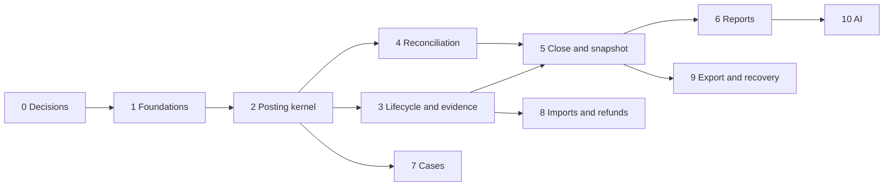

# Build plan — slices, contracts and fixtures

Date: 7 November 2026
Status: **DRAFT — proposed order of work. Stack is decided (Flutter client, Supabase, Vercel; see [stack-decision-2026-11-08.md](stack-decision-2026-11-08.md)). Where each piece of server-side code runs is proposed there, not decided. Schedule is not set.**

This turns the implementation sequence in section 5 of [the readiness addendum](implementation-readiness-addendum-2026-10-27.md) into slices. For each slice it names the contracts that must be settled first, the fixtures in [`test-vectors/`](test-vectors/README.md) that the slice must pass, and the human inputs it needs. "Draft EC" means a design in [the EC draft](engineering-contracts-draft-2026-11-07.md) that the implementation designer has not approved.

## Slice 0 — decisions before any code

| Decision | Who | Why it comes first |
|---|---|---|
| ~~Technology stack and hosting vendor~~ **Decided 2026-11-08: Flutter client, Supabase, Vercel.** Still open: the split of server-side code (Postgres functions, Edge Functions, Vercel functions), the backup-dump job, and how evidence files are backed up | You, with the implementation designer | See the stack decision. The split shapes slices 1, 5, 6 and 9 |
| Name the implementation designer (a person) | You | Owns EC01–EC08 approval |
| Approve EC06 and EC04's acknowledgement rule | Implementation designer | They shape the posting kernel and storage layout. The addendum asks for both early |
| EC01 lock style (row locks or serializable isolation) | Implementation designer | Used by slices 2, 4 and 7 |

## Slices

| # | Slice | Contracts it needs | Fixtures it must pass | Human inputs |
|---|---|---|---|---|
| 1 | **Foundations:** workspace and tenant, authentication, capability checks (workspace close capability vs Fund-only roles), Accounts, Funds, Scopes, audit log, idempotency records, master publication from the 289-row derivation with the B113 override and `allowed_effect_kinds` | S 3, D11, RD07 grant path, RD13 fiscal start, RD10 (immutable rows) | B23, B33, B34; catalog checks in `design-analysis-checks-2026-10-19.json` | Church identity, timezone, authorization source (RD07), `allowed_effect_kinds` on rows that need CUSTODY |
| 2 | **Posting kernel:** opening batch, owned receipt, direct expense, Account and Fund transfers, typed voucher series, period gate, per-Fund assertion, durable acknowledgement | S 4.1–4.2, E052, E053, E059, RD05, RD13; EC06 and the EC04 acknowledgement rule (draft EC) | A01–A03, A05, A06, B08–B10, B22, B24–B26 | Opening schedules, Account and Fund list |
| 3 | **Lifecycle, approval and evidence:** draft, review, finalize, redate, external declaration, evidence statuses including `REJECTED`, version resolution by business date | S 5.1–5.3, RD06, RD09, EC07 (draft EC) | B06, B07, B27, B28 | Approval thresholds and evidence policy, if the church uses them |
| 4 | **Reconciliation:** statement observations, match groups, unconsumed amounts, timing items | S 6.3, EC01 (draft EC) | None yet: write RC11 fixtures first | Statement formats, cash-count procedure |
| 5 | **Close and snapshot:** chronological close, blockers, readiness attestation and waiver, closer's confirmation, snapshot with Party IDs, incident record, close archive | S 5.5, 6.4, RD01, RD08, RD09, RD11 (snapshot part), RD12; EC04 close archive (draft EC) | B01–B05, B15–B18, B29–B31 | Pilot Treasurer accepts the RD08 consequence before any production close |
| 6 | **Reports and restricted views:** F01–F14, reviewed default template, Fund-slice representation on every surface | S 7–8, 11, RD02, RD03, RC01–RC16 | A04, B11, B19–B21, B32, A01 (RC10) | Officer accepts the default template; sample PDF and Excel review |
| 7 | **Advances, transit, reimbursements:** case recipes, expense items, money components | S 4.2, 5.4, RD10, EC01–EC03 (draft EC) | A05, A06, B09, B12–B14 | Beneficiaries, allocation formulas, due dates |
| 8 | **Imports and refunds:** staged import with idempotency, refund and donor-return events | S 6.2, RC15; RD04 table once approved | B35, B36, A07 (PROPOSED: wait for approval) | RD04 table approved by the product owner |
| 9 | **Export and recovery:** portable export, restore drill | S 13, EC04, EC05 (draft EC) | None yet: write the EC04 drill and EC05 cases first | Supabase PITR add-on, a Vercel Blob store for close archives, the scheduled encrypted dump job |
| 10 | **AI assistance (optional):** extraction and suggestions with pinned models, ZDR, cap reservation | S 12, E049, E050, EC08 (draft EC) | None yet: write EC08 cases first | Reviewed price and IDR rate per policy version |

Slices 1 to 5, plus a basic report and export from slice 6, are the "first complete finance path" milestone in the addendum. Slices 7 to 10 expand it.

## Gaps to close before the slice that needs them

- **No fixtures yet** for reconciliation (RC11), evidence statuses and `REJECTED` (EC07), approval declarations, import idempotency (RC15), concurrency (EC01, EC02), export (EC05), the EC04 restore drill and the EC08 cap. Write each set before its slice starts, from the acceptance cases in the EC draft.
- **Open product conditions** that block production use, not coding: a paid Supabase plan with the PITR add-on before any real church ledger is stored (the Free plan has no backups and pauses idle projects), counsel's view and PDF retention (RD11), the church's 1 January confirmation (RD13), the pilot Treasurer's acceptance (RD08), the church-named authorization source (RD07), the officer's template acceptance (RD03), approval of the RD04 table.
- **Unconfirmed readings:** RD10's unset-value rule and its publication-time consequence, and the RD13 voucher-skip residual. Both are written up in the addendum.

## Order inside the chain

