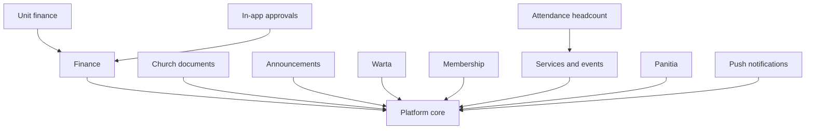
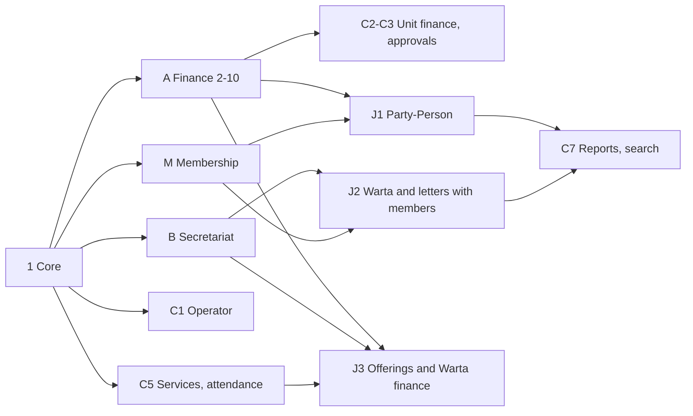

# Platform module plan — Treasurer-first or Secretary-first

Date: 17 November 2026
Status: **DRAFT.** The decisions in section 2 are made by the user, acting as product owner, on 17 and 18 November 2026. Everything else is proposed. Labels in the tables: **Source** means the rule is already in P or S; **Decided** means section 2; **Proposed** means this plan suggests it; **Undefined** means no document covers it and someone must decide.

References: [P: MVP specification v5.0](GMIM_Treasurer_MVP_Design_Specification_and_Rulebook_v5.0.md), [S: engineering specification v2.0](GMIM_Treasurer_Domain_Model_Posting_Rules_State_Machines_and_Report_Pack_Data_Mapping_v2.0.md), [build plan](build-plan-2026-11-07.md), [stack decision](stack-decision-2026-11-08.md), [UI/UX brief v2](ui-ux-design-brief-v2.md).

## 1. Why this plan exists

P plans one adoption path: the Treasurer first, then Operator, unit treasurers, approvers and finally the full platform (P 1.2). The wider platform appears only as rules (P 14, rulebook AH–BB), with no domain records, screens or build order.

This plan does three things:

1. Splits the platform into a **shared core** and **modules** that can be switched on per church.
2. Makes two **entry modules** usable by one person alone: Finance (Bendahara) and Secretariat (Sekretaris). A church may start with either, run only one for as long as it likes, and add the other later without re-entering data. Membership (members and their Penatua Kolom) can be added after either.
3. Puts every module in a build order, so each one is built and tested before a church needs it, and switched on only when that church's people are ready.

Treasurer-first stays the strategy for the Finance module (rule 753), and Finance is built first (DL9). The only Treasurer V1 rule this plan changes is who may act on a vacant Bendahara post (DL12).

## 2. Decision log — 17 and 18 November 2026

Decided by the user, acting as product owner. DL12 and DL13 were revised later the same day; the table holds the final wording.

| # | Decision |
|---|---|
| DL1 | The platform is modular. A church can start with the Treasurer or with the Secretary and add other roles later. |
| DL2 | The **Sekretaris Jemaat** publishes the Warta Jemaat, publishes church-wide documents, and maintains the documents of the whole church. |
| DL3 | Church-wide documents include: decisions and circulars (SK BPMJ, surat edaran, decisions of church meetings and synods); meeting minutes; church rules and liturgy (tata gereja, regulations, tata ibadah); and letters issued to one member on request (atestasi, surat keterangan). |
| DL4 | The Secretary is the Warta editor, reviewer and approver. |
| DL5 | The Secretary alone may reveal a member's masked name in the Warta, for a stated necessity, with a reason and an audit record. **This amends approved rule 634** ("ordinary editors cannot independently perform protected identity overrides") for the Secretary. Rules 633 and 635–638 still apply: necessity, reason, authority, audit and informing the member. |
| DL6 | The member registry is kept by members and their Penatua Kolom. Members submit their own data and life events; their own Penatua Kolom verifies. An Operator handles exceptions, such as members without a phone. |
| DL7 | Consent under Indonesia's personal data law (UU PDP) is declared by the person when they apply to become a member. |
| DL8 | Existing members from the church's paper book are imported by an Operator as **unconfirmed** records, visible only to their Penatua Kolom and the Operator. Each household confirms its data and gives consent in the app, or on a signed paper form the Penatua uploads. Nothing about an unconfirmed person is published. |
| DL9 | Finance (the Bendahara) is built first. |
| DL10 | The Secretary's appointment is verified like the Treasurer's (RD07): a written church authorization, checked by the onboarding reviewer, then an audited grant. |
| DL11 | A service is approved by the Penatua or Syamas of the Kolom or BIPRA that is its audience. Jemaat-wide services (Sunday worship, Natal, Paskah) and Panitia events are approved by the **Ketua Jemaat**; when there is no Ketua Jemaat, by the Secretary or someone appointed. |
| DL12 | **An Operator may take over any vacant post, including the Bendahara.** This amends, for vacancies: RD07 (financial capability only from a verified written church authorization), rule 481 (Operator does not approve financial activity), rule 563 (no automatic replacement leadership), rule 566 (financial access does not pass to another person on death) and the matching text in P 14.2 and 14.5. Maker/checker still needs two distinct people (round 3C). |
| DL13 | **A member may withdraw consent and ask for their data to be deleted; the member is then deleted.** This amends rule 725 (member records use lifecycle status, not deletion) and P 14.11 for living members. Their finance records keep the name as recorded, as part of the church's bookkeeping. Warta editions and church documents already published stay exactly as published (rules 612, 643). |
| DL14 | Announcements (D4, which the user asked this plan to decide): the Secretary writes and publishes; an Operator may draft. Lifecycle `DRAFT → PUBLISHED → ARCHIVED`, with no review step because the Secretary is the only approver (as DL4). Each announcement has an audience (all members, officers, or one unit) and an optional end date, after which it archives itself. A correction is a new revision (rule 723). |
| DL15 | A donor the Treasurer recorded who is not linked to any member appears in the Warta with the name as recorded (D8). |
| DL16 | Inventory is left out for now (D9). A Panitia's remaining assets (rule 521) are handed over by a church document recording the approved owner or destination. |
| DL17 | Komisi is a standing organizational unit type, a permanent work unit such as Komisi Diakonia or Pembangunan, with its own officers and, if the church wants, its own Fund (D11). |
| DL18 | Baptism, Sidi and Marriage are recorded as Membership life events: the member submits, their Penatua Kolom verifies (D12). The service itself stays in Services and events. |
| DL19 | The Ketua Jemaat is a BPMJ position the church assigns, usually the Pendeta. The church sets its other capabilities per position, such as approving Church Fund requests once in-app approvals are on (D13). |
| DL20 | Push notifications use Firebase Cloud Messaging, sent from a Supabase Edge Function so the server key stays off the phone. This adds Firebase to the stack, for push only (D14). |
| DL21 | The **authorized church officer** records every role assignment. The developer assigns the authorized church officer at onboarding. The Treasurer and Secretary still also go through the onboarding reviewer (RD07, DL10). |
| DL22 | An Operator's appointment is recorded by the authorized church officer like any other role, with no onboarding-reviewer check. |
| DL23 | A Penatua Kolom sees full data for the members and households of their own Kolom, plus transfer requests into it, and nothing else beyond what is published. |
| DL24 | The Secretary can read the whole member registry but cannot change it. |
| DL25 | An Operator can see everything in every module, including all finance records and bank statements. |
| DL26 | A unit treasurer (Bendahara Kolom, BIPRA, Komisi or Panitia) finalizes transactions in their own Fund. The church Bendahara still closes the month. |
| DL27 | The authorized church officer creates a Panitia and moves it through its stages. The church Bendahara approves where its leftover money goes. |
| DL28 | A member's BIPRA is worked out from birth date, sex and marital status, using age limits the church sets. It changes by itself on birthdays and marriages, and the Penatua Kolom can correct an individual case. |
| DL29 | In-app approvers come from the approval table in each church's configuration. Until a church fills it, the Ketua Jemaat approves Church Fund requests and a unit's Ketua approves that unit's Fund requests. Below a threshold the church sets, no approval is needed. |
| DL30 | Whoever approves a service assigns its attendance counters, reviews the count and finalizes it. Counters can only count. |
| DL31 | The Sekretaris BPMJ and Bendahara BPMJ are the Sekretaris Jemaat and Bendahara Jemaat. A church can give each role to whichever person it chooses. |
| DL32 | *(18 November 2026, EC09 P1)* A unit treasurer finalizes only on Accounts their unit operates. Movements on a church-operated Account, even of unit money, are finalized by the church Bendahara. |
| DL33 | *(18 November 2026, EC09 P2)* The church Bendahara may clear a unit's blockers before close: cancel or redate its open draft, and confirm its unit-operated Account's reconciliation from the unit's recorded observations. Each action needs a reason and notifies the unit. |

**Risks accepted with these decisions.**
- **A path to Bendahara powers without a verified church document.** Together, DL12, DL21 and DL22 let someone reach the Bendahara's finalize and close powers without a verified written church authorization: the developer assigns the authorized church officer, the officer records an Operator, and the Operator covers a vacant Bendahara post. RD07 now protects the person who holds the Treasurer post, not whoever covers it.
- **Operators see everything.** DL25 lets every Operator see all finance records, bank statements and members' full identities, including members who chose masking.
- **Unit finalization is not yet specified.** DL26 lets unit treasurers finalize, but the posting rules for it are not written yet (D17).

## 3. Constraints carried from the source documents

- One person has one account and may hold several scoped roles at once. Permissions come from role + scope + delegation + workflow rules + active period (P 14.1, rules 463–469).
- Organizational units (Jemaat, Kolom, BIPRA, Komisi, Panitia, custom) use one generic model (rules 456–462).
- Technical administration is not church or financial authority (rules 146–148, 472). The developer's only church-facing act is assigning the authorized church officer (DL21).
- Operators reduce clerical work (P 14.2, rules 473–485). DL12 adds an exception: an Operator may act on a vacant post. DL25 lets Operators see everything.
- Self-service is not self-approval (rule 527). Member submissions are not authoritative until verified (rule 526).
- One application and one transactional database. No general workflow builder, no event-store platform (S 3).
- Flutter client on Supabase and Vercel, plus Firebase for push (DL20). Authority runs in Postgres functions and row-level security, never in the client (stack decision).
- History is not rewritten: revision instead of replacement, reversal instead of editing (rules 722–730). DL13 makes member deletion the one exception.

## 4. Shape: one core, many modules

**Module rule (Proposed):** a module depends on the core and on the modules its arrow points to, nothing else. It reads another module only through that module's published functions or views, never its tables, and it keeps working when an optional neighbor is switched off. Warta, documents, reports and search read from whichever source modules are active.

In code: one Postgres schema per module (`core`, `finance`, `documents`, `membership`, …) and one Flutter feature package per module. The app builds its navigation from the active modules and the user's capabilities.

## 5. Platform core

Every module uses these. They belong in build-plan slice 1 (Foundations), so a Treasurer-first church already has them and nothing needs rework when the Secretary or members join.

| Core part | What it holds | Source |
|---|---|---|
| Workspace and tenant | Church identity, timezone, fiscal settings, policy versions | S 3 Workspace |
| Person | Minimal identity: name, status (`UNCONFIRMED`, `ACTIVE`, `DECEASED`, …), optional login link. Membership adds the member profile; Finance keeps counterparties as `Party` with an optional link to a Person | Proposed. S 3 Party already has an "optional member link"; `UNCONFIRMED` from DL8 |
| Login account | One per person; Supabase Auth | P 14.1, stack decision |
| Organizational unit | The existing `Scope` record: type, name, parent, effective dates, status. Types: Jemaat, Kolom, BIPRA, Komisi, Panitia, custom | S 3 Scope, rules 456–462; Komisi DL17 |
| Role assignment | Person, role, scope, start date, end date, status. Recorded by the authorized church officer, whom the developer assigns at onboarding (DL21). A post with no active holder is **vacant** | P 14.1, rules 465–468; DL21 |
| Capability catalog and check | Each module registers its capabilities. One database function answers "may this person do this, in this scope, at this time", counting active period, scope ancestry, delegation, vacancy cover (DL12) and whether the module is active | Proposed, from P 14.1 |
| Delegation | Actor, acting role, scope, on behalf of, start, end; expires automatically | P 14.2, rules 486–494 |
| Vacancy cover | While a post is vacant, an Operator may act in it. Each action is audited as "acting for vacant post"; the cover ends when a holder is assigned | DL12; audit and ending Proposed |
| Church authorization grant | `AuthorityGrant` from RD07, widened to cover the Secretary as well as the Treasurer | S 3 AuthorityGrant; DL10 |
| Module registry | Per workspace: module, status (`OFF`, `ACTIVE`, `READ_ONLY`), who switched it and when, config version | Proposed |
| Audit | Actor, acting role, scope, delegation or vacancy cover, before and after, reason, time | S 3 AuditRecord, rules 707–721 |
| Files | One private store with an access decision per linked record: finance evidence, church documents, consent forms, Warta PDFs | Proposed, from S 13 |
| Notifications | One outbox and inbox every module writes to; realtime in-app through Supabase, push through Firebase Cloud Messaging | P 14.10, rules 691–706; DL20 |
| Export | Church-owned export covering every active or retired module | S 13, rule 771 |

**Not in the core:** approvals and reviews. Each module keeps its own state machine (finance approval, membership verification, Warta publishing, attendance finalization). They share only the capability check and audit. This follows S 3's ban on a general workflow builder.

## 6. Module catalog

| Module | Indonesian label | What it does | First user | Needs | Rules | Specification status |
|---|---|---|---|---|---|---|
| Finance | Keuangan | Treasurer V1: capture, evidence, classification, external approvals, reconciliation, close, GMIM Report Pack, optional AI | Bendahara | Core | P 2–13; S | Specified (S, EC drafts, fixtures) |
| Unit finance | Keuangan unit | Bendahara Kolom, BIPRA, Komisi and Panitia record and finalize transactions in their own Funds (DL26); Fund-only views; readiness attestation; the church Bendahara closes | Unit treasurers | Finance | P 1.2 level 3, 14.3; AK; RD02, RD12; DL26 | Restricted views and RD12 decided; unit-finalization rules (D17) and unit screens not written |
| In-app approvals | Persetujuan di aplikasi | `IN_APP` approval mode. Church Fund flow: Request → Treasurer review → BPMJ approval → payment → evidence. Maker/checker with distinct humans | BPMJ positions (including the Ketua Jemaat), Penatua, Syamas, unit leaders | Finance | P 6.2, 14.3; I, J; S 5.2; DL19, DL29 | State machine in S 5.2; approvers come from the church's configuration table, with defaults (DL29); no screens |
| Church documents | Dokumen gereja | The church's document archive: decisions and circulars, meeting minutes, rules and liturgy. Publishing to a chosen audience. Letters issued to members on request (atestasi, surat keterangan). Panitia asset handovers | Sekretaris | Core; uses Membership when on | DL2, DL3, DL16; rule 723 (revision, not replacement) | Decided scope; records and screens to write. Out of V1 (the UI brief excludes a document system from the Treasurer V1) |
| Announcements | Pengumuman | Announcements as records of their own, reused by Warta | Sekretaris | Core | P 14.6; rule 604; DL14 | Owner and lifecycle decided; records to write |
| Warta | Warta jemaat | Publication built from active sources, with mandatory masking, PDF and print. The Secretary edits, reviews, approves and publishes | Sekretaris | Core; reads Announcements, Services, Attendance, Membership, Finance when on | P 14.6–14.7; AS, AT; S 13; DL4, DL5, DL15 | Roles decided; template to write |
| Membership | Data jemaat | Membership application with UU PDP consent; persons, households, Kolom membership, BIPRA worked out automatically (DL28); life events (birth, Baptism, Sidi, Marriage, Kolom movement, transfer in and out, temporary relocation, inactive, death); import of the paper book; masking preferences; withdrawal and deletion; duplicate handling | Members and their Penatua Kolom; Operator for import and exceptions | Core | P 14.5, 14.11; AM–AR, BA; DL6–DL8, DL12, DL13, DL18, DL23, DL28 | Owners decided; records and state machines to write |
| Services and events | Ibadah dan kegiatan | Service records: Sunday, Kolom, BIPRA, Baptism, Sidi, Marriage, Funeral, pastoral, Panitia events. No roster (deferred, P 2.2) | Penatua and Syamas of the audience's Kolom or BIPRA; Ketua Jemaat for Jemaat-wide services and Panitia events | Core; uses Membership when on | P 14.8; AU; DL11, DL12 | Approvers decided; records to write |
| Attendance | Jumlah kehadiran | Anonymous headcount per service; the service's approver assigns counters, reviews and finalizes (DL30) | Counters and the service's approver | Services | P 14.9; AV; DL30 | Rules, capability names and holders decided |
| Panitia | Panitia | Temporary unit with Ketua, Sekretaris, Bendahara, members; lifecycle to archive. The authorized church officer creates it and changes its stages; the church Bendahara approves its leftover money (DL27); remaining assets are handed over by a church document | Authorized church officer; Panitia officers | Core; Finance when it has a Fund; Church documents for the asset handover | P 14.4; AL; DL16, DL27 | Rules, lifecycle and owners decided |
| Push notifications | Notifikasi | Push through Firebase Cloud Messaging; WhatsApp, SMS and email later | Everyone | Core | P 14.10; AW; DL20 | Provider decided |
| Reports and search | Laporan dan pencarian | Cross-module reports by Jemaat, Kolom, BIPRA, Komisi, Panitia, Fund, Account; lifecycle statistics; permission-aware search | By role | Core and sources | P 14.11; AZ | Rules |

**Left out for now:** Inventory (DL16).

The **Church Operator** is a core role, not a module. What an Operator may do grows with each module the church switches on (P 14.2), and includes acting on any vacant post (DL12).

### 6.1 Flows for the newly decided modules

**Church documents.**
- Each document has a kind (decision or circular, minutes, rule or liturgy, member letter, asset handover), an audience, and revisions. The audience is chosen per document: all members, officers only, or one unit such as a Kolom, BIPRA or Komisi. A correction is a new revision; the old one stays (rule 723). (Proposed)
- A signed decision is uploaded as the signed scan. The signature lives in the document, so there is no in-app approval step. (Proposed)
- **Member letters:** a member asks in the app, or at the church office, where an Operator records the request. The Secretary issues the letter from the verified membership record and stores the signed copy. The member and the member's household can see it, and so can officers whose role covers that member. An atestasi records the letter only. The transfer itself is a Membership life event that the Penatua Kolom verifies. (Proposed)

**Announcements** (DL14): `DRAFT → PUBLISHED → ARCHIVED`. Written and published by the Secretary; drafted by an Operator if needed; each has an audience and an optional end date.

**Membership** (DL6–DL8, DL12, DL13, DL18).
- **New member:** the person applies and declares UU PDP consent (`SUBMITTED`). Their Penatua Kolom verifies (`VERIFIED`), returns it for changes, or declines. Only a verified application makes the person a member.
- **Existing member:** an Operator imports the person as `UNCONFIRMED`. The household confirms its data and consents in the app, or on a signed paper form that the Penatua uploads. The Penatua Kolom verifies, and the person becomes `ACTIVE`.
- **Consent record:** person, consent-text version, date, channel (app or paper), the scanned form where there is one, and who gave consent. For a child or dependent, a parent or guardian gives consent in the household's application (Proposed).
- **Life events** (birth, Baptism, Sidi, Marriage, death, Kolom move, transfer): the member or household submits, and the Penatua Kolom verifies (P 14.5, DL18). A Baptism, Sidi or Marriage life event may reference the service where it took place.
- **No self-verification** (rule 527): when a submission comes from the Penatua or the Penatua's household, the Syamas of the same Kolom verifies it (Proposed).
- **Vacant post** (DL12): when the Kolom has no Penatua, or has no Syamas to verify the Penatua's own household, an Operator verifies. The system routes each item by the role assignments in force, so nothing waits on an empty post.
- **Withdrawal and deletion** (DL13):
  - **Request.** A member withdraws consent and asks for deletion in the app, or at the church office, where an Operator records it. For a child, a parent or guardian asks. A request made through the member's own login is acted on directly; the Penatua Kolom confirms a paper request is genuine first. (Proposed)
  - **Deleted:** the member profile; household membership and Kolom and BIPRA history; life events; masking preferences; letters issued to them (Proposed); the login account. Their role assignments end, so any post they held becomes vacant (DL12).
  - **Kept:**
    - Finance records, with the name as recorded on the `Party` (DL13). The link from that Party to the Person is removed.
    - Published Warta editions and church documents, exactly as published (DL13).
    - Audit records, which keep the Person ID and the action, but no profile data (Proposed).
    - A deletion record holding the date, the channel and who carried it out, with no personal data, as proof that the request was honored (Proposed).
  - **Afterwards:**
    - A Party unlinked by deletion is not named in future Warta editions. The person withdrew consent, so DL15's "name as recorded" does not apply to them (Proposed).
    - Membership statistics recomputed later no longer count the person; figures already published stay as published.
  - Deceased members are not deleted (rule 550); deletion is a living member's request.

**Services and events** (DL11, DL12).
- The approver follows the service's audience: the Penatua or the Syamas of that Kolom or BIPRA (either one); the Ketua Jemaat for Jemaat-wide services (Sunday worship, Natal, Paskah) and Panitia events.
- A member-requested service (Baptism, Sidi, Marriage, Funeral) takes the member's Kolom as its audience for approval (Proposed).
- When a Kolom or BIPRA has neither a Penatua nor a Syamas, an Operator approves (DL12).
- When there is no Ketua Jemaat, the Secretary, a person appointed for it (DL11), or an Operator (DL12) approves. Proposed mechanism for "appointed": a dated delegation (rules 486–494) from the Ketua Jemaat, or from the authorized church officer when the post is vacant.
- An approver may create and schedule a service directly. The Secretary or an Operator may draft one for approval (Proposed).

**Role assignment and visibility** (DL21–DL25, DL31).
- The developer assigns the authorized church officer at onboarding. The officer records every other role assignment, including Operators. The Treasurer and Secretary also go through the onboarding reviewer (RD07, DL10).
- Proposed safeguards:
  - The officer cannot assign a role to themselves.
  - The developer works from a written church document.
  - Every assignment is audited, with the church decision attached where there is one.
- The Sekretaris and Bendahara BPMJ are the Sekretaris and Bendahara Jemaat (DL31).
- What each role sees:
  - A Penatua Kolom sees full data for their own Kolom's members and households, plus transfer requests into it, and nothing else beyond what is published (DL23).
  - The Secretary reads the whole member registry but cannot change it (DL24).
  - An Operator sees everything in every module, including finance records and bank statements (DL25).
  - Other finance roles keep the Fund-slice rules (RD02).

**Unit finalization** (DL26). Unit treasurers finalize their own Fund's transactions; the church Bendahara still closes the whole workspace (RD01). The draft rules are **EC09** in [the engineering contracts draft](engineering-contracts-draft-2026-11-07.md), with fixtures B93–B100. In short, a unit treasurer finalizes only transactions that meet all of these:
- wholly in their unit's Funds;
- on Accounts their unit operates;
- not a Fund ownership transfer, controlled opening or controlled adjustment.

Vouchers come from the one workspace series (RD13). Units reconcile their own Accounts and attest readiness (RD12). Approvals follow the church's table (DL29). The church Bendahara may clear a unit's open drafts and unconfirmed reconciliations before close, with a reason and a notice (DL33).

**Panitia** (DL27). The authorized church officer creates the Panitia from its SK and moves it through `PLANNING → ACTIVE → EVENT COMPLETED → FINANCIAL CLOSING → CLOSED → ARCHIVED`. The church Bendahara approves where the leftover money goes; remaining assets are handed over by a church document (DL16). Proposed: the officer cannot move it past Financial closing while its Fund still holds money.

**BIPRA** (DL28). Worked out from birth date, sex and marital status, using age limits the church sets. A member moves to the next BIPRA by themselves on a birthday or a recorded marriage (DL18), and the Penatua Kolom may correct an individual case.

**In-app approvals** (DL29). Each church fills the approval table in its configuration. Until it does, the Ketua Jemaat approves Church Fund requests and a unit's Ketua approves that unit's Fund requests. A Kolom has no Ketua post, so its Penatua does (Proposed). Below a threshold the church sets, no approval is needed.

**Attendance** (DL30). Whoever approves a service assigns its counters, reviews the count and finalizes it. Counters can only count.

**Vacancy cover in Finance** (DL12). An Operator covering a vacant Bendahara post holds the Treasurer's capabilities, including finalizing and the irreversible month close (D07). This is what DL12 decides. The safeguards that remain (Proposed):
- The cover exists only while the post has no active holder.
- Every covered action is audited as acting for the vacant post.
- The cover ends as soon as a new Bendahara is granted under RD07.
- When maker/checker is on, the same Operator cannot be both maker and checker.

## 7. Seams: how modules meet

These are the places where a church that started with one module must end up with the same data as one that started with another.

| Seam | One side alone | The other side alone | When both are on |
|---|---|---|---|
| People (Finance and Membership) | Finance: counterparties are `Party` records; no membership needed (S 3) | Membership: members are `Person` records with a member profile | An officer links a Party to a Person. The system suggests matches; a human confirms. Snapshots hold Party IDs, so past reports do not change (RD11). Deleting a member removes the link; the Party keeps the name (DL13) |
| Organizational units | Treasurer creates the Kolom, BIPRA, Komisi and Panitia scopes the Funds need | Secretary or Operator creates them | Same core records. Nothing is copied or merged |
| Who can read published material (Secretariat and Membership) | Secretariat without Membership: Warta, documents and announcements reach officers in the app, and everyone else as PDF or print | Membership without Secretariat: members have accounts but nothing is published to them | Members see published Warta (rule 610), documents and announcements for their audience in the app |
| Member letters (Documents and Membership) | Without Membership: the Secretary types the member's details into the letter | — | The letter is filled from the verified membership record |
| Names in Warta (Warta and Membership) | Without Membership: no member preferences exist, so the Warta names no individual members | — | Masking comes from each member's choice. Only the Secretary may reveal, with a reason and an audit record (DL5) |
| Donor names in Warta (Warta and Finance) | — | — | A donor Party linked to a member follows that member's masking. An unlinked Party appears with the name as recorded (DL15), except a Party unlinked by deletion, which is not named (Proposed) |
| Sacraments (Services and Membership) | Services without Membership: the service holds the names typed in | Membership without Services: the life event stands alone | The life event may reference the service (DL18) |
| Offerings and services | Finance: an offering has a date and a description | Services: a service has no money | An offering may reference the service record (S 13) |
| Warta finance section | — | — | A finance excerpt is bound to a closed report snapshot and an approved narrative (S 13) |
| Lifecycle and authority | Treasurer replacement follows RD07; an Operator may cover meanwhile (DL12) | Death, transfer or deletion ends role assignments in the core | Same, and finance approval authority is removed and pending items rerouted (P 14.5) |
| Notifications and search | Each module's own items | — | One inbox and one search, filtered by each module's permissions |

## 8. Switching modules on and off

Proposed rules:

1. A module is switched on per workspace. Switching on checks that its dependencies are active and its required church values are filled in.
2. A role can be granted only for an active module. Its capabilities come from that module.
3. Switching a module off never deletes data. It becomes `READ_ONLY` for people who held view capabilities, and stays in the church export. Only a member's deletion request deletes data (DL13).
4. Navigation, notifications and search show only active modules the user has capabilities for.
5. **Solo rule for both entry modules.** P 1.2 says no daily finance flow may need another church user. The same holds for the Secretariat: a lone Secretary can keep the document archive, issue member letters, publish announcements and publish the Warta without any other user (DL4, DL14).
6. Built is not the same as ready. Each module still needs its church values and acceptance checks before it goes live, as Finance does (addendum 5).

## 9. Adoption paths

P 1.2's five levels become three tracks. A church starts with Finance or the Secretariat, adds the other whenever it wants, and adds Membership once its Penatua are ready.

**Finance track** (P 1.2 levels 1–4, unchanged)

| Step | Who joins | Modules |
|---|---|---|
| F1 | Bendahara alone | Core, Finance |
| F2 | Operator or finance assistant | No new module; Operator role |
| F3 | Bendahara Kolom, BIPRA, Komisi, Panitia | Unit finance, Panitia |
| F4 | Approvers | In-app approvals |

**Secretariat track**

| Step | Who joins | Modules |
|---|---|---|
| S1 | Sekretaris alone: document archive, publishing, member letters, announcements, Warta | Core, Church documents, Announcements, Warta |
| S2 | Operator, for filing and letter requests at the office | No new module; Operator role |

**Membership track** (after either entry track, or alone if the church wants)

| Step | Who joins | Modules |
|---|---|---|
| M1 | Operator imports the paper book; Penatua Kolom verify; households confirm and consent | Membership |
| M2 | Members apply, submit life events, choose their masking, and may withdraw and ask for deletion; Penatua Kolom verify | Membership (member accounts) |

**Joining the tracks:** when a second track starts, run the seam steps in section 7: link Parties to Persons, fill letters from member records, open published material to members in the app, start linking offerings to services, and turn on Warta's finance section. Services and events (once the Penatua, Syamas and Ketua Jemaat have accounts), attendance, push notifications, and reports and search can be added at any point. P's level 5 ("full church platform") is every track active.

## 10. Roles

| Role | Indonesian label | Module | Can | Cannot | Status |
|---|---|---|---|---|---|
| System administrator | Pengelola teknis | Core | Technical administration | Act as Treasurer, Secretary or approver | Source |
| Onboarding reviewer | Petugas verifikasi | Core | Verify a church's written appointment before a role gets its authority | Grant authority from technical access alone | Source for the Treasurer (RD07); Decided for the Secretary (DL10) |
| Authorized church officer | Pimpinan Jemaat yang berwenang | Core, Panitia | Supply church values; accept report templates; record every role assignment (DL21); create a Panitia and change its stages (DL27); appoint a substitute for a vacant Ketua Jemaat | Assign a role to themselves (Proposed) | Source; DL21 and DL27 Decided; assigned by the developer at onboarding; substitute Proposed |
| Church Operator | Operator | Core | Prepare drafts, upload documents, record letter and deletion requests, import the paper member book, enter paper forms for members without a phone, in active modules; **act on any vacant post, including the Bendahara**; **see everything in every module** (DL25) | Appoint leaders or manage permissions; be both maker and checker | Source; membership duties Decided (DL6, DL8); vacancy cover Decided (DL12); appointment recorded by the officer with no verification (DL22) |
| Delegate | — | Core | Act for someone within a dated, scoped delegation | Receive governance authority through administrative delegation | Source |
| Bendahara Jemaat (the Bendahara BPMJ, DL31) | Bendahara | Finance | The full Treasurer workflow; approve where a Panitia's leftover money goes (DL27) | Change a CLOSED month; bypass maker/checker | Source; DL27, DL31 |
| Checker | Pemeriksa kedua | Finance | Be the distinct second person when maker/checker is on | Be the maker under another role | Source |
| Exception authority | Pemberi pengecualian | Finance | Accept missing evidence with a reason | Act beyond the configured authority | Source |
| Fund-only viewer | Akses terbatas | Finance | See their Fund's slice | See other Funds, whole vouchers, statements | Source |
| Unit treasurer | Bendahara Kolom, BIPRA, Komisi, Panitia | Unit finance | Record and finalize transactions in their own Fund; attest readiness | Close the workspace; finalize in another Fund | Decided (DL26); rules to write (D17); screens Undefined |
| In-app approver | BPMJ positions, Penatua, Syamas, unit leaders | In-app approvals | Approve requests in their scope | Approve their own request under another role | Source; the church's table decides who approves what, with defaults (DL29) |
| External approver | — | Finance | Be named on a declaration | Log in | Source |
| Sekretaris Jemaat (the Sekretaris BPMJ, DL31) | Sekretaris | Church documents, Announcements, Warta | Read the whole member registry (DL24); keep the church's document archive; publish documents to a chosen audience; issue member letters; publish announcements; edit, review, approve and publish the Warta; reveal a masked name with a reason and audit; approve services when there is no Ketua Jemaat (DL11) | Finance capabilities; change or verify member data | Decided (DL2–DL5, DL10, DL11, DL14, DL24, DL31) |
| Penatua Kolom | Penatua | Membership, Services | Verify applications, data changes and life events (including Baptism, Sidi, Marriage) of members in their Kolom; confirm paper deletion requests; upload signed consent forms; approve services for their Kolom; see full data for their own Kolom only (DL23); correct a member's BIPRA (DL28); assign counters and finalize attendance for services they approve (DL30) | Verify their own or their household's submission; see other Kolom's member data | Decided (DL6, DL11, DL18, DL23, DL28, DL30); self-verification and paper-request rules Proposed |
| Syamas Kolom | Syamas | Membership, Services | Approve services for their Kolom and assign counters and finalize attendance for them (Decided, DL11, DL30); verify submissions from their Kolom's Penatua and that Penatua's household (Proposed) | — | Decided and Proposed |
| Penatua and Syamas BIPRA | Penatua, Syamas | Services, Attendance | Approve services for their BIPRA; assign counters and finalize attendance for those services | — | Decided (DL11, DL30) |
| Ketua Jemaat | Ketua Jemaat | Services; In-app approvals when on | Approve Jemaat-wide services and Panitia events, and assign counters and finalize attendance for them (DL30); approve Church Fund requests until the church fills its approval table (DL29); appoint a substitute by dated delegation; other capabilities the church sets for the position | — | Decided (DL11, DL19, DL29, DL30) |
| Attendance counter | — | Attendance | `attendance.count` for the services they are assigned to | Review or finalize | Source; assigned by the service's approver, who holds `.review`, `.finalize`, `.correct` and `.assign_counter` (DL30) |
| Member | Anggota jemaat | Membership | Apply with UU PDP consent; submit own data and life events; set and preview masking; request letters; read published Warta, documents and announcements for their audience; withdraw consent and ask for deletion | Verify own submissions | Source; application, consent and deletion Decided (DL7, DL13) |
| Household representative | — | Membership | Submit for the household, such as a birth; confirm imported household data; consent for children and ask for a child's deletion | Verify | Source that "parents or household may submit"; the role is Proposed |
| Panitia Ketua, Sekretaris, Bendahara, member | — | Panitia | Run their committee within its lifecycle. The Panitia Bendahara finalizes in the Panitia Fund (DL26); the Panitia Ketua approves that Fund's requests until the church fills its approval table (DL29) | Change the Panitia's stage (the officer does, DL27); keep financial activity after CLOSED | Source; DL26, DL27, DL29 |

## 11. Capabilities

Proposed naming follows P 14.9's `attendance.count` style: `<module>.<action>`, for example `finance.finalize`, `finance.close`, `documents.publish`, `documents.issue_letter`, `announcements.publish`, `warta.publish`, `warta.reveal_identity`, `membership.verify`, `membership.delete`, `services.approve`.

- Each module registers its capability list when it is built. A capability can be granted only while its module is active.
- Roles are bundles of capabilities set per church, so "BPMJ Sekretaris" and "BPMJ Bendahara" can differ (rule 471).
- The core check covers role, scope, period, delegation, vacancy cover and module status. Workflow rules (maker/checker, no self-approval or self-verification, distinct humans) are checked inside each module's command, because they depend on the record being acted on.
- The full capability matrix per role is still engineering work (P 14.1). Write each module's matrix as part of its specification, before its code.

## 12. Build order

Slice 1 of the build plan becomes the platform core in section 5. Then:

| Track | Slices | Notes |
|---|---|---|
| A — Finance | Build plan slices 2–10, unchanged; vacancy cover (DL12) is part of slice 1 | The Treasurer pilot path |
| B — Secretariat | B1 Church document archive and publishing · B2 Announcements and Warta (without member data) · B3 Member letters | B1–B2 make Secretary-first usable (step S1); B3 works with typed details until Membership is on |
| M — Membership | M1 Registry, households, consent records, paper-book import, Penatua verification · M2 Member accounts, applications, life events, masking preferences, withdrawal and deletion | M1 needs only the core |
| C — Collaboration | C1 Operator and delegation screens · C2 Unit finance · C3 In-app approvals · C4 Panitia lifecycle · C5 Services and events, Attendance · C6 Push notifications (Firebase) · C7 Cross-module reports, search, duplicate handling | C2 and C3 need A, and C2 needs D17 first; C4's asset handover needs B1; C7 needs A, B and M |
| J — Join | J1 Party-to-Person linking · J2 Warta member content and masking, letters from member records · J3 Offering-to-service link, Warta finance section | J1 needs A and M; J2 needs B and M; J3 needs A, B and C5 |

**Order:** Finance is built first (DL9): Core → Finance A2–A6, after which the pilot Treasurer can start. Recommended after that: Secretariat B1–B2 (a church can then start Secretary-first) → Membership M1 → joins and the rest. Tracks A, B and M share nothing but the core, so a second developer could start B or M without slowing A.

## 13. Specification work before each module's code

Finance has P, S, EC drafts, fixtures and a UI brief. Every other module has rules or decisions only. Before a module's first slice, write the same layers for it, scaled to its size:

| Layer | Finance | Other modules |
|---|---|---|
| Domain records and constraints | S 3 | To write: Document, DocumentRevision, LetterRequest, Announcement, WartaEdition, IdentityReveal, MemberProfile, Household, MembershipApplication, ConsentRecord, DeletionRecord, MembershipAssignment, LifeEvent, Service, AttendanceCount; VacancyCover in the core |
| State machines | S 5 | Lifecycles exist for Panitia, Warta, Services, Attendance and Announcements. Section 6.1 sets out membership application, import confirmation, withdrawal and deletion, and letter requests; write them out |
| Capability matrix | Partly, in the UI brief's role table | To write, per module |
| Screens | UI brief | To write, per module |
| Acceptance fixtures | `test-vectors/` | To write. Cover at least: masking precedence and Secretary reveal audit; unconfirmed members never published; Penatua cannot verify own household; vacant posts route to an Operator, the cover is audited and ends when a holder is assigned; an Operator covering the Bendahara cannot also be the checker; service approval follows the audience; the officer cannot assign their own role; a Penatua sees only their own Kolom; a unit treasurer cannot finalize outside their Fund; BIPRA moves on a birthday and a recorded marriage; deletion keeps finance names and published editions, and a deleted member's Party is not named in later Warta; life-event authority revocation; headcount de-duplication |
| Church values | Configuration template | To add per module: Kolom and BIPRA to Penatua and Syamas mapping, who the Ketua Jemaat is and the position's capabilities, consent text version, document kinds and default audiences, masking defaults |

## 14. Open decisions

Resolved on 17 November 2026: D1–D9 and D11–D16, plus the role questions that became DL21–DL31. They are in section 2.

| # | Decision | Recommendation | Owner | Blocks |
|---|---|---|---|---|
| D10 | Capability matrix per role, per module (the user chose to leave this to the designer) | Write with each module's specification, from DL1–DL31 | Implementation designer | Each module |
| D17 | Unit finalization rules (DL26): what a unit treasurer may finalize when a transaction touches several Funds or a shared Account, voucher series, maker/checker | Drafted on 18 November 2026 as EC09 in the engineering contracts draft, with fixtures B93–B100. Its product questions are answered (DL32, DL33) and are in S and P. Next: the designer decides the `operator_scope` field and approves the rest of EC09, which then moves to S | Implementation designer | C2 |

RD11's open parts (Finance Parties, generated PDF retention, pseudonymization) stay tracked in the [readiness addendum](implementation-readiness-addendum-2026-10-27.md).

## 15. What this plan does not change, and what it amends

Unchanged:
- Treasurer V1 scope and build slices 2–10.
- The deferrals in P 2.2: budgeting, procurement and service rosters stay out.
- Attendance stays anonymous headcount only (P 14.9).
- Mask by request, reveal by exception, audit every exception (P 14.7). DL5 changes only who may reveal.

**Applied to P on 17 November 2026:** sections 1.1, 1.2, 6.2 and 14 (with new 14.12); amended rules M148, M481, M563, M566, M634, M725 and M753; added rules M776–M806 in subsection BC. See P 0.4.

**Applied to the other documents on 17 November 2026:**
- S: a "Product-owner decisions — 17 November 2026" register in section 1; amended text in sections 1–3, 13 and 14; E043 amended; E061–E063 added; three acceptance cases in section 15.
- The readiness addendum's RD07 entry (DL10, DL12).
- The stack decision: Firebase Cloud Messaging for push (DL20).

**DL21–DL31 applied the same day:**
- P: 1.2, 6.2, 14.1–14.5, 14.9 and 14.12; M472 and M484 amended; M807–M822 added.
- S: register rows; 5.1, 5.2, 12 and 13; E064–E066 added; three acceptance cases.
- The readiness addendum's RD07 entry.

**DL32–DL33 applied on 18 November 2026:**
- P: 1.2 and 14.3; M823–M824 added.
- S: register rows; 5.1, 6.4 and 13; E066 amended; E067 added; acceptance cases.

The rest of EC09 waits for the designer.

Build-plan slice 1 already points here.
