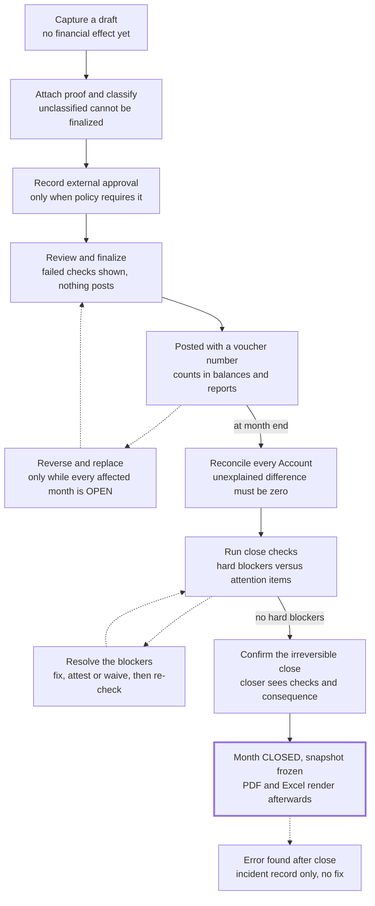

# GMIM Treasurer — UI/UX design brief

16 November 2026. This file holds the design brief and, after it, the [Indonesian UI glossary](#indonesian-ui-glossary).

We need the UI/UX design for V1 of GMIM Treasurer: the app a congregation's Bendahara uses to record church money, back it with evidence and close each month for good. Terms are defined under The product. Citations such as P 3.2, S 5.2, RD07 and EC07 point to the MVP specification, the engineering specification, the product decisions and the draft engineering contracts listed in References.

## The ask

Design the first complete finance path: a solo Treasurer sets up the church, records money, reconciles, closes one month and gets a basic report. That is build slices 1 to 5 plus a basic report and export (build plan). Everything below in this section is a proposal for the product owner to confirm.

| Deliverable | What it covers | Form |
| --- | --- | --- |
| Information architecture | Navigation, screen inventory, where each object lives, phone and web | Sitemap and navigation model. P 3.2 is a starting point, not a final menu |
| Key flows | Onboarding and opening balances; receipt, expense and transfer capture; draft to review to finalize; external approval; evidence; reverse and replace; reconciliation and cash count | Annotated flows showing every state in "States the UI must show" |
| Dashboard | Needs Attention, Cash and Bank positions, month totals, quick actions | High-fidelity phone and web frames, for an empty month and a busy one |
| Close flow | Checks, blockers versus attention items, attestation or waiver, the irreversible confirmation, incident record | Clickable prototype |
| Component set | Amount field, status badges, Mata Anggaran picker, evidence panel, attention item, approval declaration card, preview and official banners, retry state | Components that map to standard Flutter widgets |
| Report layouts | Page layouts for the GMIM Report Pack, starting with the basic report | Sample PDF and Excel pages for early officer review |

Round one lays out only the basic report, and the officer's review of it is preliminary. Formal acceptance (RD03) covers the complete default template, F01 to F14 with all eight annexes, and the first production close waits for it. Design the acceptance screen now and the full layouts in P2.

**Review, in order:**

1. The product owner checks the IA and flows against this brief and the hard rules.
2. The implementation designer checks each flow against server behavior: states, refusals and retries.
3. The pilot Treasurer walks through the prototype on a phone, with fictional data.
4. An authorized church officer reviews sample PDF and Excel output, including negative, zero and empty values.

Timeline, team names and review dates are not set (see Open questions).

## The product

GMIM Treasurer V1 is a finance workspace for the Treasurer (Bendahara) of one local GMIM congregation (Jemaat), first in Minahasa and North Sulawesi (P 1). It must be fully useful even if no other church officer ever opens it.

**The problem.** Treasurers keep the books across Excel files, notebooks, WhatsApp messages, bank screenshots and receipt folders. Every month they classify, reconcile and rebuild the GMIM reports by hand.

**The promise.** Record each transaction once, classify it, keep its proof, reconcile, and get the GMIM reports automatically (P 17.5). Success is a reliable month-end report pack built from daily records. Approvals given on paper or in meetings are recorded by the Treasurer, not given in the app.

| Term | Meaning |
| --- | --- |
| Bendahara | The church Treasurer, and the main V1 user |
| Jemaat | A local GMIM congregation. One Jemaat is one workspace, isolated from all others |
| Account | Where money physically sits: a cash box (Kas) or a bank account |
| Fund | Who owns the money and which rules apply. Several Funds can share one Account. The UI label is "Peruntukan" (see the [Indonesian UI glossary](#indonesian-ui-glossary)). Avoid "Dana", which collides with Mata Anggaran names such as DANA TRANSIT |
| Scope | The unit an activity belongs to: Jemaat, Kolom (a group within the congregation), BIPRA (the Bapa, Ibu, Pemuda, Remaja and Anak groups: men, women, youth, teens and children), Panitia (a committee). It never changes ownership |
| Mata Anggaran | The versioned code for what money was for. A classification, not a budget |
| Pendapatan, Belanja | The income tree (131 rows) and the expenditure tree (158 rows). Codes can look the same in both |
| Draft, Finalized | A draft has no financial effect. Finalizing posts it, gives it a voucher number and makes it read-only |
| Voucher (No. Bukti) | System number given at finalization: one ordinary series per calendar year, plus OPN (opening) and ADJ (adjustment). Prefix and padding are church settings |
| External approval | The Treasurer's record that someone, such as BPMJ (the congregation's executive council), approved outside the app |
| Uang Muka | A cash advance: money handed out before spending, later settled with receipts and returned change. Not an expense when issued |
| Titipan (Dana Transit) | Money held for an outside beneficiary, such as the Sinode or Wilayah, and passed on later. Owed money, never income or expense. The UI label is "Titipan"; "Dana Transit" stays only as the Mata Anggaran family name and in the fixed F01 lines |
| Sentralisasi | A contribution to a church body. From church-owned money (Milik sendiri) it is an expense (Belanja); from money held for that body (Titipan) it is a remittance (Penyaluran). Church policy decides which, never the code alone |
| OPEN, CLOSED | A month's status. CLOSED is final: no reopen and no correction |
| Cutover | The date the church starts recording in the app. Earlier history enters only as opening balances, and no report covers activity before it |
| Maker/checker | An optional church policy, off by default: a second person checks a record before it is finalized |
| Preview, Snapshot | A live, non-official report view, and the frozen official report made by closing the month |
| GMIM Report Pack | The 14 monthly reports, F01 to F14, as PDF and Excel |

Indonesian labels for these and every other UI term: [Indonesian UI glossary](#indonesian-ui-glossary), at the end of this file.

## Users and roles

Design for the solo Treasurer first: no daily finance flow (record, classify, reconcile, close, export) may need another church user or AI (P 1.2; acceptance case in P 17.3). Three V1 steps do involve another person: verifying the first Treasurer's authorization (RD07), the officer accepting the report template (RD03), and a distinct checker when the church turns maker/checker on (S 5.2).

| Role | When | Can | Cannot |
| --- | --- | --- | --- |
| Bendahara (Treasurer) | V1, main user | Set up, capture, attach evidence, verify where policy permits, record external approvals, finalize, reverse while OPEN, reconcile, close, export | Change a CLOSED month; bypass maker/checker when it is on |
| Checker | V1, off by default | Be the distinct second person when maker/checker is on | Be the maker under a second role. With no eligible checker, finalizing is blocked and the screen says who is needed |
| Onboarding reviewer | V1 | Verify the church's written authorization before the first Treasurer gets financial capability | Grant capability from technical access alone |
| Authorized church officer | V1 | Supply configuration values; accept the default report template | Not a daily user |
| Exception authority | V1, named in configuration | Accept missing evidence as an exception, with a reason | Act beyond the configured authority |
| Scoped preparer | Not settled for V1; only once they exist | Prepare drafts; attest close readiness for their own Fund | Close the workspace |
| Fund-only viewer | V1 | See their Fund's slice of vouchers, balances and reports | See other Funds, whole-voucher totals, bank statements, attachments or voucher gaps |
| System administrator | V1 | Technical administration | Act as Treasurer or approver |
| External approver, such as BPMJ | V1, recorded as data only | Be named on a declaration with role, date, method and proof | Log in, or appear to have approved inside the app |

## Platform and constraints

One Flutter app for phone and web, used by a non-technical treasurer, with the server holding all financial authority.

| Topic | What designers must know |
| --- | --- |
| Client | One Flutter app with a web build. Whether native phone builds ship is open |
| Layout | Mobile-friendly and usable by non-technical church officers (P 16 rule 19). Design phone and web together |
| Connectivity | No offline finalization. Finalizing, numbering, reconciliation and close run on the server; the app captures, reviews and displays |
| Failures | A failed save shows an unsaved state and a safe retry. A retry never creates a duplicate or a second voucher number |
| Conflicts | Show a conflict when someone else changed the record, never overwrite silently |
| Language | Domain terms and report titles are Indonesian. The UI language is not decided. Search accepts Indonesian queries such as "persembahan Minggu pagi bulan Oktober" |
| Money | Rupiah only, whole numbers, no foreign currency. The separator style is undecided: the specs write both Rp1.250.000 and Rp1,250,000 |
| Dates | The business (effective) date is in church-local time and can differ from the created, posted and document dates. The fiscal year starts 1 January, pending church confirmation |
| Periods | Calendar months, closed oldest first. The first month may be partial, starting at the cutover date |
| Codes and numbers | Mata Anggaran codes are strings of varying shape, such as 1.3.53.07.00 or 4.03.03.00. Lay out codes and voucher numbers for variable width |
| Proof | Arrives as phone photos, bank screenshots, counting sheets and messages. The free plan used while building caps a file at 50 MB; the production limit is not set |
| Privacy | Church and Scope isolation on every screen, search, file, export and AI answer. Evidence files are private |
| Design data | Fictional data only. Real church ledgers stay off the build environment, and donor and personal data are restricted |

## The monthly cycle

Each month the Treasurer records and posts money, reconciles every Account, clears the close blockers and closes the month, which freezes the official snapshot.

**Every correction happens before close; a closed month never reopens.**

Every day, while the month is OPEN:

1. Capture a draft: no financial effect yet.
2. Attach proof and classify: an unclassified item cannot be finalized.
3. Record external approval: only when policy requires it.
4. Review and finalize: failed checks are shown and nothing posts.
5. Posted with a voucher number: it counts in balances and reports.
   - Side path, reverse and replace: allowed only while every affected month is OPEN. The replacement goes back through step 4.

At month end:

6. Reconcile every Account: the unexplained difference must be zero.
7. Run close checks: hard blockers versus attention items.
   - Side path, resolve the blockers: fix, attest or waive, then run the checks again.
8. Confirm the irreversible close, once no hard blocker remains: the closer sees the checks and the consequence.
9. Month CLOSED, snapshot frozen: the PDF and Excel files render afterwards.
   - Side path, error found after close: an incident record only, never a fix.

In a solo church the Treasurer does every step. Evidence may be verified after posting, but must be verified or accepted as an exception before close; an error found after close can only be recorded.

## Screens to design

Design the P1 screens first: together they make the first complete finance path. P2 maps to build slices 6 to 8 and P3 to slices 9 and 10; this mapping is a proposal derived from the build plan.

**P1: first complete finance path**

| Screen | For | Key content and actions |
| --- | --- | --- |
| Church setup | First run of one workspace | Church identity, timezone, fiscal year start (1 January, not editable), first production month, cutover date, Accounts, Funds, Scopes |
| Mata Anggaran publication | Publish the income and expenditure masters | Review, then publish. An authorized person sets `allowed_effect_kinds` (ECONOMIC, TRANSIT or BOTH) per row; a row left empty cannot take money held for others. Published rows never change: a change is a new version from a later month |
| Treasurer authorization | Grant financial capability from a church decision (RD07) | Record the authorization naming nominee and authorizer, with evidence; reviewer verifies; audited grant. A signed-in person awaiting verification sees why nothing financial is available |
| Treasurer succession | Keep one accountable Treasurer over time (RD07) | Account recovery restores the same person; replacement needs a new authorization and ends the old Treasurer's sessions; emergency revocation is immediate and can leave no current Treasurer. A replacement inherits no approvals |
| Opening balances | Starting position at the cutover date | Per Account: verified amount and its source, split across Funds so the split equals the Account exactly, zeros included. Outstanding advances by recipient and Fund; money held for others by beneficiary. Evidence, approval, OPN voucher. Never income. Final once the first month closes |
| Dashboard | Attention-first home (P 3.2) | Needs Attention, in two groups: Perlu tindakan (drafts, missing proof, unclassified items, unmatched bank lines, open reconciliation, close blockers) and Untuk diketahui (open advances, due dates, AI unavailable). Cash and Bank positions from posted records only; month income, expense and net. Quick actions: Income, Expense, Offering, Reconcile, Generate Report |
| Months | See every month since cutover and which closes next | One row per month: OPEN or CLOSED, open blockers, and for CLOSED months the snapshot and its files. Several months can be OPEN; only the oldest OPEN month can close, so an empty month must still be closed before the next. Lists and reports need a month switcher |
| Transactions | Find and filter work | State badge, voucher, effective date, amount, Account, Fund; filter by state and month. Drafts visibly do not count |
| Receipt capture | Income, a simple offering or a donation | Account, Fund, Scope, Pendapatan row or unclassified, amount, dates, donor or anonymous, evidence; saved as a draft |
| Expense capture | A direct payment | Payee, purpose, Account, Fund, Scope, one or more Belanja lines that sum exactly to the payment, evidence, approval |
| Transfer capture | Move money between Accounts, or ownership between Funds | An Account transfer shows both sides, with any fee as a separate expense. A Fund transfer stays in one Account. Neither is income or expense |
| Transaction detail | One record's full story | State, all dates, voucher, approval, evidence status, links to original or reversal, audit history, and only the actions its state allows |
| Review and finalize | Move a draft to posted | Each failed check with its reason; review then finalize, or one combined step for a solo Treasurer where policy permits. Until the REVIEWED question is answered, design both |
| Reverse and replace | Correct a posted record while every affected month is OPEN | Reason; a dependency check listing linked records. Either a full reversal, or a reversal plus replacement that commit together as one bundle. A reversal is never edited or reversed. Refused, with the reason, if any affected month is CLOSED |
| External approval | Record an approval given outside the app | Declared approver, role, date, method, notes, proof; recorder and time captured automatically. A wrong declaration is superseded, never edited. A change to amount, recipient, Accounts, Funds, classification, date or purpose resets it to MISSING |
| Evidence panel | Attach and decide on proof | Upload, status, verify, accept an exception with reason and authority, decision history. Reject with a reason is draft EC07: design it, flag it provisional |
| Mata Anggaran picker | Classify a line | Exact code and label, hierarchy, Pendapatan or Belanja label, only postable rows allowed for the money's kind, search, split across rows, leave unclassified |
| Reconciliation | Prove each Account against a statement or cash count | Book versus observed balance; enter or upload statement lines; match 1:1, 1:many or many:1 with the unconsumed amount per line; unmatch; create the missing transaction from a statement-only line; timing items carried into next month; a bank fee as its own expense; unexplained difference; confirm. No "adjust to match" action |
| Cash count | Record counted cash | Account, date and time, amount (an explicit zero is allowed), counters, evidence |
| Month close | Close one month for the whole church | Earlier-months check; hard blockers versus attention items, each linked to its fix; coverage interval; the consequence in plain words (no reopen, no later correction, a later error is only recorded as an incident and may block later months); explicit confirmation. Provisional (draft EC04): a close that aborts because records changed while it ran, and its retry |
| Readiness attestation | Per-Fund sign-off before close | Attest per Fund; later changes invalidate it; the Treasurer waives a missing one with a reason. Only once scoped preparers exist |
| Close incident | Record an error found after close | Period, records, facts, reconciliation impact, responsible officer, escalation outcome. It offers no fix: it changes no closed data and clears no blocker. Design the case where the error behind it stops a later month from reconciling or closing, without promising a remedy V1 lacks |
| Report template acceptance | Select the reviewed default template before the first close | Template, F14 annex list, signers from configuration, sample PDF and Excel, accepting officer and date. Until accepted, close shows it as a blocker |
| Basic report and export | First official output | Preview versus official snapshot; PDF and Excel; generating, failed and retry states |
| Settings | Controlled configuration | Church, Accounts, Funds, Scopes, master versions, voucher series, approval and evidence policy, maker/checker, report template. Versioned, not edited in place: a change shows the month it takes effect and never alters posted records. Anything in use is deactivated, never deleted |

**P2 and P3: later slices**

| Screen | Priority | Key content and actions |
| --- | --- | --- |
| Offering with components | P2 | Cash, QR and bank parts with a total; church-owned versus held for others per part; counting sheet and counters; the bank deposit as a transfer |
| Cash advance (Uang Muka) | P2 | Recipient, Fund, issued, settlements with receipts, returns, derived outstanding, due and overdue |
| Reimbursement | P2 | Claim review with no effect, then a payment that records the expense once |
| Money held for others (Titipan) | P2 | Beneficiary (Titipan untuk); collected, remitted and remaining payable per case |
| GMIM Report Pack, full | P2 | F01 to F14, drill-down from any total to its transactions |
| Restricted Fund views | P2 | The same screens showing only the Fund slice, each absent field explained |
| Voucher list and gap listing | P2 | Gap listing only for workspace-wide viewers |
| Import staging | P2 | Import, validate, duplicate check, classification review, commit; raw beside interpreted values; dispositions for rejected rows |
| Refund and donor return | P2, waits on RD04 | Link to the original; the rest follows the RD04 event table once approved |
| Church export | P3 | Ledger, versions, evidence files with checksums, reports, manifest; an incomplete export says what is missing |
| AI assistance | P3 | See AI assistance below |
| Audit log, session revocation, notifications | Not assigned | Audit and session revocation are MVP requirements (P 15.1); P 3.2 lists an Audit / export workspace but defines no screen. Notifications appear only in the roadmap; their V1 status is open |

## States the UI must show

Every object shows its state explicitly; a blank field must never imply one. The question each screen answers is "does this count yet, and what can I still change?"

| Object | States | What the screen must make obvious |
| --- | --- | --- |
| Transaction | DRAFT, REVIEWED, FINALIZED, REVERSED, CANCELLED | Drafts and reviewed items do not count. Posted records count and carry a voucher: a FINALIZED record, and a REVERSED original, which keeps its voucher while its own numbered reversal offsets it. Lists and reports never drop REVERSED originals. CANCELLED was never posted |
| Classification | Unclassified, classified | An unclassified item cannot be finalized: it stays a draft, shows on the dashboard and blocks close. Labels: "Mata Anggaran belum dipilih" and "Mata Anggaran sudah dipilih" (see the [glossary](#indonesian-ui-glossary)) |
| Approval | NOT\_REQUIRED, MISSING, RECORDED | RECORDED is a declaration: show the declared approver apart from the person who recorded it. NOT\_REQUIRED names its policy rule |
| Evidence requirement | NOT\_REQUIRED, REQUIRED\_MISSING, UPLOADED, VERIFIED, EXCEPTION\_ACCEPTED | Uploaded is not verified. Close needs VERIFIED or EXCEPTION\_ACCEPTED. Show the verifier, or the exception's reason and authority. On a closed month, show the status frozen at close beside the current one |
| Evidence file | Uploading, failed, attached, removed, quarantined; REJECTED (draft EC07) | A failed upload offers retry and never reads as attached. A removed or rejected file stays in history and the status is recomputed |
| Month | OPEN, CLOSED | Whether corrections are still possible. "Checking" shows only while a close runs |
| Close check | Hard blocker, attention item | A blocker stops close and links to its fix. Blockers: an earlier month still OPEN; an Account without a confirmed reconciliation or with an unexplained difference; a missing required classification, approval or evidence; a draft, reviewed item or staged row dated in the month; a missing Fund attestation; no accepted report template (S 6.4). An attention item, such as an open advance, a timing item or AI being unavailable, is disclosed but allows close |
| Fund attestation | Current, invalidated, missing, waived | Which Funds lack a current attestation; a waiver shows its reason and who gave it |
| Reconciliation | OPEN, REVIEWED, CONFIRMED, invalidated | The unexplained difference must be zero to close. A later change to the books invalidates a confirmation |
| Statement line | UNMATCHED, PARTIAL, MATCHED | The unconsumed amount per line. A suggested match consumes nothing until a human confirms it |
| Cash count | Counted amount, counted zero, missing | Missing is never shown as zero |
| Advance, transit case (P2) | OPEN, PARTIALLY\_SETTLED or PARTIALLY\_REMITTED, SETTLED; overdue | The outstanding amount is derived, with no field to overwrite it. A total never hides one overdrawn case |
| Import (P2) | STAGED, VALIDATED, REVIEWED, COMMITTED; rejected rows | Nothing counts before COMMITTED. Raw values beside interpreted ones |
| Master version | DRAFT, REVIEWED, PUBLISHED | Published is permanent. Each transaction shows the version it was posted under |
| Report | PREVIEW, SNAPSHOT; file QUEUED, GENERATED, FAILED | A preview is non-official and changes. A snapshot is official, with its cutoff, versions and ID |
| Save | Saved, unsaved, retrying, failed | Never show success for a failed save |
| Treasurer authority | Awaiting verification, granted, revoked, no current Treasurer | A replacement inherits no approvals. History keeps the former Treasurer as the actor |

**Actions by transaction state.** Offer only these; hide anything else, or disable it with the reason.

| State | Offer | Never offer |
| --- | --- | --- |
| DRAFT | Edit, attach evidence, classify, record approval, review, finalize (one step where policy permits), redate to a later OPEN month with a reason, cancel with a reason. Delete only an empty draft | — |
| REVIEWED | Finalize, redate or cancel with a reason. A material edit or a redate sends it back to DRAFT; warn before review and approval are lost | An edit that silently keeps the review |
| DRAFT or REVIEWED dated in a CLOSED month | Redate or cancel. Finalize is refused with an explanation | Finalize |
| FINALIZED, every affected month OPEN | Add or verify evidence; reverse and replace with a reason | Editing amount, date, Account, Fund, Scope or classification |
| FINALIZED, any affected month CLOSED | View; add late evidence, which changes the current status, not the closed report; record a close incident | Reverse, replace, reclassify, adjust |
| REVERSED | View the original with links to its reversal and replacement | Editing or reversing the reversal |
| CANCELLED | View, with reason, who and when | Finalize |

**Empty and first-run states.**

- Before setup is published and a Treasurer is granted: no financial actions; show the remaining setup steps and who must act.
- A month with no activity is not "done": each Account still needs its cash count or statement, then the month's own close.
- A quiet month's reports still print every income and expenditure row, at zero.
- An empty list or search for a Fund-only viewer never hints at other Funds' records.

## Hard rules

A design that breaks one of these fails review. Each comes from a decided rule in the specs.

**Truth of the numbers**

- Official balances and totals use posted records only; drafts, staged rows and AI proposals add nothing (S 4.1).
- Never show success when a save failed, or when only an upload or an AI draft succeeded (P 5.4, 15.3).
- Missing is never zero: cash counts, observations and empty report fields stay visibly absent (S 8).
- Keep negative amounts from corrections; never clip them to zero (S 8).
- Split lines sum exactly to the payment, and one payment appears once (P 7.3).
- Transfers, advance issues and returns, and opening entries are never income or expense (P 5.1).
- Never label an unexplained difference as reconciled; matching tolerance is zero (S 6.3).

**Finality**

- A posted amount, date or classification is never edited; offer reverse and replace only while every affected month is OPEN; a CLOSED original is never corrected from a later OPEN month (P 5.3, S 4.3).
- No reopen, unlock, admin bypass or later-month correction for a CLOSED month, and no refusal that suggests one (S 4.3).
- Before close, show the final checks, the coverage and the irreversible consequence, then record an explicit confirmation (RD08).
- Delete only empty drafts; everything else is cancelled, reversed or deactivated (P 5.2).
- Every refusal explains what blocked it (S 5.1, RD09) and offers the allowed next step, such as fixing the record, redating, cancelling or recording an incident.
- Require a reason for cancel, redate, reversal, evidence exception and attestation waiver (S 5.1, RD12).

**Approval and evidence**

- Review is not approval. No review or finalize control says "Approve", even when one person does every step (S 5.2).
- Show an external approval as the Treasurer's declaration, never as "approved in the app" (P 6.1).
- Uploaded is not verified, and AI confidence is not evidence (P 8.1).

**Classification**

- Keep Account, Fund, Scope and Mata Anggaran as four separate inputs; never derive one from another (P 4.1).
- Never force a Mata Anggaran guess or default to "Other"; allow saving as unclassified (P 10.3).
- Show codes and labels exactly as stored, odd spelling included, and always label Pendapatan or Belanja (P 11.2, 11.4, 11.7).
- Only rows flagged postable can be picked; never infer it from a ".00" ending (P 11.3).
- Never frame Mata Anggaran as a budget. The default template has no budget, variance or percent-of-budget columns (P 2.2, S 8 F05 and F07).

**Privacy and authority**

- A Fund-only viewer sees only their Fund's amounts and permitted metadata, the same way on screens, search, AI, PDF, Excel and exports. A voucher number may show. Whole-voucher totals, notes, actors, other Funds' lines and original files each need a separate entitlement, which a Fund-only viewer does not have (RD02).
- Never show another church's or an unauthorized Scope's records, even when a name matches in search (S 1 round 5B, P 15.2).
- Technical access alone never grants Treasurer capability (RD07).
- AI only proposes; it never posts, finalizes, approves, verifies, closes or supplies official totals (P 13.4).
- Voucher numbers are made by the system, never typed or reused; show imported original numbers separately (P 8.2).

## Reports and outputs

The core output is the GMIM Report Pack: 14 reports built from posted records, never retyped by hand (P 12). The design team lays out the reviewed default template, because no original church forms have been supplied.

| ID | Name | What it shows |
| --- | --- | --- |
| F01 | Laporan Perbendaharaan Bulanan | Monthly treasury report: opening and closing cash and bank, income and spending, transit in and out, advances, reconciliation conclusion |
| F02 | Buku Kas Umum | General cash book: Tanggal, No. Bukti, No. MA, Uraian, Penerimaan, Pengeluaran, Saldo |
| F03 | Buku Kas Pembantu | Subsidiary books by Account, Fund, advance case, beneficiary or Scope |
| F04 | Mata Anggaran Pendapatan | Every row of the published income master |
| F05 | Realisasi Pendapatan Menurut Mata Anggaran | Actual income per row, in hierarchy order, zero rows included |
| F06 | Mata Anggaran Belanja | Every row of the published expenditure master |
| F07 | Realisasi Belanja Menurut Mata Anggaran | Actual spending per row, in hierarchy order |
| F08 | Rekap Penerimaan | Receipts recap, each measure in its own labeled column |
| F09 | Rekap Pengeluaran | Payments recap, including spending settled from advances |
| F10 | Posisi Kas & Bank | Per Account: book balance against counted cash or statement, and the unexplained difference |
| F11 | Rekonsiliasi | Per Account: timing items, adjusted balance, matched and unmatched lines |
| F12 | Daftar Bukti Kas | Voucher and evidence register with approvals and exceptions |
| F13 | Sentralisasi / Penyaluran | Money held for each beneficiary (collected, remitted, still payable), plus own-church centralization expense shown separately. Source title "Sentralisasi / Settlement"; the new title needs the officer's agreement (see [Still open](#still-open) in the glossary) |
| F14 | Lampiran Laporan Bulanan | Source title "Supporting Accountability Outputs"; the new title needs the officer's agreement. Eight annexes: advances, settlement items, offering counts, reimbursements, evidence exceptions, corrections, opening cutover, control checks |

- **Formats.** Screen, PDF, Excel and print. Files may differ byte for byte, but their data is identical.
- **The default template**: No layout may claim to match an original church form. An empty annex prints as having no records. There are no simulated signatures.
- **Preview and snapshot.** Files render after close; a failed render retries from the same snapshot and never undoes the close.
- **Coverage.** Every report labels the interval it covers and never claims activity before the cutover date (RD05).
- **Drill-down.** Any total opens the permitted transactions behind it.
- **Restricted copies.** A Fund-only viewer gets a file generated for their slice, titled as restricted, never a hidden version of the full file. Names are filled in at render time (RD11).

**Layout rules for the default template**

- Buku Kas Umum (F02): a split payment shows its amount once, with its codes listed. With several Accounts, use an Account label and a combined-balance column, or separate Account blocks, never one ambiguous Saldo column. Mark reversal rows.
- Posisi Kas & Bank (F10): counted cash and the bank statement balance are separate columns, never added together.
- Mata Anggaran lists (F04, F06): every row in source order, with exact strings.
- The draft attention annex in F12 is labeled non-official and changes no totals.

## AI assistance

AI is optional help placed beside the draft or issue it serves: it proposes, a human decides, and it ships last (slice 10). It is never a chatbot as the main interface.

**How suggestions appear.** A suggestion sits visibly apart from the confirmed value and reads as a draft until accepted. The human accepts, edits or rejects it, and overriding it needs no reason (P 13.4). Low-confidence items are marked for review. A suggestion on a draft that has since changed goes stale and cannot be applied.

**Where it helps:**

- Prefill a draft from a receipt photo or bank proof, or from a typed sentence such as "Bayar PLN Rp1.250.000 dari BNI tanggal 6 Oktober". Manual forms must work without it.
- Suggest a Mata Anggaran row or a split, from a narrowed set of valid rows.
- Suggest reconciliation matches, which consume nothing until confirmed.
- Flag likely duplicates, mismatches, missing evidence and unusual entries, worded as information, never as accusation.
- Summarize month-end issues, explain reports, draft the monthly narrative and answer scoped questions.

**Never:** post, finalize, approve, verify evidence, accept exceptions, close a month, change a frozen report, or supply official totals. The month-end assistant has no close button.

**Monthly cost cap.** Rp150,000 per church per month, decided in S 12. Warn at 70% (Rp105,000). At 90% (Rp135,000), prefer the cheaper routine model and avoid unnecessary escalation. At 100%, optional AI stops until next month.

At every level, and when the provider fails, all accounting keeps working. AI being unavailable is an attention item, never a close blocker (S 6.4).

## Out of scope for V1

Do not design these for V1; leave room only where noted.

- Budgeting, budget limits and variance figures; procurement; service rosters.
- Foreign currency; more than one church per workspace; a fiscal year not starting 1 January.
- Offline finalization and church self-hosting.
- In-app approvals, Church Operators and unit treasurers. Leave room in navigation and role labels.
- Member self-service, Warta (the bulletin), services, lifecycle events, inventory, attendance.
- WhatsApp, SMS and email notifications.
- A custom report or query builder, and a standalone document-management system: evidence lives on its records.
- Importing history before the cutover as real journals.

## Close confirmation wording (draft)

This is the draft wording for the last screen before a month closes, written from RD08, S 4.3 and S 6.4. The pilot Treasurer must accept it before any real month is closed (question 9). Indonesian is the proposed UI language (question 2); the English is for review. Words in braces come from the close being confirmed.

| Part | Indonesian | English |
| --- | --- | --- |
| Title | Tutup buku bulan {Oktober 2026}? | Close the books for {October 2026}? |
| Lead | Mohon baca ringkasan di bawah ini sebelum menutup buku. | Please read the summary below before closing the books. |
| Checks | Semua syarat wajib sudah terpenuhi: | All required checks pass: |
| Checks, list | bulan sebelumnya sudah ditutup · semua {4} kas/bank sudah direkonsiliasi · Mata Anggaran sudah dipilih untuk semua transaksi · persetujuan yang wajib sudah dicatat · dokumen pendukung wajib sudah terverifikasi atau dikecualikan · tidak ada transaksi Draf atau Sudah diperiksa · tidak ada baris impor yang tertunda · persetujuan format laporan sudah dicatat | earlier months closed · all {4} cash and bank accounts reconciled · a Mata Anggaran chosen for every transaction · required approvals recorded · required evidence verified or accepted as an exception · no Draft or Reviewed transactions · no pending import rows · report template acceptance recorded |
| Exceptions, when any | Dipenuhi dengan pengecualian yang dicatat: {1} dokumen pendukung wajib | Met by a recorded exception: {1} required evidence item |
| Attention items, heading | Untuk diketahui (tidak menghalangi tutup buku). Tetap ditampilkan di laporan, dan yang masih tersisa dibawa ke bulan berikutnya: | For your information (does not block closing). These stay in the reports, and anything still remaining carries into the next month: |
| Attention items, examples | {2} uang muka dengan sisa belum dipertanggungjawabkan; {1} setoran dalam perjalanan (belum tercatat di rekening koran) | {2} advances with an amount not yet accounted for; {1} deposit in transit (not yet on the bank statement) |
| Coverage | Laporan resmi mencakup {1–31 Oktober 2026} untuk seluruh Jemaat: semua peruntukan dan semua kas/bank. | The official reports cover {1–31 October 2026} for the whole congregation: every Fund and every Account. |
| Coverage, first partial month | Laporan resmi mencakup {15–31 Oktober 2026}, terhitung sejak tanggal mulai pencatatan di aplikasi ini. | The official reports cover {15–31 October 2026}, starting on the date recording began in the app. |
| Consequence, heading | Tutup buku bersifat permanen. | Closing the books is permanent. |
| Consequence 1 | Buku bulan {Oktober 2026} menjadi final untuk semua pengguna, siapa pun. | The books for {October 2026} become final for every user, whoever they are. |
| Consequence 2 | Transaksi {Oktober 2026} tidak dapat diubah, dibalik, atau dikoreksi, bahkan dari bulan-bulan sesudahnya. | Transactions in {October 2026} cannot be changed, reversed or corrected, not even from a later month. |
| Consequence 3 | Laporan resmi {Oktober 2026} dibekukan dan tidak akan berubah. | The official reports for {October 2026} are frozen and will not change. |
| Consequence 4 | Kesalahan atau transaksi terlewat yang ditemukan di kemudian hari hanya dapat dicatat sebagai kejadian setelah tutup buku. Kejadian itu tidak mengubah angka apa pun, tidak menghapus selisih, dan tidak menghilangkan hambatan tutup buku. | An error or missed transaction found later can only be recorded as an incident after close. The incident changes no figures, does not remove a difference and does not clear a close blocker. |
| Consequence 5 | Kesalahan seperti itu dapat menghalangi rekonsiliasi atau tutup buku bulan-bulan sesudahnya. Bulan yang tidak dapat ditutup juga menahan tutup buku semua bulan setelahnya, dan aplikasi ini tidak menyediakan cara untuk memperbaikinya. | Such an error may block reconciliation or closing of later months. A month that cannot close also holds back every month after it, and the app provides no way to fix this. |
| Still possible, heading | Yang masih dapat Anda lakukan: | What you can still do: |
| Still possible 1 | Mempertanggungjawabkan uang muka dan menyalurkan titipan yang masih tersisa, sebagai transaksi baru yang bertanggal di bulan sesudahnya. | Account for the advances and hand over the money held for others that still remain, as new transactions dated in a later month. |
| Still possible 2 | Mencocokkan setoran dalam perjalanan dengan rekening koran bulan sesudahnya. | Match deposits in transit against a later month's bank statement. |
| Still possible 3 | Melampirkan dokumen pendukung yang datang terlambat. Dokumen itu tetap disimpan, tetapi laporan resmi {Oktober 2026} tidak berubah. | Attach evidence that arrives late. It is kept, but the official reports for {October 2026} do not change. |
| Confirmation checkbox | Saya sudah membaca ringkasan dan laporan sementara. Saya mengerti bahwa tutup buku ini bersifat permanen dan transaksi {Oktober 2026} tidak dapat dikoreksi lagi. | I have read the summary and the report preview. I understand this close is permanent and the transactions in {October 2026} can no longer be corrected. |
| Primary button | Tutup buku {Oktober 2026} | Close {October 2026} |
| Secondary button | Kembali | Back |
| Link | Lihat laporan sementara | View the report preview |
| After closing | Buku bulan {Oktober 2026} sudah ditutup. Angka laporan resmi sudah dibekukan; file laporannya sedang disiapkan. | {October 2026} is closed. The official figures are frozen; the report files are being prepared. |
| Close failed at the last check | Tutup buku tidak terjadi: ada perubahan sejak ringkasan ini ditampilkan. Bulan {Oktober 2026} tetap belum ditutup. Mohon lihat hambatan yang baru muncul. | The close did not happen: something changed after this summary was shown. {October 2026} stays open. Please look at the new blockers. |

**Notes for the designers**

- Show this screen only when no hard blocker remains; otherwise show the blocker list.
- Keep the primary button disabled until the box is ticked. Test with the pilot Treasurer whether also typing the month name is needed; add it only if the checkbox alone feels too light.
- Never say "approve", and never mention reopening, undoing or "contact the admin", even as a hint.
- Record who confirmed and when, as part of the close (S 6.4).
- An attention item is disclosed, not a blocker: list it plainly, without warning colours that suggest the close is unsafe.
- Once scoped preparers exist, add "pernyataan kesiapan semua peruntukan sudah ada" (every Fund attested ready) to the checks list, and show a waived attestation under exceptions.
- The labels follow the [Indonesian UI glossary](#indonesian-ui-glossary): Fund is "Peruntukan", the incident is "Kejadian setelah tutup buku" (short form "Kejadian"), evidence is "dokumen pendukung" and money held for others is "titipan". Use the same label on every screen. "Laporan sementara" (preview) was chosen over "pratinjau", which many older readers do not know. Labels still to be confirmed are listed under [Still open](#still-open) in the glossary.

Pilot Treasurer acceptance (RD08): not yet given.

## Open questions

Each question has a proposed answer. A proposal becomes a decision only when its owner decides it, and every row below still reads Proposed: designers may work from the proposals but should flag them. Questions 1 to 8 shape the round-one frames, so settle them in the first week.

| # | Question | Proposed answer | Who decides | Status |
| --- | --- | --- | --- | --- |
| 1 | Timeline, team and review dates; who is the implementation designer? | Name the implementation designer before design starts, even if it is the product owner | Product owner | Proposed |
| 2 | Is the UI in Indonesian, English or both? | Bahasa Indonesia only for V1, since the reports are already Indonesian. English later | Product owner | Proposed |
| 3 | Rupiah, date and negative-amount formats | Indonesian convention: Rp1.250.000; 06/10/2026 in tables and "6 Oktober 2026" in reports; a minus sign for negatives. The officer confirms how current reports show negatives | Product owner, with the church officer | Proposed |
| 4 | Web only, or phone apps too? Camera capture? | Phone first, with web for reconciliation and reports on a laptop. An Android app plus web for V1. Camera capture included | Product owner, implementation designer | Proposed |
| 5 | May drafts be captured offline? | No for V1: online only, with an unsaved state and retry. Revisit after the pilot | Product owner, implementation designer | Proposed |
| 6 | Which report is the basic report? | F01 Laporan Perbendaharaan Bulanan; F02 Buku Kas Umum if the Treasurer prefers | Product owner | Proposed |
| 7 | Is REVIEWED a separate step for a solo Treasurer? | One combined review-and-finalize step by default; a separate review only when maker/checker is on | Product owner, church policy | Proposed |
| 8 | Can Fund and Scope be pre-filled or hidden for a simple church? | Pre-fill and collapse them when the church has one Fund and one Scope; both are still recorded | Product owner | Proposed |
| 9 | Wording of the irreversible-close consequence (RD08) | Draft wording is under Close confirmation wording; the pilot Treasurer accepts it in the close prototype | Product owner, with the pilot Treasurer | Proposed |
| 10 | Close incident: states, who records it, and what happens when it blocks a later month | The Treasurer records it; states open and resolved; narrative and financial resolution kept separate. A blocked month links to the incident and offers no fix V1 lacks | Product owner, with the pilot Treasurer | Proposed |
| 11 | Who is the onboarding reviewer, and where do they work? | The product owner or the implementation team for the pilot, on a small internal admin page outside the Treasurer app | Product owner | Proposed |
| 12 | What shows while there is no current Treasurer after an emergency revocation? | The workspace is read-only for everyone else, with a banner naming who must act | Product owner (RD07) | Proposed |
| 13 | Who records the officer's template acceptance? | The Treasurer, like an external approval: the officer's name, role, date and proof | Product owner | Proposed |
| 14 | May transactions be captured before the opening is approved? | Drafts yes; finalizing waits until the opening is approved | Product owner | Proposed |
| 15 | Will scoped preparers exist at launch? | No: V1 is the solo Treasurer, so attestation screens move to P2 | Product owner | Proposed |
| 16 | Notifications; where the audit log and session revocation live | No push in V1; Needs Attention covers it. A history tab on each record, a workspace audit list under Settings, session revocation on the Treasurer authorization screen | Product owner | Proposed |
| 17 | What triggers Needs Attention items? | Always: missing proof, unclassified items, unmatched bank lines, open drafts in the month. Overdue items only if the church sets due dates | Church officer (configuration) | Proposed |
| 18 | Can the uploader also verify? Who may accept exceptions? | Allow solo verification in a one-Treasurer church; the church names its exception authorities in configuration | Church policy | Proposed |
| 19 | What do the original GMIM forms look like? | Ask the church now; without them the design team builds the default template | Church officer | Proposed |
| 20 | How do statement lines get in? | Typed entry plus a CSV upload in V1; reading a photo is a later AI feature. The church supplies its bank's formats | Implementation designer | Proposed |
| 21 | Is the report rendered on the server or in the app? | Decided in slice 6; designers draw a generic generating state now | Implementation designer | Proposed |
| 22 | Wording that explains absent fields to Fund-only viewers | The design team proposes it | Design team; product owner approves | Proposed |
| 23 | AI confidence or model name; cap banner wording | The design team proposes it when AI is designed (slice 10) | Design team; product owner approves | Proposed |
| 24 | Personal data (RD11): a pseudonymize action, and how old PDF and Excel files with names are kept | Needs counsel; does not block round one | Product owner, with counsel | Proposed |

## References

All files on `main` are in `docs/design/` of the [meimodev/palakat](https://github.com/meimodev/palakat) repository; the last two items below are in open pull requests and may change. Citations in this brief use the short names below.

- **P**: [MVP specification v5.0](https://github.com/meimodev/palakat/blob/main/docs/design/GMIM_Treasurer_MVP_Design_Specification_and_Rulebook_v5.0.md). Read sections 1 to 3 first (vision, scope, workflow, navigation and dashboard), then 5 to 13 for each workflow. Section 14 shows what V1 must leave room for.
- **S**: [engineering specification v2.0](https://github.com/meimodev/palakat/blob/main/docs/design/GMIM_Treasurer_Domain_Model_Posting_Rules_State_Machines_and_Report_Pack_Data_Mapping_v2.0.md). Section 5 state machines, 6.4 close blockers, 8 field mapping for F01 to F14, 11 the default template, 13 restricted views.
- [Readiness addendum](https://github.com/meimodev/palakat/blob/main/docs/design/implementation-readiness-addendum-2026-10-27.md): the product decisions RD01 to RD13 (twelve decided, RD11 partly; the RD04 event table is proposed, not approved) and the open engineering contracts EC01 to EC08.
- [Build plan](https://github.com/meimodev/palakat/blob/main/docs/design/build-plan-2026-11-07.md): a draft, proposed order of work with no schedule set: slices 1 to 10 and the first complete finance path.
- [Stack decision](https://github.com/meimodev/palakat/blob/main/docs/design/stack-decision-2026-11-08.md): Flutter, Supabase, Vercel. Its server-side split, including the abort-and-retry close, is proposed, not decided.
- [Engineering contracts draft](https://github.com/meimodev/palakat/blob/main/docs/design/engineering-contracts-draft-2026-11-07.md): EC04 close abort and retry, EC07 rejected evidence, EC08 AI cost rate and reservation. Drafts, not approved. The Rp150,000 cap itself is decided.
- Church configuration template, in [meimodev/palakat#88](https://github.com/meimodev/palakat/pull/88) (open pull request): the values a church supplies, which shows what the settings screens must hold.
- Test fixtures, in [meimodev/palakat#87](https://github.com/meimodev/palakat/pull/87) (open pull request): more cases on top of the decided-rule fixtures already in docs/design/test-vectors/ on main. Vectors marked PROPOSED or DRAFT\_EC are not decided behavior.

---

## Indonesian UI glossary

Use one Indonesian label per concept, the same on every screen, button, badge, message and report. The tables below cover 191 concepts in 12 groups. They follow the proposed Indonesian-only UI (question 2) and were chosen from three angles (treasurer practice, accounting terms, Indonesian app conventions), then checked for collisions and plain language.

**Status:** Source means a GMIM or spec term fixes the label. Proposed means this glossary chose it and it can still change. Confirm means the church or the pilot Treasurer must agree.

**The rules behind it**

- Four dimensions, four words that never overlap: Kas/Bank (Account), Peruntukan (Fund), Lingkup (Scope), Mata Anggaran.
- Periksa is review, never approval; persetujuan is only the recorded outside approval.
- Dibatalkan is a dropped draft; Dibalik is a posted record offset by a Pembalikan.
- No. Bukti is the voucher number; evidence is Dokumen pendukung.
- Titipan is money held for others; Dana Transit stays only as the Mata Anggaran family name.
- The dashboard and reports never use budget words: no pagu, sisa anggaran or realisasi against a budget.

### Terms

#### Money and records

| English | Indonesian label | Status | Avoid | Notes |
| --- | --- | --- | --- | --- |
| Account | Kas/Bank | Proposed | Rekening; Tempat uang; any word from Peruntukan, Lingkup or Mata Anggaran | The dimension label on every screen, e.g. 'Kas/Bank: Kas' or 'Kas/Bank: Bank BNI'. 'No. rekening' is allowed only as the number field inside a Bank. |
| Cash box (Kas) | Kas | Source | Tunai for the Account; Kas tunai, Kas kecil variants | Buku Kas Umum, Buku Kas Pembantu and Daftar Bukti Kas keep their books meaning. |
| Bank account | Bank {nama bank} | Source | Rekening bank; Tabungan | Add ··{4 angka akhir} when two Accounts share a bank, e.g. 'Bank BNI ··4821'. A second cash box is 'Kas {tempat atau pemegang}'. Never put a Peruntukan or Lingkup word in an Account name. |
| Fund | Peruntukan | Confirm | Dana; Kantong; 'Kas Diakonia'-style names; Pos; Pundi | On capture screens: 'Diambil dari peruntukan' (money out) or 'Masuk ke peruntukan' (money in), never a bare 'Peruntukan' beside Mata Anggaran. Help: 'Uang siapa ini, bukan untuk apa (itu Mata Anggaran)'. |
| Scope | Lingkup | Proposed | Cakupan; Unit pelayanan; Wadah; Kelompok; Bagian | Values are Jemaat, Kolom, BIPRA and Panitia only. |
| Jemaat (congregation) | Jemaat | Source | Gereja as a synonym on any screen; lowercase 'jemaat' in labels | One word for the workspace and the root Lingkup. |
| Scope types: Kolom, BIPRA, Panitia | Kolom · BIPRA · Panitia | Source | Bare 'kolom' for a table or Excel column; a Panitia's money shown without the word Peruntukan |  |
| Transaction | Transaksi | Proposed | Catatan; Entri, Jurnal; Mutasi | Book-side items in matching are also called Transaksi. |
| Amount | Jumlah (Rp) | Proposed | Total for a single amount; Nominal; Saldo | Whole rupiah, e.g. Rp1.250.000, with a minus sign for negatives, never clipped. Split screens say 'Total baris harus sama dengan Jumlah'. |
| Effective date (business date) | Tanggal transaksi | Proposed | Bare 'Tanggal' on a screen with several dates; Tanggal berlaku; Tanggal buku | The other dates are 'Tanggal nota' (document), 'Dicatat pada' (recorded) and 'Dibukukan pada' (posted). |
| Voucher number (No. Bukti) | No. Bukti | Source | Bare 'Bukti', or 'bukti' for evidence; Nomor voucher; any editable field | Given by the system at Bukukan. An imported original number shows separately as 'No. bukti asal'. |
| Voucher series (ordinary, OPN opening, ADJ adjustment) | Seri No. Bukti: Biasa · OPN Saldo awal pencatatan · ADJ Penyesuaian | Proposed | Penyesuaian anywhere else, including the reconciliation balance; Koreksi for ADJ | Prefixes and padding are church settings. |
| Income (receipt) | Pendapatan | Proposed | Penerimaan; Pemasukan; Persembahan for a donation | Dashboard: 'Pendapatan bulan ini (tanpa titipan)', with 'Titipan masuk / disalurkan bulan ini' shown separately. |
| Expense (payment) | Belanja | Proposed | Pengeluaran; bare Biaya; Pembayaran | Dashboard: 'Belanja bulan ini (tanpa titipan)'. |
| Account transfer | Pindah antar Kas/Bank | Proposed | bare Transfer; Pindah Kas/Bank; Pemindahbukuan; Mutasi | Shows both sides: 'Dari Kas ke Bank BNI'. A bank deposit is recorded this way; a fee is its own Belanja. |
| Fund transfer | Alih peruntukan | Confirm | Pindah; Transfer; Rekening; Dana | Same Kas/Bank and an unchanged total, under an explicit rule. |
| Payee / recipient | Dibayar kepada | Proposed | Penerima; Pihak ketiga | For an advance, the field reads 'Diberikan kepada'. |
| Net for the month | Surplus/Defisit bulan ini | Proposed | Selisih; Saldo; Laba/Rugi; Sisa | Subtitle: 'Pendapatan dikurangi Belanja, tanpa titipan, hanya yang sudah dibukukan'. |

#### Classification

| English | Indonesian label | Status | Avoid | Notes |
| --- | --- | --- | --- | --- |
| Mata Anggaran | Mata Anggaran | Source | Pagu, batas, sisa anggaran, 'realisasi vs anggaran' or any budget framing; Akun; Kategori | Use the short form 'MA' only in 'No. MA'. |
| Pendapatan (income tree) | Pendapatan | Source | Penerimaan; a 'Lainnya' default | Every code shows its tree, e.g. 'Pendapatan 1.3.53.07.00'. |
| Belanja (expenditure tree) | Belanja | Source | Pengeluaran; Biaya |  |
| Mata Anggaran code and row name | No. MA · Nama Mata Anggaran | Source | Uraian for the row name; Akun; any trimmed code or corrected spelling | Shown exactly as stored, with the tree name. |
| Postable row (versus family and group rows) | Dapat dibukukan | Proposed | Aktif; Bisa diisi; Baris rincian; any hint from a '.00' ending | Family and group rows read 'Judul kelompok, tidak dapat dibukukan' and cannot be picked. |
| Unclassified (leave unclassified) | Mata Anggaran belum dipilih | Proposed | Lainnya; Sementara; Suspense; Belum diklasifikasi | The leave-it action is 'Simpan tanpa Mata Anggaran'. |
| Classified | Mata Anggaran sudah dipilih | Proposed | Terklasifikasi; Mata Anggaran lengkap | Used in the close checks list. |
| Split across rows | Bagi ke beberapa Mata Anggaran | Proposed | Pecah; Rincian; Alokasi | Shows 'Total baris harus sama dengan Jumlah'. |
| Master version (Mata Anggaran version) | Versi Mata Anggaran | Proposed | Edisi; Revisi; 'Anggaran tahun …' | Shown on every transaction as 'Versi Mata Anggaran: …'. |
| PUBLISHED / Publish (master version) | Diterbitkan (tindakan: Terbitkan) | Proposed | Disetujui, Setujui; Disahkan; Ditetapkan; Berlaku | Paired with 'Berlaku mulai {bulan}'. |
| Allowed effect kinds (ECONOMIC, TRANSIT, BOTH) | Boleh untuk: Milik sendiri · Titipan · Keduanya | Proposed | Ekonomi; Transit; Dana | Uses the same words as the ownership labels. |

#### Transactions and statuses

| English | Indonesian label | Status | Avoid | Notes |
| --- | --- | --- | --- | --- |
| DRAFT | Draf | Proposed | Konsep; Sementara; Belum final; a Draf-style badge on AI items | Also the first state of a Versi Mata Anggaran. |
| REVIEWED | Sudah diperiksa | Proposed | Disetujui, Setujui; Terverifikasi; Sudah dicek; Ditinjau | 'Periksa' is reserved for this state and the Pemeriksa kedua. An edit or Pindah tanggal returns the item to Draf, with a warning. Also the REVIEWED state of an import batch and of a reconciliation. |
| FINALIZED (posted) | Dibukukan | Proposed | Final; Disetujui; Tersimpan; Resmi | Shows No. Bukti and 'Dibukukan pada {waktu}'. Read-only, and offers only the actions its state allows. |
| REVERSED | Dibalik | Proposed | Dibatalkan; Dihapus; Dikoreksi; Dianulir | Always shown with the link 'Dibalik oleh No. Bukti {…}'. Stays in lists and reports. Comprehension is an open item. |
| CANCELLED | Dibatalkan | Proposed | Batal as a dialog dismiss; 'tidak dapat dibatalkan' for irreversibility; Dihapus; Dibalik | Shown with Alasan, who and when. It never had a No. Bukti. |
| Reversal | Pembalikan | Proposed | Penyesuaian; Koreksi; Pembatalan | Has its own No. Bukti and is linked to the original. Never edited or reversed. |
| Replacement | Transaksi koreksi | Proposed | Pengganti or Penggantian; Perbaikan; Penyesuaian | Committed together with its Pembalikan and marked 'Koreksi dari No. Bukti {…}'. |
| Does not count yet | Belum masuk saldo | Proposed | Belum dihitung; Sementara; Tidak resmi | Shown on Draf, Sudah diperiksa, Ditampung rows and Usulan AI. |
| Reason | Alasan | Proposed | Keterangan; Catatan | Required for Batalkan, Pindah tanggal, Buat pembalikan, Catat pengecualian and Bebaskan. |
| History (audit trail) | Riwayat | Proposed | Catatan; Log; Jejak audit | A tab on each record. The Settings list is 'Riwayat aktivitas'. A former Bendahara stays named as the actor. |
| Saved | Tersimpan | Proposed | Dibukukan; Selesai; Berhasil |  |
| Unsaved | Belum tersimpan | Proposed | Draf; Gagal |  |
| Retrying | Mencoba menyimpan lagi… | Proposed | Menyimpan ulang; Memproses | Never creates a duplicate or a second No. Bukti. |
| Failed (save, upload or report file) | Gagal disimpan · Gagal diunggah · File gagal dibuat | Proposed | Bare Gagal or Error; anything that reads as Tersimpan, Terlampir or Siap diunduh; 'Gagal' for a close that did not happen | Always offers 'Coba lagi'. A failed report file never undoes Tutup buku. |
| Changed since you opened it (conflict) | Sudah diubah sejak Anda membukanya | Proposed | Sudah diubah orang lain | Add '(oleh {nama}, {waktu})' from Riwayat. Never claim another person unless the actor differs. |
| Not allowed, with the reason | Tidak dapat dilakukan: {alasan} | Proposed | perbaiki | Next steps use the button labels for the state: Ubah · Pindah tanggal · Batalkan · Koreksi dengan pembalikan · Catat kejadian. |
| STAGED (import, P2) | Ditampung | Proposed | Sementara; Draf | Nothing counts yet ('Belum masuk saldo'). In sentences, 'baris impor yang tertunda' covers both Ditampung and Lolos pengecekan rows. |
| VALIDATED (import, P2) | Lolos pengecekan | Proposed | Sudah diperiksa; Valid; Terverifikasi | Raw values are shown beside the interpreted ones. |
| COMMITTED (import, P2) | Sudah diimpor | Proposed | Dibukukan; Masuk |  |
| Rejected row (import, P2) | Tidak diimpor | Proposed | Ditolak; Dihapus; Dilewati | Kept with its reason. |

#### Actions and buttons

| English | Indonesian label | Status | Avoid | Notes |
| --- | --- | --- | --- | --- |
| Save as draft | Simpan sebagai draf | Proposed | Bare Simpan; the primary-button style used for Bukukan | Secondary button style. |
| Edit | Ubah | Proposed | Edit; Koreksi; Perbaiki | On a Sudah diperiksa item, warns that the review and any recorded persetujuan will be reset. |
| Attach evidence (add late evidence) | Lampirkan dokumen pendukung | Proposed | Unggah bukti, Tambah bukti; Lampiran as the evidence noun | After Tutup buku it changes only 'Status sekarang'. A late file is a 'dokumen susulan'. |
| Classify | Pilih Mata Anggaran | Proposed | Klasifikasikan; Kategorikan; Tentukan anggaran | The picker also offers 'Bagi ke beberapa Mata Anggaran' and 'Simpan tanpa Mata Anggaran'. |
| Record external approval | Catat persetujuan | Proposed | Setujui; Beri persetujuan; Approve |  |
| Review | Tandai sudah diperiksa | Proposed | Setujui; Verifikasi; bare 'Periksa' | For a solo Bendahara where policy allows, the combined step is 'Periksa dan bukukan'. |
| Finalize (post) | Bukukan | Proposed | Setujui; Simpan; Final, Finalisasi; Posting; Kirim | When Wajib pemeriksa kedua is on and no eligible checker exists, it is refused, and the screen names who is needed. |
| Redate | Pindah tanggal | Proposed | Ubah tanggal; Undur tanggal; any Sudah ditutup month in the picker | The picker lists only later months marked 'Belum ditutup'. Alasan is required, and the record returns to Draf. |
| Cancel (with reason) | Batalkan | Proposed | Batal or Batalkan as a dialog dismiss; Hapus; Buat pembalikan | Only on Draf or Sudah diperiksa. Alasan is required. |
| Delete (empty draft only) | Hapus draf | Proposed | Hapus on anything else; Buang | Offered only on an empty draft. |
| Reverse | Buat pembalikan | Proposed | Batalkan; Hapus; bare Koreksi; Sesuaikan | After the action: 'Pembalikan dibuat sebagai Draf — perlu dibukukan'. Show 'Dibalik oleh No. Bukti {…}' only once it is booked. |
| Reverse and replace | Koreksi dengan pembalikan | Proposed | Balik dan koreksi; Balikkan; Ubah; Perbaiki; Ganti | Refused, with the reason, if any affected month is Sudah ditutup. |
| Retry | Coba lagi | Proposed | Ulangi; Kirim ulang |  |
| Generate report | Buat laporan sementara · Lihat laporan resmi | Proposed | Cetak; Ekspor | The first for a month Belum ditutup, the second for one Sudah ditutup. Never offer 'Buat' on a closed month. |
| Download PDF / Excel | Unduh PDF · Unduh Excel | Proposed | Ekspor; Download; Simpan |  |
| Deactivate | Nonaktifkan | Proposed | Hapus; Batalkan; Arsipkan |  |

#### Approval and evidence

| English | Indonesian label | Status | Avoid | Notes |
| --- | --- | --- | --- | --- |
| External approval (declaration) | Persetujuan di luar aplikasi | Proposed | 'Disetujui di aplikasi'; Catatan persetujuan; Pernyataan | Fields: Pemberi persetujuan, jabatan, tanggal, cara (surat, notulen rapat), Keterangan (notes) and the dokumen pendukung. |
| NOT\_REQUIRED (approval or evidence) | Tidak diperlukan (aturan: {aturan}) | Proposed | Dikecualikan; Bebas; Opsional |  |
| MISSING (approval) | Persetujuan belum dicatat | Proposed | Belum disetujui; Ditolak | A change to the amount, recipient, Kas/Bank, Peruntukan, Mata Anggaran, date or purpose resets the item to this state. |
| RECORDED (approval declaration) | Persetujuan sudah dicatat | Proposed | Disetujui; Sah; Lengkap | A wrong entry is replaced by a new one and never edited. |
| Declared approver (versus recorded by) | Pemberi persetujuan | Proposed | Disetujui oleh; Penyetuju; Approver | Shown beside 'Dicatat oleh {nama}, {waktu}'. |
| Evidence (proof) | Dokumen pendukung | Proposed | Bukti, Bukti pendukung; Lampiran; Berkas | Status chips under the 'Dokumen pendukung' heading drop the noun. |
| REQUIRED\_MISSING (evidence) | Wajib, belum ada | Proposed | Kosong; Kurang; Belum lengkap |  |
| UPLOADED (evidence) | Diunggah, belum diverifikasi | Proposed | Bare Terlampir or Ada; Lengkap |  |
| VERIFIED (evidence) | Terverifikasi (oleh {nama}) | Proposed | Disetujui; Sah; Sesuai; Sudah diperiksa | Close accepts Terverifikasi or Dikecualikan. |
| EXCEPTION\_ACCEPTED (evidence) | Dikecualikan (alasan, oleh {nama}) | Proposed | Diterima; Dibebaskan; Tidak diperlukan |  |
| Uploading | Sedang diunggah… | Proposed | Terlampir; Tersimpan |  |
| Attached | Terlampir | Proposed | Terverifikasi; Lengkap | A file state only. The evidence chip beside it still reads 'Diunggah, belum diverifikasi'. |
| Removed | Dilepas | Proposed | Dihapus; Dibatalkan | Same root as 'Lepaskan' for unmatching: unlinked, never deleted. |
| Quarantined | Ditahan (alasan keamanan) | Proposed | Pemeriksaan or diperiksa; Virus; Diblokir |  |
| REJECTED / Reject with reason (evidence file, provisional) | Ditolak (tindakan: Tolak dengan alasan) | Proposed | Ditolak for import rows or AI; Dihapus; Tidak sah | Provisional (draft EC07). Stays in Riwayat. |
| Verify evidence | Verifikasi | Proposed | Setujui; Sahkan; Periksa; Cek | Solo verification is allowed where policy permits. |
| Accept as exception | Catat pengecualian | Proposed | Terima; Setujui; Bebaskan | Needs Alasan and a named Pemberi pengecualian. Same 'catat' pattern as Catat persetujuan. |
| Status at close (versus current status) | Status saat tutup buku · Status sekarang | Proposed | Status lama/baru; Status final |  |

#### Advances, transit and offerings

| English | Indonesian label | Status | Avoid | Notes |
| --- | --- | --- | --- | --- |
| Cash advance (Uang Muka) | Uang Muka | Source | Panjar; Kasbon; DP; Belanja |  |
| Advance settlement | Pertanggungjawaban uang muka | Proposed | Penyaluran and Settlement; Penyelesaian; the abbreviations SPJ and LPJ | Accepted spending becomes Belanja. |
| Advance return | Pengembalian sisa uang muka | Proposed | Bare Pengembalian; Pendapatan; Setoran |  |
| Outstanding (advance) / remaining payable (transit) | Sisa belum dipertanggungjawabkan (uang muka) · Sisa belum disalurkan (titipan) | Proposed | Selisih; Saldo; Utang; a single total that hides one overdrawn case | Derived, never typed. Shown per case. |
| OPEN (advance or transit case) | Belum dipertanggungjawabkan (uang muka) · Belum disalurkan (titipan) | Proposed | Terbuka or Buka; Aktif | Close and dashboard wording says 'Sisa belum dipertanggungjawabkan' or 'Sisa belum disalurkan', not the bare state words. |
| PARTIALLY\_SETTLED (advance) | Sebagian dipertanggungjawabkan | Proposed | Sebagian lunas; Sebagian selesai |  |
| PARTIALLY\_REMITTED (transit case) | Sebagian disalurkan | Proposed | Sebagian disetor |  |
| SETTLED (advance or transit case) | Sudah dipertanggungjawabkan (uang muka) · Sudah disalurkan (titipan) | Proposed | Lunas; Selesai; Ditutup | One state, two verbs, so the two acts stay apart. |
| Overdue (and due date) | Lewat jatuh tempo (jatuh tempo: {tanggal}) | Proposed | Terlambat; Kedaluwarsa; blocker styling unless the church configures it as a Hambatan | The date field is 'Jatuh tempo'. |
| Money held for others (custody) | Titipan | Proposed | Dana Transit for the money itself; Dana titipan | Help text: 'uang titipan untuk pihak lain'. Keep 'Dana Transit' only as the Mata Anggaran family name and in the fixed F01 lines. |
| Beneficiary (Sinode, Wilayah) | Titipan untuk | Proposed | Penerima; Pemilik | Required on every transit case, e.g. 'Titipan untuk: Sinode'. |
| Remit (transit) | Salurkan (catatan: Penyaluran) | Proposed | Setor, Setoran; Bayar; Belanja | Matches the DANA TRANSIT rows 'Penyaluran …'. |
| Sentralisasi (centralization) | Sentralisasi | Source | Setoran ke Sinode; Iuran | Church policy, not the code, decides whether it is Belanja (Milik sendiri) or Penyaluran (Titipan). |
| Church-owned or held for others (OWNED, CUSTODY, SPLIT) | Milik sendiri · Titipan · Campuran | Proposed | Dana; Milik Jemaat; Ekonomi or Transit | Same words as 'Boleh untuk'. |
| Offering (Persembahan) | Persembahan | Source | Persembahan for donations; Kantong |  |
| Offering parts, counting sheet and counters | Tunai · QRIS · Transfer bank; Lembar penghitungan persembahan; Petugas penghitung | Confirm | Kas for the cash part; Pindah antar Kas/Bank for the QR or bank part; Hitung kas | QRIS and the counting-sheet name are not in the specs. |
| Bank deposit | Setoran ke bank | Proposed | Pendapatan; Penyaluran; Transfer | Recorded as Pindah antar Kas/Bank. |
| Reimbursement (P2) | Penggantian biaya | Proposed | Uang Muka; Pengganti; Ganti uang talangan | Reviewing the claim has no effect. The payment records the Belanja once. |

#### Reconciliation

| English | Indonesian label | Status | Avoid | Notes |
| --- | --- | --- | --- | --- |
| Reconciliation | Rekonsiliasi | Source | 'Cocokkan saldo' as the title; Penyesuaian |  |
| Cash count (counted amount) | Hitung kas | Proposed | Penghitungan; Kas opname; Saldo kas | The counted amount is 'Hasil hitung kas'. |
| Counted zero | Dihitung: Rp0 | Proposed | A blank; '—'; Kosong |  |
| Not yet counted / no observation | Belum dihitung (kas) · Rekening koran belum diisi (bank) | Proposed | Rp0 or 0; Nihil | The amount cell shows '—'. |
| Bank statement | Rekening koran | Proposed | e-Statement; Laporan bank; Mutasi rekening for the document | The only label that uses 'rekening'. |
| Statement line | Mutasi bank | Proposed | Baris; Transaksi; bare Mutasi for book movements |  |
| Book balance | Saldo buku | Proposed | Saldo pembukuan; Saldo akhir; Saldo bank | Same 'buku' as Tutup buku and Buku Kas Umum: posted records only. |
| Observed balance (statement or counted) | Saldo rekening koran (bank) · Hasil hitung kas (kas) | Proposed | Saldo bank; any combined total of the two |  |
| UNMATCHED (statement line) | Belum cocok | Proposed | Selisih; Gagal; an Usulan AI match shown as Cocok |  |
| PARTIAL (statement line) and amount not yet matched | Sebagian cocok (sisa belum dicocokkan: Rp…) | Proposed | Selisih for the remainder |  |
| MATCHED (statement line) | Cocok | Proposed | Sesuai; Direkonsiliasi |  |
| Match / unmatch | Cocokkan · Lepaskan | Proposed | Batalkan cocok; Hapus; Pasangkan | Lepaskan never deletes the line. |
| Timing item (carried forward) | Dalam perjalanan (dibawa ke bulan berikutnya) | Proposed | Transit; Tertunda; Selisih; 'rekening bank' | Shown as 'Setoran dalam perjalanan' or 'Pembayaran dalam perjalanan'. |
| Unexplained difference | Selisih belum dijelaskan | Proposed | Selisih for the dashboard net or an unmatched remainder; 'Sudah direkonsiliasi' while it is not Rp0; any tolerance wording | Must be Rp0 to close. Bare 'selisih' in prose means only this. |
| Adjusted balance | Saldo pembanding | Proposed | Saldo setelah diperhitungkan; disesuaikan | Help: 'rekening koran atau hasil hitung kas, ditambah/dikurangi item Dalam perjalanan'. Selisih belum dijelaskan = Saldo buku − Saldo pembanding. |
| OPEN (reconciliation) | Sedang dikerjakan | Proposed | Terbuka; Draf |  |
| CONFIRMED / Confirm (reconciliation) | Sudah dipastikan (tindakan: Pastikan rekonsiliasi) | Proposed | Konfirmasi; Disetujui | Every Kas/Bank needs this to close. |
| Invalidated (reconciliation or Fund attestation) | Perlu dipastikan lagi (rekonsiliasi) · Perlu dinyatakan lagi (pernyataan kesiapan) | Proposed | ulang, Ulangi, Perlu diulang | Matches are kept; only the confirmation stops counting. |
| Bank fee | Biaya administrasi bank | Proposed | Potongan | Matches the Belanja row 5.03.03.00 and is always its own Belanja. |

#### Month close

| English | Indonesian label | Status | Avoid | Notes |
| --- | --- | --- | --- | --- |
| Close the month | Tutup buku | Proposed | Tutup bulan; Finalisasi; Kunci; bare 'Tutup' as a dialog dismiss | The oldest month that is Belum ditutup closes first. |
| OPEN (month) | Belum ditutup | Proposed | Terbuka or Buka |  |
| CLOSED (month) | Sudah ditutup | Proposed | Final as a badge; Dikunci; Dibukukan | 'Final' appears only in the close consequence sentence. |
| Checking | Sedang menutup buku… | Proposed | Sedang diperiksa; Memproses |  |
| Blocker | Hambatan | Proposed | Peringatan; Masalah; Error | Each item links to its fix. |
| Attention item | Untuk diketahui | Proposed | Peringatan; Perlu perhatian; Hambatan; warning colours |  |
| Needs Attention (dashboard) | Perlu tindakan | Proposed | Notifikasi | Dashboard groups: Perlu tindakan (blockers and items to fix) · Untuk diketahui (open advances, due dates, AI unavailable). |
| Coverage (period covered) | Periode laporan | Proposed | Cakupan; Periode berlaku | 'Mencakup' stays in sentences. |
| Irreversible close confirmation | Konfirmasi tutup buku | Proposed | Setujui; Pernyataan; 'tidak dapat dibatalkan' | Records who confirmed and when. |
| Close incident | Kejadian setelah tutup buku | Proposed | Temuan; Masalah; Kesalahan; Insiden; Selesai | Short form 'Kejadian'; action 'Catat kejadian'. States Belum ditindaklanjuti · Sudah ditindaklanjuti; 'Penjelasan' and 'Penyelesaian keuangan' are separate fields. |
| Close did not complete | Tutup buku tidak terjadi: {alasan} | Proposed | Gagal; Error; Dibatalkan | The month stays 'Belum ditutup'. Offer 'Coba lagi' only when a retry can help. |
| Fund attestation (current) | Pernyataan kesiapan (per Peruntukan) | Proposed | Dana; Persetujuan; Disetujui | P2 (question 15). The action is 'Nyatakan siap'. |
| Attestation missing | Pernyataan kesiapan belum ada | Proposed | Belum disetujui | Listed as a Hambatan. |
| Waived (attestation) | Dibebaskan (oleh Bendahara, dengan alasan) | Proposed | Dikecualikan; Dilewati; Disetujui | The action is 'Bebaskan'. Listed under exceptions on the close screen. |

#### Reports

| English | Indonesian label | Status | Avoid | Notes |
| --- | --- | --- | --- | --- |
| GMIM Report Pack | Paket Laporan Bulanan GMIM | Proposed | Report Pack; Laporan lengkap |  |
| F01 Laporan Perbendaharaan Bulanan (monthly treasury report) | Laporan Perbendaharaan Bulanan | Source |  |  |
| F02 Buku Kas Umum (general cash book) | Buku Kas Umum | Source | Retitling to 'Kas/Bank' | 'Kas' here covers bank too. |
| F03 Buku Kas Pembantu (subsidiary books) | Buku Kas Pembantu | Source |  | Sub-books read 'per Kas/Bank', 'per Peruntukan', 'per Lingkup', 'per Uang Muka', 'per Titipan untuk'. |
| F04 Mata Anggaran Pendapatan (income master) | Mata Anggaran Pendapatan | Source |  |  |
| F05 Realisasi Pendapatan Menurut Mata Anggaran (actual income by row) | Realisasi Pendapatan Menurut Mata Anggaran | Source | Budget columns; 'realisasi vs anggaran' wording |  |
| F06 Mata Anggaran Belanja (expenditure master) | Mata Anggaran Belanja | Source |  |  |
| F07 Realisasi Belanja Menurut Mata Anggaran (actual spending by row) | Realisasi Belanja Menurut Mata Anggaran | Source | Budget columns |  |
| F08 Rekap Penerimaan (receipts recap) | Rekap Penerimaan | Source | Rekap Pendapatan | Gross book receipts, not Pendapatan. |
| F09 Rekap Pengeluaran (payments recap) | Rekap Pengeluaran | Source | Rekap Belanja |  |
| F10 Posisi Kas & Bank (cash and bank position) | Posisi Kas & Bank | Source |  | The dashboard reuses this name. The source of the Kas/Bank label. |
| F11 Rekonsiliasi (reconciliation) | Rekonsiliasi | Source |  |  |
| F12 Daftar Bukti Kas (voucher and evidence register) | Daftar Bukti Kas | Source | Daftar Dokumen Pendukung | 'Bukti' here means vouchers. The draft annex is 'Daftar perlu tindakan (tidak resmi)'. |
| F13 Sentralisasi / Settlement | Sentralisasi / Penyaluran | Confirm | Settlement; Pertanggungjawaban | Matches the DANA TRANSIT 'Penyaluran' rows. A change to a source title needs the officer's agreement. |
| F14 Supporting Accountability Outputs | Lampiran Laporan Bulanan | Confirm | Pertanggungjawaban; LPJ; Pendukung | S 8 says these are not official GMIM forms, so the officer must agree to the name. |
| F14 annexes | Uang Muka · Rincian Pertanggungjawaban Uang Muka · Penghitungan Persembahan · Penggantian Biaya · Pengecualian Dokumen Pendukung · Pembalikan dan Koreksi · Saldo Awal Pencatatan · Hasil Pengecekan Otomatis (kosong: Nihil) | Confirm | A blank page for an empty annex; 'Bukti' for evidence | Each name reuses the glossary word for its concept. |
| Date column (Tanggal) | Tanggal | Source |  | Shows the Tanggal transaksi. |
| Description (Uraian) | Uraian | Source | Uraian for the Mata Anggaran row name | Also the capture description field. |
| Receipts column (Penerimaan) | Penerimaan | Source | Using it to mean Pendapatan | Help text: includes transfers in and advance returns. |
| Payments column (Pengeluaran) | Pengeluaran | Source | Using it to mean Belanja | Help text: includes advance issues and transfers out. |
| Balance (Saldo) | Saldo | Source | One unnamed Saldo column across several Kas/Bank | Always name the Kas/Bank in the header, e.g. 'Saldo Kas' or 'Saldo Bank BNI'. |
| F01 lines: Saldo awal / Saldo akhir Kas/Bank, Pendapatan ekonomi, Belanja ekonomi, Dana Transit masuk / keluar | Saldo awal Kas/Bank · Saldo akhir Kas/Bank · Pendapatan ekonomi · Belanja ekonomi · Dana Transit masuk / keluar | Source | 'Ekonomi' in any other label; 'Saldo awal' for the cutover balances | 'Dana Transit masuk / keluar' carries the help 'Titipan masuk / disalurkan'. The English-only F01 lines still need names (open item). |
| Report preview | Laporan sementara | Proposed | Pratinjau; Draf laporan; 'sementara' anywhere else | F12's draft annex also carries the 'tidak resmi' marking. |
| Official report (snapshot) | Laporan resmi | Proposed | Laporan final; Snapshot |  |
| Generating (report file queued) | Sedang disiapkan | Proposed | Gagal; Memproses tutup buku | The figures are already frozen. |
| Ready (report file generated) | Siap diunduh | Proposed | Selesai; Tersimpan |  |
| Drill-down (see the transactions behind a total) | Lihat transaksi | Proposed | Lihat rincian; Detail |  |
| Report template and its acceptance | Format laporan (Persetujuan format: belum dicatat · sudah dicatat) | Proposed | 'Disetujui aplikasi'; Penerimaan template; Template; Pengesahan | Recorded like Persetujuan di luar aplikasi. It is a Hambatan until recorded. |

#### People and roles

| English | Indonesian label | Status | Avoid | Notes |
| --- | --- | --- | --- | --- |
| Treasurer (Bendahara) | Bendahara | Source |  |  |
| BPMJ (congregation executive council) | BPMJ | Source |  |  |
| Checker | Pemeriksa kedua | Proposed | Penyetuju; Verifikator; Pengecek | Shares 'periksa' with Sudah diperiksa on purpose, because this person does the review. |
| Onboarding reviewer | Petugas verifikasi | Proposed | Admin; Pemeriksa |  |
| Authorized church officer | Pimpinan Jemaat yang berwenang | Confirm | Admin; 'gereja'; GMIM titles not confirmed |  |
| Exception authority | Pemberi pengecualian | Proposed | Penyetuju; Admin |  |
| Fund-only viewer (restricted view) | Akses terbatas: Peruntukan {nama} | Confirm | Dana; Kantong; Tamu | Files are titled 'TERBATAS'. Follows the Fund label decision. |
| System administrator | Pengelola teknis | Proposed | Admin; Administrator; Pengurus | Never appears in close or refusal wording. |
| Awaiting verification (Treasurer authority) | Menunggu verifikasi wewenang | Proposed | Belum disetujui; Nonaktif |  |
| Granted (Treasurer authority) | Wewenang Bendahara aktif | Proposed | Disetujui; Terverifikasi |  |
| Revoked (Treasurer authority) | Wewenang dicabut | Proposed | Dihapus; Diblokir; Dinonaktifkan |  |
| No current Treasurer | Belum ada Bendahara aktif | Proposed | Hubungi admin; Terkunci | The banner names who must act. |

#### Setup and settings

| English | Indonesian label | Status | Avoid | Notes |
| --- | --- | --- | --- | --- |
| Church setup | Pengaturan awal Jemaat | Proposed | Onboarding; Registrasi | Minahasa uses WITA. 'Tahun buku mulai 1 Januari' is shown as not editable. |
| First production month | Bulan pertama pencatatan | Proposed | 'pembukuan' in any setup label (one letter from 'pembukaan') | Read-only, derived from Tanggal mulai pencatatan. |
| Cutover date | Tanggal mulai pencatatan | Proposed | Tanggal awal; Saldo awal | From the draft close wording. |
| Opening balances | Saldo awal pencatatan | Proposed | Bare 'Saldo awal'; Saldo pembukaan; Pendapatan | Pairs with Tanggal mulai pencatatan and the OPN series. |
| Treasurer authorization | Penunjukan Bendahara | Confirm | Persetujuan Bendahara; Pendaftaran | Whether the document is an SK or a berita acara varies by church. |
| Treasurer replacement (succession) | Serah terima Bendahara | Proposed | Pengganti; Pergantian; Pemulihan akun | Account recovery is 'Pemulihan akun'. |
| Effective from (month) | Berlaku mulai {bulan} | Proposed | Tanggal transaksi; Efektif | 'Berlaku' is used only for settings and masters. |
| Approval and evidence policy | Aturan persetujuan dan dokumen pendukung | Proposed | Kebijakan; 'bukti' |  |
| Maker/checker | Wajib pemeriksa kedua | Proposed | Maker/checker; Persetujuan ganda | Off by default. |

#### AI

| English | Indonesian label | Status | Avoid | Notes |
| --- | --- | --- | --- | --- |
| AI assistance | Bantuan AI | Proposed | Otomatis; Asisten pintar |  |
| Suggestion | Usulan AI | Proposed | Draf; Dokumen; any styling of a confirmed value |  |
| Accept, edit or reject a suggestion | Pakai · Ubah · Abaikan | Proposed | Terima, Tolak | Overriding needs no reason. |
| Low confidence: please check | AI kurang yakin, mohon dicek | Proposed | Bukti; Terverifikasi; percentages shown as proof | 'Cek' marks checks that never count, unlike 'periksa' and 'verifikasi'. |
| Out of date (stale suggestion) | Usulan lama — draf sudah berubah | Proposed | Kedaluwarsa; Tidak berlaku |  |
| Possible issue (AI flag) | Mungkin perlu dicek | Proposed | Masalah; Kesalahan; Mencurigakan; Peringatan |  |
| AI unavailable | AI sedang tidak tersedia | Proposed | Hambatan; Error; Gagal | Listed under Untuk diketahui. |
| Monthly AI cost limit | Batas biaya AI per bulan | Proposed | Anggaran AI; Kuota |  |

### Still open

These labels need a person to decide. Until then, design with the chosen option and keep it in one place so it can be swapped.

| Concept | Options (first is the one used in this glossary) | Who decides |
| --- | --- | --- |
| Fund label | Peruntukan; Kantong (two reviewers preferred it, but it reads as a place money sits and as the offering bag); Pemilik uang. Also check whether the congregation already names its funds 'Dana …' or 'Kas …'. | Product owner, with the pilot Treasurer and the church officer |
| REVERSED badge | Dibalik, always with the 'Dibalik oleh No. Bukti' link; Dinetralkan; Distorno. An earlier native review said 'dibalik' can read as 'flipped over'. | Product owner, with the pilot Treasurer in the close prototype (Q9) |
| Close irreversibility phrase | 'Tutup buku bersifat permanen'; 'tidak dapat ditarik kembali' (sits next to the 'Kembali' button) | Product owner, with the pilot Treasurer (Q9) |
| Close incident label | Kejadian setelah tutup buku; Temuan setelah tutup buku (reads as an audit finding); Catatan kejadian | Product owner, with the pilot Treasurer (Q10) |
| Scope label | Lingkup (GMIM also says 'lingkup Wilayah/Sinode', which are not Scopes here); Unit pelayanan; Wadah | Church officer, with the pilot Treasurer |
| Anonymous donor wording | Tanpa nama; NN; Hamba Tuhan. None is in the specs. | Church officer |
| Offering parts and counting sheet | QRIS or QR; Lembar penghitungan persembahan or Berita acara penghitungan persembahan | Church officer |
| F13 and F14 titles, annex names, empty-annex text | F13 'Sentralisasi / Penyaluran' or the source 'Sentralisasi / Settlement'; F14 'Lampiran Laporan Bulanan' or the English title; empty annex 'Nihil' or 'Tidak ada data pada periode ini' | Church officer (S 8; church configuration template section 12, listed in the brief's References) |
| F01 lines named only in English | Indonesian names needed for the advance bridge, held-money liability, transfers and adjustments, treasury net position, reconciliation conclusion and accountability flags | Church officer, with the design team |
| Church officer title and Treasurer appointment document | Pimpinan Jemaat yang berwenang or a GMIM title; SK BPMJ or berita acara | Church officer |
| Statement line | Mutasi bank (the mobile-banking word); Baris rekening koran (fits a printed statement) | Pilot Treasurer |
